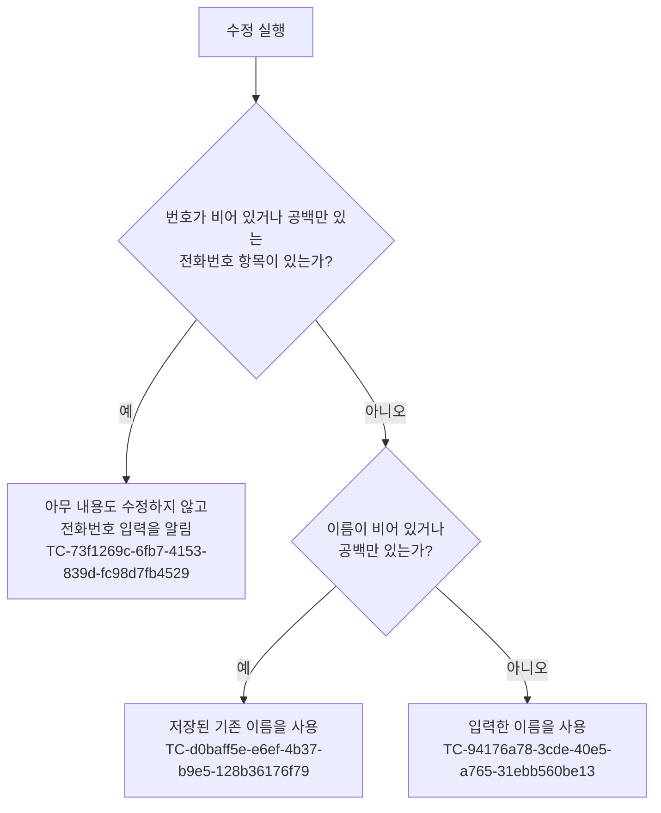

# ContactDetail 테스트 케이스

기준 스펙: [ContactDetail 화면 스펙](../spec/client/contact-detail.md)

이 문서에서 `feature > 진입할 때의 입력 초점`, `domain > 요청 제한`, `data > 대상 조회`, `data > 저장 실패` 절은 [항목 상세 화면 공통 스펙](../spec/client/entity-detail.md)이 소유한다. 나머지 케이스의 절은 기준 스펙이 소유한다.

ContactHome에서 연락처를 선택해 ContactDetail로 이동하는 케이스는 [ContactHome 테스트 케이스](./contact-home.md)에서, 각 입력의 문자 제한과 조작 자체의 케이스는 [ContactAdd 테스트 케이스](./contact-add.md)에서, 설명 입력 자체의 케이스는 [설명 입력 테스트 케이스](./description-input.md)에서, 목록과 상세를 함께 쓰는 배치의 케이스는 [Contact 목록·상세 배치 테스트 케이스](./contact-list-detail.md)에서, 연락처를 서버와 맞추는 케이스는 [데이터 동기화 테스트 케이스](./data-sync.md)에서 다룬다.

## feature

### TC-fa515331-9493-41a3-9cae-8687bb10ae74: 조회에 성공하면 저장된 내용을 입력에 채운다

- 근거: `feature > 진입과 내용`
- Given: 이름, 설명, 키, 신발 사이즈, 생일, 고향과 전화번호가 모두 저장된 연락처가 조회되도록 설정되어 있다.
- When: ContactDetail 화면이 표시된다.
- Then: 저장된 이름, 설명, 키, 신발 사이즈, 고향이 각 입력에 채워지고 저장된 생일이 저장된 달력 구분이 골라진 상태로 표시되며 저장된 전화번호가 저장된 순서대로 채워진다.

### TC-a0abfce7-53b6-4147-80cd-abb7db9817bc: 값이 없는 정보는 비어 있는 상태로 채운다

- 근거: `feature > 진입과 내용`
- Given: 이름만 있고 설명과 고향이 비어 있으며 키·신발 사이즈·생일이 없고 전화번호가 하나도 없는 연락처가 조회되도록 설정되어 있다.
- When: ContactDetail 화면이 표시된다.
- Then: 설명, 키, 신발 사이즈, 고향 입력이 비어 있고 생일이 고르지 않은 상태로 표시되며 달력 구분을 고르는 수단이 제공되지 않고 전화번호 항목이 하나도 표시되지 않는다.

### TC-9d72ac6d-8cf2-46f3-9495-f0a4f321ffa0: 화면 제목에 저장된 연락처 이름을 표시한다

- 근거: `feature > 진입과 내용`
- Given: 이름이 저장된 연락처가 조회되도록 설정되어 있다.
- When: ContactDetail 화면이 표시된다.
- Then: 화면 제목에 저장된 연락처 이름이 표시된다.

### TC-18548af4-447a-4739-808b-8c5bda1d2f6b: 조회 중에는 수정과 즐겨찾기 변경과 삭제를 실행할 수 없다

- 근거: `feature > 조회 상태`
- Given: 연락처 조회가 완료되지 않고 진행 중인 상태로 설정되어 있다.
- When: ContactDetail 화면이 표시된다.
- Then: 입력과 수정 동작과 삭제 동작이 제공되지 않고 조회 중 상태가 표시된다.

### TC-49a7b54d-3d36-40fd-914e-064a21ce1ee4: 조회할 수 없으면 조회 중 상태를 유지한다

- 근거: `feature > 조회 상태`
- Given: 대상 연락처를 조회할 수 없도록 설정되어 있다.
- When: ContactDetail 화면이 표시된다.
- Then: 조회 중 상태가 유지되고 오류 안내가 표시되지 않는다.

### TC-1cf00ee4-180f-418c-a666-63be8e5b38d6: 입력이 저장된 내용과 다를 때만 수정 동작을 제공한다

- 근거: `feature > 내용 수정`
- Given: 저장된 연락처가 조회되어 입력에 채워져 있다.
- When: 사용자가 테스트 데이터의 조작을 한다.
- Then: 테스트 데이터의 기대 결과대로 수정 동작이 제공되거나 제공되지 않는다.
- 테스트 데이터:

| 조작 | 기대 결과 |
| --- | --- |
| 아무것도 바꾸지 않음 | 수정 동작이 제공되지 않음 |
| 이름을 다른 값으로 바꿈 | 수정 동작이 제공됨 |
| 설명을 다른 값으로 바꿈 | 수정 동작이 제공됨 |
| 키를 다른 값으로 바꿈 | 수정 동작이 제공됨 |
| 신발 사이즈를 다른 값으로 바꿈 | 수정 동작이 제공됨 |
| 생일을 다른 날짜로 바꿈 | 수정 동작이 제공됨 |
| 생일의 날짜는 그대로 두고 달력 구분만 바꿈 | 수정 동작이 제공됨 |
| 고향을 다른 값으로 바꿈 | 수정 동작이 제공됨 |
| 즐겨찾기만 바꿈 | 수정 동작이 제공되지 않음 |
| 전화번호 항목을 추가함 | 수정 동작이 제공됨 |
| 전화번호 항목을 삭제함 | 수정 동작이 제공됨 |
| 바꾼 값을 다시 저장된 값으로 되돌림 | 수정 동작이 제공되지 않음 |

### TC-ab35576b-3c0b-4ab9-a771-6723ee34a565: 수정에 성공하면 화면과 입력을 유지하고 성공 피드백을 제공한다

- 근거: `feature > 내용 수정`
- Given: 연락처 수정이 성공하도록 설정되어 있고 입력을 저장된 내용과 다르게 바꾼 상태다.
- When: 사용자가 수정을 실행한다.
- Then: ContactDetail 화면이 유지되고 입력 내용이 그대로 남으며 연락처가 수정되었다는 성공 피드백이 제공된다.

### TC-add5cb27-84df-43ae-83a1-1845b19b5718: 수정을 처리하는 동안 진행 상태를 표시한다

- 근거: `feature > 내용 수정`
- Given: 연락처 수정 처리가 완료되지 않고 진행 중인 상태로 설정되어 있고 입력을 저장된 내용과 다르게 바꾼 상태다.
- When: 사용자가 수정을 실행한 뒤 화면을 확인한다.
- Then: 수정 처리가 끝날 때까지 진행 상태가 표시된다.

### TC-26e85c64-7227-4259-9ae3-5de6f31e6c54: 수정에 실패하면 입력을 유지하고 다시 시도할 수 있다

- 근거: `feature > 내용 수정`
- Given: 연락처 수정이 실패하도록 설정되어 있고 입력을 저장된 내용과 다르게 바꾼 상태다.
- When: 사용자가 수정을 실행한다.
- Then: ContactDetail 화면과 입력 내용이 그대로 유지되고 진행 상태만 해제되어 수정을 다시 실행할 수 있다.

### TC-2f5e9a91-c345-4b33-be1c-9209710b562b: 이름을 비운 채 수정하면 기존 이름이 유지된다

- 근거: `feature > 내용 수정`
- Given: 이름이 저장된 연락처가 조회되어 있고 연락처 수정이 성공하도록 설정되어 있다.
- When: 사용자가 이름을 비우고 설명을 바꾼 뒤 수정을 실행한다.
- Then: 저장된 기존 이름이 그대로 유지되고 바꾼 설명만 반영되며 성공 피드백이 제공된다.

### TC-26b544ba-3732-4f73-aeaa-2d26666a76ae: 저장된 전화번호를 저장된 순서대로 채운다

- 근거: `feature > 전화번호 입력`
- Given: 전화번호를 순서대로 여러 개 가진 연락처가 조회되도록 설정되어 있다.
- When: ContactDetail 화면이 표시된다.
- Then: 저장된 전화번호가 저장된 순서 그대로 전화번호 항목에 채워진다.

### TC-05f2c60c-85f8-49b0-bd88-edb5f89dc2b5: 번호가 비어 있는 전화번호 항목이 있으면 수정하지 않고 알린다

- 근거: `feature > 전화번호 미입력`
- Given: 저장된 연락처가 조회되어 있고 사용자가 이름과 설명을 바꾼 상태다.
- When: 사용자가 번호가 비어 있는 전화번호 항목을 추가한 뒤 수정을 실행한다.
- Then: 연락처가 수정되지 않고 전화번호 입력이 필요하다는 피드백이 제공되며, 입력 중이던 이름, 설명, 키, 신발 사이즈, 생일, 태어난 연도, 고향과 전화번호 항목이 모두 그대로 유지된다.

### TC-e62577b8-fca8-450e-914a-51e85aa357a5: 삭제에 성공하면 화면에서 빠져나간다

- 근거: `feature > 삭제`
- Given: 연락처 삭제가 성공하도록 설정되어 있고 ContactDetail 화면이 표시되어 있다.
- When: 사용자가 삭제를 실행한다.
- Then: 뒤로가기와 같은 결과로 ContactDetail 화면에서 빠져나간다.

### TC-56e1e1a0-f562-40de-89fd-6a9d40a15168: 삭제를 처리하는 동안 진행 상태를 표시한다

- 근거: `feature > 삭제`
- Given: 연락처 삭제 처리가 완료되지 않고 진행 중인 상태로 설정되어 있다.
- When: 사용자가 삭제를 실행한 뒤 화면을 확인한다.
- Then: 삭제 처리가 끝날 때까지 진행 상태가 표시된다.

### TC-9b240a10-03ba-47cb-91ac-683812ff70d8: 삭제에 실패하면 화면에 머무르고 다시 시도할 수 있다

- 근거: `feature > 삭제`
- Given: 연락처 삭제가 실패하도록 설정되어 있다.
- When: 사용자가 삭제를 실행한다.
- Then: ContactDetail 화면에 머무르고 진행 상태만 해제되어 삭제를 다시 실행할 수 있다.

### TC-12500e2f-5240-466e-9de3-e5578d68f1cd: 삭제 전에 확인을 되묻지 않는다

- 근거: `feature > 삭제`
- Given: ContactDetail 화면이 표시되어 있다.
- When: 사용자가 삭제를 실행한다.
- Then: 확인을 되묻는 안내 없이 삭제가 곧바로 처리된다.

### TC-dafe2fc2-77a4-4701-b471-701945e5d7c3: 저장된 이름이 다른 경로에서 바뀌면 화면 제목만 갱신한다

- 근거: `feature > 외부 변경`
- Given: ContactDetail 화면이 표시되어 있고 사용자가 이름과 설명을 입력 중이다.
- When: 같은 연락처의 저장된 이름이 다른 경로에서 바뀐다.
- Then: 화면 제목이 최신 저장 이름으로 갱신되고 입력 중이던 이름과 설명은 덮어쓰이지 않는다.

### TC-b7e14b09-d12c-4454-addb-34dc24a60be2: 대상 연락처가 삭제 상태가 되어도 내용 표시 상태를 유지한다

- 근거: `feature > 외부 변경`
- Given: ContactDetail 화면에 연락처 내용이 표시되어 있고 사용자가 입력을 바꾼 상태다.
- When: 대상 연락처가 다른 경로에서 삭제 상태로 바뀐다.
- Then: 내용 표시 상태가 유지되고 입력 중이던 내용이 그대로 남으며 수정과 삭제를 그대로 실행할 수 있다.

### TC-78791b8f-d31d-4c12-8344-5429561913bc: 화면이 재생성되어도 입력 중이던 내용을 유지한다

- 근거: `feature > 진행 상태 유지`
- Given: ContactDetail 화면에서 이름, 설명, 키, 신발 사이즈, 생일, 고향과 전화번호 항목을 바꿔 태어난 연도도 바뀐 생일의 연도가 된 상태다.
- When: 화면이 재생성된다.
- Then: 바꾼 이름, 설명, 키, 신발 사이즈, 고른 생일과 그 생일의 연도인 태어난 연도, 고향과 전화번호 항목의 번호·순서가 그대로 유지된다.

### TC-eaa0d3cf-24b5-47c0-b968-beab1d53116a: 화면을 떠났다가 다시 들어오면 저장된 내용으로 다시 시작한다

- 근거: `feature > 진행 상태 유지`
- Given: ContactDetail 화면에서 입력을 바꾸고 수정을 실행하지 않은 채 테스트 데이터의 경계를 지났다.
- When: 사용자가 같은 연락처의 ContactDetail 화면에 다시 들어온다.
- Then: 바꾸던 내용이 복원되지 않고 저장된 내용이 입력에 채워진다.
- 테스트 데이터:

| 경계 |
| --- |
| 화면을 떠남 |
| 앱을 종료한 뒤 다시 실행함 |

### TC-569aca85-a747-4a6e-8e65-79a07ae1b288: 뒤로가면 진입하기 전 화면으로 돌아간다

- 근거: `feature > 뒤로가기`
- Given: ContactDetail 화면이 표시되어 있고 사용자가 입력을 바꾼 상태다.
- When: 사용자가 뒤로가기를 실행한다.
- Then: 진입하기 전 화면으로 돌아가고 반영하지 않은 수정 내용은 저장되지 않는다.

### TC-eafd0e2a-13a8-4a95-8aab-b571ed661a6c: 진입할 때 어느 입력에도 초점을 두지 않는다

- 근거: `feature > 진입할 때의 입력 초점`
- Given: 저장된 연락처가 조회되도록 설정되어 있다.
- When: ContactDetail 화면이 표시된다.
- Then: 어느 입력에도 입력 초점이 놓이지 않는다.

### TC-5c68a7c9-415a-4db6-a150-80fd7d7656cb: 저장된 달력 구분을 골라진 상태로 채운다

- 근거: `feature > 진입과 내용`
- Given: 테스트 데이터의 달력 구분으로 생일이 저장된 연락처가 조회되도록 설정되어 있다.
- When: ContactDetail 화면이 표시된다.
- Then: 저장된 달력 구분이 골라진 상태로 표시된다.
- 테스트 데이터:

| 저장된 구분 |
| --- |
| 양력 |
| 음력 |

### TC-40c3de92-563a-42e5-8163-762eb6064646: 고향을 입력하거나 바꿀 수 있다

- 근거: `feature > 내용 수정`
- Given: 고향이 저장된 연락처가 조회되어 입력에 채워져 있다.
- When: 사용자가 고향을 다른 값으로 바꾼다.
- Then: 바꾼 고향이 그대로 표시된다.

### TC-cee773f5-9237-4cd5-9c50-f60146701ef7: 저장된 즐겨찾기 여부를 확인할 수 있다

- 근거: `feature > 진입과 내용`, `feature > 즐겨찾기`
- Given: 즐겨찾기 여부가 테스트 데이터와 같은 연락처가 조회되도록 설정되어 있다.
- When: ContactDetail 화면이 표시된다.
- Then: 즐겨찾기 여부가 테스트 데이터의 상태로 표시된다.
- 테스트 데이터:

| 저장된 즐겨찾기 여부 |
| --- |
| 즐겨찾기임 |
| 즐겨찾기가 아님 |

### TC-57132162-2a6e-4602-8225-a8524d4b1272: 즐겨찾기를 누르면 즉시 반대 값으로 바뀐다

- 근거: `feature > 즐겨찾기`
- Given: 즐겨찾기가 아닌 연락처가 조회되어 표시되어 있다.
- When: 사용자가 즐겨찾기 변경을 실행한다.
- Then: 별도의 확정 동작 없이 그 연락처가 즐겨찾기로 저장되고 화면에 즐겨찾기 상태로 표시된다.

### TC-0fa8feeb-ad4c-40f5-9ba2-bcb13769eabf: 즐겨찾기 변경은 입력 중이던 내용과 수정 동작을 바꾸지 않는다

- 근거: `feature > 즐겨찾기`
- Given: 저장된 연락처가 조회되어 있고 사용자가 이름과 고향을 저장된 값과 다르게 입력해 수정 동작이 제공되고 있다.
- When: 사용자가 즐겨찾기 변경을 실행한다.
- Then: 입력 중이던 이름과 고향이 그대로 유지되고 수정 동작이 계속 제공된다.

### TC-4ad526ff-2bf4-4d12-892d-39c28e1861e4: 즐겨찾기 변경을 처리하는 동안 진행 상태를 표시한다

- 근거: `feature > 즐겨찾기`
- Given: 즐겨찾기 변경 처리가 완료되지 않도록 설정되어 있다.
- When: 사용자가 즐겨찾기 변경을 실행한다.
- Then: 즐겨찾기 변경의 진행 상태가 표시되고 내용 수정과 삭제를 그대로 실행할 수 있다.

### TC-271a7c74-58a2-40fb-8bec-aa7492b3efd2: 즐겨찾기 변경에 성공해도 별도로 안내하지 않는다

- 근거: `feature > 즐겨찾기`
- Given: 즐겨찾기가 아닌 연락처가 조회되어 표시되어 있다.
- When: 사용자가 즐겨찾기 변경을 실행하고 처리가 성공한다.
- Then: 즐겨찾기 상태만 바뀌고 성공을 알리는 안내가 표시되지 않는다.

### TC-d5e4cbf9-eaec-4df6-9581-0c546fdc06f1: 즐겨찾기 변경에 실패하면 저장된 값을 그대로 표시한다

- 근거: `feature > 즐겨찾기`
- Given: 즐겨찾기 변경 처리가 실패하도록 설정되어 있고 즐겨찾기가 아닌 연락처가 표시되어 있다.
- When: 사용자가 즐겨찾기 변경을 실행한다.
- Then: 진행 상태만 해제되고 즐겨찾기가 아닌 상태로 표시되며 화면과 입력 내용이 유지된다.

### TC-10e09312-9488-4a6e-aa75-2e3fdef64843: 저장된 즐겨찾기가 다른 경로에서 바뀌면 화면 표시도 갱신된다

- 근거: `feature > 외부 변경`
- Given: 저장된 연락처가 조회되어 있고 사용자가 입력 중인 내용이 있다.
- When: 같은 연락처의 즐겨찾기 여부가 다른 경로로 바뀐다.
- Then: 즐겨찾기 표시가 최신 저장 값으로 갱신되고 입력 중이던 내용은 덮어쓰지 않는다.

### TC-326c067f-a82b-450a-8c50-92257390499d: 조회 중에는 즐겨찾기를 바꿀 수 없다

- 근거: `feature > 조회 상태`
- Given: 연락처 조회가 완료되지 않도록 설정되어 있다.
- When: ContactDetail 화면이 표시된다.
- Then: 즐겨찾기를 바꾸는 수단이 제공되지 않는다.

### TC-9977790f-2803-4d46-9065-e763fb15adfc: 화면에 처음 진입하면 연락처 디테일 탭이 선택된다

- 근거: `feature > 탭 전환`
- Given: 연락처가 저장되어 있다.
- When: 사용자가 그 연락처의 ContactDetail 화면에 진입한다.
- Then: 연락처 디테일 탭이 선택되어 있고 이름·설명·키·신발 사이즈·생일·태어난 연도·고향·전화번호 입력이 표시된다.

### TC-f1fb64c5-4483-47a6-a5cd-b005b2f63d14: 탭을 선택하면 그 탭의 내용을 표시한다

- 근거: `feature > 탭 전환`
- Given: 연락처가 조회된 ContactDetail 화면에서 테스트 데이터의 현재 탭이 선택되어 있다.
- When: 사용자가 테스트 데이터의 다른 탭을 선택한다.
- Then: 선택한 탭이 선택 상태가 되고 그 탭의 내용이 표시된다.
- 테스트 데이터:

| 현재 탭 | 선택한 탭 | 기대 내용 |
| --- | --- | --- |
| 연락처 디테일 | 메모 | 대상 연락처에 연결된 메모 목록 |
| 메모 | 연락처 디테일 | 이름·설명·키·신발 사이즈·생일·태어난 연도·고향·전화번호 입력 |

### TC-23aee9fc-7a47-458d-9bb5-03fad2855507: 본문을 좌우로 밀면 옆 탭으로 전환된다

- 근거: `feature > 탭 전환`
- Given: 연락처가 조회된 ContactDetail 화면에서 테스트 데이터의 현재 탭이 선택되어 있다.
- When: 사용자가 본문을 테스트 데이터의 방향으로 민다.
- Then: 테스트 데이터의 기대 탭이 선택 상태가 되고 그 탭의 내용이 표시된다.
- 테스트 데이터:

| 현재 탭 | 미는 방향 | 기대 탭 |
| --- | --- | --- |
| 연락처 디테일 | 왼쪽 | 메모 |
| 메모 | 오른쪽 | 연락처 디테일 |

### TC-d1799f37-2d5b-4d50-b220-639c506d2b89: 조회 중에도 탭을 전환할 수 있다

- 근거: `feature > 탭 전환`, `feature > 조회 상태`
- Given: 상세 대상 연락처를 조회할 수 없어 조회 중 상태가 유지되고 있다.
- When: 사용자가 메모 탭을 선택한다.
- Then: 메모 탭이 선택되고 메모 탭의 내용이 표시된다.

### TC-b389dcda-ec30-4127-83aa-309893e3b59e: 탭을 전환해도 수정 중이던 내용이 유지된다

- 근거: `feature > 탭 전환`
- Given: 연락처 디테일 탭에서 이름, 설명, 키, 신발 사이즈, 생일, 태어난 연도, 고향과 전화번호를 저장된 내용과 다르게 수정했다.
- When: 사용자가 메모 탭으로 전환한 뒤 다시 연락처 디테일 탭으로 돌아온다.
- Then: 수정 중이던 내용이 그대로 남아 있다.

### TC-4c5603df-f8bc-4dfb-8f56-e666346d4403: 수정 반영 동작은 연락처 디테일 탭에서만 제공된다

- 근거: `feature > 내용 수정`, `domain > 수정 동작의 제공 기준`
- Given: 입력 내용이 저장된 내용과 달라 수정 반영 동작이 제공되고 있다.
- When: 사용자가 메모 탭으로 전환한다.
- Then: 수정 반영 동작이 제공되지 않고, 연락처 디테일 탭으로 돌아오면 다시 제공된다.

### TC-c6d8e832-89b2-4791-bec2-bff702a26c79: 즐겨찾기 변경과 삭제는 선택한 탭과 관계없이 제공된다

- 근거: `feature > 탭 전환`
- Given: 연락처가 조회된 ContactDetail 화면에서 테스트 데이터의 탭이 선택되어 있다.
- When: 사용자가 화면에서 실행할 수 있는 동작을 확인한다.
- Then: 즐겨찾기 변경과 삭제를 실행할 수 있다.
- 테스트 데이터:

| 선택한 탭 |
| --- |
| 연락처 디테일 |
| 메모 |

### TC-42162aa2-ab99-49db-a43c-444a697b7dd5: 화면 재생성 후에도 선택한 탭이 유지된다

- 근거: `feature > 진행 상태 유지`, `domain > 선택한 탭`
- Given: 같은 연락처의 ContactDetail 화면에서 메모 탭을 선택했다.
- When: 화면이 재생성된다.
- Then: 메모 탭이 선택된 상태가 유지된다.

### TC-b289c12a-bcd4-4c33-86ab-3620be01d42f: 메모 탭에서 뒤로가도 진입하기 전 화면으로 돌아간다

- 근거: `feature > 뒤로가기`
- Given: ContactDetail 화면에서 메모 탭을 선택했다.
- When: 사용자가 뒤로간다.
- Then: 연락처 디테일 탭으로 먼저 돌아가지 않고 ContactDetail 화면에 진입하기 전 화면이 표시된다.

### TC-b702f97a-cb11-44c5-acda-8d0c7ff988b8: 조회 중에도 탭 행과 메모 탭이 표시된다

- 근거: `feature > 조회 상태`
- Given: 상세 대상 연락처를 조회할 수 없어 조회 중 상태가 유지되고 있다.
- When: 사용자가 ContactDetail 화면을 확인한다.
- Then: 연락처 디테일 탭에는 조회 중 표시가 있고 탭 행은 그대로 표시되어 메모 탭을 선택할 수 있다.

### TC-f04f8a20-41ad-4db3-9ffe-98d4b0898c5e: 처리 중 상태가 되거나 저장 내용이 갱신되어도 보던 화면 위치를 유지한다

- 근거: `feature > 진행 상태 유지`
- Given: 한 화면에 다 들어가지 않을 만큼 전화번호가 많은 연락처가 내용 표시 상태로 표시되어 있고, 사용자가 연락처 디테일 탭을 내려 마지막 전화번호 항목을 보고 있어 이름 입력은 화면 밖에 있다.
- When: 테스트 데이터의 변화가 일어난다.
- Then: 마지막 전화번호 항목이 같은 자리에 계속 보이고, 이름 입력은 여전히 화면 밖에 있어 화면이 맨 위로 돌아가지 않는다.
- 테스트 데이터:

| 변화 |
| --- |
| 수정 처리가 시작되어 진행 상태가 됨 |
| 즐겨찾기 변경 처리가 시작되어 진행 상태가 됨 |
| 삭제 처리가 시작되어 진행 상태가 됨 |
| 다른 경로에서 저장된 이름과 즐겨찾기 여부가 바뀌어 화면이 갱신됨 |

### TC-bd456258-1f5b-4ef4-8eac-9c987c676f57: 메모 카드 위에서 밀면 탭은 바뀌지 않고 카드 동작이 실행된다

- 근거: `feature > 탭 전환`
- Given: ContactDetail 화면의 메모 탭이 선택되어 있고 목록에 메모 카드가 표시되어 있다.
- When: 사용자가 메모 카드 위에서 오른쪽으로 민다.
- Then: 메모 탭이 선택된 채로 남고, 그 메모의 완료가 한 번 요청된다.

### TC-186b58f0-9ae4-4a97-94fc-623434fc2d55: 전화번호 미입력으로 수정하면 보고 있던 입력에 초점을 그대로 둔다

- 근거: `feature > 전화번호 미입력`
- Given: 저장된 연락처가 조회되어 있고, 사용자가 번호가 비어 있는 전화번호 항목을 추가한 뒤 이름이 아닌 다른 입력에 초점을 두고 있다.
- When: 사용자가 수정을 실행해 전화번호 입력이 필요하다는 피드백이 제공된다.
- Then: 입력 초점이 실행 전에 보고 있던 입력에 그대로 있다.

### TC-08ca0893-554b-4489-9dcb-9f90da46d790: 이름을 비운 채 수정해도 수정 동작이 계속 제공된다

- 근거: `domain > 수정 동작의 제공 기준`
- Given: 이름이 저장된 연락처가 조회되어 있고 연락처 수정이 성공하도록 설정되어 있다.
- When: 사용자가 이름을 비운 채 수정을 실행하고 수정이 끝난다.
- Then: 비어 있는 이름 입력이 저장된 이름과 계속 다르므로 수정 동작이 계속 제공된다.

### TC-253d84b3-3a0f-4903-8237-9306829e693b: 화면이 재생성되어도 즐겨찾기 표시는 저장된 값을 보여 준다

- 근거: `feature > 진행 상태 유지`
- Given: 즐겨찾기 여부가 테스트 데이터와 같은 연락처의 ContactDetail 화면이 표시되어 있다.
- When: 화면이 재생성된다.
- Then: 즐겨찾기 표시가 저장된 즐겨찾기 여부 그대로 표시된다.
- 테스트 데이터:

| 저장된 즐겨찾기 여부 |
| --- |
| 즐겨찾기임 |
| 즐겨찾기가 아님 |

### TC-ef7f75d7-17b5-4ed2-94dc-bfd8c64c1141: 탭을 전환해도 메모 탭에서 보던 목록 위치가 유지된다

- 근거: `feature > 탭 전환`
- Given: 한 화면에 다 들어가지 않을 만큼 메모가 연결된 연락처의 ContactDetail 화면에서 메모 탭을 내려 뒤쪽의 메모를 보고 있다.
- When: 사용자가 연락처 디테일 탭으로 전환한 뒤 다시 메모 탭으로 돌아온다.
- Then: 전환 전에 보던 메모가 그대로 보이고 목록의 맨 위로 돌아가지 않는다.

### TC-2ce102ba-505f-41e9-831c-a890bde4f08b: 저장된 키는 소수점 아래 한 자리까지 표시하고 소수점 아래가 0이면 정수로 표시한다

- 근거: `domain > 입력 내용 채우기`
- Given: 키가 테스트 데이터의 값으로 저장된 연락처가 조회되도록 설정되어 있다.
- When: ContactDetail 화면이 표시된다.
- Then: 키 입력에 테스트 데이터의 표시 값이 채워진다.
- 테스트 데이터:

| 저장된 키 | 표시 값 |
| --- | --- |
| 175cm | `175` |
| 175.5cm | `175.5` |

### TC-f4e2d8b7-ff47-40d9-9617-76a5e66f037d: 저장된 태어난 연도를 채우고 생일이 있으면 바꿀 수 없게 둔다

- 근거: `feature > 내용 수정`, `domain > 입력 내용 채우기`
- Given: 테스트 데이터의 생일과 태어난 연도가 저장된 연락처가 조회되도록 설정되어 있다.
- When: ContactDetail 화면이 표시된다.
- Then: 태어난 연도에 테스트 데이터의 표시 값이 채워지고, 테스트 데이터의 입력 가능 여부대로 태어난 연도를 입력할 수 있거나 없다.
- 테스트 데이터:

| 저장된 생일 | 저장된 태어난 연도 | 표시 값 | 입력 가능 여부 |
| --- | --- | --- | --- |
| 1990년 5월 5일 | 1990 | `1990` | 입력할 수 없음 |
| 없음 | 1990 | `1990` | 입력할 수 있음 |
| 없음 | 없음 | 빈 값 | 입력할 수 있음 |

### TC-3e3f1f6b-6a0e-40df-b0dc-5dec53dfef7b: 태어난 연도만 바꿔도 수정 동작을 제공한다

- 근거: `domain > 수정 동작의 제공 기준`
- Given: 생일 없이 태어난 연도 1990이 저장된 연락처의 ContactDetail 화면이 표시되어 있다.
- When: 사용자가 태어난 연도를 `1991`로 바꾼다.
- Then: 수정 반영 동작이 제공된다.

### TC-9bebb442-1322-4ef8-952f-ae795d257857: 저장된 생일을 지우면 태어난 연도도 지워지고 입력할 수 있다

- 근거: `feature > 내용 수정`
- Given: 1990년 5월 5일 생일이 저장된 연락처의 ContactDetail 화면이 표시되어 있다.
- When: 사용자가 생일 지우기를 실행한다.
- Then: 태어난 연도가 비어 있는 상태가 되고 태어난 연도를 입력할 수 있다.

## domain

### TC-0a2ee967-4aef-47e4-b293-63ea9d0c8c95: 삭제 상태인 연락처도 상세 대상으로 조회한다

- 근거: `domain > 상세 대상과 내용 표시`
- Given: 현재 계정과 연결되고 삭제 상태인 연락처가 저장되어 있다.
- When: 그 연락처를 상세 대상으로 조회한다.
- Then: 삭제 상태인 연락처가 그대로 조회된다.

### TC-2957350d-6626-496a-88b5-14324123a7b6: 입력 내용은 처음 조회한 값으로 한 번만 채운다

- 근거: `domain > 입력 내용 채우기`
- Given: ContactDetail 화면에 저장된 내용이 입력에 채워져 있다.
- When: 같은 연락처의 저장 내용이 다른 경로에서 바뀐다.
- Then: 입력이 새 저장 내용으로 다시 채워지지 않는다.

### TC-b421cb23-cb2f-4170-9edf-c483eafca13e: 같은 번호가 여러 개여도 각각의 전화번호 항목으로 채운다

- 근거: `domain > 입력 내용 채우기`
- Given: 같은 번호를 두 개 이상 가진 연락처가 저장되어 있다.
- When: 그 연락처의 입력 내용을 채운다.
- Then: 같은 번호가 하나로 합쳐지지 않고 저장된 개수만큼 각각의 전화번호 항목으로 채워진다.

### TC-73f1269c-6fb7-4153-839d-fc98d7fb4529: 번호가 없는 전화번호 항목이 있으면 어떤 내용도 수정하지 않는다

- 근거: `domain > 수정 성립 조건`
- Given: 저장된 연락처가 있고 이름과 설명과 키와 신발 사이즈와 생일과 고향을 저장된 값과 다르게 바꾼 상태다.
- When: 번호가 테스트 데이터의 상태인 전화번호 항목을 포함해 수정을 실행한다.
- Then: 이름, 설명, 키, 신발 사이즈, 생일, 고향, 전화번호 중 어느 것도 수정되지 않고 전화번호 입력이 필요하다는 결과가 전달된다.
- 테스트 데이터:

| 번호 상태 |
| --- |
| 빈 문자열 |
| 공백 문자만 있음 |

### TC-d0baff5e-e6ef-4b37-b9e5-128b36176f79: 이름이 비어 있으면 저장된 기존 이름으로 수정한다

- 근거: `domain > 수정 성립 조건`
- Given: 이름이 저장된 연락처가 있다.
- When: 이름이 테스트 데이터의 상태이고 나머지 내용을 바꾼 채 수정을 실행한다.
- Then: 저장된 기존 이름이 유지되고 설명, 키, 신발 사이즈, 생일, 고향, 전화번호는 입력한 대로 수정된다.
- 테스트 데이터:

| 이름 상태 |
| --- |
| 빈 문자열 |
| 공백 문자만 있음 |

### TC-94176a78-3cde-40e5-a765-31ebb560be13: 입력한 내용으로 연락처를 수정하고 수정 시각을 기록한다

- 근거: `domain > 수정되는 내용`
- Given: 저장된 연락처가 있다.
- When: 공백이 아닌 이름과 설명, 키, 신발 사이즈, 생일, 고향, 전화번호를 입력해 수정을 실행한다.
- Then: 입력한 이름, 설명, 키, 신발 사이즈, 생일, 고향, 전화번호가 반영되고 수정 시각이 수정 시점으로 기록된다.

### TC-f3979f2f-35c3-4167-bfe7-6ff671ff044e: 비운 값은 없는 값이나 비어 있는 값으로 수정한다

- 근거: `domain > 수정되는 내용`
- Given: 설명, 키, 신발 사이즈, 생일, 고향, 전화번호가 모두 저장된 연락처가 있다.
- When: 설명과 키와 신발 사이즈와 고향을 비우고 생일을 지우고 전화번호 항목을 모두 삭제한 채 수정을 실행한다.
- Then: 설명과 고향이 비어 있는 값으로, 키와 신발 사이즈가 없는 값으로, 생일이 날짜와 달력 구분 모두 없는 값으로 반영되고 전화번호가 하나도 남지 않는다.

### TC-b55bd3d9-08dc-4afb-b09e-d24205aca28e: 수정은 즐겨찾기 여부와 삭제 여부와 생성 시각과 계정 연결을 바꾸지 않는다

- 근거: `domain > 수정되는 내용`
- Given: 현재 계정과 연결되고 삭제 상태이며 즐겨찾기인 연락처가 저장되어 있다.
- When: 그 연락처의 내용을 수정한다.
- Then: 즐겨찾기 여부와 삭제 상태와 생성 시각과 계정 연결이 그대로 유지된다.

### TC-124101d7-d5d4-4b1e-ab74-74cbdca328ce: 전화번호는 번호와 순서를 함께 비교해 수정 동작 제공 여부를 판정한다

- 근거: `domain > 수정 동작의 제공 기준`
- Given: 서로 다른 번호를 순서대로 두 개 가진 연락처가 조회되어 입력에 채워져 있다.
- When: 사용자가 두 전화번호 항목의 번호를 서로 바꿔 입력한다.
- Then: 번호의 구성이 같아도 순서가 다르므로 수정 동작이 제공된다.

### TC-dbfd266a-6ba8-4701-92ac-d6c7b57da787: 삭제는 삭제 여부와 수정 시각만 바꾼다

- 근거: `domain > 삭제`
- Given: 이름, 설명, 키, 신발 사이즈, 생일, 고향과 전화번호가 저장되어 있고 즐겨찾기인 연락처가 있다.
- When: 그 연락처를 삭제한다.
- Then: 삭제 여부가 삭제로 바뀌고 수정 시각이 삭제 시점으로 갱신되며 이름, 설명, 키, 신발 사이즈, 생일, 고향, 전화번호와 즐겨찾기 여부는 그대로 유지된다.

### TC-5fdc3edb-cf98-436d-a420-53fed0e7432d: 수정과 즐겨찾기 변경과 삭제는 같은 종류의 요청만 제한한다

- 근거: `domain > 요청 제한`
- Given: 테스트 데이터의 처리 중인 동작이 완료되지 않고 진행 중인 상태다.
- When: 사용자가 테스트 데이터의 동작을 실행한다.
- Then: 테스트 데이터의 기대 결과대로 요청이 처리되거나 처리되지 않는다.
- 테스트 데이터:

| 처리 중인 동작 | 실행한 동작 | 기대 결과 |
| --- | --- | --- |
| 수정 | 수정 | 처리되지 않음 |
| 수정 | 즐겨찾기 변경 | 처리됨 |
| 수정 | 삭제 | 처리됨 |
| 즐겨찾기 변경 | 즐겨찾기 변경 | 처리되지 않음 |
| 즐겨찾기 변경 | 수정 | 처리됨 |
| 즐겨찾기 변경 | 삭제 | 처리됨 |
| 삭제 | 삭제 | 처리되지 않음 |
| 삭제 | 수정 | 처리됨 |
| 삭제 | 즐겨찾기 변경 | 처리됨 |

### TC-a265a315-496d-4472-81d3-20daceae4119: 달력 구분만 바꾼 수정도 그 구분으로 반영된다

- 근거: `domain > 수정되는 내용`
- Given: 양력 생일이 저장된 연락처가 있다.
- When: 생일 날짜는 그대로 두고 달력 구분만 음력으로 바꿔 수정을 실행한다.
- Then: 생일 날짜가 그대로 유지되고 달력 구분이 음력으로 반영된다.

### TC-8e1894ca-ff18-4efe-a31d-90eefe53eeeb: 수정한 태어난 연도가 반영된다

- 근거: `domain > 수정되는 내용`
- Given: 테스트 데이터의 저장된 값을 가진 연락처가 있다.
- When: 테스트 데이터의 수정 내용으로 수정을 실행한다.
- Then: 태어난 연도가 테스트 데이터의 반영 값으로 바뀐다.
- 테스트 데이터:

| 저장된 값 | 수정 내용 | 반영되는 태어난 연도 |
| --- | --- | --- |
| 생일 없음, 태어난 연도 1990 | 태어난 연도를 1991로 바꿈 | 1991 |
| 생일 없음, 태어난 연도 1990 | 태어난 연도를 지움 | 없음 |
| 생일 1990년 5월 5일 | 생일을 1992년 3월 1일로 바꿈 | 1992 |
| 생일 1990년 5월 5일 | 생일을 지움 | 없음 |

### TC-66fe1ae0-5c27-40f0-bafc-db93304bb0f5: 화면을 떠났다 다시 들어오면 연락처 디테일 탭으로 시작한다

- 근거: `domain > 선택한 탭`
- Given: ContactDetail 화면에서 메모 탭을 선택한 뒤 테스트 데이터의 경계를 지났다.
- When: 사용자가 같은 연락처의 ContactDetail 화면에 다시 진입한다.
- Then: 연락처 디테일 탭이 선택된 상태로 시작한다.
- 테스트 데이터:

| 경계 |
| --- |
| 화면을 떠남 |
| 앱을 종료한 뒤 다시 실행함 |

### TC-41b75655-7025-4ede-8597-5d1daec44497: 상세 대상이 다른 연락처로 바뀌면 연락처 디테일 탭으로 초기화한다

- 근거: `domain > 선택한 탭`
- Given: 연락처 목록과 상세를 함께 표시하는 배치에서 연락처 A의 상세가 메모 탭을 선택한 상태로 표시되어 있다.
- When: 사용자가 목록에서 연락처 B를 선택한다.
- Then: 상세 영역은 연락처 B의 연락처 디테일 탭이 선택된 상태로 표시된다.

### TC-f6c4655c-6b0f-45dd-8ad1-484b911c005f: 삭제 상태인 연락처에서도 두 탭을 모두 사용할 수 있다

- 근거: `domain > 선택한 탭`
- Given: 삭제 상태인 연락처의 ContactDetail 화면이 표시되어 있다.
- When: 사용자가 메모 탭을 선택한 뒤 다시 연락처 디테일 탭을 선택한다.
- Then: 두 탭이 모두 선택되고 각 탭의 내용이 표시된다.

### TC-29770871-fd33-49e4-bc9d-3327412bd216: 메모 탭의 완료·삭제·실행 취소는 이 화면의 요청 제한에 포함되지 않는다

- 근거: `domain > 요청 제한`
- Given: 내용 수정이나 삭제를 처리하는 중이다.
- When: 사용자가 메모 탭에서 메모를 완료하거나 삭제하거나 실행 취소한다.
- Then: 진행 중인 수정이나 삭제와 무관하게 메모의 상태 변경이 요청된다.

### TC-35936a00-dba1-4723-94e1-1a8190599b61: 즐겨찾기 변경은 즐겨찾기 여부를 반대 값으로 바꾸고 수정 시각을 기록한다

- 근거: `domain > 즐겨찾기 변경`
- Given: 즐겨찾기 여부가 테스트 데이터의 현재 값인 연락처가 있다.
- When: 그 연락처의 즐겨찾기 변경을 실행한다.
- Then: 즐겨찾기 여부가 테스트 데이터의 바뀐 값으로, 수정 시각이 변경 시점으로 기록된다.
- 테스트 데이터:

| 현재 값 | 바뀐 값 |
| --- | --- |
| 즐겨찾기가 아님 | 즐겨찾기임 |
| 즐겨찾기임 | 즐겨찾기가 아님 |

### TC-f0aabb78-2348-41f2-8203-5ea73829103c: 삭제 상태인 연락처도 즐겨찾기를 바꿀 수 있고 삭제 여부는 되돌리지 않는다

- 근거: `domain > 즐겨찾기 변경`
- Given: 현재 계정과 연결되고 삭제 상태이며 즐겨찾기가 아닌 연락처가 저장되어 있다.
- When: 그 연락처의 즐겨찾기 변경을 실행한 뒤 그 연락처를 조회한다.
- Then: 즐겨찾기 여부가 즐겨찾기로 바뀌고 삭제 상태는 그대로 유지된다.

### TC-7182b46f-2795-437e-8947-9baa100c0a81: 이름을 비우고 번호가 없는 전화번호 항목도 있으면 전화번호 입력을 알린다

- 근거: `domain > 수정 성립 조건`
- Given: 이름이 저장된 연락처가 있다.
- When: 이름을 비우고 번호가 비어 있는 전화번호 항목을 포함해 수정을 실행한다.
- Then: 어떤 내용도 수정되지 않고 전화번호 입력이 필요하다는 결과가 전달된다.

### TC-aaabe24f-ef74-498f-a9b3-bdf9bbc9f92f: 앱이 백그라운드에 다녀와도 선택한 탭이 유지된다

- 근거: `domain > 선택한 탭`
- Given: ContactDetail 화면에서 메모 탭을 선택했다.
- When: 앱이 백그라운드에 갔다가 같은 화면으로 돌아온다.
- Then: 메모 탭이 선택된 상태가 유지된다.

## data

### TC-250658dc-32f8-47a3-8410-3e244df01331: 현재 계정과 대상 식별자로 연락처와 전화번호를 함께 조회한다

- 근거: `data > 대상 연락처 조회`
- Given: 현재 계정과 연결되고 전화번호를 순서대로 가지며 고향이 저장되어 있고 즐겨찾기인 연락처가 저장되어 있다.
- When: 대상 식별자로 상세 대상을 조회한다.
- Then: 그 연락처가 조회되고 전화번호가 저장된 순서 그대로, 고향과 즐겨찾기 여부가 저장된 값 그대로 함께 조회된다.

### TC-229c2151-ee96-48d8-b3fc-ba0dd5bf1723: 다른 계정의 연락처는 상세 대상으로 조회되지 않는다

- 근거: `data > 대상 연락처 조회`
- Given: 다른 계정과만 연결된 연락처가 저장되어 있다.
- When: 그 식별자로 상세 대상을 조회한다.
- Then: 조회되는 연락처가 없다.

### TC-3fcc976b-4672-46ba-916e-8fbff0c3ad10: 화면에 진입하는 것만으로는 서버에서 연락처를 다시 가져오지 않는다

- 근거: `data > 대상 연락처 조회`
- Given: 인증된 사용자 계정이 확인된 상태이고 진행 중인 동기화가 없다.
- When: 사용자가 ContactDetail 화면에 진입한다.
- Then: 계정 데이터의 서버 동기화가 요청되지 않는다.

### TC-6ec3f675-b8e4-4edc-8e7f-9af3c7691cfa: 수정은 전화번호를 반영한 순서 그대로 저장한다

- 근거: `data > 수정의 저장`
- Given: 전화번호를 가진 연락처가 저장되어 있다.
- When: 전화번호 항목의 순서를 바꾸고 새 항목을 추가해 수정을 반영한다.
- Then: 저장된 전화번호가 반영한 순서 그대로 대체된다.

### TC-1c371ce2-5734-4028-b428-301bc197ab5a: 전화번호를 모두 지운 수정을 반영하면 전화번호가 남지 않는다

- 근거: `data > 수정의 저장`
- Given: 전화번호를 가진 연락처가 저장되어 있다.
- When: 전화번호 항목을 모두 삭제한 채 수정을 반영한다.
- Then: 그 연락처의 전화번호가 하나도 남지 않는다.

### TC-92a80131-b9a8-457a-93e9-5aef7d57aea0: 대상 식별자와 계정을 만족하지 않으면 수정이 아무것도 바꾸지 않는다

- 근거: `data > 수정의 저장`
- Given: 현재 계정과 연결되지 않은 식별자가 대상으로 지정되어 있다.
- When: 수정을 반영한다.
- Then: 저장된 어떤 연락처도 바뀌지 않는다.

### TC-9aaa0ba4-69e2-4de4-a225-3e64e1f24b30: 삭제는 연락처와 계정 연결과 전화번호를 기기에서 지우지 않는다

- 근거: `data > 삭제의 저장`
- Given: 전화번호를 가진 연락처가 현재 계정과 연결되어 저장되어 있다.
- When: 그 연락처의 삭제를 반영한다.
- Then: 연락처와 계정 연결과 전화번호가 기기에 그대로 남고 삭제 여부와 수정 시각만 바뀐다.

### TC-7ff50880-b5cd-4f40-bde3-44fe777b0439: 대상 식별자와 계정을 만족하지 않으면 삭제가 아무것도 바꾸지 않는다

- 근거: `data > 삭제의 저장`
- Given: 현재 계정과 연결되지 않은 식별자가 대상으로 지정되어 있다.
- When: 삭제를 반영한다.
- Then: 저장된 어떤 연락처도 바뀌지 않는다.

### TC-1baea3d4-f655-46b8-8d62-64d922ba1d95: 저장에 실패하면 실패를 그대로 전달한다

- 근거: `data > 저장 실패`
- Given: 기기 저장이 실패하도록 설정되어 있다.
- When: 테스트 데이터의 동작을 반영한다.
- Then: 실패가 성공으로 바뀌지 않고 그대로 전달되며 저장된 연락처는 바뀌지 않는다.
- 테스트 데이터:

| 동작 |
| --- |
| 수정 |
| 삭제 |

### TC-8549cc6d-5e8c-452f-948a-11916bc70255: 수정한 태어난 연도를 기기에 저장한다

- 근거: `data > 수정의 저장`
- Given: 생일 없이 태어난 연도가 저장된 연락처가 현재 계정과 연결되어 기기에 있다.
- When: 태어난 연도를 다른 연도로 바꾼 내용으로 수정을 반영한 뒤 그 연락처를 조회한다.
- Then: 바꾼 태어난 연도가 조회된다.

### TC-46698d03-f59c-4489-9bd6-b8911ff63fa5: 수정과 즐겨찾기 변경과 삭제를 반영하면 업로드 대기로 기록되고 동기화가 시작된다

- 근거: `data > 수정과 즐겨찾기 변경과 삭제의 동기화`
- Given: 인증된 사용자 계정이 확인된 상태로 연락처가 저장되어 있다.
- When: 테스트 데이터의 동작을 반영한다.
- Then: 그 연락처가 업로드 대기로 기록되고 백그라운드 동기화가 한 번 시작된다.
- 테스트 데이터:

| 동작 |
| --- |
| 수정 |
| 즐겨찾기 변경 |
| 삭제 |

### TC-54110044-b9ea-4ff2-b2c1-29777056471f: 로그인하지 않은 상태에서 수정하고 삭제한 연락처는 기기에만 남는다

- 근거: `data > 수정과 즐겨찾기 변경과 삭제의 동기화`
- Given: 인증된 사용자 계정이 없는 상태로 연락처가 저장되어 있다.
- When: 그 연락처를 수정하거나 즐겨찾기를 바꾸거나 삭제한다.
- Then: 기기에는 반영되고 서버로 보내는 요청은 일어나지 않는다.

### TC-21d1c705-308e-4ddc-bb00-1dcffba5d805: 즐겨찾기 변경은 즐겨찾기 여부와 수정 시각만 저장한다

- 근거: `data > 즐겨찾기의 저장`
- Given: 이름, 설명, 키, 신발 사이즈, 생일, 고향, 전화번호가 저장된 즐겨찾기가 아닌 연락처가 있다.
- When: 그 연락처의 즐겨찾기 변경을 실행한 뒤 그 연락처를 조회한다.
- Then: 즐겨찾기 여부가 즐겨찾기로 바뀌고 수정 시각이 변경 시점으로 갱신되며, 이름·설명·키·신발 사이즈·생일·고향·전화번호와 삭제 여부, 생성 시각은 그대로 조회된다.

### TC-11b8fded-b993-4a0c-8334-0da88e444e17: 대상 식별자와 계정을 만족하지 않으면 즐겨찾기 변경이 아무것도 바꾸지 않는다

- 근거: `data > 즐겨찾기의 저장`
- Given: 다른 계정과 연결된 연락처가 저장되어 있다.
- When: 현재 계정으로 그 연락처의 즐겨찾기 변경을 실행한다.
- Then: 그 연락처의 즐겨찾기 여부와 수정 시각이 바뀌지 않는다.

### TC-e5d727a2-80a2-4f39-bc0f-a1295f84684d: 즐겨찾기 변경에 실패하면 저장된 즐겨찾기 여부가 바뀌지 않는다

- 근거: `data > 저장 실패`
- Given: 저장이 실패하도록 설정되어 있고 즐겨찾기가 아닌 연락처가 저장되어 있다.
- When: 그 연락처의 즐겨찾기 변경을 실행한다.
- Then: 실패가 그대로 전달되고 저장된 즐겨찾기 여부가 바뀌지 않는다.
