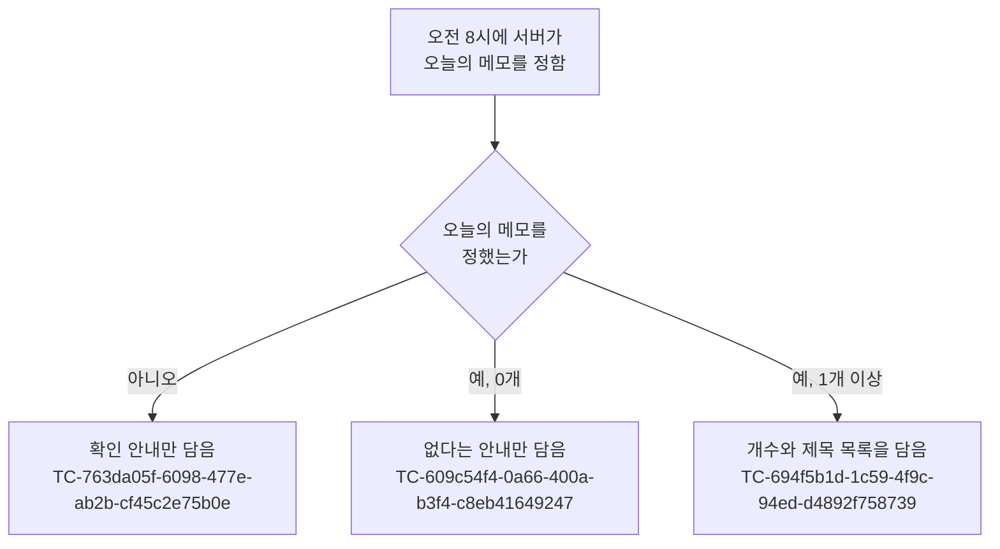
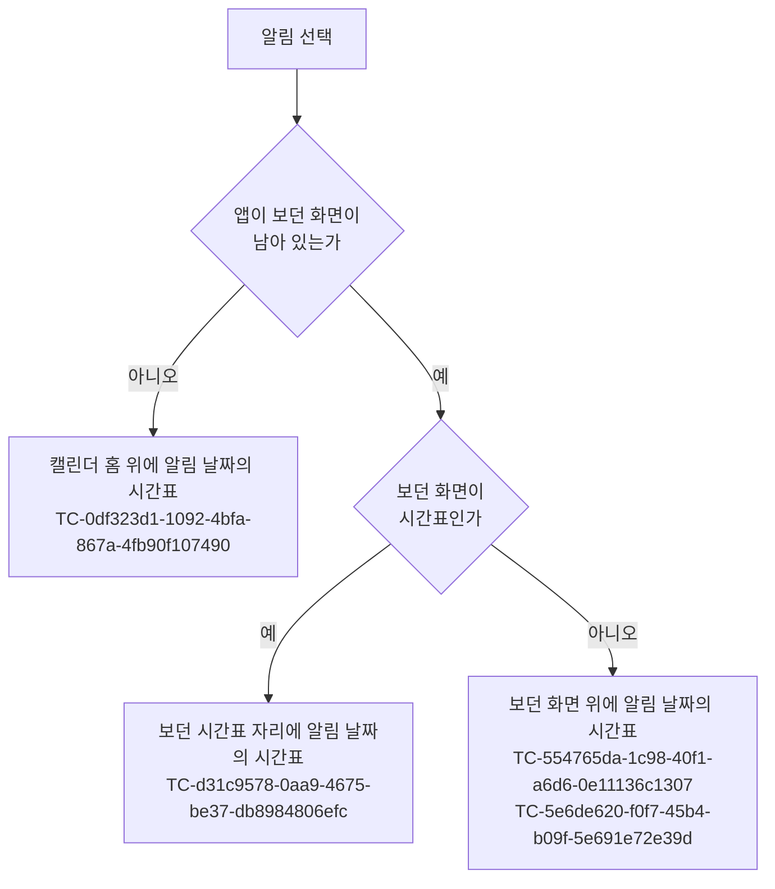
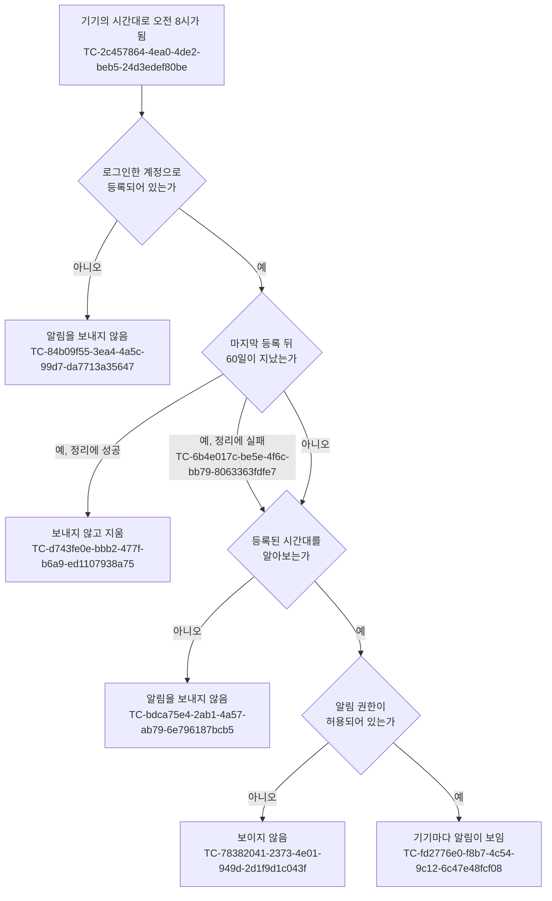

# 일일 메모 알림 테스트 케이스

기준 스펙: [일일 메모 알림 스펙(client)](../spec/client/daily-memo-notification.md), [일일 메모 알림 스펙(common)](../spec/common/daily-memo-notification.md), [일일 메모 알림 스펙(server)](../spec/server/daily-memo-notification.md)

각 케이스의 `근거`는 절이 있는 스펙 폴더를 앞에 붙여 `client > domain > 절 이름`처럼 적는다.

알림은 서버가 등록된 기기로 보내므로, 이 문서의 케이스 대부분은 서버가 정하는 발송 대상과 내용을 검증한다. 어느 기기가 언제 등록되는지는 [푸시 알림 수신 등록 테스트 케이스](./fcm-token.md)가 검증한다.

## feature

[server 스펙](../spec/server/daily-memo-notification.md) `domain > 알림 내용을 정하는 시점`이 가르는 알림 내용과 각 경로를 덮는 케이스는 다음과 같다.

### TC-ece22345-0319-48e2-ad04-8af2068cac1e: 오전 8시가 되면 오늘의 메모를 알려 주는 알림이 발생한다

- 근거: `client > feature > 오늘의 메모 확인 안내 받기`, `server > domain > 발생 조건`
- Given: 서버에 계정 A의 기기가 시간대 `Asia/Seoul`로 등록되어 있고, 계정 A에는 오늘의 메모가 없다.
- When: `Asia/Seoul`의 현지 시각이 오전 8시가 된다.
- Then: 오늘의 메모가 있는지와 관계없이 그 기기로 알림이 한 번 발송된다.
- 작성하지 않는 이유: 서버의 발송 규칙이어서 앱의 단위 테스트 환경에서 결정적으로 판정할 수 없다. 서버 정책 테스트 환경이 마련되면 작성한다.

### TC-4481f806-14cd-4628-a905-e7aeb2bd6b75: 알림은 매일 오전 8시마다 반복해서 발송된다

- 근거: `client > feature > 오늘의 메모 확인 안내 받기`
- Given: 서버에 계정 A의 기기가 등록되어 있고, 어제 오전 8시에 그 기기로 알림이 발송되었다.
- When: 등록된 시간대의 현지 시각이 다시 오전 8시가 된다.
- Then: 그 기기로 알림이 다시 한 번 발송된다.
- 작성하지 않는 이유: 서버의 발송 규칙이어서 앱의 단위 테스트 환경에서 결정적으로 판정할 수 없다. 서버 정책 테스트 환경이 마련되면 작성한다.

### TC-1f12b35d-e27b-4783-a9f5-0bdf0660c5a4: 앱이 실행 중이지 않거나 오랫동안 실행되지 않아도 등록이 남아 있으면 알림이 발생한다

- 근거: `server > domain > 발생 조건`
- Given: 서버에 계정 A의 기기가 시간대 `Asia/Seoul`로 등록되어 있고 그 등록이 남아 있으며, 그 기기의 앱은 테스트 데이터의 상태다.
- When: `Asia/Seoul`의 현지 시각이 오전 8시가 된다.
- Then: 앱의 상태와 관계없이 그 기기로 알림이 한 번 발송된다.
- 테스트 데이터:

| 앱의 상태 |
| --- |
| 종료되어 실행 중이지 않음 |
| 기기를 다시 시작한 뒤 한 번도 실행하지 않음 |
| 마지막 등록 뒤 오랫동안 실행하지 않았지만 등록이 지워지기 전임 |

- 작성하지 않는 이유: 서버의 발송 규칙이어서 앱의 단위 테스트 환경에서 결정적으로 판정할 수 없다. 서버 정책 테스트 환경이 마련되면 작성한다.

### TC-3788b5fc-b522-403e-897a-7f8a5b9565ad: 사용자가 알림을 선택하면 앱이 열리고 알림이 발생한 날의 하루 시간표가 보인다

- 근거: `client > feature > 알림에서 앱 열기`, `client > domain > 표시 조건`
- Given: 테스트 데이터의 경로로 알림이 도착해 사용자에게 표시되어 있다.
- When: 사용자가 알림을 선택한다.
- Then: 앱이 열리고 알림이 발생한 날을 하루 형식으로 표시하는 시간표가 보이며, 선택한 알림은 알림 목록에서 사라진다.
- 테스트 데이터:

| 표시 경로 |
| --- |
| 앱이 화면에 보이는 동안 도착해 앱이 표시한 알림 |
| 앱이 화면에 보이지 않을 때 도착해 시스템이 표시한 알림 |

- 작성하지 않는 이유: 시스템이 표시한 알림 경로는 자동화하지 않는다. 그 알림을 만들고 선택했을 때 앱을 여는 동작은 각 플랫폼의 알림 시스템이 수행하는데, 현재 테스트 환경은 시스템이 표시한 알림과 그 선택을 재현하지 않는다. 시스템 알림의 표시와 선택을 제어할 수 있는 테스트 환경이 제공되면 자동화한다.

### TC-2a9d4211-fb15-455a-a888-72323919b7b9: 같은 날의 알림은 한 기기에 하나만 보인다

- 근거: `client > domain > 하루에 표시되는 알림`
- Given: 같은 날 알림이 이미 한 번 도착해 표시되어 있다.
- When: 같은 날 알림이 테스트 데이터의 경로로 다시 도착한다.
- Then: 나중에 도착한 알림이 앞서 도착한 알림을 대신해 사용자에게는 알림이 하나만 남는다. 알림을 서로 대신하게 하는 정보가 다른 알림은 서로 대신하지 않는다.
- 테스트 데이터:

| 표시 경로 |
| --- |
| 앱이 화면에 보이는 동안 도착해 앱이 표시한 알림 |
| 앱이 화면에 보이지 않을 때 도착해 시스템이 표시한 알림 |

- 작성하지 않는 이유: 시스템이 표시한 알림 경로만 자동화하지 않는다. 그 알림이 몇 개 남는지는 각 플랫폼의 알림 목록에서만 관찰할 수 있고, 현재 테스트 환경은 시스템이 표시한 알림 목록을 확인하지 않는다. 시스템 알림 목록을 제어할 수 있는 테스트 환경이 제공되면 자동화한다. 발송 요청에 담기는 같은 날 알림 식별 값은 TC-8936e709-11a5-4e33-ba7b-ffb4e13ea9eb이 덮는다.

### TC-694f5b1d-1c59-4f9c-94ed-d4892f758739: 오늘의 메모가 있으면 알림에 개수와 제목 목록이 담긴다

- 근거: `client > feature > 오늘의 메모 확인 안내 받기`
- Given: 서버에 계정 A의 기기가 등록되어 있고, 계정 A에 오늘의 메모가 세 개 저장되어 있다.
- When: 등록된 시간대의 현지 시각이 오전 8시가 된다.
- Then: 발송된 알림에 오늘의 메모가 세 개라는 개수와 세 메모의 제목이 스펙의 순서대로 한 줄에 하나씩 담긴다.
- 작성하지 않는 이유: 서버의 발송 규칙이어서 앱의 단위 테스트 환경에서 결정적으로 판정할 수 없다. 서버 정책 테스트 환경이 마련되면 작성한다.

### TC-609c54f4-0a66-400a-b3f4-c8eb41649247: 오늘의 메모가 없으면 없다는 안내만 담고 제목 목록을 두지 않는다

- 근거: `client > feature > 오늘의 메모 확인 안내 받기`
- Given: 서버에 계정 A의 기기가 등록되어 있고, 계정 A에 오늘의 메모가 하나도 없다.
- When: 등록된 시간대의 현지 시각이 오전 8시가 된다.
- Then: 발송된 알림은 오늘의 메모가 없다는 안내만 담고 제목 목록을 두지 않는다.
- 작성하지 않는 이유: 서버의 발송 규칙이어서 앱의 단위 테스트 환경에서 결정적으로 판정할 수 없다. 서버 정책 테스트 환경이 마련되면 작성한다.

### TC-763da05f-6098-477e-ab2b-cf45c2e75b0e: 오늘의 메모를 정하지 못하면 확인 안내만 담아 알림을 보낸다

- 근거: `server > domain > 알림 내용을 정하는 시점`, `server > data > 오늘의 메모 조회`
- Given: 서버에 계정 A의 기기가 등록되어 있고, 서버가 계정 A의 메모를 조회하면 실패하도록 준비되어 있다.
- When: 등록된 시간대의 현지 시각이 오전 8시가 된다.
- Then: 알림이 한 번 발송되고, 오늘의 메모를 확인하라는 안내만 담고 개수와 제목 목록을 두지 않으며, 사용자에게 실패를 따로 알리지 않는다.
- 작성하지 않는 이유: 서버의 발송 규칙이어서 앱의 단위 테스트 환경에서 결정적으로 판정할 수 없다. 서버 정책 테스트 환경이 마련되면 작성한다.

### TC-22429a81-350f-4c39-ae40-5ee3b9a8d5d3: 받은 알림의 제목과 본문을 고치지 않고 그대로 표시한다

- 근거: `client > domain > 표시 조건`, `common > domain > 알림 내용`
- Given: Android에서 테스트 데이터의 경로로 테스트 데이터의 제목과 본문을 담은 알림이 도착한다.
- When: 기기가 알림을 표시한다.
- Then: 표시된 알림의 제목과 본문이 테스트 데이터의 기대 결과와 같다.
- 테스트 데이터:

| 표시 경로 | 받은 본문 | 기대 결과 |
| --- | --- | --- |
| 앱이 화면에 보이는 동안 도착해 앱이 표시한 알림 | 여러 줄의 본문 | 받은 제목과 본문을 그대로 표시하고, 펼치면 본문 전체가 보인다 |
| 앱이 화면에 보이는 동안 도착해 앱이 표시한 알림 | 본문 없음 | 받은 제목만 표시하고 본문 문구를 두지 않는다 |
| 앱이 화면에 보이지 않을 때 도착해 시스템이 표시한 알림 | 여러 줄의 본문 | 받은 제목과 본문을 그대로 표시한다 |

- 작성하지 않는 이유: 시스템이 표시한 알림 경로만 자동화하지 않는다. 현재 테스트 환경은 시스템이 표시한 알림을 재현하지 않으며, 시스템 알림의 표시를 제어할 수 있는 테스트 환경이 제공되면 자동화한다.

### TC-8bd47d8e-d759-4876-a1b2-be83de3bddb7: 앱이 화면에 보이는 동안 도착한 알림도 같은 알림 분류와 아이콘으로 표시한다

- 근거: `client > feature > 앱을 사용하는 중에 받은 알림`, `client > domain > 표시 조건`, `client > domain > 알림 분류`
- Given: Android에서 앱이 화면에 보이는 동안 알림이 도착한다.
- When: 기기가 알림을 표시한다.
- Then: 알림은 앱 화면 안의 안내가 아니라 알림으로 표시되고, 알림에 담긴 알림 분류로 표시되며 알림 분류가 담겨 있지 않으면 일일 메모 알림 분류로 표시되고, 앱 알림 아이콘을 쓴다.

### TC-9f301640-b44b-4506-9ffe-341bdc45e5e0: iOS에서 앱이 화면에 보이는 동안 도착한 알림도 알림으로 표시한다

- 근거: `client > feature > 앱을 사용하는 중에 받은 알림`
- Given: iOS에서 앱이 화면에 보이는 동안 알림이 도착한다.
- When: 기기가 알림을 표시한다.
- Then: 알림은 앱 화면 안의 안내가 아니라 앱을 사용하지 않을 때와 같은 알림으로 표시되고, 보고 있던 화면은 바뀌지 않는다.
- 작성하지 않는 이유: iOS에서 앱이 앞에 있는 동안 도착한 알림을 표시할지는 iOS 알림 시스템이 앱의 응답을 받아 정하며, 현재 유닛 테스트 환경은 iOS에서 실행되지 않고 iOS 알림 표시를 재현하지 않는다. iOS 기기나 시뮬레이터에서 앞에 있는 앱에 알림을 전달하고 표시 결과를 확인할 수 있는 테스트 환경이 갖춰지면 자동화한다.

[client 스펙](../spec/client/daily-memo-notification.md) `feature > 알림에서 앱 열기`가 가르는 시간표의 자리와 각 경로를 덮는 케이스는 다음과 같다.

### TC-0df323d1-1092-4bfa-867a-4fb90f107490: 앱을 새로 시작하며 알림을 선택하면 캘린더 홈 위에 알림이 발생한 날의 하루 시간표가 열린다

- 근거: `client > feature > 알림에서 앱 열기`
- Given: 앱이 실행 중이 아니고, 2026년 11월 4일에 발생한 알림이 표시되어 있다.
- When: 사용자가 알림을 선택해 앱이 시작된다.
- Then: 2026년 11월 4일을 하루 형식으로 표시하는 시간표가 보이고, 뒤로 가면 캘린더 홈 화면이 보인다.

### TC-554765da-1c98-40f1-a6d6-0e11136c1307: 앱이 보던 화면이 남아 있으면 그 화면 위에 알림이 발생한 날의 하루 시간표를 열고 뒤로 가면 보던 화면이 보인다

- 근거: `client > feature > 알림에서 앱 열기`
- Given: 2026년 11월 4일에 발생한 알림이 표시되어 있고, 앱이 보던 화면이 테스트 데이터의 화면으로 남아 있다.
- When: 사용자가 알림을 선택한다.
- Then: 보던 화면을 닫지 않고 그 위에 2026년 11월 4일을 하루 형식으로 표시하는 시간표가 열리며, 뒤로 가면 테스트 데이터의 보던 화면이 그대로 보인다.
- 테스트 데이터:

| 보던 화면 |
| --- |
| 캘린더 홈 화면 |
| 메모 홈 화면 |
| 메모 홈 화면에서 연 MemoDetail 화면 |
| `더보기` 위에 연 FileHome 화면 |

### TC-d31c9578-0aa9-4675-be37-db8984806efc: 보던 화면이 시간표면 그 자리에 알림이 발생한 날의 하루 시간표를 연다

- 근거: `client > feature > 알림에서 앱 열기`
- Given: 2026년 11월 4일에 발생한 알림이 표시되어 있고, 앱이 보던 화면이 테스트 데이터의 시간표다.
- When: 사용자가 알림을 선택한다.
- Then: 시간표를 하나 더 쌓지 않고 보던 시간표 자리에 2026년 11월 4일을 하루 형식으로 표시하는 시간표가 열리며, 뒤로 가면 테스트 데이터의 화면이 보인다.
- 테스트 데이터:

| 보던 시간표 | 뒤로 가면 보이는 화면 |
| --- | --- |
| 캘린더 홈 화면에서 2026년 11월 4일을 골라 연 하루 형식 시간표 | 캘린더 홈 화면 |
| 캘린더 홈 화면에서 2026년 11월 3일을 골라 연 하루 형식 시간표 | 캘린더 홈 화면 |
| 캘린더 홈 화면에서 2026년 11월 4일이 속한 주를 골라 연 주간 형식 시간표 | 캘린더 홈 화면 |
| 메모 홈 화면을 보다가 2026년 11월 3일에 발생한 알림을 선택해 연 시간표 | 메모 홈 화면 |

- 작성하지 않는 이유: 새로 연 시간표가 처음 표시될 때의 시간대부터 보이는지는 자동화하지 않고, 보던 시간표 자리에 알림 날짜의 하루 형식 시간표가 놓이고 그 아래 화면이 그대로 남는 것만 자동화한다. 보이는 시간대는 시간표 화면이 가진 상태여서, 현재 테스트 환경은 시간표 화면을 띄운 채 알림 선택을 전달해 그 화면을 관찰할 수 없다. 처음 표시될 때의 시간대는 [Timetable 테스트 케이스](timetable.md)의 TC-aa805b54-9195-4caf-9c67-e00bb487c927이 덮는다. 시간표 화면을 연 채 알림 선택을 전달하고 보이는 시간대를 확인할 수 있는 테스트 환경이 갖춰지면 자동화한다.

### TC-5e6de620-f0f7-45b4-b09f-5e691e72e39d: 시간표 위에 다른 화면을 열어 두었으면 그 화면 위에 시간표를 새로 연다

- 근거: `client > feature > 알림에서 앱 열기`
- Given: 2026년 11월 4일에 발생한 알림이 표시되어 있고, 캘린더 홈 화면에서 2026년 11월 4일을 골라 연 하루 형식 시간표에서 메모를 선택해 MemoDetail 화면을 보고 있다.
- When: 사용자가 알림을 선택한다.
- Then: MemoDetail 화면 위에 2026년 11월 4일을 하루 형식으로 표시하는 시간표가 새로 열리고, 뒤로 가면 MemoDetail 화면이, 한 번 더 뒤로 가면 처음 연 시간표가 보인다.

### TC-fcd4902d-80e1-4567-bf71-aeda492d3e21: Android에서 앱이 화면 뒤에 있을 때 시스템이 표시한 알림을 선택해도 보던 화면이 남는다

- 근거: `client > feature > 알림에서 앱 열기`
- Given: Android에서 앱이 메모 홈 화면을 보던 중에 화면 뒤로 갔고, 그동안 도착한 알림을 시스템이 표시했다.
- When: 사용자가 알림을 선택한다.
- Then: 앱이 새로 시작되지 않고 앞으로 나와 메모 홈 화면 위에 알림이 발생한 날의 하루 시간표가 열리며, 뒤로 가면 메모 홈 화면이 보인다.
- 작성하지 않는 이유: 실행 중인 앱을 앞으로 가져오는 것은 Android가 앱을 여는 동작이어서, 현재 테스트 환경은 시스템이 표시한 알림의 선택을 실행 중인 앱에 전달해 그 결과를 관찰할 수 없다. 실행 중인 앱에 알림 선택을 전달하고 보이는 화면을 확인할 수 있는 기기 테스트 환경이 갖춰지면 자동화한다.

### TC-1d147cfe-a43f-4673-9ebf-84377e14e773: 알림을 선택하지 않고 지우거나 그대로 두어도 앱에서 달라지는 것은 없다

- 근거: `client > feature > 알림에서 앱 열기`
- Given: 알림이 표시되어 있고, 앱은 테스트 데이터의 동작 전과 같은 화면과 데이터를 가지고 있다.
- When: 사용자가 테스트 데이터대로 알림을 다룬 뒤 앱을 연다.
- Then: 앱의 화면과 데이터는 알림을 다루기 전과 같다.
- 테스트 데이터:

| 알림을 다루는 방법 |
| --- |
| 알림을 선택하지 않고 지운다 |
| 알림을 선택하지 않고 그대로 둔다 |

- 작성하지 않는 이유: 표시된 알림을 지우거나 그대로 두는 동작은 각 플랫폼의 알림 목록에서 일어나고, 현재 테스트 환경은 시스템이 표시한 알림 목록과 그 조작을 재현하지 않는다. 시스템 알림 목록에서 알림을 지울 수 있고 그 뒤 앱 상태를 확인할 수 있는 기기 테스트 환경이 갖춰지면 자동화한다.

### TC-27fed418-d09e-4354-b82b-ec4e75307dce: 지우지 않은 이전 날의 알림은 새 알림이 대신한다

- 근거: `client > domain > 하루에 표시되는 알림`
- Given: 이전 날의 알림을 사용자가 지우지 않아 표시되어 있다.
- When: 다음 날 알림이 테스트 데이터의 경로로 도착한다.
- Then: 새 알림이 이전 날의 알림을 대신해 사용자에게는 이 알림이 하나만 남는다.
- 테스트 데이터:

  | 표시 경로 |
  | --- |
  | 앱이 화면에 보이는 동안 도착해 앱이 표시한 알림 |
  | 앱이 화면에 보이지 않을 때 도착해 시스템이 표시한 알림 |

- 작성하지 않는 이유: 시스템이 표시한 알림 경로만 자동화하지 않는다. 그 알림이 몇 개 남는지는 각 플랫폼의 알림 목록에서만 관찰할 수 있고, 현재 테스트 환경은 시스템이 표시한 알림 목록을 확인하지 않는다. 시스템 알림 목록을 제어할 수 있는 테스트 환경이 제공되면 자동화한다.

### TC-9d589efc-6695-4e95-9fc9-df10ab46eb11: 게스트로 작성한 메모는 알림 대상이 아니고 로그인하면 그 뒤에 오는 첫 알림부터 받는다

- 근거: `client > feature > 오늘의 메모 확인 안내 받기`
- Given: 게스트 상태의 기기에서 오늘 기간의 메모를 작성했고, 그 기기는 서버에 등록되어 있지 않다.
- When: 등록된 시간대의 현지 시각이 오전 8시가 되고, 그 뒤 사용자가 로그인해 기기가 계정 A로 등록된 다음 다시 현지 시각이 오전 8시가 된다.
- Then: 로그인하기 전의 오전 8시에는 알림이 발송되지 않고, 로그인한 뒤 처음 오는 오전 8시에 알림이 한 번 발송된다.
- 작성하지 않는 이유: 서버의 발송 규칙이어서 앱의 단위 테스트 환경에서 결정적으로 판정할 수 없다. 서버 정책 테스트 환경이 마련되면 작성한다. 로그인으로 기기가 등록되는 계기는 [푸시 알림 수신 등록 테스트 케이스](./fcm-token.md)가 검증한다.

### TC-cb1c4fa9-9163-4581-8efe-7259b70a6c2a: 앱은 이 알림을 끄는 설정과 알림 시각을 바꾸는 수단을 제공하지 않고, 시스템에서 알림을 꺼도 앱의 다른 행동은 줄어들지 않는다

- 근거: `client > feature > 알림 그만 받기`
- Given: 로그인한 기기가 서버에 등록되어 있다.
- When: 사용자가 앱의 설정 화면을 살펴보고, 시스템의 알림 설정에서 이 앱의 알림을 끈 뒤 앱을 사용한다.
- Then: 앱의 어느 화면에도 이 알림을 끄는 설정이나 알림 시각을 바꾸는 수단이 없고, 시스템에서 알림을 끄면 알림이 보이지 않지만 앱에서 할 수 있는 행동은 줄어들지 않는다.
- 작성하지 않는 이유: 시스템의 알림 설정을 끄는 조작과 그 결과는 각 플랫폼의 알림 시스템이 소유하며, 현재 테스트 환경은 실제 플랫폼의 알림 설정을 조작하지 않는다. 앱 화면에 이 설정이 없다는 것은 앱 전체 화면을 훑어야 판정할 수 있어 단위 테스트로 결정적으로 확인할 수 없다. 플랫폼의 알림 설정을 제어하고 앱의 모든 화면을 확인할 수 있는 테스트 환경이 갖춰지면 자동화한다.

## domain

[server 스펙](../spec/server/daily-memo-notification.md) `domain > 발송 대상`과 [client 스펙](../spec/client/daily-memo-notification.md) `domain > 표시 조건`이 정의한 경로와 각 경로를 덮는 케이스는 다음과 같다.

### TC-78382041-2373-4e01-949d-2d1f9d1c043f: 알림 권한이 허용되어 있지 않으면 알림이 사용자에게 보이지 않는다

- 근거: `client > domain > 표시 조건`
- Given: 알림 권한이 허용되어 있지 않은 기기가 서버에 등록되어 있다.
- When: 등록된 시간대의 현지 시각이 오전 8시가 되어 알림이 도착한다.
- Then: 알림이 사용자에게 보이지 않고, 앱은 이를 사용자에게 따로 안내하지 않는다.
- 작성하지 않는 이유: 권한이 없는 알림을 표시하지 않는 판단은 각 플랫폼의 알림 시스템이 소유하며, 현재 테스트 환경은 실제 플랫폼의 권한 상태를 만들지 못한다. 플랫폼의 권한 상태를 제어할 수 있는 테스트 환경이 제공되면 자동화한다.

### TC-78ffbd47-25a7-4986-b70d-a76c0709c071: 기간이 알림이 발생하는 날과 하루라도 겹치는 메모만 오늘의 메모다

- 근거: `server > domain > 오늘의 메모`
- Given: 서버에 계정 A와 연결된 완료되지 않고 삭제되지 않은 메모가 여러 기간으로 저장되어 있고, 알림이 발생하는 날이 정해져 있다.
- When: 서버가 그 날의 계정 A의 오늘의 메모를 정한다.
- Then: 기대 결과대로 포함되거나 제외된다.
- 테스트 데이터:

  | 메모의 기간 | 기대 결과 |
  | --- | --- |
  | 그 날 하루 | 포함 |
  | 이틀 전부터 그 날까지 | 포함 |
  | 그 날부터 이틀 뒤까지 | 포함 |
  | 이틀 전부터 이틀 뒤까지 | 포함 |
  | 이틀 전부터 하루 전까지 | 제외 |
  | 하루 뒤부터 이틀 뒤까지 | 제외 |
  | 기간 없음 | 제외 |

- 작성하지 않는 이유: 서버의 조회 규칙이어서 앱의 단위 테스트 환경에서 결정적으로 판정할 수 없다. 서버 정책 테스트 환경이 마련되면 작성한다.

### TC-c8a1559a-51b5-4acf-a07f-8b762f610f11: 시각이 있는 기간의 겹침도 날짜만으로 판단한다

- 근거: `server > domain > 오늘의 메모`
- Given: 서버에 계정 A와 연결된 시각이 있는 기간의 메모가 저장되어 있고, 알림이 발생하는 날이 정해져 있다.
- When: 서버가 그 날의 계정 A의 오늘의 메모를 정한다.
- Then: 시각을 무시하고 시작일과 종료일만으로 판단해 기대 결과대로 포함되거나 제외된다.
- 테스트 데이터:

  | 메모의 기간 | 기대 결과 |
  | --- | --- |
  | 하루 전 오후 11시부터 그 날 오전 0시 30분까지 | 포함 |
  | 그 날 오후 11시 30분부터 하루 뒤 오전 1시까지 | 포함 |
  | 하루 전 오전 9시부터 하루 전 오후 11시 59분까지 | 제외 |

- 작성하지 않는 이유: 서버의 조회 규칙이어서 앱의 단위 테스트 환경에서 결정적으로 판정할 수 없다. 서버 정책 테스트 환경이 마련되면 작성한다.

### TC-6d8f5e91-6df2-4ec5-93e3-bff4d4e88499: 완료된 메모는 오늘의 메모에서 제외한다

- 근거: `server > domain > 오늘의 메모`
- Given: 서버에 계정 A와 연결된, 알림이 발생하는 날과 겹치는 완료된 메모와 완료되지 않은 메모가 저장되어 있다.
- When: 서버가 그 날의 계정 A의 오늘의 메모를 정한다.
- Then: 완료되지 않은 메모만 포함되고 완료된 메모는 제외된다.
- 작성하지 않는 이유: 서버의 조회 규칙이어서 앱의 단위 테스트 환경에서 결정적으로 판정할 수 없다. 서버 정책 테스트 환경이 마련되면 작성한다.

### TC-188b8c7d-22d1-4b68-974c-d7b1c75ff2ed: 삭제된 메모는 오늘의 메모에서 제외한다

- 근거: `server > domain > 오늘의 메모`
- Given: 서버에 계정 A와 연결된, 알림이 발생하는 날과 겹치는 삭제된 메모와 삭제되지 않은 메모가 저장되어 있다.
- When: 서버가 그 날의 계정 A의 오늘의 메모를 정한다.
- Then: 삭제되지 않은 메모만 포함되고 삭제된 메모는 제외된다.
- 작성하지 않는 이유: 서버의 조회 규칙이어서 앱의 단위 테스트 환경에서 결정적으로 판정할 수 없다. 서버 정책 테스트 환경이 마련되면 작성한다.

### TC-56ae900b-d453-47cf-b3c4-e48a8bc1f751: 등록된 기기에 연결된 계정의 메모만 오늘의 메모다

- 근거: `server > domain > 오늘의 메모`
- Given: 서버에 계정 A와 계정 B에 각각 알림이 발생하는 날과 겹치는 메모가 저장되어 있고, 기기는 계정 A로 등록되어 있다.
- When: 서버가 그 기기의 오늘의 메모를 정한다.
- Then: 계정 A와 연결된 메모만 포함된다.
- 작성하지 않는 이유: 서버의 조회 규칙이어서 앱의 단위 테스트 환경에서 결정적으로 판정할 수 없다. 서버 정책 테스트 환경이 마련되면 작성한다.

### TC-3f01e77c-ddd6-49e6-86ee-163a679fb266: 오늘의 메모 순서는 캘린더 메모의 조회 결과 정렬을 따른다

- 근거: `server > domain > 오늘의 메모`
- Given: 서버에 계정 A와 연결된, 알림이 발생하는 날과 겹치는 종일 메모와 시각이 있는 메모가 테스트 데이터의 시작, 종료, 제목으로 저장되어 있다.
- When: 서버가 그 날의 계정 A의 오늘의 메모를 정한다.
- Then: 종일 메모가 시각이 있는 메모보다 앞에 오고, 같은 형태 안에서는 테스트 데이터의 기준으로 나열된다.
- 테스트 데이터:

  | 형태 | 시작이 다를 때 | 시작이 같을 때 | 시작과 종료가 모두 같을 때 |
  | --- | --- | --- | --- |
  | 종일 메모 | 시작이 이른 순 | 종료가 늦은 순 | 제목의 오름차순 |
  | 시각이 있는 메모 | 시각을 포함한 시작이 이른 순 | 시각을 포함한 종료가 이른 순 | 제목의 오름차순 |

- 작성하지 않는 이유: 서버의 조회 규칙이어서 앱의 단위 테스트 환경에서 결정적으로 판정할 수 없다. 서버 정책 테스트 환경이 마련되면 작성한다.

### TC-bbef8f9c-b1ce-444b-92bb-859b61cf9cec: 알림이 발생하는 날은 기기가 등록한 시간대의 날짜다

- 근거: `server > domain > 오늘의 메모`, `server > data > 오늘의 메모 조회`
- Given: 서버에 계정 A의 기기가 시간대 `Asia/Seoul`로 등록되어 있고, 계정 A에는 `Asia/Seoul` 기준 오늘 하루짜리 메모 한 개와 어제 하루짜리 메모 한 개가 저장되어 있다.
- When: `Asia/Seoul`의 현지 시각이 오전 8시가 된다. 이때 UTC의 날짜는 아직 어제다.
- Then: 발송된 알림에는 `Asia/Seoul` 기준 오늘의 메모만 담기고, UTC 날짜인 어제의 메모는 담기지 않는다.
- 작성하지 않는 이유: 서버의 조회 규칙이어서 앱의 단위 테스트 환경에서 결정적으로 판정할 수 없다. 서버 정책 테스트 환경이 마련되면 작성한다.

### TC-a1c4c998-4c14-4d52-bf6e-1830019fd6f0: 캘린더의 태그 필터처럼 화면이 더한 표시 조건은 오늘의 메모에 적용하지 않는다

- 근거: `server > domain > 오늘의 메모`
- Given: 서버에 계정 A의 기기가 등록되어 있고, 계정 A에는 알림이 발생하는 날과 겹치는 메모가 태그가 연결된 것과 연결되지 않은 것으로 저장되어 있으며, 그 기기의 캘린더에는 특정 태그만 보이도록 필터가 걸려 있다.
- When: 등록된 시간대의 현지 시각이 오전 8시가 된다.
- Then: 발송된 알림에는 필터와 관계없이 알림이 발생하는 날과 겹치는 완료되지 않고 삭제되지 않은 메모가 모두 담긴다.
- 작성하지 않는 이유: 서버의 조회 규칙이어서 앱의 단위 테스트 환경에서 결정적으로 판정할 수 없다. 서버 정책 테스트 환경이 마련되면 작성한다.

### TC-42fa3dbf-7df8-4c7f-8108-1304943e7dd2: 앱을 실행해도 알림이 추가로 발생하거나 발생 시각이 바뀌지 않는다

- 근거: `server > domain > 발생 조건`
- Given: 서버에 계정 A의 기기가 시간대 `Asia/Seoul`로 등록되어 있다.
- When: 사용자가 하루 중 테스트 데이터의 때에 앱을 실행한다.
- Then: 앱을 실행한 것 때문에 알림이 추가로 발송되지 않고, 알림은 그날 `Asia/Seoul`의 오전 8시에 한 번만 발송된다.
- 테스트 데이터:

  | 앱을 실행하는 때 |
  | --- |
  | 오전 8시 전 |
  | 오전 8시가 지난 뒤 |

- 작성하지 않는 이유: 서버의 발송 규칙이어서 앱의 단위 테스트 환경에서 결정적으로 판정할 수 없다. 서버 정책 테스트 환경이 마련되면 작성한다. 앱을 열 때 기기가 다시 등록되는 규칙은 [푸시 알림 수신 등록 테스트 케이스](./fcm-token.md)가 검증한다.

### TC-2c457864-4ea0-4de2-beb5-24d3edef80be: 알림은 기기가 등록한 시간대의 오전 8시에 발송된다

- 근거: `server > domain > 발생 시각`
- Given: 서버에 서로 다른 시간대로 등록된 기기가 여러 대 있다.
- When: 시각이 흐른다.
- Then: 각 기기로 그 시간대의 오전 8시에 해당하는 절대 시각에 알림이 한 번 발송되고, 다른 시간대의 오전 8시에는 발송되지 않는다.
- 테스트 데이터:

  | 등록된 시간대 | 오전 8시에 해당하는 UTC 시각 |
  | --- | --- |
  | `Asia/Seoul` | 전날 23:00 |
  | `UTC` | 08:00 |
  | `America/New_York` (표준시) | 13:00 |
  | `Asia/Kolkata` | 02:30 |

- 작성하지 않는 이유: 서버의 발송 규칙이어서 앱의 단위 테스트 환경에서 결정적으로 판정할 수 없다. 서버 정책 테스트 환경이 마련되면 작성한다.

### TC-84b09f55-3ea4-4a5c-99d7-da7713a35647: 서버에 등록되지 않은 기기에는 알림을 보내지 않는다

- 근거: `client > domain > 알림을 받는 기기`, `server > domain > 발송 대상`
- Given: 서버에 기기 1이 계정 A로 등록되어 있고, 기기 2는 테스트 데이터의 이유로 등록되어 있지 않다.
- When: 등록된 시간대의 현지 시각이 오전 8시가 된다.
- Then: 기기 1로만 알림이 발송되고 기기 2로는 발송되지 않는다.
- 테스트 데이터:

  | 기기 2가 등록되어 있지 않은 이유 |
  | --- |
  | 게스트 상태여서 해제됨 |
  | 로그아웃해 해제됨 |
  | 한 번도 등록되지 않음 |

- 작성하지 않는 이유: 서버의 발송 규칙이어서 앱의 단위 테스트 환경에서 결정적으로 판정할 수 없다. 서버 정책 테스트 환경이 마련되면 작성한다.

### TC-fd2776e0-f8b7-4c54-9c12-6c47e48fcf08: 같은 계정의 여러 기기는 기기마다 등록된 시간대와 언어로 알림을 받는다

- 근거: `client > domain > 알림을 받는 기기`, `server > domain > 발송 대상`, `server > domain > 알림 문구의 언어`
- Given: 서버에 계정 A의 기기 1이 시간대 `Asia/Seoul`, 언어 `ko-KR`로, 기기 2가 시간대 `America/New_York`, 언어 `en-US`로 등록되어 있다.
- When: 각 시간대의 현지 시각이 오전 8시가 된다.
- Then: 기기 1로는 `Asia/Seoul`의 오전 8시에 한국어 알림이, 기기 2로는 `America/New_York`의 오전 8시에 영어 알림이 각각 한 번 발송된다.
- 작성하지 않는 이유: 서버의 발송 규칙이어서 앱의 단위 테스트 환경에서 결정적으로 판정할 수 없다. 서버 정책 테스트 환경이 마련되면 작성한다.

### TC-709b5880-1adc-4615-8c82-6c882418ed2d: 시간대가 다시 등록되면 그 뒤부터 새 시간대의 오전 8시에 발송된다

- 근거: `server > domain > 발생 시각`
- Given: 서버에 계정 A의 기기가 시간대 `Asia/Seoul`로 등록되어 있다.
- When: 같은 기기가 시간대 `America/New_York`로 다시 등록된 뒤 시각이 흐른다.
- Then: 다시 등록된 뒤에는 `America/New_York`의 오전 8시에 알림이 발송되고 `Asia/Seoul`의 오전 8시에는 발송되지 않는다.
- 작성하지 않는 이유: 서버의 발송 규칙이어서 앱의 단위 테스트 환경에서 결정적으로 판정할 수 없다. 서버 정책 테스트 환경이 마련되면 작성한다.

### TC-dcf92f25-1dc8-4e75-8176-cc33c5a9aa54: 알림 내용은 발송 시점에 서버에 반영된 메모로 정한다

- 근거: `server > domain > 알림 내용을 정하는 시점`
- Given: 서버에 계정 A의 기기가 등록되어 있고, 계정 A에 오늘의 메모가 하나 저장되어 있다.
- When: 오전 8시 전에 다른 기기에서 오늘의 메모 하나가 서버에 반영되고, 이 기기에서 만든 오늘의 메모 하나는 서버에 반영되지 않은 채 오전 8시가 된다.
- Then: 발송된 알림에는 서버에 반영된 두 메모만 담기고 반영되지 않은 메모는 담기지 않는다.
- 작성하지 않는 이유: 서버의 발송 규칙이어서 앱의 단위 테스트 환경에서 결정적으로 판정할 수 없다. 서버 정책 테스트 환경이 마련되면 작성한다.

### TC-d743fe0e-bbb2-477f-b6a9-ed1107938a75: 마지막 등록 뒤 60일이 지난 등록에는 보내지 않고 서버에서 지운다

- 근거: `server > data > 오래 남은 수신 정보의 정리`
- Given: 서버에 계정 A의 기기가 테스트 데이터의 시점에 마지막으로 등록되어 있다.
- When: 등록된 시간대의 현지 시각이 오전 8시가 된다.
- Then: 기대 결과대로 발송되거나, 발송되지 않고 그 등록이 서버에서 지워진다.
- 테스트 데이터:

  | 마지막 등록 시점 | 기대 결과 |
  | --- | --- |
  | 59일 전 | 발송 |
  | 60일을 조금 넘긴 시점 | 발송하지 않고 지움 |
  | 61일 전 | 발송하지 않고 지움 |

- 작성하지 않는 이유: 서버의 정리 규칙이어서 앱의 단위 테스트 환경에서 결정적으로 판정할 수 없다. 서버 정책 테스트 환경이 마련되면 작성한다.

### TC-727a958f-cde2-4fca-be27-2f6255534c2b: 알림 문구는 등록된 언어를 따르고 지원하지 않는 언어는 영어로 만든다

- 근거: `server > domain > 알림 문구의 언어`
- Given: 서버에 계정 A의 기기가 테스트 데이터의 언어로 등록되어 있다.
- When: 등록된 시간대의 현지 시각이 오전 8시가 된다.
- Then: 발송된 알림의 문구가 기대 언어로 만들어진다.
- 테스트 데이터:

  | 등록된 언어 | 기대 언어 |
  | --- | --- |
  | `ko-KR` | 한국어 |
  | `ko` | 한국어 |
  | `en-US` | 영어 |
  | `ja-JP` | 영어 |
  | `kok-IN` | 영어 |

- 작성하지 않는 이유: 서버의 발송 규칙이어서 앱의 단위 테스트 환경에서 결정적으로 판정할 수 없다. 서버 정책 테스트 환경이 마련되면 작성한다.

### TC-bdca75e4-2ab1-4a57-ab79-6e796187bcb5: 서버가 알아보지 못하는 시간대로 등록된 기기에는 알림을 보내지 않는다

- 근거: `server > domain > 발송 대상`
- Given: 서버에 계정 A의 기기 1이 시간대 `Asia/Seoul`로, 기기 2가 서버가 알아보지 못하는 시간대 이름으로 등록되어 있다.
- When: 시각이 흘러 `Asia/Seoul`의 현지 시각이 오전 8시가 된다.
- Then: 기기 1로만 알림이 발송되고, 기기 2로는 어느 시각에도 발송되지 않으며 사용자에게도 알리지 않는다.
- 작성하지 않는 이유: 서버의 발송 규칙이어서 앱의 단위 테스트 환경에서 결정적으로 판정할 수 없다. 서버 정책 테스트 환경이 마련되면 작성한다.

### TC-6b4e017c-be5e-4f6c-bb79-8063363fdfe7: 오래 남은 등록의 정리에 실패하면 그 회차에는 그 등록에도 알림을 보낸다

- 근거: `server > data > 오래 남은 수신 정보의 정리`
- Given: 서버에 계정 A의 기기가 61일 전에 마지막으로 등록되어 있고, 그 회차의 오래 남은 등록 정리가 실패하도록 준비되어 있다.
- When: 등록된 시간대의 현지 시각이 오전 8시가 된다.
- Then: 그 회차의 발송은 계속되어 그 기기로 알림이 한 번 발송되고, 그 등록은 서버에 남는다.
- 작성하지 않는 이유: 서버의 정리 규칙이어서 앱의 단위 테스트 환경에서 결정적으로 판정할 수 없다. 서버 정책 테스트 환경이 마련되면 작성한다.

### TC-0fe56458-f7dd-4f4d-8277-9eef73c3bca3: Android에서 앱이 시작되면 일일 메모 알림 분류를 한 번만 만든다

- 근거: `client > domain > 알림 분류`
- Given: Android 기기에 일일 메모 알림 분류가 아직 없다.
- When: 앱이 시작되고, 그 뒤 앱이 다시 시작된다.
- Then: 일일 메모 알림 분류가 디자인이 정한 이름과 설명을 갖고 디자인이 정한 대로 진동과 배지를 쓰지 않는 분류로 만들어지고, 다시 시작해도 알림 분류는 하나만 남는다.

### TC-e796965c-a412-40d7-baa9-592912813377: 실행되지 않은 회차의 알림은 나중에 몰아서 보내지 않는다

- 근거: `server > domain > 발생 시각`
- Given: 서버에 계정 A의 기기가 시간대 `Asia/Seoul`로 등록되어 있고, `Asia/Seoul`의 오전 8시에 해당하는 회차의 확인이 서버 사정으로 실행되지 않았다.
- When: 다음 회차의 확인이 실행된다.
- Then: 그 기기로 그날의 알림이 발송되지 않는다.
- 작성하지 않는 이유: 서버의 발송 규칙이어서 앱의 단위 테스트 환경에서 결정적으로 판정할 수 없다. 서버 정책 테스트 환경이 마련되면 작성한다.

### TC-d364dca6-3929-449e-8c9a-5907b5c36030: 알림으로 여는 시간표의 날짜는 알림을 선택한 때와 관계없이 알림이 발생한 날이다

- 근거: `client > domain > 알림으로 여는 날짜`
- Given: 2026년 11월 4일에 발생한 알림이 표시되어 있고, 앱이 캘린더 홈 화면을 보고 있다.
- When: 사용자가 테스트 데이터의 때에 알림을 선택한다.
- Then: 2026년 11월 4일을 하루 형식으로 표시하는 시간표가 열린다.
- 테스트 데이터:

| 선택한 때 |
| --- |
| `Asia/Seoul`의 2026년 11월 4일 오후 11시 59분 |
| `Asia/Seoul`의 2026년 11월 5일 오전 0시 0분 |
| 기기의 시간대를 `America/Los_Angeles`로 바꾼 뒤, 그 시간대의 2026년 11월 3일 오후 6시 |

- 작성하지 않는 이유: 선택한 날짜가 알림이 발생한 날과 다른 행은 날짜까지 맞춰 자동화하지 않고, 기기의 시간대를 바꾸어도 알림이 발생한 날을 여는 것만 자동화한다. 현재 테스트 환경은 사용자가 알림을 선택하는 때의 기기 날짜와 시각을 정해 둘 수 없다. 알림을 선택하는 때의 기기 시각을 제어할 수 있는 테스트 환경이 갖춰지면 자동화한다.

### TC-0c488028-2358-4e3f-8cf9-3f3447bc6ace: 열 화면을 알아볼 수 없는 알림을 선택하면 특정 화면으로 이동하지 않는다

- 근거: `client > domain > 알림으로 여는 날짜`
- Given: 앱의 상태가 테스트 데이터와 같다.
- When: 사용자가 테스트 데이터의 알림을 선택한다.
- Then: 테스트 데이터의 화면이 보이고 시간표는 열리지 않는다.
- 테스트 데이터:

| 앱의 상태 | 알림 | 보이는 화면 |
| --- | --- | --- |
| 메모 홈 화면을 보고 있다 | 열 화면이 담겨 있지 않은 알림 | 메모 홈 화면 |
| 메모 홈 화면을 보고 있다 | 앱이 알아보지 못하는 열 화면이 담긴 알림 | 메모 홈 화면 |
| 메모 홈 화면을 보고 있다 | 날짜를 알아볼 수 없는 시간표를 가리키는 열 화면이 담긴 알림 | 메모 홈 화면 |
| 실행 중이 아니다 | 열 화면이 담겨 있지 않은 알림 | 캘린더 홈 화면 |
| 실행 중이 아니다 | 앱이 알아보지 못하는 열 화면이 담긴 알림 | 캘린더 홈 화면 |

- 작성하지 않는 이유: 열 화면이 담겨 있지 않은 알림의 두 경로는 자동화하지 않는다. 열 화면이 담겨 있지 않은 알림의 선택은 플랫폼의 앱 진입점이 받아 처리하는데, 현재 테스트 환경은 알림 선택을 받는 앱 진입점을 띄울 수 없다. 알림 선택과 함께 앱 진입점을 띄울 수 있는 테스트 환경이 갖춰지면 자동화한다.

### TC-cb7cf038-72e9-46c2-90ce-2049402e3314: 알림으로 연 시간표는 화면이 재생성되어도 다시 열리지 않는다

- 근거: `client > domain > 실행 경계에서의 유지`
- Given: 사용자가 알림을 선택해 알림이 발생한 날의 하루 시간표가 열린 뒤, 그 위에 MemoDetail 화면을 열어 두었다.
- When: 화면이 재생성된다.
- Then: MemoDetail 화면이 그대로 보이고 시간표가 다시 열리지 않으며, 뒤로 가면 알림으로 연 시간표가 보인다.
- 작성하지 않는 이유: 알림 선택을 받아 화면을 여는 것은 플랫폼의 앱 진입점인데, 현재 테스트 환경은 알림 선택을 받는 앱 진입점을 띄우고 재생성할 수 없다. 알림 선택과 함께 앱 진입점을 띄우고 재생성할 수 있는 테스트 환경이 갖춰지면 자동화한다.

### TC-d888357b-7ac9-4c0b-a5a1-a54d29f20b00: 앱이 백그라운드에 다녀와도 표시된 알림과 알림 발생에는 아무 영향이 없다

- 근거: `client > domain > 실행 경계에서의 유지`
- Given: 알림이 표시되어 있다.
- When: 앱이 백그라운드로 갔다가 다시 앞으로 돌아온다.
- Then: 표시된 알림은 그대로 하나만 남고, 앱을 다녀온 것 때문에 알림이 추가로 표시되거나 사라지지 않는다.
- 작성하지 않는 이유: 표시된 알림이 몇 개 남는지는 각 플랫폼의 알림 목록에서만 관찰할 수 있고, 현재 테스트 환경은 시스템이 표시한 알림 목록을 확인하지 않는다. 시스템 알림 목록을 제어할 수 있는 테스트 환경이 제공되면 자동화한다.

### TC-f7aed08a-4119-4fbb-9a2d-bdded857c13d: 데스크톱 앱과 웹은 이 알림을 제공하지 않고 제공하지 않는다는 안내도 표시하지 않는다

- 근거: `client > domain > 알림을 받는 기기`
- Given: 사용자가 데스크톱 앱이나 웹에서 로그인해 앱을 사용하고 있다.
- When: 서버가 등록된 기기로 일일 메모 알림을 발송하는 시각이 된다.
- Then: 데스크톱 앱과 웹에서는 알림이 표시되지 않고, 알림을 제공하지 않는다는 안내도 표시되지 않으며, 앱은 그대로 사용할 수 있다.
- 작성하지 않는 이유: 데스크톱 앱과 웹이 서버에 등록되지 않는 것은 [푸시 알림 수신 등록 테스트 케이스](./fcm-token.md)의 `TC-10ca5481-2fad-4307-afc7-cde4a831f225`가 검증한다. 안내가 어느 화면에도 나타나지 않는다는 것은 앱의 모든 화면을 확인해야 판정할 수 있어 단위 테스트로 결정적으로 확인할 수 없다. 앱의 모든 화면을 데스크톱과 웹 환경에서 확인할 수 있는 테스트 환경이 갖춰지면 자동화한다.

## data

### TC-8936e709-11a5-4e33-ba7b-ffb4e13ea9eb: 발송 요청에는 같은 날 알림 식별 값과 그날이 끝나는 도착 기한을 담는다

- 근거: `server > data > 발송`, `common > domain > 알림에 담기는 정보`
- Given: 서버에 계정 A의 기기가 시간대 `Asia/Seoul`로 등록되어 있다.
- When: `Asia/Seoul`의 현지 시각이 오전 8시가 되어 알림이 발송된다.
- Then: 알림 전송 수단으로 보낸 요청에 모든 일일 메모 알림이 같은 값을 갖는 같은 날 알림 식별 값과, `Asia/Seoul` 기준 그날이 끝나는 시점의 도착 기한이 담긴다.
- 작성하지 않는 이유: 서버의 발송 요청 계약이어서 앱의 단위 테스트 환경에서 결정적으로 판정할 수 없다. 서버 정책 테스트 환경이 마련되면 작성한다.

### TC-3c854942-4fa1-4328-aaa5-0fc4e78cca96: 발송 요청에는 서버가 만든 제목과 본문, 그리고 알림이 발생한 날의 시간표를 가리키는 열 화면이 담긴다

- 근거: `server > data > 발송`, `common > domain > 알림 내용`, `common > domain > 알림에 담기는 정보`
- Given: 서버에 계정 A의 기기가 시간대 `Asia/Seoul`로 등록되어 있고, 계정 A에 오늘의 메모가 두 개 저장되어 있다.
- When: `Asia/Seoul`의 2026년 11월 4일 오전 8시가 되어 알림이 발송된다.
- Then: 알림 전송 수단으로 보낸 요청에 표시할 제목과 본문이 그대로 담기고, 같은 날 알림 식별 값, 도착 기한, Android의 알림 분류와 알림 아이콘, Android와 iOS에 같은 값으로 2026년 11월 4일을 하루 형식으로 표시하는 시간표를 가리키는 열 화면이 함께 담긴다.
- 작성하지 않는 이유: 서버의 발송 요청 계약이어서 앱의 단위 테스트 환경에서 결정적으로 판정할 수 없다. 서버 정책 테스트 환경이 마련되면 작성한다.

### TC-18f273e4-70a3-43f2-a3ee-c64bcc64f8ef: Android에서 앱이 표시한 알림은 선택했을 때 알림이 가리키는 시간표를 열도록 열 화면을 그대로 담는다

- 근거: `client > feature > 알림에서 앱 열기`, `common > domain > 알림에 담기는 정보`
- Given: Android에서 앱이 화면에 보이는 동안 테스트 데이터의 열 화면을 담은 알림이 도착한다.
- When: 앱이 알림을 표시한다.
- Then: 표시한 알림을 선택했을 때 앱에 전달되는 열 화면이 테스트 데이터의 결과와 같다.
- 테스트 데이터:

| 알림에 담긴 열 화면 | 앱에 전달되는 열 화면 |
| --- | --- |
| 2026년 11월 4일의 하루 형식 시간표 | 2026년 11월 4일의 하루 형식 시간표 |
| 담겨 있지 않음 | 없음 |

### TC-40b394a6-fd38-4571-bf88-a3545c0dbf1c: 한 기기로의 발송이 실패해도 다른 기기로의 발송은 계속하고 같은 날 다시 보내지 않는다

- 근거: `server > data > 발송`
- Given: 서버에 같은 시간대로 등록된 기기 1, 기기 2, 기기 3이 있고, 기기 2로의 요청만 테스트 데이터의 이유로 실패한다.
- When: 그 시간대의 현지 시각이 오전 8시가 된다.
- Then: 기기 1과 기기 3으로 알림이 발송되고, 기기 2에는 같은 날 다시 발송하지 않으며, 기기 2의 실패가 서버 오류 기록으로 한 번 남고 사용자에게는 알리지 않는다.
- 테스트 데이터:

  | 기기 2로의 요청이 실패하는 이유 |
  | --- |
  | Firebase가 일시적인 오류로 응답 |
  | 요청 중에 통신이 끊김 |
- 작성하지 않는 이유: 서버의 발송 규칙이어서 앱의 단위 테스트 환경에서 결정적으로 판정할 수 없다. 서버 정책 테스트 환경이 마련되면 작성한다.

### TC-b29738f6-8382-4311-9739-b8e4939e6248: Firebase가 유효하지 않다고 답한 수신 정보는 서버에서 지운다

- 근거: `server > data > 오래 남은 수신 정보의 정리`
- Given: 서버에 같은 시간대로 등록된 기기 1과 기기 2가 있고, Firebase가 기기 2로의 요청에 수신 정보가 더 이상 유효하지 않다고 응답한다.
- When: 그 시간대의 현지 시각이 오전 8시가 된다.
- Then: 서버에는 기기 1의 등록만 남고 기기 2의 등록은 지워진다.
- 작성하지 않는 이유: 서버의 정리 규칙이어서 앱의 단위 테스트 환경에서 결정적으로 판정할 수 없다. 서버 정책 테스트 환경이 마련되면 작성한다.

### TC-cb884ba6-61a6-49f2-8587-09ef051d25d9: 한 회차를 시작하지 못하면 그 회차의 알림을 보내지 않고 다시 시도하지 않는다

- 근거: `server > data > 발송`
- Given: 서버에 같은 시간대로 등록된 기기가 있고, 테스트 데이터의 이유로 그 시간대의 오전 8시 회차를 시작하지 못한다.
- When: 그 회차와 그다음 회차의 확인이 실행된다.
- Then: 어느 회차에서도 그 기기로 그날의 알림이 발송되지 않고, 사용자에게 알리지 않는다.
- 테스트 데이터:

  | 회차를 시작하지 못하는 이유 |
  | --- |
  | 발송할 기기를 고르지 못함 |
  | 알림 전송 수단에 연결하지 못함 |

- 작성하지 않는 이유: 서버의 발송 규칙이어서 앱의 단위 테스트 환경에서 결정적으로 판정할 수 없다. 서버 정책 테스트 환경이 마련되면 작성한다.

### TC-70870fac-4df2-40d0-9074-b01e5535714d: 발송은 서버의 예약 작업만 시작할 수 있다

- 근거: `server > data > 발송 처리의 보호`
- Given: 서버에 등록된 기기가 있다.
- When: 테스트 데이터의 요청자가 발송을 요청한다.
- Then: 요청이 거절되고 어느 기기로도 알림이 발송되지 않는다.
- 테스트 데이터:

  | 요청자 |
  | --- |
  | 로그인 세션 없이 요청한 앱 |
  | 로그인 세션으로 요청한 앱 |

- 작성하지 않는 이유: 서버의 접근 제한 규칙이어서 서버 함수 실행 환경에서만 판정할 수 있고, 그 환경은 저장소의 자동 검증 절차에 포함되어 있지 않다. 서버 함수 테스트 러너가 검증 절차에 들어오면 자동화한다.

### TC-1b0f47e1-901b-44e2-a71c-10c46627fe6b: 앱은 발송에 쓰는 기기 목록과 다른 계정의 메모를 읽을 수 없다

- 근거: `server > data > 발송 처리의 보호`
- Given: 서버에 계정 A와 계정 B의 기기가 등록되어 있고, 계정 B에 오늘의 메모가 저장되어 있다.
- When: 계정 A의 로그인 세션으로 발송할 기기 목록이나 계정 B의 오늘의 메모를 조회하려 한다.
- Then: 어느 기기 목록도, 계정 B의 메모도 돌려받지 못한다.
- 작성하지 않는 이유: 서버 저장소의 접근 제한 규칙이어서 앱의 단위 테스트 환경에서 결정적으로 판정할 수 없다. 서버 정책 테스트 환경이 마련되면 작성한다.

### TC-29602b9c-85f9-4ad0-a21e-857b42384334: 발송 요청은 기기가 등록한 수신 정보의 방식으로 대상을 가리킨다

- 근거: `server > data > 발송`
- Given: 서버에 계정 A의 두 기기가 시간대 `Asia/Seoul`로 하나는 설치 식별 정보 `fid-a`로, 하나는 이전 방식 수신 정보 `token-b`로 등록되어 있다.
- When: `Asia/Seoul`의 현지 시각이 오전 8시가 되어 알림이 발송된다.
- Then: 알림 전송 수단으로 보낸 두 요청 중 하나는 설치 식별 정보 `fid-a`를, 다른 하나는 이전 방식 수신 정보 `token-b`를 각 방식의 대상으로 가리킨다.
- 작성하지 않는 이유: 서버의 발송 요청 계약이어서 앱의 단위 테스트 환경에서 결정적으로 판정할 수 없다. 서버 정책 테스트 환경이 마련되면 작성한다.
