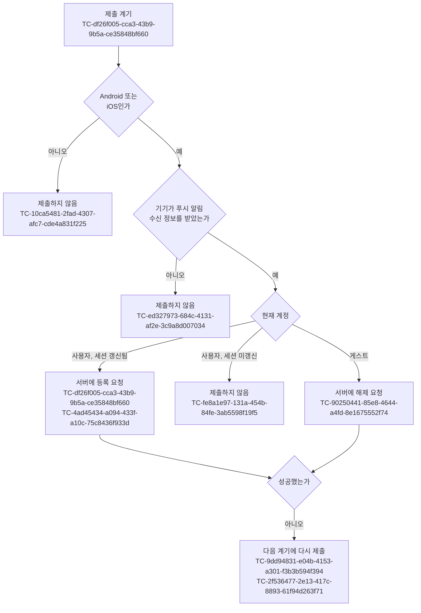

# 푸시 알림 수신 등록 테스트 케이스

기준 스펙: [푸시 알림 수신 등록 스펙(client)](../spec/client/fcm-token.md), [푸시 알림 수신 등록 스펙(common)](../spec/common/fcm-token.md), [푸시 알림 수신 등록 스펙(server)](../spec/server/fcm-token.md)

각 케이스의 `근거`는 절이 있는 스펙 폴더를 앞에 붙여 `client > domain > 절 이름`처럼 적는다.

서버 케이스에서 수신 정보의 방식을 적지 않은 경우, 그 케이스의 모든 수신 정보는 같은 방식이며 두 방식 모두에 같은 결과가 적용된다. 방식에 따라 결과가 달라지는 규칙은 방식을 적은 케이스가 따로 검증한다.

## domain

### TC-10ca5481-2fad-4307-afc7-cde4a831f225: 데스크톱 앱과 웹에서는 수신 정보를 제출하지 않는다

- 근거: `client > domain > 등록하는 기기`
- Given: 데스크톱 앱 또는 웹에서 현재 계정이 사용자이고 세션이 갱신되어 있다.
- When: 앱이 시작되어 계정이 확인된다.
- Then: 서버로 등록 요청과 해제 요청이 발생하지 않고, 사용자에게 안내가 표시되지 않는다.
- 작성하지 않는 이유: 데스크톱 앱 환경에서 서버로 등록 요청과 해제 요청이 발생하지 않는지는 자동화한다. 웹은 그 플랫폼에서 테스트를 실행해야 판정할 수 있는데 현재 유닛 테스트 환경은 데스크톱 앱과 Android 호스트 환경에서만 실행하고, 안내가 표시되지 않는지는 앱 전체 화면을 띄워 확인해야 한다. 웹 실행 환경에서 테스트를 돌리고 앱 전체 화면을 띄워 안내 유무를 볼 수 있게 되면 자동화한다.

### TC-90250441-85e8-4644-a4fd-8e1675552f74: 게스트 상태에서는 수신 정보 해제를 제출한다

- 근거: `client > domain > 제출`
- Given: Android 또는 iOS에서 현재 계정이 게스트다.
- When: 앱이 시작되어 계정이 확인된다.
- Then: 서버로 현재 수신 정보의 해제 요청이 한 번 발생하고 등록 요청은 발생하지 않는다.

### TC-fe8a1e97-131a-454b-84fe-3ab5598f19f5: 세션이 갱신되지 않은 동안에는 제출하지 않고 갱신된 뒤 등록한다

- 근거: `client > domain > 제출`
- Given: Android 또는 iOS에서 저장된 사용자 정보는 있지만 로그인 세션이 아직 인증되지 않았다.
- When: 앱이 시작되어 계정이 확인되고, 그 뒤 로그인 세션이 인증된 상태로 바뀐다.
- Then: 세션이 인증되기 전에는 등록 요청과 해제 요청이 발생하지 않고, 인증된 뒤 등록 요청이 한 번 발생한다.

### TC-744ada98-8541-475e-971e-b637dc67d656: 알림 권한이 거부되어 있어도 수신 정보를 등록한다

- 근거: `client > domain > 등록 정보`
- Given: Android 또는 iOS에서 현재 계정이 사용자이고 세션이 갱신되어 있으며, 시스템 알림 권한이 거부되어 있다.
- When: 앱이 시작되어 계정이 확인된다.
- Then: 서버로 등록 요청이 발생한다.
- 작성하지 않는 이유: Android에서 알림 권한이 거부된 채 계정이 확인되면 등록 요청을 시작하는 부분은 자동화한다. 권한이 거부된 기기에서 Firebase가 수신 정보를 실제로 발급해 서버 등록 요청까지 이어지는지와 iOS의 결과는 실제 기기와 Firebase 없이 판정할 수 없다. 알림 권한을 거부한 채 Firebase 수신 정보 발급과 서버 등록 요청을 함께 관찰할 수 있는 기기 테스트 환경이 마련되면 남은 부분을 작성한다.

### TC-df26f005-cca3-43b9-9b5a-ce35848bf660: 각 제출 계기에서 현재 정보로 등록한다

- 근거: `client > domain > 제출 계기`
- Given: Android 또는 iOS에서 현재 계정이 사용자이고 세션이 갱신되어 있다.
- When: 테스트 데이터의 계기 중 하나가 발생한다.
- Then: 서버로 현재 수신 정보, 시간대, 언어를 담은 등록 요청이 한 번 발생한다.
- 테스트 데이터:

| 계기 |
| --- |
| 앱이 시작되어 계정이 확인됨 |
| 앱이 다시 활성 상태가 되어 계정이 확인됨 |
| 앱을 사용하는 동안 로그인이 완료되어 인증된 계정이 확인됨 |
| 확인된 계정이 다른 계정으로 바뀜 |

### TC-a1ebfeb6-711c-4050-a781-92f8e6a83cee: 같은 계정이 같은 정보로 다시 확인되기만 하면 제출하지 않는다

- 근거: `client > domain > 제출 계기`
- Given: Android 또는 iOS에서 현재 계정이 사용자이고 세션이 갱신되어 있으며, 앱이 시작되어 계정이 확인된 뒤 등록 요청이 한 번 발생했다.
- When: 앱이 활성 상태를 유지한 채 같은 계정이 같은 정보로 다시 확인된다.
- Then: 서버로 등록 요청과 해제 요청이 더 발생하지 않는다.

### TC-4d699fe4-d119-4653-b256-1b898c3a889b: 같은 계정의 계정 정보가 바뀌면 다시 등록한다

- 근거: `client > domain > 제출 계기`
- Given: Android 또는 iOS에서 현재 계정이 사용자이고 세션이 갱신되어 있으며, 앱이 시작되어 계정이 확인된 뒤 등록 요청이 한 번 발생했다.
- When: 앱이 활성 상태를 유지한 채 같은 계정의 테스트 데이터 정보가 바뀐다.
- Then: 서버로 등록 요청이 한 번 더 발생한다.
- 테스트 데이터:

| 바뀐 정보 |
| --- |
| 이메일 |
| 프로필 이미지 |

### TC-6fee7d8e-8951-49e5-a985-2864217598f2: 화면이 재생성되면 같은 계정이어도 다시 등록한다

- 근거: `client > domain > 제출 계기`, `client > domain > 실행 경계`
- Given: Android 또는 iOS에서 현재 계정이 사용자이고 세션이 갱신되어 있으며, 앱이 시작되어 계정이 확인된 뒤 등록 요청이 한 번 발생했다.
- When: 계정이 그대로인 채 화면이 재생성된다.
- Then: 서버로 같은 계정의 등록 요청이 한 번 더 발생한다.

### TC-b1063fda-0b31-4379-a58e-e186b589267e: 백그라운드에 있는 동안 바뀐 계정은 다시 활성 상태가 될 때 한 번 제출한다

- 근거: `client > domain > 실행 경계`
- Given: Android 또는 iOS에서 앱이 백그라운드에 있다.
- When: 백그라운드에 있는 동안 계정이 게스트에서 세션이 갱신된 사용자로, 다시 다른 사용자로 바뀐 뒤 앱이 다시 활성 상태가 된다.
- Then: 백그라운드에 있는 동안에는 제출이 발생하지 않고, 활성 상태가 된 뒤 그때의 계정으로 제출이 한 번 발생한다.

### TC-ed327973-684c-4131-af2e-3c9a8d007034: 기기에 아직 수신 정보가 없으면 그 계기에는 제출하지 않는다

- 근거: `client > domain > 등록 정보`
- Given: Android 또는 iOS에서 현재 계정이 사용자이고 세션이 갱신되어 있으며, 기기가 아직 푸시 알림 수신 정보를 받지 못했다.
- When: 앱이 시작되어 계정이 확인된다.
- Then: 서버로 등록 요청과 해제 요청이 발생하지 않고, 오류 보고도 남지 않는다.

### TC-8df0e0c3-4978-4aa1-b355-df1ed8d79653: 수신 정보를 받아 오지 못하면 제출 실패로 다룬다

- 근거: `client > domain > 등록 정보`, `client > domain > 실패 처리`
- Given: Android 또는 iOS에서 현재 계정이 사용자이고 세션이 갱신되어 있으며, Firebase가 수신 정보 요청에 오류로 응답한다.
- When: 앱이 시작되어 계정이 확인된다.
- Then: 서버로 등록 요청이 발생하지 않고, 그 오류를 실패 원인으로 담은 오류 보고가 한 번 남는다.

### TC-bf3183c4-151d-459d-a768-f0fc6596c1f4: 새로 발급된 수신 정보는 다음 계기의 등록에 담긴다

- 근거: `client > domain > 등록 정보`, `client > domain > 제출 계기`
- Given: Android 또는 iOS에서 현재 계정이 사용자이고 세션이 갱신되어 있으며, 직전 계기에 등록한 뒤 Firebase가 수신 정보를 새로 발급했다.
- When: 앱이 다시 활성 상태가 되어 계정이 확인된다.
- Then: 서버로 새 수신 정보를 담은 등록 요청이 한 번 발생한다.

### TC-065688c3-be4c-4116-b1b1-f362455a7f78: 같은 계정 정보의 제출이 진행 중이면 새 계기에 제출하지 않는다

- 근거: `client > domain > 제출 계기`
- Given: Android 또는 iOS에서 확인된 계정의 제출이 진행 중이고 서버가 아직 답하지 않았다.
- When: 테스트 데이터의 계정으로 새 제출 계기가 생긴다.
- Then: 테스트 데이터의 결과가 된다.
- 테스트 데이터:

| 새 계기의 계정 | 결과 |
| --- | --- |
| 진행 중인 제출과 같은 계정 정보 | 새 제출이 일어나지 않고, 진행 중인 제출이 끝난 뒤의 계기에는 다시 제출한다 |
| 진행 중인 제출과 다른 계정 정보 | 진행 중인 제출을 기다리지 않고 바로 제출한다 |

### TC-4ad45434-a094-433f-a10c-75c8436f933d: 같은 정보라도 계기마다 다시 등록한다

- 근거: `client > domain > 제출`
- Given: Android 또는 iOS에서 현재 계정이 사용자이고 세션이 갱신되어 있으며, 직전 계기에 같은 수신 정보, 시간대, 언어로 등록에 성공했다.
- When: 앱이 다시 활성 상태가 되어 같은 계정이 확인된다.
- Then: 진행 중인 제출이 없을 때 서버로 같은 수신 정보, 시간대, 언어를 담은 등록 요청이 다시 한 번 발생한다.

### TC-8882d07c-9e92-4fa8-9541-c16408248857: 시간대나 언어가 바뀐 뒤 처음 오는 계기의 등록에 새 값이 담긴다

- 근거: `client > domain > 등록 정보`
- Given: Android 또는 iOS에서 현재 계정이 사용자이고 세션이 갱신되어 있으며, 직전 계기 뒤에 기기의 시간대 또는 언어가 바뀌었다.
- When: 앱이 다시 활성 상태가 되어 계정이 확인된다.
- Then: 서버로 바뀐 값을 담은 등록 요청이 한 번 발생한다.
- 테스트 데이터:

| 달라진 값 |
| --- |
| 시간대 |
| 언어 |

### TC-a76579fa-2a6a-4896-8ac6-7245ed05afa4: 시간대나 언어가 바뀐 것만으로는 제출하지 않는다

- 근거: `client > domain > 등록 정보`
- Given: Android 또는 iOS에서 현재 계정이 사용자이고 세션이 갱신되어 있다.
- When: 제출 계기 없이 기기의 시간대 또는 언어가 바뀐다.
- Then: 서버로 등록 요청이 발생하지 않는다.

### TC-9dd94831-e04b-4153-a301-f3b3b594f394: 등록에 실패하면 같은 계기 안에서 다시 시도하지 않고 다음 계기에 다시 등록한다

- 근거: `client > domain > 실패 처리`
- Given: Android 또는 iOS에서 현재 계정이 사용자이고 세션이 갱신되어 있으며, 서버가 등록 요청에 실패로 응답한다.
- When: 앱이 시작되어 계정이 확인되고, 그 뒤 서버가 성공으로 응답하는 상태에서 앱이 다시 활성 상태가 되어 같은 계정이 확인된다.
- Then: 첫 계기에서 등록 요청이 한 번만 발생하고 사용자에게 오류가 표시되지 않으며, 두 번째 계기에서 등록 요청이 다시 발생한다.

### TC-68ae3e2d-db68-4521-841f-5fa83acf7e6b: 로그아웃은 해제를 기다리지 않고, 게스트로 바뀐 것이 계기가 되어 해제를 제출한다

- 근거: `client > domain > 로그아웃과 해제`
- Given: Android 또는 iOS에서 현재 계정이 사용자이고, 서버에 도달할 수 없어 해제 요청이 실패한다.
- When: 사용자가 로그아웃을 진행한다.
- Then: 해제 요청의 결과를 기다리지 않고 로그인 세션이 제거되어 계정 상태가 게스트로 바뀌고, 게스트로 바뀐 뒤 현재 수신 정보의 해제 요청이 한 번 발생한다.

### TC-539b3049-d6b1-46d0-968b-be41e11946ca: 로그아웃 확인에서 취소를 고르면 해제를 제출하지 않는다

- 근거: `client > domain > 로그아웃과 해제`
- Given: Android 또는 iOS에서 현재 계정이 사용자이고, 등록 요청이 한 번 발생한 뒤 로그아웃 확인 다이얼로그가 표시되어 있다.
- When: 사용자가 다이얼로그의 취소를 고른다.
- Then: 계정이 사용자로 남고 서버로 해제 요청이 발생하지 않는다.
- 작성하지 않는 이유: 다이얼로그의 취소와 수신 등록은 서로 다른 화면과 앱 전체 수준에서 처리되어, 한 테스트에서 함께 판정하려면 로그아웃 확인 화면과 앱 전체의 수신 등록을 함께 띄워야 한다. 취소하면 로그아웃이 실행되지 않는 결과는 [MoreHome 테스트 케이스](./more-home.md)의 TC-c4f73ebf-449e-43f0-a3f9-1d87743a56cd이, 계정이 그대로면 제출하지 않는 결과는 TC-a1ebfeb6-711c-4050-a781-92f8e6a83cee이 각각 자동화한다. 로그아웃 확인 화면과 앱 전체의 수신 등록을 함께 띄우는 통합 테스트 환경이 갖춰지면 자동화한다.

### TC-2f536477-2e13-417c-8893-61f94d263f71: 해제에 실패하면 다음 계기에 다시 해제를 제출한다

- 근거: `client > domain > 로그아웃과 해제`, `client > domain > 실패 처리`
- Given: Android 또는 iOS에서 현재 계정이 게스트이고, 서버가 해제 요청에 실패로 응답한다.
- When: 앱이 시작되어 계정이 확인되고, 그 뒤 서버가 성공으로 응답하는 상태에서 앱이 다시 활성 상태가 되어 계정이 확인된다.
- Then: 첫 계기에서 해제 요청이 한 번만 발생하고 사용자에게 오류가 표시되지 않으며, 두 번째 계기에서 해제 요청이 다시 발생한다.

### TC-1f59cdc7-b364-4675-8396-9372bf186a49: 등록 실패와 해제 실패는 오류 보고로 남는다

- 근거: `client > domain > 실패 처리`
- Given: Android 또는 iOS에서 서버가 테스트 데이터의 요청에 실패로 응답한다.
- When: 테스트 데이터의 계정 상태에서 제출 계기가 발생한다.
- Then: 실패 원인을 담은 오류 보고가 한 번 남는다.
- 테스트 데이터:

| 계정 상태 | 요청 |
| --- | --- |
| 세션이 갱신된 사용자 | 등록 |
| 게스트 | 해제 |

### TC-9a2080b2-f51e-4d2a-bb69-cbf648bdd0ee: 통신 오류로 인한 실패도 오류 보고로 남는다

- 근거: `client > domain > 실패 처리`
- Given: Android 또는 iOS에서 현재 계정이 사용자이고 세션이 갱신되어 있으며, 서버에 도달할 수 없어 등록 요청이 통신 오류로 실패한다.
- When: 앱이 시작되어 계정이 확인된다.
- Then: 통신 오류를 실패 원인으로 담은 오류 보고가 한 번 남는다.

### TC-969f648b-64d1-4167-b5a1-e95732282aa5: 진행 중인 제출이 중단되면 보고하지 않는다

- 근거: `client > domain > 실패 처리`
- Given: Android 또는 iOS에서 제출 요청이 서버 응답을 기다리는 중이다.
- When: 앱 종료나 화면 이탈로 진행 중인 제출이 중단된다.
- Then: 오류 보고가 남지 않는다.

## data

### TC-151a7384-b1d2-4272-a502-e16304ba0087: 등록 요청에는 설치 식별 정보, 시간대, 언어만 담고 계정은 담지 않는다

- 근거: `common > data > 제출 요청`, `client > domain > 등록 정보`
- Given: Android 또는 iOS에서 현재 계정이 사용자이고 세션이 갱신되어 있으며, 기기의 설치 식별 정보가 `fid-a`, 시간대가 `Asia/Seoul`, 언어가 `ko-KR`이다.
- When: 앱이 시작되어 계정이 확인된다.
- Then: 서버로 보낸 등록 요청은 인증된 세션을 사용하고, 요청에 설치 식별 정보 방식의 수신 정보 `fid-a`, 시간대 `Asia/Seoul`, 언어 `ko-KR`을 담으며 계정과 이전 방식 수신 정보를 담지 않는다.

### TC-3822e4ff-6e13-4ed0-8859-8ee236fd553d: 해제 요청에는 설치 식별 정보만 담는다

- 근거: `common > data > 제출 요청`, `client > domain > 제출`
- Given: Android 또는 iOS에서 현재 계정이 게스트이고 기기의 설치 식별 정보가 `fid-a`다.
- When: 앱이 시작되어 계정이 확인된다.
- Then: 서버로 보낸 해제 요청은 요청에 설치 식별 정보 방식의 수신 정보 `fid-a`만 담는다.

### TC-bda1ff9f-2fae-4c92-ac01-ac1b1ec7853c: 같은 수신 정보가 다시 등록되면 새 건을 만들지 않고 값을 바꾼다

- 근거: `server > data > 등록 처리`, `server > domain > 한 기기와 한 계정`
- Given: 서버에 수신 정보 `token-a`가 계정 A, 시간대 `Asia/Seoul`, 언어 `ko-KR`로 저장되어 있다.
- When: 테스트 데이터의 세션으로 수신 정보 `token-a`의 등록 요청이 도착한다.
- Then: 서버에는 수신 정보 `token-a` 건이 하나만 남고, 그 건의 계정, 시간대, 언어, 등록 시각이 요청 값으로 바뀐다.
- 테스트 데이터:

| 세션 계정 | 요청 시간대 | 요청 언어 | 결과 계정 |
| --- | --- | --- | --- |
| A | `America/New_York` | `en-US` | A |
| B | `Asia/Seoul` | `ko-KR` | B |

- 작성하지 않는 이유: 서버 저장소의 저장 규칙이어서 앱의 단위 테스트 환경에서 결정적으로 판정할 수 없다. 서버 정책 테스트 환경이 마련되면 작성한다.

### TC-380faecc-9a2c-47c0-be53-5f8a28eed420: 계정이 삭제되면 연결된 수신 정보 건도 삭제된다

- 근거: `server > data > 저장한 정보의 보호`
- Given: 서버에 계정 A에 연결된 수신 정보 건이 둘 있다.
- When: 계정 A가 삭제된다.
- Then: 계정 A에 연결된 수신 정보 건이 모두 삭제된다.
- 작성하지 않는 이유: 서버 저장소의 삭제 규칙이어서 앱의 단위 테스트 환경에서 결정적으로 판정할 수 없다. 서버 정책 테스트 환경이 마련되면 작성한다.

### TC-df4e27a3-9503-4395-9f78-259ee13fd6c7: 세션 없는 등록 요청은 거절되고, 해제 요청은 세션 없이 수신 정보 건을 지운다

- 근거: `common > data > 제출 요청`, `server > data > 등록 처리`, `server > data > 해제 처리`
- Given: 서버에 수신 정보 `token-a`가 계정 A에, 수신 정보 `token-b`가 계정 B에 저장되어 있다.
- When: 세션 없이 테스트 데이터의 요청이 도착한다.
- Then: 요청의 결과와 서버에 남는 수신 정보 건은 테스트 데이터와 같다.
- 테스트 데이터:

| 요청 | 결과 | 남는 수신 정보 건 |
| --- | --- | --- |
| `token-a`의 등록(시간대·언어 포함) | 거절 | `token-a`, `token-b` |
| `token-a`의 해제 | 성공 | `token-b` |
| `token-b`의 해제 | 성공 | `token-a` |
| `token-c`의 해제 | 성공 | `token-a`, `token-b` |

- 작성하지 않는 이유: 서버의 요청 처리 규칙이어서 앱의 단위 테스트 환경에서 결정적으로 판정할 수 없다. 서버 정책 테스트 환경이 마련되면 작성한다.

### TC-b7c84a9a-eaf1-4444-82e5-cd03ae96babf: 비어 있는 값이 담긴 등록과 해제는 거절된다

- 근거: `server > data > 등록 처리`, `server > data > 해제 처리`
- Given: 서버에 테스트 데이터의 요청이 테스트 데이터의 세션으로 도착한다.
- When: 서버가 요청을 처리한다.
- Then: 요청이 거절되고 서버에 저장된 수신 정보 건은 바뀌지 않는다.
- 테스트 데이터:

| 요청 | 세션 |
| --- | --- |
| 수신 정보가 비어 있는 등록 | 인증된 세션 |
| 시간대가 비어 있는 등록 | 인증된 세션 |
| 언어가 비어 있는 등록 | 인증된 세션 |
| 수신 정보가 비어 있는 해제 | 세션 없음 |

- 작성하지 않는 이유: 서버의 요청 검증 규칙이어서 서버 함수 실행 환경에서만 판정할 수 있고, 그 환경은 저장소의 자동 검증 절차에 포함되어 있지 않다. 서버 함수 테스트 러너가 검증 절차에 들어오면 자동화한다.

### TC-6f97cd9a-5d09-4551-87fc-a16ed7e9c6d0: 시간대와 언어 중 하나만 담은 제출은 거절된다

- 근거: `common > data > 제출 요청`
- Given: 서버에 수신 정보와 함께 테스트 데이터의 값만 담은 제출이 인증된 세션으로 도착한다.
- When: 서버가 요청을 처리한다.
- Then: 등록도 해제도 되지 않고 요청이 거절되며, 서버에 저장된 수신 정보 건은 바뀌지 않는다.
- 테스트 데이터:

| 담은 값 |
| --- |
| 시간대만 |
| 언어만 |

- 작성하지 않는 이유: 서버의 요청 검증 규칙이어서 서버 함수 실행 환경에서만 판정할 수 있고, 그 환경은 저장소의 자동 검증 절차에 포함되어 있지 않다. 앱은 두 값을 늘 함께 담거나 함께 비우므로 앱 쪽에서는 TC-151a7384-b1d2-4272-a502-e16304ba0087과 TC-3822e4ff-6e13-4ed0-8859-8ee236fd553d가 덮는다. 서버 함수 테스트 러너가 검증 절차에 들어오면 자동화한다.

### TC-e2fbdfab-2e68-4b0c-81fa-ce52de4e5f7b: 한 계정의 여러 기기는 따로 등록되고 서로 영향을 주지 않는다

- 근거: `server > domain > 한 기기와 한 계정`
- Given: 계정 A로 로그인한 두 기기의 수신 정보 `token-a`와 `token-b`가 모두 계정 A로 등록되어 있다.
- When: `token-a`의 해제 요청이나 새 시간대의 등록 요청이 도착한다.
- Then: `token-a` 건만 지워지거나 바뀌고, `token-b` 건은 계정 A에 연결된 채 값이 그대로 남는다.
- 작성하지 않는 이유: 서버 저장소의 저장 규칙이어서 앱의 단위 테스트 환경에서 결정적으로 판정할 수 없다. 서버 정책 테스트 환경이 마련되면 작성한다.

### TC-e91cdbe1-4005-46a6-b654-0225714a242f: 앱은 서버에 저장된 등록 정보를 읽을 수 없다

- 근거: `server > data > 저장한 정보의 보호`
- Given: 서버에 계정 A와 계정 B의 수신 정보 건이 저장되어 있다.
- When: 계정 A의 인증된 세션으로 저장된 등록 정보를 조회하려 한다.
- Then: 계정 A와 계정 B의 어느 등록 정보도 돌려받지 못한다.
- 작성하지 않는 이유: 서버 저장소의 접근 제한 규칙이어서 앱의 단위 테스트 환경에서 결정적으로 판정할 수 없다. 서버 정책 테스트 환경이 마련되면 작성한다.

### TC-139d41e7-3828-42e4-902f-83389e2033e5: 서버가 등록이나 해제를 처리하지 못하면 실패를 돌려주고 저장된 정보를 바꾸지 않는다

- 근거: `server > data > 처리 실패`
- Given: 서버에 수신 정보 `token-a` 건이 저장되어 있고, 서버가 저장소에 반영하지 못하는 상태다.
- When: `token-a`의 등록 요청이나 해제 요청이 도착한다.
- Then: 요청은 실패로 끝나고 `token-a` 건의 계정, 시간대, 언어, 등록 시각이 요청 전과 같다.
- 작성하지 않는 이유: 서버 함수의 실패 처리 규칙이어서 서버 함수 실행 환경에서 저장소 실패를 제어해야 하며, 그 환경은 저장소의 자동 검증 절차에 포함되어 있지 않다. 서버 함수 테스트 러너가 검증 절차에 들어오면 자동화한다.

### TC-1872f851-4322-4b14-8dce-24a6a15f32ab: 설치 식별 정보가 등록되면 같은 계정의 이전 방식 등록이 모두 지워진다

- 근거: `server > domain > 이전 방식 등록의 정리`, `server > data > 등록 처리`
- Given: 서버에 이전 방식 수신 정보 `token-a`와 `token-b`가 계정 A로, 이전 방식 수신 정보 `token-c`가 계정 B로, 설치 식별 정보 `fid-b`가 계정 A로 저장되어 있다.
- When: 계정 A의 인증된 세션으로 설치 식별 정보 `fid-a`의 등록 요청이 도착한다.
- Then: 서버에는 계정 A의 `fid-a`와 `fid-b`, 계정 B의 `token-c`가 남고, `token-a`와 `token-b`는 지워진다.
- 작성하지 않는 이유: 서버 저장소의 저장 규칙이어서 앱의 단위 테스트 환경에서 결정적으로 판정할 수 없다. 서버 정책 테스트 환경이 마련되면 작성한다.

### TC-4c8bf603-d07d-43e4-9cd2-2a0ce4319b79: 이전 방식 수신 정보의 등록은 다른 기기의 등록을 지우지 않는다

- 근거: `server > domain > 이전 방식 등록의 정리`
- Given: 서버에 설치 식별 정보 `fid-a`와 이전 방식 수신 정보 `token-b`가 계정 A로 저장되어 있다.
- When: 계정 A의 인증된 세션으로 방식을 담지 않은 이전 방식 수신 정보 `token-c`의 등록 요청이 도착한다.
- Then: 서버에는 계정 A의 `fid-a`, `token-b`, `token-c`가 모두 남는다.
- 작성하지 않는 이유: 서버 저장소의 저장 규칙이어서 앱의 단위 테스트 환경에서 결정적으로 판정할 수 없다. 서버 정책 테스트 환경이 마련되면 작성한다.

### TC-4c6706f5-1aae-4d06-b14d-adb0149b8ea4: 방식을 담지 않은 제출은 이전 방식 수신 정보로 처리된다

- 근거: `common > data > 제출 요청`, `server > data > 해제 처리`
- Given: 서버에 이전 방식 수신 정보 `token-a`와 설치 식별 정보 `fid-a`가 계정 A로 저장되어 있다.
- When: 세션 없이 테스트 데이터의 해제 요청이 도착한다.
- Then: 테스트 데이터의 건만 지워지고 다른 건은 남는다.
- 테스트 데이터:

| 요청 | 지워지는 건 |
| --- | --- |
| 방식 없이 `token-a`의 해제 | `token-a` |
| 설치 식별 정보 방식으로 `fid-a`의 해제 | `fid-a` |
| 방식 없이 `fid-a`의 해제 | 없음 |

- 작성하지 않는 이유: 서버의 요청 처리 규칙이어서 앱의 단위 테스트 환경에서 결정적으로 판정할 수 없다. 서버 정책 테스트 환경이 마련되면 작성한다.

### TC-125b0dbb-b146-460e-9d2b-72e339dc1c81: 설치 식별 정보 등록에서 이전 방식 정리가 실패하면 등록도 반영하지 않는다

- 근거: `server > data > 등록 처리`, `server > data > 처리 실패`
- Given: 서버에 이전 방식 수신 정보 `token-a`가 계정 A로 저장되어 있고, 서버가 이전 방식 등록을 지우지 못하는 상태다.
- When: 계정 A의 인증된 세션으로 설치 식별 정보 `fid-a`의 등록 요청이 도착한다.
- Then: 요청은 실패로 끝나고, 서버에는 `fid-a` 건이 생기지 않으며 `token-a` 건이 요청 전과 같다.
- 작성하지 않는 이유: 서버 저장소의 실패 처리 규칙이어서 저장소 실패를 제어할 수 있는 서버 정책 테스트 환경에서만 판정할 수 있고, 그 환경은 저장소의 자동 검증 절차에 포함되어 있지 않다. 서버 정책 테스트 환경이 마련되면 작성한다.

### TC-7d9e4cc4-114c-4c7e-9845-3a7ffd9a6a65: 방식이 다르면 같은 값이어도 다른 건으로 저장된다

- 근거: `server > data > 등록 처리`
- Given: 서버에 이전 방식 수신 정보 `same-value`가 계정 B로 저장되어 있다.
- When: 계정 A의 인증된 세션으로 설치 식별 정보 `same-value`의 등록 요청이 도착한다.
- Then: 서버에는 계정 A의 설치 식별 정보 `same-value` 건이 새로 생기고, 계정 B의 이전 방식 수신 정보 `same-value` 건은 연결 계정과 값이 그대로 남는다.
- 작성하지 않는 이유: 서버 저장소의 저장 규칙이어서 앱의 단위 테스트 환경에서 결정적으로 판정할 수 없다. 서버 정책 테스트 환경이 마련되면 작성한다.

### TC-1690bbd2-3859-49bb-ad67-d9d31e892c88: 설치 식별 정보와 이전 방식 수신 정보를 함께 담은 제출은 거절된다

- 근거: `common > data > 제출 요청`
- Given: 서버에 설치 식별 정보 `fid-a`와 이전 방식 수신 정보 `token-a`를 함께 담은 제출이 테스트 데이터의 세션으로 도착한다.
- When: 서버가 요청을 처리한다.
- Then: 등록도 해제도 되지 않고 요청이 거절되며, 서버에 저장된 수신 정보 건은 바뀌지 않는다.
- 테스트 데이터:

| 제출 | 세션 |
| --- | --- |
| 시간대·언어를 담은 등록 | 인증된 세션 |
| 시간대·언어를 비운 해제 | 세션 없음 |

- 작성하지 않는 이유: 서버의 요청 검증 규칙이어서 서버 함수 실행 환경에서만 판정할 수 있고, 그 환경은 저장소의 자동 검증 절차에 포함되어 있지 않다. 앱은 설치 식별 정보만 담으므로 앱 쪽에서는 TC-151a7384-b1d2-4272-a502-e16304ba0087과 TC-3822e4ff-6e13-4ed0-8859-8ee236fd553d가 덮는다. 서버 함수 테스트 러너가 검증 절차에 들어오면 자동화한다.

