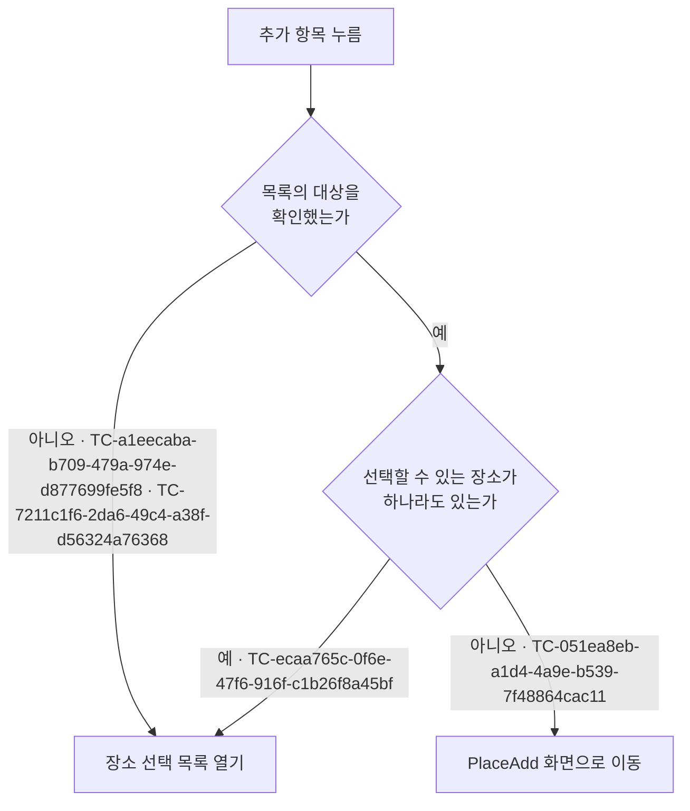

# 메모 장소 카드 테스트 케이스

기준 스펙: [메모 장소 카드 컴포넌트 스펙](../spec/client/memo-place-card.md)

지도의 표시·조작·제공자 전환과 핀 표시·핀 선택 자체의 케이스는 [DiaryMap 테스트 케이스](./diary-map.md)에서 다룬다. 핀을 눌러 이동한 상세 화면의 내용과 수정·삭제 케이스는 [PlaceDetail 테스트 케이스](./place-detail.md)에서 다룬다. 현재 위치를 확인하는 규칙 자체의 케이스는 [현재 위치 확인 테스트 케이스](./current-location.md)에서 다룬다. 기본 지도를 고르고 저장하는 케이스는 [SettingMap 테스트 케이스](./setting-map.md)에서 다룬다. 메모와 장소 연결 규칙 자체의 케이스는 [메모 장소 테스트 케이스](./memo-place.md)에서, 선택이 반영되는 화면별 케이스는 [MemoAdd 테스트 케이스](./memo-add.md)와 [MemoDetail 테스트 케이스](./memo-detail.md)에서 다룬다. 자리 표시 케이스의 `근거`가 가리키는 절은 공통 규칙을 [페이지 조회 목록의 자리 표시 스펙](../spec/client/paged-list-placeholder.md)에 위임한다. 검색어의 정규화와 일치 판정, 검색 결과 없음 판정도 [검색어 일치 판정 스펙](../spec/client/search-match.md)에 위임되어 있으며, 장소 선택 목록에서의 결과를 이 문서의 케이스로 덮는다.

## feature

### TC-649e3b47-a249-4368-837b-e9dd21aecd2a: MemoAdd 화면 본문에 장소 카드가 표시된다

- 근거: `feature > 카드 표시`
- Given: MemoAdd 화면이 표시되어 있다.
- When: 사용자가 본문을 확인한다.
- Then: 메모의 장소를 보여 주는 장소 카드가 표시된다.

### TC-2f2161b0-8611-4832-9213-5fa348e0f5e0: MemoDetail 화면 본문에 장소 카드가 표시된다

- 근거: `feature > 카드 표시`
- Given: 메모 조회가 완료된 MemoDetail 화면이 표시되어 있다.
- When: 사용자가 본문을 확인한다.
- Then: 메모의 장소를 보여 주는 장소 카드가 표시된다.

### TC-a2329351-5d96-4a5d-b6c2-465d26366250: 기본 지도를 확인하지 못하면 지도를 표시하지 않는다

- 근거: `feature > 지도 표시`
- Given: 사용자가 고른 기본 지도를 아직 확인하지 못했거나 읽지 못한 상태로 장소 카드가 표시되어 있다.
- When: 사용자가 장소 카드를 확인한다.
- Then: 지도가 표시되지 않고 별도의 로딩 안내나 오류 안내도 표시되지 않으며, 카드와 장소 목록은 그대로 표시된다.

### TC-40088a6c-af25-478e-a361-f4d4f1091e59: 연결된 장소가 컬러와 제목으로 표시된다

- 근거: `feature > 장소 표시`
- Given: 카드가 노출하는 장소가 테스트 데이터와 같다.
- When: 사용자가 장소 카드의 장소 목록을 확인한다.
- Then: 각 장소가 저장된 컬러와 제목으로 구분되어 모두 표시된다.
- 테스트 데이터:

| 노출하는 장소 |
| --- |
| 장소 한 개 |
| 서로 다른 제목과 컬러의 장소 여러 개 |

### TC-662794b9-b18b-4787-aac5-ff399b42a925: 장소를 누르면 지도가 그 장소로 이동한다

- 근거: `feature > 장소 위치 보기`, `domain > 장소 위치 보기와 지도 이동`
- Given: 기본 지도가 확인되어 지도가 표시되어 있고, 카드가 서로 다른 좌표의 장소 여러 개를 노출하고 있으며, 지도는 그 장소들과 다른 위치를 가운데에 두고 있다.
- When: 사용자가 장소 하나를 누른다.
- Then: 지도가 그 장소의 좌표를 가운데에 두도록 이동하고 장소 상세 이동은 요청되지 않는다. 이때 확대 수준이 유지되는 것은 [DiaryMap 테스트 케이스](./diary-map.md)의 TC-5e16f287-92f8-4a1f-ae15-0559952c7d38가 다룬다.

### TC-16def837-7242-4e9f-ac6e-b05b1748d3a7: 지도가 표시되지 않는 동안 장소를 눌러도 지도 이동이 일어나지 않는다

- 근거: `feature > 장소 위치 보기`
- Given: 기본 지도를 아직 확인하지 못해 지도가 표시되지 않고, 카드가 장소를 노출하고 있다.
- When: 사용자가 장소 하나를 누른다.
- Then: 지도 이동이 일어나지 않고 장소 상세 이동도 요청되지 않는다.

### TC-68786efe-067a-4b6b-9f6f-8a4eb581e7c4: 같은 장소를 다시 누르면 지도를 다시 그 좌표로 옮긴다

- 근거: `domain > 장소 위치 보기와 지도 이동`
- Given: 기본 지도가 확인되어 지도가 표시되어 있고, 사용자가 장소 하나를 눌러 지도가 그 좌표로 이동한 뒤 지도를 다른 곳으로 옮겼다.
- When: 사용자가 같은 장소를 다시 누른다.
- Then: 지도가 다시 그 장소의 좌표를 가운데에 두도록 이동하고 장소 상세 이동은 요청되지 않는다.

### TC-ee257126-2dd0-48fd-8c3b-99cfc84577cd: 지도를 눌러도 지점이 만들어지지 않는다

- 근거: `feature > 지도 표시`
- Given: 기본 지도가 확인되어 카드의 지도가 표시되어 있다.
- When: 사용자가 지도의 한 곳을 누른다.
- Then: 지점이 만들어지지 않고 지점 표시도 나타나지 않는다.
- 작성하지 않는 이유: 지도 누르기는 지도 제공자의 실제 표시 요소가 필요하고, 현재 호스트 테스트 환경은 이를 제공하지 않는다. 지도 표시를 대체할 수 있는 테스트 환경이 제공되면 자동화한다.

### TC-56f0908d-0893-494f-acc6-f6309ffb8bb9: 장소 추가 항목이 장소 목록 하단에 항상 표시된다

- 근거: `feature > 장소 선택 목록`
- Given: 카드가 노출하는 장소가 테스트 데이터와 같다.
- When: 사용자가 장소 카드의 장소 목록을 확인한다.
- Then: 장소 목록 하단에 추가 항목이 표시된다.
- 테스트 데이터:

| 노출하는 장소 |
| --- |
| 없음 |
| 장소 여러 개 |

추가 항목을 눌렀을 때의 동작 판정은 다음 케이스가 나누어 덮는다.

### TC-ecaa765c-0f6e-47f6-916f-c1b26f8a45bf: 추가 항목을 누르면 장소 선택 목록이 열린다

- 근거: `feature > 장소 선택 목록`
- Given: 계정과 연결된 삭제되지 않은 장소 여러 개가 저장되어 있고, 그중 일부가 선택되어 있다.
- When: 사용자가 장소 목록의 추가 항목을 누른다.
- Then: 장소 선택 목록이 열리고 준비된 장소가 각 장소의 선택 여부와 함께 표시된다.

### TC-051ea8eb-a1d4-4a9e-b539-7f48864cac11: 선택할 수 있는 장소가 없는 것으로 확정되면 추가 항목이 PlaceAdd 이동을 요청한다

- 근거: `feature > 장소 추가 이동`, `domain > 추가 항목의 동작 판정`
- Given: 선택할 수 있는 장소가 하나도 없는 것으로 확정되어 있다.
- When: 사용자가 장소 목록의 추가 항목을 누른다.
- Then: PlaceAdd 화면 이동이 한 번 요청되고 장소 선택 목록은 열리지 않는다.

### TC-41b7a438-c9ca-4fa5-9c6f-dfddd2dca958: 목록을 연 적이 없어도 화면에 들어온 뒤 대상이 없다고 확인되면 첫 누름에 PlaceAdd 이동을 요청한다

- 근거: `domain > 추가 항목의 동작 판정`
- Given: 계정과 연결되고 삭제되지 않은 장소가 하나도 저장되어 있지 않은 상태로 화면에 들어왔고, 장소 선택 목록을 한 번도 열지 않은 채 선택할 수 있는 장소가 없다는 확인이 끝났다.
- When: 사용자가 추가 항목을 처음 누른다.
- Then: 장소 선택 목록이 열리지 않고 PlaceAdd 화면으로의 이동이 한 번 요청된다.

### TC-7211c1f6-2da6-49c4-a38f-d56324a76368: 목록의 대상을 처음 불러오지 못하면 추가 항목이 목록을 연다

- 근거: `domain > 추가 항목의 동작 판정`
- Given: 선택할 수 있는 장소의 첫 조회가 실패하도록 제어되어 있고, 그 조회가 실패로 끝났다.
- When: 사용자가 카드의 추가 항목을 누른다.
- Then: 장소 선택 목록이 열리고 PlaceAdd 화면으로의 이동이 요청되지 않는다.

### TC-af75366c-2658-41e6-ae42-6168aefd537f: 확인 중에 연 목록이 대상 없음으로 확정되면 목록 영역이 비어 있는 채로 유지된다

- 근거: `feature > 장소 선택 목록`
- Given: 선택할 수 있는 장소의 확인이 끝나지 않은 상태에서 장소 선택 목록이 열려 있다.
- When: 확인이 끝나 선택할 수 있는 장소가 하나도 없는 것으로 확정된다.
- Then: 목록 영역이 비어 있는 채로 유지되고 별도의 안내 문구가 표시되지 않는다.

### TC-e63b6309-8e74-4b3f-8366-5d98c40e494c: 장소 선택 목록에 장소 추가 항목이 항상 표시된다

- 근거: `feature > 장소 선택 목록`
- Given: 장소 선택 목록이 열려 있고 목록에 나타나는 장소가 테스트 데이터와 같다.
- When: 사용자가 장소 선택 목록을 확인한다.
- Then: 목록과 함께 장소 추가 항목이 표시된다.
- 테스트 데이터:

| 목록에 나타나는 장소 |
| --- |
| 없음 |
| 장소 여러 개 |

### TC-16a56440-8c52-46b8-9ccd-b494b5122495: 목록의 장소 추가 항목을 누르면 목록이 닫히고 PlaceAdd 이동이 요청된다

- 근거: `feature > 장소 선택 목록`, `feature > 장소 추가 이동`, `domain > 추가 항목의 동작 판정`
- Given: 장소 선택 목록이 열려 있고 목록에 나타나는 장소가 테스트 데이터와 같다.
- When: 사용자가 장소 선택 목록의 장소 추가 항목을 누른다.
- Then: PlaceAdd 화면 이동이 한 번 요청되고 장소 선택 목록이 닫히며, 선택은 바뀌지 않는다.
- 테스트 데이터:

| 목록에 나타나는 장소 |
| --- |
| 없음 |
| 장소 여러 개 |

### TC-ae4dfccd-1c16-4896-829d-d4003b9ea4ce: PlaceAdd 화면에서 추가한 장소가 돌아왔을 때 선택된다

- 근거: `feature > 장소 추가 이동`, `domain > 추가한 장소의 자동 선택`
- Given: 장소 하나가 선택된 상태에서 사용자가 PlaceAdd 화면으로 이동해 테스트 데이터만큼 장소를 추가했다.
- When: 사용자가 카드가 있는 화면으로 돌아온다.
- Then: 이동하기 전에 선택했던 장소가 유지된 채로 추가한 장소가 모두 카드의 장소 목록에 나타난다.
- 테스트 데이터:

| 추가한 장소 |
| --- |
| 한 개 |
| 여러 개 |

### TC-b9375659-81fa-4f2d-8c4d-f89f05ecf182: 장소를 추가하지 않고 돌아오면 선택이 그대로 유지된다

- 근거: `feature > 장소 추가 이동`
- Given: 장소 두 개가 선택된 상태에서 사용자가 PlaceAdd 화면으로 이동해 장소를 하나도 추가하지 않았다.
- When: 사용자가 카드가 있는 화면으로 돌아온다.
- Then: 선택한 두 장소가 그대로 유지된다.

### TC-0afc7d5d-f965-4243-98b8-808d0f87978a: PlaceAdd 화면에서 돌아와도 장소 선택 목록이 저절로 열리지 않는다

- 근거: `feature > 장소 추가 이동`
- Given: 사용자가 장소 선택 목록의 장소 추가 항목을 눌러 PlaceAdd 화면으로 이동해 장소를 추가했다.
- When: 사용자가 카드가 있는 화면으로 돌아온다.
- Then: 장소 선택 목록이 닫힌 채로 유지된다.

### TC-e9e1ffa2-ffcf-4eb3-8735-5b3dd0ccf471: 목록에서 장소를 선택하면 즉시 반영된다

- 근거: `feature > 장소 선택과 해제`
- Given: 장소 선택 목록이 열려 있고 선택되지 않은 장소가 표시되어 있다.
- When: 사용자가 그 장소를 선택한다.
- Then: 별도의 확정 동작 없이 그 장소가 선택된 것으로 표시되고, 카드의 장소 목록에 나타난다.

### TC-a1af6784-f104-4cda-943b-71d1904701d1: 목록에서 장소 선택을 해제하면 즉시 반영된다

- 근거: `feature > 장소 선택과 해제`
- Given: 장소 선택 목록이 열려 있고 선택된 장소가 표시되어 있다.
- When: 사용자가 그 장소의 선택을 해제한다.
- Then: 별도의 확정 동작 없이 그 장소가 선택되지 않은 것으로 표시되고, 카드의 장소 목록에서 사라진다.

### TC-c468b9e8-6689-47fe-bf3e-ea731aa62f1e: 목록을 닫아도 반영한 선택이 유지된다

- 근거: `feature > 장소 선택 목록`
- Given: 사용자가 장소 선택 목록에서 장소를 선택하거나 해제했다.
- When: 사용자가 목록을 닫는다.
- Then: 목록에서 반영한 선택이 카드의 장소 목록에 그대로 유지된다.

### TC-d3900af3-81b5-4b4f-9ced-19c7734b5888: 목록을 닫았다가 다시 열면 앞부분부터 나타난다

- 근거: `feature > 장소 선택 목록`
- Given: 한 화면에 모두 담기지 않는 수의 선택할 수 있는 장소가 있고, 사용자가 장소 선택 목록을 열어 뒷부분까지 내려 본 상태다.
- When: 사용자가 목록을 닫고 다시 연다.
- Then: 목록이 정렬 순서의 앞부분부터 나타난다.

### TC-9abc5d57-6f0f-4359-9e90-c0c44ca76380: 장소를 선택하거나 해제해도 지도가 보고 있는 위치가 바뀌지 않는다

- 근거: `feature > 장소 선택과 해제`, `domain > 초기 지도 위치`
- Given: 기본 지도가 확인되어 지도가 표시되어 있고 장소 선택 목록이 열려 있다.
- When: 사용자가 장소를 선택하거나 해제한다.
- Then: 지도가 보고 있는 위치와 확대 수준이 바뀌지 않는다.
- 작성하지 않는 이유: 지도가 보고 있는 위치를 관찰하려면 지도 제공자의 실제 표시 요소가 필요하고, 현재 호스트 테스트 환경은 이를 제공하지 않는다. 지도 표시를 대체할 수 있는 테스트 환경이 제공되면 자동화한다.

### TC-a1eecaba-b709-479a-974e-d877699fe5f8: 목록을 준비하는 동안 추가 항목을 누르면 목록이 열리고 안내를 표시하지 않는다

- 근거: `feature > 장소 선택 목록`, `domain > 추가 항목의 동작 판정`
- Given: 계정과 연결된 장소의 목록 준비가 아직 끝나지 않았다.
- When: 사용자가 장소 목록의 추가 항목을 누른다.
- Then: 장소 선택 목록이 열리고 PlaceAdd 화면 이동은 요청되지 않으며, 빈 상태 안내나 진행 안내가 표시되지 않는다.

### TC-74f38916-1af8-4f2f-9f17-148fe33177b5: 목록을 내려 보면 아직 준비되지 않은 구간의 장소가 이어서 나타난다

- 근거: `feature > 장소 선택 목록`
- Given: 계정과 연결된 삭제되지 않은 장소가 한 번에 준비되는 양보다 많이 저장되어 있고 장소 선택 목록이 열려 있다.
- When: 사용자가 목록을 아직 준비되지 않은 구간까지 내려 본다.
- Then: 그 구간의 장소가 정렬 순서에 이어서 나타난다.
- 작성하지 않는 이유: 목록을 끝으로 옮긴 뒤 다음 장소가 준비되는 과정은 화면 테스트 환경에서 배경 조회가 끝나는 시점을 제어할 수 없어 같은 조건에서 결과가 일정하지 않다. 조회가 정렬 순서 앞쪽부터 나뉘어 이루어지고 이어지는 조회가 그다음 장소를 가져온다는 결과는 `TC-d4e161bd-740b-4244-89e2-a08f2ca1f9eb`로 검증한다. 화면 테스트에서 배경 조회 완료 시점을 제어할 수 있게 되면 작성한다.

### TC-aa2b94bf-0fe7-4158-801a-4043c0591b77: 다음 장소를 불러오는 동안에도 이미 나타난 장소를 조작할 수 있다

- 근거: `feature > 장소 선택 목록`
- Given: 장소 선택 목록이 열려 있고 다음 구간의 조회가 끝나지 않도록 제어되어 있다.
- When: 사용자가 이미 나타난 장소를 누른다.
- Then: 그 장소의 선택 여부가 바뀐다.

### TC-27fb4be9-fa05-4ef5-af0a-0c753bba9c3d: 목록의 장소를 눌러도 장소 상세로 이동하지 않는다

- 근거: `feature > 장소 선택 목록`
- Given: 장소 선택 목록이 열려 있고 장소가 나타나 있다.
- When: 사용자가 목록의 장소를 누른다.
- Then: 장소 상세 이동이 요청되지 않고 그 장소의 선택 여부만 바뀐다.

### TC-b4820f67-50fa-4e61-a61e-f86dabc63a79: 연결된 장소가 지도 핀으로 지정된다

- 근거: `feature > 장소 표시`, `domain > 지도에 표시하는 핀`
- Given: 기본 지도가 확인되었고 카드가 서로 다른 좌표, 컬러와 제목의 장소 여러 개를 노출하고 있다.
- When: 사용자가 카드의 지도를 확인한다.
- Then: 카드의 장소 목록과 같은 장소들이 지도 기능의 핀으로 지정되고, 각 핀은 그 장소의 좌표에 놓이며 핀의 색은 장소의 컬러, 라벨은 장소의 제목이다.
- 작성하지 않는 이유: 장소가 좌표, 컬러 색과 제목 라벨의 핀으로 변환되는 것은 자동화한다. 핀이 지도 기능에 지정되는 것은 지도가 표시된 화면을 구성해야 관찰할 수 있는데, 현재 호스트 테스트 환경은 실제 지도의 플랫폼 표시 요소를 제공하지 않는다. 지도 표시를 대체할 수 있는 테스트 환경이 제공되면 자동화한다.

### TC-c192eec0-c936-4129-9cd3-47ff0b80dcda: 노출하는 장소가 바뀌면 핀도 함께 바뀐다

- 근거: `feature > 장소 표시`, `domain > 지도에 표시하는 핀`
- Given: 기본 지도가 확인되었고 카드가 장소 여러 개를 노출하고 있다.
- When: 사용자가 장소를 선택하거나 해제해 카드가 노출하는 장소가 바뀐다.
- Then: 지도 기능에 지정되는 핀이 바뀐 장소 목록과 같은 장소들로 갱신되어, 새로 노출된 장소의 핀이 더해지고 노출에서 빠진 장소의 핀은 빠진다.
- 작성하지 않는 이유: 핀이 지도 기능에 지정되는 것은 지도가 표시된 화면을 구성해야 관찰할 수 있는데, 현재 호스트 테스트 환경은 실제 지도의 플랫폼 표시 요소를 제공하지 않는다. 장소 목록의 갱신 자체는 TC-e9e1ffa2-ffcf-4eb3-8735-5b3dd0ccf471와 TC-a1af6784-f104-4cda-943b-71d1904701d1에서 검증한다. 지도 표시를 대체할 수 있는 테스트 환경이 제공되면 자동화한다.

### TC-6f355b95-4860-4c00-8be2-a1dd51acf036: 노출하는 장소가 없으면 핀도 없다

- 근거: `feature > 장소 표시`, `domain > 지도에 표시하는 핀`
- Given: 기본 지도가 확인되었고 카드가 노출하는 장소가 없다.
- When: 사용자가 카드의 지도를 확인한다.
- Then: 지도 기능에 지정되는 핀이 없다.
- 작성하지 않는 이유: 핀이 지도 기능에 지정되지 않는 것은 지도가 표시된 화면을 구성해야 관찰할 수 있는데, 현재 호스트 테스트 환경은 실제 지도의 플랫폼 표시 요소를 제공하지 않는다. 노출하는 장소가 없는 상태 자체는 TC-56f0908d-0893-494f-acc6-f6309ffb8bb9에서 검증한다. 지도 표시를 대체할 수 있는 테스트 환경이 제공되면 자동화한다.

### TC-c1675e90-9734-4d23-95ab-19d56294c722: 지도 핀을 누르면 그 장소의 상세로 이동한다

- 근거: `feature > 장소 상세 이동`, `domain > 장소 상세 이동 대상`
- Given: 기본 지도가 확인되어 서로 다른 장소들이 핀으로 표시되어 있다.
- When: 사용자가 그중 한 핀을 누른다.
- Then: 그 핀이 가리키는 장소로 장소 상세 이동이 한 번 요청되고, 지도가 보고 있는 위치와 확대 수준, 지도 제공자와 카드의 선택 상태는 바뀌지 않는다.
- 작성하지 않는 이유: 핀 누르기는 지도가 표시된 화면과 지도 제공자의 입력 처리가 필요한데, 현재 호스트 테스트 환경은 실제 지도의 플랫폼 표시 요소를 제공하지 않는다. 핀의 식별 값으로 상세 대상을 정하는 것은 TC-324e8d9b-1ec9-4829-82a9-4b300b72947d에서 검증한다. 지도 표시와 지도 입력을 대체할 수 있는 테스트 환경이 제공되면 자동화한다.

### TC-900c168f-4d21-46d2-bc65-fe3e44cd6992: 지도 가운데에 있지 않은 장소를 목록에서 눌러도 장소 상세로 이동하지 않고 선택이 바뀌지 않는다

- 근거: `feature > 장소 위치 보기`, `feature > 장소 상세 이동`
- Given: 카드가 장소 여러 개를 노출하고 있고, 지도가 표시되지 않았거나 지도가 그 장소들과 다른 위치를 가운데에 두고 있다.
- When: 사용자가 카드의 장소 목록에서 장소 하나를 누른다.
- Then: 장소 상세 이동이 요청되지 않고 장소 선택 목록도 열리지 않으며, 카드가 노출하는 장소는 누르기 전과 같다.

### TC-c7757569-a5c6-4c3b-9870-3c3fbdafec46: 선택한 장소의 제목이나 컬러가 바뀌면 카드의 장소 목록에 반영된다

- 근거: `feature > 장소 상세 이동`, `data > 내용 갱신`
- Given: 장소 하나가 선택되어 카드의 장소 목록에 표시되어 있다.
- When: 그 장소의 저장된 값이 테스트 데이터처럼 다른 경로로 바뀐다.
- Then: 별도의 새로고침 없이 카드의 장소 목록에 바뀐 값이 표시된다.
- 테스트 데이터:

| 바뀐 값 |
| --- |
| 제목 |
| 컬러 |

### TC-bda2c233-4321-4a7a-9c76-67d1bbf8570d: 목록을 열면 검색어가 비어 있고 대상 전체가 나타난다

- 근거: `feature > 장소 검색`
- Given: 선택할 수 있는 장소가 여러 개 있고 장소 선택 목록이 닫혀 있다.
- When: 사용자가 카드의 추가 항목을 눌러 장소 선택 목록을 연다.
- Then: 검색 입력이 비어 있는 상태로 함께 표시되고 목록에는 대상 장소가 모두 나타난다.

### TC-39b4f022-341c-459d-829d-b516b46611af: 목록을 열면 검색어 입력에 초점이 놓인다

- 근거: `feature > 장소 검색`
- Given: 선택할 수 있는 장소가 여러 개 있고 장소 선택 목록이 닫혀 있다.
- When: 사용자가 카드의 추가 항목을 눌러 장소 선택 목록을 연다.
- Then: 검색어 입력이 입력 초점을 받아, 입력을 따로 누르지 않고 입력한 글자가 검색어 입력에 들어간다.

### TC-57e8c50e-d99a-4372-ad46-54f2c218e967: 검색어를 입력하면 목록이 즉시 좁혀진다

- 근거: `feature > 장소 검색`
- Given: 제목이 서로 다른 장소 여러 개가 목록에 나타난 상태로 장소 선택 목록이 열려 있다.
- When: 사용자가 그중 한 장소의 제목 일부를 검색어로 입력한다.
- Then: 별도의 확정 동작 없이 검색어를 만족하는 장소만 목록에 남고, 만족하지 않는 장소는 목록에서 빠진다.

### TC-b826a68e-6f4e-43f0-964d-5e51a2aad49b: 검색어를 지우면 대상 전체가 다시 나타난다

- 근거: `feature > 장소 검색`
- Given: 장소 선택 목록이 열려 있고 검색어로 목록이 일부 장소만 남도록 좁혀져 있다.
- When: 사용자가 검색어를 모두 지운다.
- Then: 목록에 대상 장소가 모두 다시 나타난다.

### TC-5f0f2e4a-1a21-4049-845b-b55b08bff1f8: 검색으로 좁힌 목록에서도 선택과 해제를 할 수 있다

- 근거: `feature > 장소 검색`
- Given: 장소 선택 목록이 열려 있고 검색어로 목록이 한 장소만 남도록 좁혀져 있다.
- When: 사용자가 그 장소를 선택한 뒤 선택을 해제한다.
- Then: 각 조작이 그 장소에 즉시 반영되고, 그 장소는 검색어를 만족하는 동안 목록에 그대로 남는다.

### TC-278082cd-6e66-4e67-9020-42c9082f7b54: 검색어에 맞는 장소가 없으면 안내가 표시된다

- 근거: `feature > 장소 검색`
- Given: 목록에 나타나는 장소가 여러 개인 상태로 장소 선택 목록이 열려 있다.
- When: 사용자가 어느 장소도 만족하지 않는 검색어를 입력한다.
- Then: 목록 자리에 검색어에 맞는 장소가 없으며 다른 검색어로 다시 찾을 수 있음을 알리는 안내가 표시된다.

### TC-30e5c450-494e-4218-8623-88cf06005284: 검색 결과가 없어도 장소 추가 항목으로 PlaceAdd 이동을 요청할 수 있다

- 근거: `feature > 장소 검색`, `feature > 장소 추가 이동`
- Given: 장소 선택 목록이 열려 있고 어느 장소도 만족하지 않는 검색어가 입력되어 있다.
- When: 사용자가 장소 선택 목록의 장소 추가 항목을 누른다.
- Then: 장소 추가 항목이 그대로 표시되어 있고, 누르면 PlaceAdd 화면 이동이 한 번 요청되며 장소 선택 목록이 닫힌다.

### TC-14612e04-cc72-4b85-944c-1ebc41236e8f: 목록을 닫았다가 다시 열면 검색어가 비어 있다

- 근거: `feature > 장소 검색`
- Given: 장소 선택 목록이 열려 있고 일부 장소만 남도록 검색어가 입력되어 있다.
- When: 사용자가 목록을 닫고 다시 연다.
- Then: 검색 입력이 비어 있고 목록에는 대상 장소가 모두 나타난다.

### TC-4ee9454b-e782-4029-bc5b-4ac789fe6047: 지도 가운데에 있는 장소를 목록에서 누르면 그 장소의 상세로 이동한다

- 근거: `feature > 장소 위치 보기`, `feature > 장소 상세 이동`, `domain > 장소 상세 이동 대상`
- Given: 지도가 표시되어 있고 카드가 장소 여러 개를 노출하고 있으며, 지도가 그중 한 장소의 좌표를 가운데에 두고 있다.
- When: 사용자가 카드의 장소 목록에서 그 장소를 누른다.
- Then: 그 장소로 장소 상세 이동이 한 번 요청되고, 지도가 보고 있는 위치와 카드가 노출하는 장소는 바뀌지 않는다.

### TC-ee21ac92-5dbf-4583-b9a0-109c65de50b4: 카드의 장소 목록에서 같은 장소를 두 번 누르면 처음에는 지도를 옮기고 다음에는 상세로 이동한다

- 근거: `feature > 장소 위치 보기`, `domain > 장소 위치 보기와 지도 이동`
- Given: 지도가 표시되어 있고 카드가 장소를 노출하고 있으며, 지도는 그 장소와 다른 위치를 가운데에 두고 있다.
- When: 사용자가 카드의 장소 목록에서 같은 장소를 두 번 누른다.
- Then: 첫 번째 누름에서 지도가 그 장소의 좌표를 가운데에 두고 상세 이동은 요청되지 않으며, 두 번째 누름에서 그 장소로 장소 상세 이동이 한 번 요청된다.

### TC-ef69ebeb-0b8f-4669-a639-a233e8fc7b53: 목록을 열면 목록 보기로 시작하고 지도 보기로 바꿀 수 있다

- 근거: `feature > 장소 선택 목록의 지도 보기`, `domain > 장소 선택 목록의 보기`
- Given: 기본 지도와 현재 위치가 확인되어 카드의 지도가 표시되어 있다.
- When: 사용자가 추가 항목을 눌러 장소 선택 목록을 연다.
- Then: 검색어 입력이 있는 목록 보기로 열리고, 지도 보기로 바꾸는 조작이 제공된다.

### TC-29017b00-830b-4219-a55b-b8ba0de808b5: 카드의 지도가 표시되지 않으면 지도 보기로 바꿀 수 없다

- 근거: `feature > 장소 선택 목록의 지도 보기`, `domain > 장소 선택 목록의 보기`
- Given: 기본 지도를 아직 확인하지 못해 카드의 지도가 표시되지 않았다.
- When: 사용자가 추가 항목을 눌러 장소 선택 목록을 연다.
- Then: 목록 보기로 열리고, 지도 보기로 바꾸는 조작이 제공되지 않는다.

### TC-12dc2410-d559-4a44-b160-e13bb9b35768: 지도 보기의 목록에 보이는 영역의 장소가 선택 여부와 함께 나타난다

- 근거: `feature > 장소 선택 목록의 지도 보기`
- Given: 지도가 선택된 장소 하나와 선택되지 않은 장소 하나가 있는 영역을 보고 있다고 알려왔다.
- When: 지도 보기의 목록이 표시된다.
- Then: 두 장소가 각자의 제목과 선택 여부와 함께 목록에 나타난다.

### TC-48e1e605-3ba0-47b8-abb4-3828a8cbf7a3: 지도 보기 목록의 장소를 누르면 선택 여부가 바뀌고 상세로 이동하지 않는다

- 근거: `feature > 장소 선택 목록의 지도 보기`, `domain > 지도 보기에서 장소를 누른 결과`
- Given: 지도 보기의 목록에 테스트 데이터의 처음 상태인 장소가 나타나 있다.
- When: 사용자가 목록에서 그 장소를 누른다.
- Then: 그 장소가 테스트 데이터의 결과 상태로 목록에 그대로 남아 표시되고, 장소 상세 이동은 요청되지 않는다.
- 테스트 데이터:

| 처음 상태 | 결과 상태 |
| --- | --- |
| 선택되지 않음 | 선택됨 |
| 선택됨 | 선택되지 않음 |

### TC-391f9731-8b80-41cc-901e-7bf7af807ec4: 지도 보기의 핀을 누르면 그 장소의 선택 여부가 바뀐다

- 근거: `feature > 장소 선택 목록의 지도 보기`, `domain > 지도 보기에서 장소를 누른 결과`
- Given: 장소 선택 목록이 지도 보기로 열려 있고, 선택되지 않은 장소의 핀이 지도에 표시되어 있다.
- When: 사용자가 그 핀을 누른다.
- Then: 그 장소가 선택된 것으로 목록에 그대로 남아 표시되고 핀도 남으며, 지도가 보고 있는 위치는 바뀌지 않고 장소 상세 이동은 요청되지 않는다.
- 작성하지 않는 이유: 지도를 옮기거나 핀을 누르거나 지도가 보고 있는 위치를 알려오게 하려면 지도 제공자의 실제 표시 요소가 필요하고, 현재 호스트 테스트 환경은 이를 제공하지 않는다. 지도 표시를 대체할 수 있는 테스트 환경이 제공되면 자동화한다.

### TC-3b79ed3e-d33b-46d9-b09e-b3524a6bde56: 보이는 영역 안에 장소가 없으면 안내가 표시된다

- 근거: `feature > 장소 선택 목록의 지도 보기`, `domain > 지도 보기에 나타나는 장소`
- Given: 지도가 선택할 수 있는 장소가 하나도 없는 영역을 보고 있다고 알려왔다.
- When: 지도 보기의 목록이 표시된다.
- Then: 목록 자리에 이 지역에 장소가 없으며 지도를 옮겨 다른 곳을 찾을 수 있다는 안내가 표시된다.

### TC-98fb04b1-f186-4d06-a344-7b457e0b7708: 보이는 영역을 확인하기 전에는 장소도 안내도 표시하지 않는다

- 근거: `domain > 지도 보기에 나타나는 장소`
- Given: 지도가 아직 보이는 영역을 알려오지 않았다.
- When: 지도 보기의 목록이 표시된다.
- Then: 목록 자리에 장소도 장소 없음 안내도 표시되지 않는다.

### TC-e05705cc-ec14-4dc5-9376-c051a718ede3: 지도 보기에 다녀와도 입력하던 검색어가 유지된다

- 근거: `feature > 장소 선택 목록의 지도 보기`, `feature > 장소 검색`
- Given: 장소 선택 목록이 목록 보기로 열려 있고, 일부 장소만 남도록 검색어가 입력되어 있다.
- When: 사용자가 지도 보기로 바꾼 뒤 다시 목록 보기로 바꾼다.
- Then: 검색어 입력에 입력하던 검색어가 남아 있고, 목록은 그 검색어로 좁힌 장소를 보여 준다.
- 작성하지 않는 이유: 지도 보기를 표시하려면 지도 제공자의 실제 표시 요소가 필요하고, 현재 호스트 테스트 환경은 이를 제공하지 않는다. 지도 표시를 대체할 수 있는 테스트 환경이 제공되면 자동화한다.

### TC-8b1b6279-417e-4065-a933-a1adbd5525ee: 지도 보기에서 장소 추가 항목을 누르면 목록이 닫히고 PlaceAdd 이동이 요청된다

- 근거: `feature > 장소 선택 목록의 지도 보기`, `feature > 장소 추가 이동`
- Given: 장소 선택 목록이 지도 보기로 열려 있다.
- When: 사용자가 장소 추가 항목을 누른다.
- Then: 장소 선택 목록이 닫히고 PlaceAdd 화면 이동이 한 번 요청된다.
- 작성하지 않는 이유: 지도 보기를 표시하려면 지도 제공자의 실제 표시 요소가 필요하고, 현재 호스트 테스트 환경은 이를 제공하지 않는다. 지도 표시를 대체할 수 있는 테스트 환경이 제공되면 자동화한다.

### TC-d2630269-a8cd-4514-b3ee-8a3523bc5d6a: 지도 보기의 핀은 목록과 같은 장소를 장소의 컬러와 제목으로 표시한다

- 근거: `feature > 장소 선택 목록의 지도 보기`, `domain > 지도 보기에 나타나는 장소`
- Given: 장소 선택 목록이 지도 보기로 열려 있고, 보이는 영역 안에 장소 두 개가 있다.
- When: 지도 보기가 표시된다.
- Then: 지도에 두 장소의 핀이 각 장소의 컬러와 제목으로 표시되고, 목록에도 같은 두 장소가 나타난다.
- 작성하지 않는 이유: 지도를 옮기거나 핀을 누르거나 지도가 보고 있는 위치를 알려오게 하려면 지도 제공자의 실제 표시 요소가 필요하고, 현재 호스트 테스트 환경은 이를 제공하지 않는다. 지도 표시를 대체할 수 있는 테스트 환경이 제공되면 자동화한다.

### TC-bea460d9-34ea-4387-9078-2ecd28186acc: 지도 보기로 바꾸면 검색어 입력이 사라진다

- 근거: `feature > 장소 선택 목록의 지도 보기`, `domain > 장소 선택 목록의 보기`
- Given: 장소 선택 목록이 목록 보기로 열려 있고 카드의 지도가 표시되어 있다.
- When: 사용자가 지도 보기로 바꾼다.
- Then: 검색어 입력이 표시되지 않는다.
- 작성하지 않는 이유: 지도 보기를 표시하려면 지도 제공자의 실제 표시 요소가 필요하고, 현재 호스트 테스트 환경은 이를 제공하지 않는다. 지도 표시를 대체할 수 있는 테스트 환경이 제공되면 자동화한다.

## domain

### TC-62d68aa6-8d3c-4213-8b3a-05d73b19b3a0: 초기 지도 위치는 첫 번째 장소의 좌표다

- 근거: `domain > 초기 지도 위치`
- Given: 기본 지도가 확인되었고 카드가 서로 다른 좌표의 장소 여러 개를 노출하고 있다.
- When: 장소 카드의 지도가 처음 표시된다.
- Then: 첫 번째 장소의 좌표가 지도의 초기 위치로 지정된다.
- 작성하지 않는 이유: 지도가 처음 표시될 때의 초기 위치를 관찰하려면 지도 제공자의 실제 표시 요소가 필요하고, 현재 호스트 테스트 환경은 이를 제공하지 않는다. 지도 표시를 대체할 수 있는 테스트 환경이 제공되면 자동화한다.

### TC-fa77ea4b-85b7-4eb9-b471-5ff34a1b9c94: 노출하는 장소가 없으면 현재 위치를 초기 위치로 사용한다

- 근거: `domain > 초기 지도 위치`
- Given: 기본 지도가 확인되었고 카드가 노출하는 장소가 없으며, 디바이스가 테스트 데이터의 위도와 경도를 현재 위치로 제공하도록 정해져 있다.
- When: 사용자가 화면에 진입해 현재 위치 확인이 끝난다.
- Then: 확인한 위도와 경도가 지도의 초기 위치로 지정된다.
- 테스트 데이터:

| 위도 | 경도 |
| --- | --- |
| 서울 도심의 위도 | 서울 도심의 경도 |
| 남반구 도시의 위도 | 서반구 도시의 경도 |

### TC-f9b48925-b080-439c-8d41-881da67b84af: 현재 위치를 확인하지 못하면 초기 위치를 지정하지 않는다

- 근거: `domain > 초기 지도 위치`
- Given: 기본 지도가 확인되었고 카드가 노출하는 장소가 없으며, 디바이스 위치와 공인 IP 기준 위치를 모두 확인하지 못하도록 정해져 있다.
- When: 사용자가 화면에 진입해 현재 위치 확인이 끝난다.
- Then: 지도에 초기 위치를 지정하지 않아 지도 제공자의 기본 위치에서 시작한다.

### TC-718d19df-b17b-4756-b3ce-2e652ef8ffb3: 화면이 재생성되어도 현재 위치를 다시 확인하지 않는다

- 근거: `domain > 초기 지도 위치`
- Given: 장소 카드가 있는 화면에서 현재 위치 확인이 이미 끝났다.
- When: 화면이 회전하거나 창 크기가 바뀌어 화면이 재생성된다.
- Then: 현재 위치를 다시 확인하지 않는다.

### TC-ccada8e8-fc89-41f3-afbe-6446af288e35: 메모리 정리 뒤 복원하면 현재 위치를 다시 확인하고 확인이 끝날 때까지 지도를 표시하지 않는다

- 근거: `domain > 초기 지도 위치`
- Given: 장소 카드가 있는 화면에서 현재 위치 확인이 이미 끝났고 기본 지도가 확인되어 있다.
- When: 시스템이 앱을 메모리에서 정리한 뒤 화면을 복원한다.
- Then: 현재 위치를 다시 확인하며, 다시 확인하는 동안에는 지도가 표시되지 않고 확인이 끝나면 새로 확인한 위치로 지도가 표시된다.

### TC-d69e72f7-f42b-4b45-ba68-b5c7956e161a: 화면을 떠난 뒤 다시 들어오면 현재 위치를 새로 확인한다

- 근거: `domain > 초기 지도 위치`
- Given: 장소 카드가 있는 화면에서 현재 위치 확인이 끝난 뒤 사용자가 화면을 떠났고, 디바이스가 제공하는 위치가 다른 위도와 경도로 바뀌었다.
- When: 사용자가 같은 화면에 다시 진입한다.
- Then: 바뀐 위도와 경도를 새 초기 위치로 지정한다.

### TC-3f0bd41c-022f-4747-8db8-80ef4f29acf8: 저장된 기본 지도가 초기 제공자로 표시된다

- 근거: `domain > 카드의 지도`
- Given: 기본 지도가 테스트 데이터의 지도로 저장되어 있다.
- When: 장소 카드의 지도가 처음 표시된다.
- Then: 저장된 기본 지도 제공자가 초기 제공자로 지정된다.
- 테스트 데이터:

| 저장된 기본 지도 |
| --- |
| 네이버 지도 |
| Google 지도 |

### TC-5a66c202-a4b1-456e-ab60-ad42422f0d35: 카드가 표시된 뒤 기본 지도가 바뀌면 바뀐 기본 지도로 새로 시작한다

- 근거: `domain > 카드의 지도`
- Given: 기본 지도가 네이버 지도로 저장된 상태에서 장소 카드의 지도가 표시되어 있다.
- When: 기본 지도가 Google 지도로 바뀐다.
- Then: 카드의 지도가 Google 지도로 새로 시작한다.

### TC-af968649-99d1-496c-86c9-9f650901d204: 화면이 재생성되어도 보고 있던 지도 위치와 제공자를 유지한다

- 근거: `domain > 진행 상태 유지`
- Given: 장소 카드의 지도가 표시되어 있고 사용자가 지도를 옮기고 제공자를 바꿔 보고 있다.
- When: 화면 회전이나 시스템에 의한 화면 재생성을 지나 같은 화면으로 돌아온다.
- Then: 보고 있던 지도 위치와 확대 수준, 지도 제공자가 유지된다.
- 작성하지 않는 이유: 사용자가 옮긴 지도 위치를 만들려면 지도 제공자의 실제 표시 요소가 필요하고, 현재 호스트 테스트 환경은 이를 제공하지 않는다. 지도 표시를 대체할 수 있는 테스트 환경이 제공되면 자동화한다.

### TC-01d02413-e8ec-4ee5-b3f6-866b680a4254: 상세 대상 메모가 바뀌면 새 대상 메모에 연결된 장소를 노출한다

- 근거: `domain > 진행 상태 유지`
- Given: 서로 다른 장소가 연결된 메모 두 개가 저장되어 있고, 한 메모의 MemoDetail 화면에 장소 카드가 표시되어 있다.
- When: 상세 대상이 다른 메모로 바뀐다.
- Then: 카드가 새 대상 메모에 연결된 장소를 노출한다.

### TC-2d22c977-b558-4b32-a782-4f02fc6424ae: 선택할 수 있는 장소는 삭제되지 않은 계정의 장소이고 제목 오름차순으로 정렬된다

- 근거: `domain > 선택할 수 있는 장소`, `domain > 장소 선택 목록에 나타나는 장소`
- Given: 현재 계정에 삭제되지 않은 장소 여러 개와 삭제된 장소가 함께 저장되어 있다.
- When: 사용자가 장소 선택 목록을 연다.
- Then: 삭제되지 않은 장소가 제목 오름차순으로 표시되고 삭제된 장소는 나타나지 않는다.

### TC-7f456c50-d08e-40e9-b09f-349516f0b64e: 장소 목록의 정렬 선택은 카드와 장소 선택 목록의 순서를 바꾸지 않는다

- 근거: `domain > 선택할 수 있는 장소`, `domain > 카드가 노출하는 장소`
- Given: 사용자가 장소 목록에서 제목 오름차순이 아닌 정렬을 골라 두었다.
- When: 장소 카드를 확인하고 장소 선택 목록을 연다.
- Then: 카드에 노출하는 장소와 장소 선택 목록은 제목 오름차순으로 나타난다.
- 작성하지 않는 이유: 사용자가 장소 목록에서 정렬을 고른 상태를 만들려면 장소 목록 화면을 거친 뒤 메모 화면의 장소 카드를 열어야 해, 여러 화면을 통과하는 검증이 된다. 한 화면 안에서는 장소 목록에서 고른 정렬이라는 사전 상태를 만들 수 없다. 카드와 장소 선택 목록이 항상 제목 오름차순으로 나타난다는 결과는 `TC-2d22c977-b558-4b32-a782-4f02fc6424ae`과 `TC-8508844b-1be2-4047-981e-c6d7c0bffb8a`로 검증한다. 여러 화면을 이어서 검증하는 테스트 환경이 갖춰지면 작성한다.

### TC-8508844b-1be2-4047-981e-c6d7c0bffb8a: 카드에 노출하는 장소는 제목 오름차순으로 놓인다

- 근거: `domain > 카드가 노출하는 장소`
- Given: 제목이 서로 다른 장소 여러 개가 선택되어 있거나 메모에 연결되어 있고, 선택하거나 연결한 순서가 제목 순서와 다르다.
- When: 카드에 노출하는 장소를 확인한다.
- Then: 장소가 선택하거나 연결한 순서와 관계없이 제목 오름차순으로 놓인다.
- 테스트 데이터:

| 화면 | 노출하는 장소 |
| --- | --- |
| MemoAdd | 추가할 메모에 연결할 장소로 선택한 장소 |
| MemoDetail | 상세 대상 메모에 연결된 장소 |

### TC-acdcbc3e-70a1-42cd-aef5-4605de7db1ad: 목록을 확인하지 않아도 선택한 장소가 카드에 표시된다

- 근거: `domain > 선택한 것으로 표시하는 장소`
- Given: 계정과 연결된 삭제되지 않은 장소가 한 번에 준비되는 양보다 많이 저장되어 있고, 그중 정렬 순서에서 뒤쪽에 있는 장소가 선택되어 있다.
- When: 사용자가 장소 선택 목록을 열지 않고 카드의 장소 목록을 확인한다.
- Then: 선택한 장소가 카드의 장소 목록에 표시된다.

### TC-b96302bd-9737-4519-9c8e-e7720e259f9b: 자동 선택된 장소의 선택을 해제하면 다시 선택되지 않는다

- 근거: `domain > 추가한 장소의 자동 선택`
- Given: 사용자가 PlaceAdd 화면에서 추가한 장소가 돌아온 화면에서 자동으로 선택되어 있다.
- When: 사용자가 장소 선택 목록에서 그 장소의 선택을 해제한다.
- Then: 그 장소가 카드의 장소 목록에서 사라진 상태로 유지되고 다시 선택되지 않는다.

### TC-9f584522-c3b1-4804-9016-9aea8273c2e6: 이 카드에서 이동하지 않은 PlaceAdd 화면의 장소는 자동 선택되지 않는다

- 근거: `domain > 추가한 장소의 자동 선택`
- Given: 사용자가 이 카드가 아닌 곳에서 PlaceAdd 화면을 열어 장소를 추가했다.
- When: 사용자가 카드가 있는 화면을 확인한다.
- Then: 추가한 장소는 선택한 것으로 표시되지 않는다.

### TC-7cf65b5b-70b2-4298-ac53-3303c960aff2: 삭제된 장소는 선택한 것으로 표시하지 않는다

- 근거: `domain > 선택한 것으로 표시하는 장소`
- Given: 선택된 장소가 카드의 장소 목록에 표시되어 있다.
- When: 그 장소가 삭제된 상태로 바뀐다.
- Then: 그 장소는 카드의 장소 목록에서 사라진다.

### TC-051a9522-ef23-47a0-b4ce-4c5154f8f9f4: 상세 대상 메모가 바뀌면 초기 지도 제공자와 초기 지도 위치를 다시 정한다

- 근거: `domain > 진행 상태 유지`
- Given: 서로 다른 장소가 연결된 메모 두 개가 저장되어 있고, 한 메모의 MemoDetail 화면에 장소 카드의 지도가 표시되어 있다.
- When: 상세 대상이 다른 메모로 바뀐다.
- Then: 초기 지도 제공자와 초기 지도 위치를 새 진입 기준으로 다시 정한다.
- 작성하지 않는 이유: 초기 지도 위치의 재결정을 관찰하려면 지도 제공자의 실제 표시 요소가 필요하고, 현재 호스트 테스트 환경은 이를 제공하지 않는다. 지도 표시를 대체할 수 있는 테스트 환경이 제공되면 자동화한다.

### TC-a7e0269c-f3f0-49d9-b62d-af38505b8a0c: 노출하는 장소와 현재 위치를 모두 확인하기 전에는 지도를 표시하지 않는다

- 근거: `domain > 초기 지도 위치`
- Given: 기본 지도는 확인되었고, 노출하는 장소와 현재 위치의 확인 상태가 테스트 데이터와 같다.
- When: 사용자가 장소 카드를 확인한다.
- Then: 지도가 표시되지 않는다. 확인 중이던 쪽의 확인이 끝나 두 확인이 모두 끝나면 지도가 표시된다.
- 테스트 데이터:

| 노출하는 장소 | 현재 위치 |
| --- | --- |
| 아직 확인하지 못했다 | 확인했다 |
| 확인했고 노출하는 장소가 있다 | 아직 확인 중이다 |

- 작성하지 않는 이유: 지도가 표시되지 않는 절반만 자동화했다. 두 확인이 끝난 뒤 지도가 표시되는 것을 관찰하려면 지도 제공자의 실제 표시 요소가 필요하고, 현재 호스트 테스트 환경은 이를 제공하지 않는다. 지도 표시를 대체할 수 있는 테스트 환경이 제공되면 나머지 절반을 자동화한다.

### TC-324e8d9b-1ec9-4829-82a9-4b300b72947d: 각 핀의 식별 값으로 그 핀의 장소를 정한다

- 근거: `domain > 지도에 표시하는 핀`, `domain > 장소 상세 이동 대상`
- Given: 카드가 서로 다른 장소 여러 개를 노출하고 있다.
- When: 지도 기능에 지정되는 핀들을 확인한다.
- Then: 각 핀의 식별 값이 그 핀이 나타내는 장소의 식별자와 같고, 서로 다른 장소의 식별 값이 겹치지 않는다.

### TC-ec74d700-0bdf-485f-9ce2-3a9a727cde70: 삭제된 장소는 핀에서도 사라진다

- 근거: `domain > 장소 상세 이동 대상`, `domain > 선택한 것으로 표시하는 장소`
- Given: 선택된 장소가 카드의 장소 목록과 지도 핀으로 표시되어 있다.
- When: 그 장소가 삭제된 상태로 바뀐다.
- Then: 그 장소는 카드가 노출하는 장소에서 빠지므로 지도 기능에 지정되는 핀에서도 빠진다.
- 작성하지 않는 이유: 핀이 지도 기능에서 빠지는 것은 지도가 표시된 화면을 구성해야 관찰할 수 있는데, 현재 호스트 테스트 환경은 실제 지도의 플랫폼 표시 요소를 제공하지 않는다. 삭제된 장소가 노출에서 빠지는 것 자체는 TC-7cf65b5b-70b2-4298-ac53-3303c960aff2에서 검증한다. 지도 표시를 대체할 수 있는 테스트 환경이 제공되면 자동화한다.

### TC-eb15cb67-d877-49f5-ae9a-deaa368576bf: 장소 상세에서 돌아와도 선택과 지도 상태가 유지된다

- 근거: `domain > 진행 상태 유지`, `feature > 장소 상세 이동`
- Given: 사용자가 카드의 핀을 눌러 장소 상세로 이동했다.
- When: 사용자가 카드가 있는 화면으로 돌아온다.
- Then: 선택한 장소가 그대로 유지되고, 보고 있던 지도 위치와 확대 수준, 지도 제공자도 유지되며 초기 지도 위치를 다시 정하지 않는다.
- 작성하지 않는 이유: 핀 누르기와 지도 위치의 유지는 지도가 표시된 화면과 지도 제공자의 입력 처리가 필요한데, 현재 호스트 테스트 환경은 실제 지도의 플랫폼 표시 요소를 제공하지 않는다. 지도 표시와 지도 입력을 대체할 수 있는 테스트 환경이 제공되면 자동화한다.

### TC-eb4fb10f-822e-4eeb-b84b-58a1e6a1fc6b: 검색어는 제목·설명·주소 중 하나 이상을 포함하면 만족한다

- 근거: `domain > 장소 검색어`
- Given: 테스트 데이터의 값을 가진 장소가 선택할 수 있는 장소로 저장되어 있고 장소 선택 목록이 열려 있다.
- When: 사용자가 테스트 데이터의 검색어를 입력한다.
- Then: 테스트 데이터의 기대 결과와 같이 그 장소가 목록에 남거나 빠진다.
- 테스트 데이터:

| 장소의 값 | 검색어 | 기대 결과 |
| --- | --- | --- |
| 제목 `한강 공원` | `한강` | 남음 |
| 제목 `Cafe Seoul` | `cafe` | 남음 |
| 설명에 `주차` 포함 | `주차` | 남음 |
| 주소에 `성수동` 포함 | `성수동` | 남음 |
| 제목 `한강 공원`, 좌표만 다름 | `사무실` | 빠짐 |

### TC-cda116a9-739a-4c75-8747-49ee08e64212: 앞뒤 공백만 있는 검색어는 목록을 좁히지 않는다

- 근거: `domain > 장소 검색어`
- Given: 목록에 나타나는 장소가 여러 개인 상태로 장소 선택 목록이 열려 있다.
- When: 사용자가 공백만으로 이루어진 검색어를 입력한다.
- Then: 목록에 대상 장소가 모두 그대로 나타나고 검색 결과 없음 안내도 표시되지 않는다.

### TC-3ddcd5d5-32ec-4787-b118-31b9b2901311: 검색어는 카드에 노출하는 장소를 좁히지 않는다

- 근거: `domain > 장소 검색어`
- Given: 선택한 장소 두 개가 카드의 장소 목록에 표시된 상태로 장소 선택 목록이 열려 있다.
- When: 사용자가 그중 한 장소만 만족하는 검색어를 입력한다.
- Then: 목록에는 그 한 장소만 남고, 카드의 장소 목록에는 선택한 두 장소가 모두 그대로 표시된다.

### TC-a62214d2-abbf-4897-83b5-7d6b0ef91589: 검색어는 지도 핀과 지도가 보고 있는 위치를 바꾸지 않는다

- 근거: `feature > 장소 검색`, `domain > 장소 검색어`
- Given: 기본 지도가 확인되어 선택한 장소 두 개가 지도 핀으로 표시된 상태로 장소 선택 목록이 열려 있다.
- When: 사용자가 그중 한 장소만 만족하는 검색어를 입력한다.
- Then: 지도 핀에는 선택한 두 장소가 모두 그대로 표시되고, 지도가 보고 있는 위치와 확대 수준도 바뀌지 않는다.
- 작성하지 않는 이유: 핀이 지도 기능에 지정되는 것과 지도가 보고 있는 위치는 지도가 표시된 화면을 구성해야 관찰할 수 있는데, 현재 호스트 테스트 환경은 실제 지도의 플랫폼 표시 요소를 제공하지 않는다. 핀이 카드에 노출하는 장소와 같다는 것은 `TC-3ddcd5d5-32ec-4787-b118-31b9b2901311`와 `TC-b4820f67-50fa-4e61-a61e-f86dabc63a79`의 변환 검증으로 나누어 덮는다. 지도 표시를 대체할 수 있는 테스트 환경이 제공되면 자동화한다.

### TC-60f4826e-f305-4ef9-ad34-268289108059: 화면이 재생성되어도 열려 있는 목록의 검색어가 유지된다

- 근거: `domain > 장소 검색어`
- Given: 장소 선택 목록이 열려 있고 일부 장소만 남도록 검색어가 입력되어 있다.
- When: 화면이 회전하거나 창 크기가 바뀌어 화면이 재생성된다.
- Then: 목록이 열린 채로 검색어와 그 검색어로 좁힌 결과가 그대로 유지된다.

### TC-eaa7dbd3-15c0-49d1-a893-3e24af03f68e: 장소 추가로 이동할 때 카드의 지도가 보고 있던 위치를 넘긴다

- 근거: `domain > 장소 추가로 넘기는 지도 위치`, `feature > 장소 추가 이동`
- Given: 기본 지도가 확인되어 카드의 지도가 표시되어 있고, 지도가 테스트 데이터의 위도와 경도를 보고 있다고 알려왔다.
- When: 사용자가 테스트 데이터의 경로로 장소 추가로 이동한다.
- Then: PlaceAdd 화면 이동 요청에 지도가 알려온 위도와 경도가 초기 지도 위치로 함께 담긴다.
- 테스트 데이터:

| 이동 경로 | 보고 있던 위도 | 보고 있던 경도 |
| --- | --- | --- |
| 카드의 추가 항목 | 서울 도심의 위도 | 서울 도심의 경도 |
| 장소 선택 목록의 장소 추가 항목 | 남반구 도시의 위도 | 서반구 도시의 경도 |
- 작성하지 않는 이유: 지도가 알려온 위치를 만들려면 지도 제공자의 실제 표시 요소가 필요하고, 현재 호스트 테스트 환경은 이를 제공하지 않는다. 지도 표시를 대체할 수 있는 테스트 환경이 제공되면 자동화한다.

### TC-5600d7ed-8e54-4451-afb4-9ffc53f3a739: 지도가 표시되지 않으면 지도 위치를 넘기지 않는다

- 근거: `domain > 장소 추가로 넘기는 지도 위치`, `feature > 장소 추가 이동`
- Given: 기본 지도를 아직 확인하지 못해 카드의 지도가 표시되지 않았고, 선택할 수 있는 장소가 하나도 없는 것으로 확정되어 있다.
- When: 사용자가 장소 목록의 추가 항목을 누른다.
- Then: 초기 지도 위치를 담지 않고 PlaceAdd 화면 이동이 한 번 요청된다.

### TC-2eedbcd6-775d-48b4-a131-9a376c7a0e74: 장소 추가로 이동할 때 보고 있던 지도 제공자는 넘기지 않는다

- 근거: `domain > 장소 추가로 넘기는 지도 위치`
- Given: 기본 지도가 네이버 지도로 저장되어 있고, 사용자가 카드에서 Google 지도로 잠시 바꿔 보고 있다.
- When: 사용자가 장소 추가로 이동한다.
- Then: PlaceAdd 화면 이동 요청에 지도 제공자가 담기지 않는다.
- 작성하지 않는 이유: 현재 호스트 테스트 환경은 카드에 표시되는 실제 지도의 플랫폼 표시 요소를 제공하지 않아 제공자를 바꿔 보는 상태를 결정적으로 구성할 수 없다. 지도 표시를 포함한 카드를 반복 가능하게 구성할 수 있는 테스트 환경이 제공되면 자동화한다.

### TC-586e80db-a779-454c-a6cf-409873b5f84f: 돌아온 뒤 다시 장소 추가로 이동하면 그때 보고 있던 위치를 새로 넘긴다

- 근거: `domain > 장소 추가로 넘기는 지도 위치`
- Given: 사용자가 장소 추가로 이동해 장소를 추가하고 카드가 있는 화면으로 돌아온 뒤, 카드의 지도를 다른 위치로 옮겼다.
- When: 사용자가 다시 장소 추가로 이동한다.
- Then: 옮긴 뒤 지도가 알려온 위도와 경도가 초기 지도 위치로 담기고, 이전 이동에서 넘긴 위치는 담기지 않는다.
- 작성하지 않는 이유: 사용자가 옮긴 지도 위치를 만들려면 지도 제공자의 실제 표시 요소가 필요하고, 현재 호스트 테스트 환경은 이를 제공하지 않는다. 지도 표시를 대체할 수 있는 테스트 환경이 제공되면 자동화한다.

### TC-762261d0-1140-4db7-a87e-309fcf2a1e63: 메모리 정리 뒤 복원하면 검색어가 다시 나타나고 기다리지 않고 그 검색어로 좁힌 목록을 보여 준다

- 근거: [검색어 일치 판정 스펙의 검색어 반영 시점](../spec/client/search-match.md#검색어-반영-시점), `domain > 장소 검색어`, `domain > 진행 상태 유지`
- Given: 장소 선택 목록이 열려 있고 일부 장소만 남도록 검색어가 입력되어 있다.
- When: 시스템이 앱을 메모리에서 정리한 뒤 화면을 복원한다.
- Then: 목록이 다시 열리고 입력하던 검색어가 다시 나타난다. 목록은 빈 목록이나 좁히지 않은 대상 전체를 거치지 않고, 입력 정지 대기 시간을 기다리지 않은 채 처음부터 그 검색어로 좁힌 결과로 나타난다.

### TC-fabff97a-89a2-4199-88ff-2f5ed8e4fd69: 지도 보기에는 보이는 영역 안의 선택할 수 있는 장소만 제목 오름차순으로 나타난다

- 근거: `domain > 지도 보기에 나타나는 장소`
- Given: 현재 계정에 테스트 데이터의 장소들이 저장되어 있고, 지도 보기의 지도가 북위 37도에서 38도, 동경 126도에서 127도 사이 영역을 보고 있다고 알려왔다.
- When: 지도 보기의 목록이 준비된다.
- Then: 목록에는 `나타남`이 예인 장소만 제목 오름차순으로 나타난다.
- 테스트 데이터:

| 제목 | 좌표 | 상태 | 나타남 |
| --- | --- | --- | --- |
| 다 | 영역 가운데 | 저장됨 | 예 |
| 가 | 영역 경계 위 | 저장됨 | 예 |
| 나 | 영역 가운데 | 삭제됨 | 아니오 |
| 라 | 영역 밖 | 저장됨 | 아니오 |

### TC-850687d7-e6ab-43d7-9791-8700c949bacb: 날짜변경선을 걸친 영역에서는 양쪽 범위의 장소가 모두 나타난다

- 근거: `domain > 지도 보기에 나타나는 장소`
- Given: 현재 계정에 동경 179도의 장소, 서경 179도의 장소, 동경 0도의 장소가 저장되어 있고, 지도 보기의 지도가 서쪽 경계 동경 178도, 동쪽 경계 서경 178도인 영역을 보고 있다고 알려왔다.
- When: 지도 보기의 목록이 준비된다.
- Then: 동경 179도와 서경 179도의 장소가 나타나고, 동경 0도의 장소는 나타나지 않는다.

### TC-4d1f35eb-cebf-4eb5-8817-37694d310243: 검색어는 지도 보기의 목록을 좁히지 않는다

- 근거: `domain > 지도 보기에 나타나는 장소`, `feature > 장소 선택 목록의 지도 보기`
- Given: 보이는 영역 안에 `카페`와 `서점` 두 장소가 있고, 목록 보기에서 `카페`가 입력되어 있다.
- When: 사용자가 지도 보기로 바꾼다.
- Then: 지도 보기의 목록에 `카페`와 `서점`이 모두 나타난다.
- 작성하지 않는 이유: 검색어를 입력한 목록 보기에서 지도 보기로 바꾼 뒤 지도 보기의 목록을 보려면 지도가 보이는 영역을 알려와야 하고, 이는 지도 제공자의 실제 표시 요소가 필요하다. 현재 호스트 테스트 환경은 이를 제공하지 않는다. 지도 표시를 대체할 수 있는 테스트 환경이 제공되면 자동화한다.

### TC-dfacfc42-3762-45d4-b82d-68ddb02a5a02: 보이는 영역이 바뀌면 목록이 바뀐 영역의 장소로 바뀐다

- 근거: `domain > 지도 보기에 나타나는 장소`, `feature > 장소 선택 목록의 지도 보기`
- Given: 지도 보기의 목록에 장소 A가 나타나 있고, 장소 B는 다른 영역에 있다.
- When: 지도가 장소 B만 들어 있는 영역을 보고 있다고 새로 알려온다.
- Then: 목록에는 장소 B만 나타난다.

### TC-ca9a2c3d-6156-4d6f-9fa2-17b71a953a42: 지도 보기에서 장소 추가로 이동하면 지도 보기의 지도 위치를 넘긴다

- 근거: `domain > 장소 추가로 넘기는 지도 위치`, `feature > 장소 추가 이동`
- Given: 카드의 지도와 지도 보기의 지도가 서로 다른 위치를 보고 있다.
- When: 사용자가 지도 보기에서 장소 추가 항목을 누른다.
- Then: PlaceAdd 화면 이동 요청에 지도 보기의 지도가 보고 있던 위치가 초기 지도 위치로 담긴다.
- 작성하지 않는 이유: 지도를 옮기거나 핀을 누르거나 지도가 보고 있는 위치를 알려오게 하려면 지도 제공자의 실제 표시 요소가 필요하고, 현재 호스트 테스트 환경은 이를 제공하지 않는다. 지도 표시를 대체할 수 있는 테스트 환경이 제공되면 자동화한다.

### TC-58e5a5e8-9846-44a9-8deb-2f40012fc713: 지도 보기의 지도는 카드의 지도 위치와 제공자에서 시작하고 카드의 지도를 바꾸지 않는다

- 근거: `domain > 지도 보기의 지도`, `feature > 장소 선택 목록의 지도 보기`
- Given: 카드의 지도가 Google 지도로 특정 위치를 보고 있다.
- When: 사용자가 장소 선택 목록을 열어 지도 보기로 바꾸고, 지도 보기의 지도를 옮기고 네이버 지도로 바꾼 뒤 목록을 닫는다.
- Then: 지도 보기의 지도는 Google 지도로 카드가 보던 위치에서 시작하고, 목록을 닫은 뒤 카드의 지도는 처음 위치와 Google 지도를 그대로 보여 준다.

### TC-d8e45de3-c185-4bf4-bfea-ada296d40606: 화면이 재생성되거나 메모리 정리 뒤 복원되어도 지도 보기와 그 지도의 제공자와 위치가 유지된다

- 근거: `domain > 진행 상태 유지`
- Given: 장소 선택 목록이 지도 보기로 열려 있고, 사용자가 지도 보기의 지도를 옮기고 제공자를 바꿨다.
- When: 테스트 데이터의 실행 경계가 일어난다.
- Then: 지도 보기가 다시 나타나고, 지도 보기의 지도는 옮겨 둔 위치와 바꾼 제공자를 보여 준다.
- 테스트 데이터:

| 실행 경계 |
| --- |
| 화면이 회전하거나 창 크기가 바뀌어 화면이 재생성된다 |
| 시스템이 앱을 메모리에서 정리한 뒤 화면을 복원한다 |

### TC-4f614b08-2b8d-4dae-afe6-25300f0383cf: 목록을 닫았다가 다시 열면 목록 보기로 시작한다

- 근거: `domain > 장소 선택 목록의 보기`, `domain > 진행 상태 유지`
- Given: 장소 선택 목록이 지도 보기로 열려 있다.
- When: 사용자가 목록을 닫은 뒤 다시 연다.
- Then: 목록 보기로 시작한다.

### TC-4ddfb50b-016b-4ef4-9323-70948299a75d: 영역 밖으로 나간 장소의 선택은 유지된다

- 근거: `feature > 장소 선택 목록의 지도 보기`
- Given: 지도 보기의 목록에 선택된 장소 A가 나타나 있다.
- When: 사용자가 지도를 옮겨 장소 A가 보이는 영역 밖으로 나간다.
- Then: 장소 A는 지도 보기의 목록에서 사라지지만 선택된 채로 카드의 장소 목록에 남아 있다.
- 작성하지 않는 이유: 지도를 옮기거나 핀을 누르거나 지도가 보고 있는 위치를 알려오게 하려면 지도 제공자의 실제 표시 요소가 필요하고, 현재 호스트 테스트 환경은 이를 제공하지 않는다. 지도 표시를 대체할 수 있는 테스트 환경이 제공되면 자동화한다.

### TC-d223d43e-a506-4214-8b18-6b75fcb23907: 목록 보기에 다녀와도 지도 보기의 지도는 보던 위치와 제공자를 이어서 보여 준다

- 근거: `domain > 지도 보기의 지도`
- Given: 장소 선택 목록이 지도 보기로 열려 있고, 사용자가 지도를 옮기고 제공자를 바꿨다.
- When: 사용자가 목록 보기로 바꾼 뒤 다시 지도 보기로 바꾼다.
- Then: 지도 보기의 지도는 옮겨 둔 위치, 확대 수준과 바꾼 제공자를 그대로 보여 준다.
- 작성하지 않는 이유: 지도 보기를 표시하려면 지도 제공자의 실제 표시 요소가 필요하고, 현재 호스트 테스트 환경은 이를 제공하지 않는다. 지도 표시를 대체할 수 있는 테스트 환경이 제공되면 자동화한다.

### TC-1ea4c491-ca05-4c15-b790-76ab76c61f82: 목록이 열려 있는 동안 기본 지도가 바뀌면 지도 보기의 지도를 새 기본 지도로 다시 시작한다

- 근거: `domain > 지도 보기의 지도`
- Given: 장소 선택 목록이 열려 있고, 지도 보기의 지도가 카드의 지도에서 시작해 다른 곳으로 옮겨져 있다.
- When: 기본 지도가 다른 제공자로 바뀌어 카드의 지도가 새 기본 지도로 다시 시작한다.
- Then: 지도 보기의 지도는 새 기본 지도로, 그때 카드의 지도가 보고 있는 위치에서 다시 시작한다.

### TC-f898b7cc-0191-4de5-98cb-2b4c6ce2a319: 지도 보기에 있지만 카드의 지도를 표시할 수 없으면 목록 보기의 내용을 보여 준다

- 근거: `domain > 장소 선택 목록의 보기`, `domain > 진행 상태 유지`
- Given: 장소 선택 목록이 지도 보기로 복원되었고, 카드의 지도를 아직 표시할 수 없다.
- When: 장소 선택 목록이 표시된다.
- Then: 검색어 입력과 장소 목록이 있는 목록 보기의 내용이 표시되고, 보기 전환 조작은 제공되지 않는다.

### TC-dcc67ec4-f921-4d3c-b8be-4de7ac04f7ee: 목록 보기에서 장소 추가로 이동하면 카드의 지도 위치를 넘긴다

- 근거: `domain > 장소 추가로 넘기는 지도 위치`, `feature > 장소 추가 이동`
- Given: 장소 선택 목록이 목록 보기로 열려 있고, 카드의 지도가 테스트 데이터의 위치를 보고 있다.
- When: 사용자가 장소 추가 항목을 누른다.
- Then: PlaceAdd 화면 이동 요청에 카드의 지도가 보고 있던 위치가 초기 지도 위치로 담긴다.

### TC-7c9c807f-154d-4ab8-a673-9c472ab71eb7: 카드의 지도를 표시할 수 있게 되면 지도 보기의 내용으로 돌아간다

- 근거: `domain > 장소 선택 목록의 보기`, `domain > 진행 상태 유지`
- Given: 장소 선택 목록이 지도 보기로 복원되어, 카드의 지도를 표시할 수 없는 동안 목록 보기의 내용을 보여 주고 있다.
- When: 카드의 지도를 표시할 수 있게 된다.
- Then: 지도 보기의 지도와 목록이 표시된다.
- 작성하지 않는 이유: 지도 보기를 표시하려면 지도 제공자의 실제 표시 요소가 필요하고, 현재 호스트 테스트 환경은 이를 제공하지 않는다. 지도 표시를 대체할 수 있는 테스트 환경이 제공되면 자동화한다.

### TC-28ac4c7d-eebe-44f8-8ea1-b2fb84661c8d: 지도 보기의 지도는 카드의 확대 수준을 이어받지 않는다

- 근거: `domain > 지도 보기의 지도`
- Given: 카드의 지도가 기본과 다른 확대 수준으로 확대되어 있다.
- When: 사용자가 장소 선택 목록을 열어 지도 보기로 바꾼다.
- Then: 지도 보기의 지도는 카드의 위치에서 초기 확대 수준으로 시작한다.
- 작성하지 않는 이유: 지도 보기를 표시하려면 지도 제공자의 실제 표시 요소가 필요하고, 현재 호스트 테스트 환경은 이를 제공하지 않는다. 지도 표시를 대체할 수 있는 테스트 환경이 제공되면 자동화한다.

## data

### TC-8b0f0c82-213c-48db-acc7-4aa605c80789: 저장된 장소의 변화가 선택 목록에 반영된다

- 근거: `data > 내용 갱신`
- Given: 장소 선택 목록이 열려 있다.
- When: 기기에 저장된 장소가 테스트 데이터처럼 바뀐다.
- Then: 별도의 새로 고침 없이 바뀐 내용이 선택 목록에 반영된다.
- 테스트 데이터:

| 저장된 장소의 변화 | 기대 반영 |
| --- | --- |
| 새 장소 추가 | 목록에 새 장소가 나타난다 |
| 장소 제목 변경 | 바뀐 제목이 표시된다 |
| 장소 삭제 상태로 변경 | 목록에서 사라진다 |

### TC-7ea23b38-1f53-4d62-b069-920cc4e89671: 목록 조회에 실패해도 이미 표시된 장소를 유지한다

- 근거: `data > 장소 목록 조회`
- Given: 장소 선택 목록에 장소가 표시되어 있다.
- When: 이어지는 장소 조회가 실패한다.
- Then: 이미 표시된 장소가 그대로 유지되고 오류 안내나 재시도 동작이 표시되지 않는다.

### TC-ebc3f1bd-8bba-4455-b56e-d64037f9c07a: 검색어를 바꿔 다시 조회하다 실패하면 이전 장소를 남기지 않는다

- 근거: `data > 장소 목록 조회`
- Given: 장소 선택 목록에 장소가 표시되어 있고 검색어를 바꾼 뒤의 조회가 실패하도록 제어되어 있다.
- When: 사용자가 검색어를 바꾼다.
- Then: 이전에 표시되던 장소는 남지 않고 오류 안내나 재시도 동작이 표시되지 않는다.

### TC-a8fc4651-8728-4757-89f6-d821dda8cf04: 검색어가 있으면 검색어를 만족하는 장소만 조회한다

- 근거: `data > 장소 목록 조회`
- Given: 로그인한 계정에 선택할 수 있는 장소가 한 번에 불러오는 분량보다 많이 저장되어 있고, 검색어를 만족하는 장소는 정렬 순서 뒤쪽에 하나만 있다.
- When: 장소 선택 목록에 그 검색어가 적용된다.
- Then: 검색어를 만족하는 그 장소가 처음 불러온 목록에 나타난다.

### TC-56d7583e-169a-4162-b65f-8c12d501a15a: 검색어가 바뀌면 목록의 처음부터 다시 불러온다

- 근거: `data > 장소 목록 조회`
- Given: 로그인한 계정에 검색어를 만족하는 장소가 한 번에 불러오는 분량보다 많이 저장되어 있고, 사용자가 목록의 뒤쪽 구간까지 확인한 상태다.
- When: 사용자가 검색어를 다른 값으로 바꾼다.
- Then: 새 검색어를 만족하는 장소가 정렬 순서 앞쪽부터 조회되어 목록의 처음부터 나타난다.

### TC-d4e161bd-740b-4244-89e2-a08f2ca1f9eb: 장소 선택 목록을 나누어 불러온다

- 근거: `data > 장소 목록 조회`
- Given: 한 번에 준비되는 수보다 많은 장소가 계정과 연결되어 저장되어 있다.
- When: 장소 선택 목록을 열고 끝까지 내린다.
- Then: 처음에는 정렬 순서의 첫 구간만 조회되고, 목록을 내릴 때 다음 구간이 이어서 조회된다.

### TC-a92c7f17-a3e6-4745-a158-a6381750c73b: 저장된 장소의 변화가 지도 보기의 목록에 반영된다

- 근거: `data > 내용 갱신`, `data > 장소 목록 조회`
- Given: 장소 선택 목록이 지도 보기로 열려 있고 보이는 영역 안에 장소 하나가 나타나 있다.
- When: 사용자가 아무것도 하지 않은 채 테스트 데이터의 변경이 기기에 반영된다.
- Then: 지도 보기의 목록이 테스트 데이터의 결과를 보여 준다.
- 테스트 데이터:

| 변경 | 결과 |
| --- | --- |
| 보이는 영역 안에 장소가 새로 추가된다 | 추가된 장소가 함께 나타난다 |
| 나타나 있던 장소의 제목이 바뀐다 | 바뀐 제목으로 나타난다 |
| 나타나 있던 장소가 삭제된다 | 그 장소가 사라지고 장소 없음 안내가 표시된다 |

### TC-9ee14ee5-46f8-4eb4-b7ec-5289934194dc: 지도 보기의 목록을 불러오지 못하면 장소 없음 안내를 표시한다

- 근거: `domain > 지도 보기에 나타나는 장소`
- Given: 장소 선택 목록이 지도 보기로 열려 있고, 테스트 데이터의 시점에 보이는 영역의 장소를 불러오는 데 실패한다.
- When: 지도가 보이는 영역을 알려온다.
- Then: 그때까지 보이던 장소 대신 목록 자리에 장소 없음 안내가 표시되고, 실패를 알리는 별도 안내나 다시 시도하는 조작은 없다.
- 테스트 데이터:

| 실패 시점 |
| --- |
| 처음 불러올 때 |
| 장소가 나타나 있던 중 다시 불러올 때 |

### TC-d62b34b3-3b23-41f9-ab0d-cd14bb5fe383: 보이는 영역 안의 장소를 나누지 않고 한 번에 모두 나타낸다

- 근거: `data > 장소 목록 조회`
- Given: 보이는 영역 안에 장소 선택 목록이 한 번에 불러오는 묶음보다 많은 장소가 저장되어 있다.
- When: 지도 보기의 목록이 준비된다.
- Then: 영역 안의 장소가 이어서 불러오기를 거치지 않고 한 번에 모두 나타난다.
