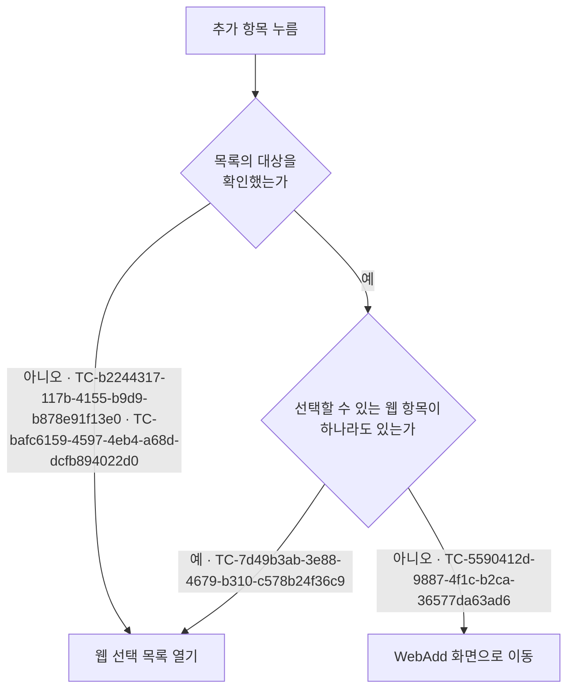

# 메모 웹 입력 컴포넌트 테스트 케이스

기준 스펙: [메모 웹 입력 컴포넌트 스펙](../spec/client/memo-web-input.md)

이 문서의 케이스는 MemoAdd 화면과 MemoDetail 화면에서 같은 결과로 판정된다. 사용자가 반영한 선택이 어디에 반영되는지는 [MemoAdd 테스트 케이스](./memo-add.md)와 [MemoDetail 테스트 케이스](./memo-detail.md)에서 다룬다.

검색어의 정규화와 일치 판정, 검색 결과 없음 판정은 [검색어 일치 판정 스펙](../spec/client/search-match.md)에 위임되어 있으며, 웹 선택 목록에서의 결과를 이 문서의 케이스로 덮는다. 아직 준비되지 않은 자리의 표시는 [페이지 조회 목록의 자리 표시 스펙](../spec/client/paged-list-placeholder.md)에 위임되어 있다.

케이스의 근거는 기준 스펙의 절이며, 그 규칙은 기준 스펙이 따르는 [메모 항목 선택 입력 공통 스펙](../spec/client/memo-entity-input.md)이 소유한다.

## feature

### TC-7d49b3ab-3e88-4679-b310-c578b24f36c9: 웹 선택 목록을 열면 목록에 나타나는 웹 항목이 표시된다

- 근거: `feature > 웹 선택 목록`
- Given: 선택할 수 있는 웹 항목이 있고 웹 선택 목록이 닫혀 있다.
- When: 사용자가 웹 입력의 추가 항목을 눌러 웹 선택 목록을 연다.
- Then: 목록에 나타나는 웹 항목과 각 웹 항목의 선택 여부가 표시된다.

### TC-eecef363-624e-475c-8e0b-7d02e5d3c91d: 웹 추가 항목이 웹 입력에 항상 표시된다

- 근거: `feature > 웹 선택 목록`
- Given: 선택한 웹 항목이 테스트 데이터와 같다.
- When: 사용자가 웹 입력을 확인한다.
- Then: 웹 입력에 추가 항목이 표시된다.
- 테스트 데이터:

| 선택한 웹 항목 |
| --- |
| 없음 |
| 웹 항목 여러 개 |

추가 항목을 눌렀을 때의 동작 판정은 다음 케이스가 나누어 덮는다.

### TC-5590412d-9887-4f1c-b2ca-36577da63ad6: 선택할 수 있는 웹 항목이 없는 것으로 확정되면 추가 항목이 WebAdd 이동을 요청한다

- 근거: `feature > 웹 추가 이동`, `domain > 추가 항목의 동작 판정`
- Given: 선택할 수 있는 웹 항목이 하나도 없는 것으로 확정되어 있다.
- When: 사용자가 웹 입력의 추가 항목을 누른다.
- Then: WebAdd 화면 이동이 한 번 요청되고 웹 선택 목록은 열리지 않는다.

### TC-0629cb7e-5a9f-43e8-a1a3-bdabfe84dafa: 목록을 연 적이 없어도 화면에 들어온 뒤 대상이 없다고 확인되면 첫 누름에 WebAdd 이동을 요청한다

- 근거: `domain > 추가 항목의 동작 판정`
- Given: 계정과 연결되고 삭제되지 않은 웹 항목이 하나도 저장되어 있지 않은 상태로 화면에 들어왔고, 웹 선택 목록을 한 번도 열지 않은 채 선택할 수 있는 웹 항목이 없다는 확인이 끝났다.
- When: 사용자가 추가 항목을 처음 누른다.
- Then: 웹 선택 목록이 열리지 않고 WebAdd 화면으로의 이동이 한 번 요청된다.

### TC-b2244317-117b-4155-b9d9-b878e91f13e0: 목록의 대상을 확인하는 중에는 추가 항목이 목록을 연다

- 근거: `domain > 추가 항목의 동작 판정`
- Given: 웹 선택 목록에 나타낼 웹 항목의 확인이 아직 끝나지 않도록 제어되어 있다.
- When: 사용자가 웹 입력의 추가 항목을 누른다.
- Then: 웹 선택 목록이 열리고 WebAdd 화면 이동은 요청되지 않는다.

### TC-bafc6159-4597-4eb4-a68d-dcfb894022d0: 목록의 대상을 처음 불러오지 못하면 추가 항목이 목록을 연다

- 근거: `domain > 추가 항목의 동작 판정`
- Given: 선택할 수 있는 웹 항목의 첫 조회가 실패하도록 제어되어 있고, 그 조회가 실패로 끝났다.
- When: 사용자가 웹 입력의 추가 항목을 누른다.
- Then: 웹 선택 목록이 열리고 WebAdd 화면으로의 이동이 요청되지 않는다.

### TC-43b72770-1f1d-4dfc-a7ce-c08c7a8a4c4c: 확인 중에 연 목록이 대상 없음으로 확정되면 목록 영역이 비어 있는 채로 유지된다

- 근거: `feature > 웹 선택 목록`
- Given: 대상 확인이 끝나지 않은 상태에서 웹 선택 목록을 열어 두었다.
- When: 선택할 수 있는 웹 항목이 없는 것으로 확정된다.
- Then: 목록 영역은 비어 있는 채로 유지되고 검색 결과 없음 안내는 표시되지 않는다.

### TC-25aecc3e-a2b4-4d61-a00d-7659dc8f2277: 웹 선택 목록에 웹 추가 항목이 항상 표시된다

- 근거: `feature > 웹 선택 목록`
- Given: 웹 선택 목록이 테스트 데이터의 상태로 열려 있다.
- When: 사용자가 목록을 확인한다.
- Then: 목록에 웹 추가 항목이 표시된다.
- 테스트 데이터:

| 목록 상태 |
| --- |
| 나타낼 웹 항목이 없음 |
| 웹 항목이 나타나 있음 |
| 검색어에 맞는 웹 항목이 없음 |

### TC-831b69ad-9b42-40fa-834e-ac184481a10b: 목록의 웹 추가 항목을 누르면 목록이 닫히고 WebAdd 이동이 요청된다

- 근거: `feature > 웹 선택 목록`, `feature > 웹 추가 이동`
- Given: 웹 선택 목록이 테스트 데이터의 상태로 열려 있다.
- When: 사용자가 목록의 웹 추가 항목을 누른다.
- Then: 목록이 닫히고 WebAdd 화면 이동이 한 번 요청되며 선택은 바뀌지 않는다.
- 테스트 데이터:

| 목록 상태 |
| --- |
| 나타낼 웹 항목이 없음 |
| 웹 항목이 나타나 있음 |

### TC-ba8ee5a5-89bc-4c15-8ab1-f5e4f488d8d2: WebAdd 화면에서 추가한 웹 항목이 돌아왔을 때 선택된다

- 근거: `feature > 웹 추가 이동`, `domain > 추가한 웹 항목의 자동 선택`
- Given: 이미 선택한 웹 항목이 있는 화면에서 WebAdd 화면으로 이동했다.
- When: 테스트 데이터의 웹 항목을 추가하고 웹 입력이 있는 화면으로 돌아온다.
- Then: 이동 전에 있던 선택이 유지된 채 추가한 웹 항목이 모두 선택으로 더해진다.
- 테스트 데이터:

| 추가한 웹 항목 수 |
| --- |
| 1개 |
| 여러 개 |

### TC-037c0c8d-7de6-409c-b346-a64b40772c2f: 웹 항목을 추가하지 않고 돌아오면 선택이 그대로 유지된다

- 근거: `feature > 웹 추가 이동`
- Given: 이미 선택한 웹 항목이 있는 화면에서 WebAdd 화면으로 이동했다.
- When: 웹 항목을 하나도 추가하지 않고 웹 입력이 있는 화면으로 돌아온다.
- Then: 선택한 웹 항목이 이동 전과 같다.

### TC-6558659d-5a97-4ce9-bf58-a25061bd3d24: WebAdd 화면에서 돌아와도 웹 선택 목록이 저절로 열리지 않는다

- 근거: `feature > 웹 추가 이동`
- Given: 웹 선택 목록에서 웹 추가로 이동해 목록이 닫힌 상태다.
- When: 웹 항목을 추가하고 웹 입력이 있는 화면으로 돌아온다.
- Then: 웹 선택 목록은 닫힌 상태로 유지되고, 추가 항목을 다시 누르면 추가한 웹 항목이 나타나는 목록이 열린다.

### TC-182019d3-4d24-47a9-bf9e-5c9eacb453aa: 목록에서 웹 항목을 선택하면 선택 상태로 표시된다

- 근거: `feature > 웹 선택과 해제`
- Given: 웹 선택 목록이 열려 있고 선택하지 않은 웹 항목이 나타나 있다.
- When: 사용자가 그 웹 항목을 누른다.
- Then: 그 웹 항목이 목록에서 선택 상태로 표시되고 웹 입력의 칩 영역에도 나타난다.

### TC-e6e37bb6-3f75-4339-bd54-49d403f22e5c: 목록에서 선택을 해제하면 선택 상태에서 제외된다

- 근거: `feature > 웹 선택과 해제`
- Given: 웹 선택 목록이 열려 있고 선택한 웹 항목이 나타나 있다.
- When: 사용자가 그 웹 항목을 누른다.
- Then: 그 웹 항목이 목록에서 선택되지 않은 상태로 표시되고 웹 입력의 칩 영역에서 사라진다.

### TC-8048ff1f-2f8e-4896-a3a8-0884453d5379: 한 번에 여러 웹 항목을 선택할 수 있다

- 근거: `feature > 웹 선택과 해제`
- Given: 웹 선택 목록이 열려 있고 선택하지 않은 웹 항목이 여러 개 나타나 있다.
- When: 사용자가 그 웹 항목을 차례로 누른다.
- Then: 누른 웹 항목이 모두 선택 상태로 표시되고, 뒤에 누른 선택이 앞서 누른 선택을 해제하지 않는다.

### TC-ba1c1bda-1357-4a6c-a004-437169008a5b: 목록을 닫아도 반영된 선택이 유지된다

- 근거: `feature > 웹 선택 목록`
- Given: 웹 선택 목록에서 웹 항목의 선택을 바꾸었다.
- When: 사용자가 목록을 닫는다.
- Then: 웹 입력에 목록에서 바꾼 선택이 그대로 표시된다.

### TC-607d6e71-a9e3-444b-8c0c-412b75730296: 선택한 웹 항목의 제목이 바뀌면 웹 입력에 반영된다

- 근거: `feature > 선택 상태 표시`
- Given: 선택한 웹 항목이 웹 입력에 표시되어 있다.
- When: 그 웹 항목의 제목이 다른 경로로 바뀐다.
- Then: 웹 입력에 바뀐 제목이 표시된다.

### TC-93954c1c-00de-4de6-8a0c-d51dd840051c: 웹 칩을 누르면 그 웹 항목의 WebDetail 화면으로 이동한다

- 근거: `feature > 웹 상세 이동`
- Given: 선택한 웹 항목이 웹 입력에 표시되어 있다.
- When: 사용자가 그 웹 칩을 누른다.
- Then: 그 웹 항목을 대상으로 하는 WebDetail 화면 이동이 한 번 요청된다.

### TC-3bbc00d3-1f10-4c09-9562-b978fd32b61b: 웹 칩을 눌러도 선택 상태와 웹 선택 목록은 바뀌지 않는다

- 근거: `feature > 웹 상세 이동`
- Given: 선택한 웹 항목이 웹 입력에 표시되어 있고 웹 선택 목록은 닫혀 있다.
- When: 사용자가 그 웹 칩을 누른다.
- Then: 그 웹 항목의 선택이 유지되고 웹 선택 목록은 열리지 않는다.

### TC-6a02d33d-a8e8-404d-a76c-dbca0caa4f11: 목록의 끝으로 이동하면 다음 웹 항목이 이어서 나타난다

- 근거: `feature > 웹 선택 목록`
- Given: 한 번에 다 나타나지 않는 수의 웹 항목이 선택할 수 있는 상태로 있고 목록이 열려 있다.
- When: 사용자가 목록의 끝으로 이동한다.
- Then: 정렬 순서의 다음 웹 항목이 이어서 나타난다.

### TC-158373bf-ebe6-4f46-b5e2-ffe112e98c73: 다음 웹 항목을 불러오는 동안에도 이미 나타난 웹 항목을 조작할 수 있다

- 근거: `feature > 웹 선택 목록`
- Given: 웹 선택 목록이 열려 있고 다음 웹 항목의 조회가 끝나지 않도록 제어되어 있다.
- When: 사용자가 이미 나타난 웹 항목을 누른다.
- Then: 그 웹 항목의 선택이 바뀌어 표시된다.

### TC-d420b3a9-86c5-4509-bf58-9010ded1dd10: 목록을 불러오지 못해도 이미 나타난 웹 항목을 유지한다

- 근거: `feature > 웹 선택 목록`
- Given: 웹 선택 목록에 웹 항목이 나타나 있고 다음 조회가 실패하도록 제어되어 있다.
- When: 사용자가 목록의 끝으로 이동한다.
- Then: 이미 나타난 웹 항목이 그대로 표시되고 오류 안내나 재시도 동작은 표시되지 않는다.

### TC-831b5827-f3a4-4326-9764-64f273bb4565: 검색어를 바꿔 다시 조회하다 실패하면 이전 웹 항목을 남기지 않는다

- 근거: `feature > 웹 선택 목록`
- Given: 선택 목록에 웹 항목이 나타나 있고 검색어를 바꾼 뒤의 조회가 실패하도록 제어되어 있다.
- When: 사용자가 검색어를 바꾼다.
- Then: 이전에 나타나 있던 웹 항목은 남지 않고 오류 안내나 재시도 동작이 표시되지 않는다.

### TC-085cb4bd-d3e7-4248-aa68-6236dcab4f31: 목록을 닫았다가 다시 열면 앞부분부터 나타난다

- 근거: `feature > 웹 선택 목록`
- Given: 웹 선택 목록을 열어 뒷부분까지 확인한 뒤 목록을 닫았다.
- When: 사용자가 웹 선택 목록을 다시 연다.
- Then: 목록이 정렬 순서의 앞부분부터 나타난다.

### TC-06d7e4b2-05a1-4790-9926-6b2dbf557467: 목록의 웹 항목을 눌러도 웹 상세로 이동하지 않는다

- 근거: `feature > 웹 선택 목록`
- Given: 웹 선택 목록이 열려 있고 웹 항목이 나타나 있다.
- When: 사용자가 목록의 웹 항목을 누른다.
- Then: 그 웹 항목의 선택 여부만 바뀌고 WebDetail 화면 이동은 요청되지 않는다.

### TC-3cea2c48-8bd7-42a0-8ae5-2e18d5f8751b: 목록을 열면 검색어가 비어 있고 대상 전체가 나타난다

- 근거: `feature > 웹 검색`
- Given: 선택할 수 있는 웹 항목이 여러 개 있고 웹 선택 목록이 닫혀 있다.
- When: 사용자가 웹 선택 목록을 연다.
- Then: 검색 입력이 비어 있고 목록의 대상 전체가 정렬 순서의 앞부분부터 나타난다.

### TC-824216fe-cbcf-406b-b265-c565b04ded11: 목록을 열면 검색어 입력에 초점이 놓인다

- 근거: `feature > 웹 검색`
- Given: 선택할 수 있는 웹 항목이 여러 개 있고 웹 선택 목록이 닫혀 있다.
- When: 사용자가 웹 선택 목록을 연다.
- Then: 검색어 입력이 입력 초점을 받아, 입력을 따로 누르지 않고 입력한 글자가 검색어 입력에 들어간다.

### TC-8417ef0c-392b-486e-9762-f62ebd749db9: 검색어를 입력하면 목록이 좁혀진다

- 근거: `feature > 웹 검색`
- Given: 웹 선택 목록이 열려 있고 제목이 서로 다른 웹 항목이 나타나 있다.
- When: 사용자가 일부 웹 항목의 제목만 만족하는 검색어를 입력한다.
- Then: 검색어를 만족하는 웹 항목만 목록에 나타나고 별도의 확정 동작 없이 반영된다.

### TC-e733afb8-b8db-4e03-ac5f-38b34230f194: 검색어를 지우면 대상 전체가 다시 나타난다

- 근거: `feature > 웹 검색`
- Given: 웹 선택 목록에 검색어를 입력해 목록이 좁혀져 있다.
- When: 사용자가 검색어를 모두 지운다.
- Then: 목록의 대상 전체가 다시 나타난다.

### TC-a7adfc30-cff3-4273-a3e8-97b5089cb52b: 검색으로 좁힌 목록에서도 선택과 해제를 바꿀 수 있다

- 근거: `feature > 웹 검색`
- Given: 웹 선택 목록에 검색어를 입력해 목록이 좁혀져 있다.
- When: 사용자가 좁혀진 목록의 웹 항목을 눌러 선택하고 다시 눌러 해제한다.
- Then: 선택과 해제가 반영되고 그 웹 항목은 검색어를 만족하는 동안 목록에 그대로 남는다.

### TC-a5eb1ba9-ea98-4269-be0e-e6b894138a85: 검색어에 맞는 웹 항목이 없으면 안내가 표시된다

- 근거: `feature > 웹 검색`
- Given: 웹 선택 목록이 열려 있고 웹 항목이 나타나 있다.
- When: 사용자가 어느 웹 항목도 만족하지 않는 검색어를 입력한다.
- Then: 목록 자리에 검색어에 맞는 웹 항목이 없으며 다른 검색어로 다시 찾을 수 있음을 알리는 안내가 표시된다.

### TC-78bb1ad9-88b2-49fd-81d4-ebb1c5ad4b68: 검색 결과가 없어도 웹 추가 항목으로 WebAdd 이동을 요청할 수 있다

- 근거: `feature > 웹 검색`
- Given: 검색어를 입력해 목록에 나타낼 웹 항목이 없는 상태다.
- When: 사용자가 목록의 웹 추가 항목을 누른다.
- Then: 목록이 닫히고 WebAdd 화면 이동이 한 번 요청된다.

### TC-e3b77205-ecb5-45c9-a9a0-c4b62cbbb9d7: 목록을 닫았다가 다시 열면 검색어가 비어 있다

- 근거: `feature > 웹 검색`
- Given: 웹 선택 목록에 검색어를 입력해 목록이 좁혀져 있다.
- When: 사용자가 목록을 닫고 다시 연다.
- Then: 검색 입력이 비어 있고 목록의 대상 전체가 다시 나타난다.

## domain

### TC-89d8de55-5bef-4789-a0b0-231ef02fe974: 선택할 수 있는 웹 항목은 계정과 연결된 삭제되지 않은 웹 항목이다

- 근거: `domain > 선택할 수 있는 웹 항목`
- Given: 테스트 데이터의 웹 항목이 저장되어 있다.
- When: 웹 선택 목록을 연다.
- Then: 테스트 데이터의 기대 결과대로 목록에 나타나거나 나타나지 않는다.
- 테스트 데이터:

| 웹 항목 상태 | 목록 노출 |
| --- | --- |
| 현재 계정과 연결, 삭제되지 않음 | 나타난다 |
| 현재 계정과 연결, 삭제됨 | 나타나지 않는다 |
| 다른 계정과만 연결, 삭제되지 않음 | 나타나지 않는다 |

### TC-901baeec-4bf8-43d0-b255-4713ee5c5b6f: 선택할 수 있는 웹 항목은 제목 오름차순으로 정렬된다

- 근거: `domain > 선택할 수 있는 웹 항목`
- Given: 제목이 서로 다른 웹 항목이 여러 개 저장되어 있다.
- When: 웹 선택 목록을 연다.
- Then: 목록이 제목 오름차순으로 나타난다.

### TC-d27cf2bd-2a8a-43db-9092-82493aae7bef: 웹 목록의 정렬 선택은 웹 선택 목록의 순서를 바꾸지 않는다

- 근거: `domain > 선택할 수 있는 웹 항목`
- Given: 사용자가 웹 목록에서 제목 오름차순이 아닌 정렬을 골라 두었다.
- When: 웹 선택 목록을 연다.
- Then: 웹 선택 목록은 제목 오름차순으로 나타난다.
- 작성하지 않는 이유: 사용자가 웹 목록에서 정렬을 고른 상태를 만들려면 웹 목록 화면을 거친 뒤 메모 화면의 웹 선택 목록을 열어야 해, 여러 화면을 통과하는 검증이 된다. 한 화면 안에서는 웹 목록에서 고른 정렬이라는 사전 상태를 만들 수 없다. 웹 선택 목록이 항상 제목 오름차순으로 나타난다는 결과는 `TC-901baeec-4bf8-43d0-b255-4713ee5c5b6f`로 검증한다. 여러 화면을 이어서 검증하는 테스트 환경이 갖춰지면 작성한다.

### TC-a5bb5bdd-231e-4510-b72e-b0e944ae0f0c: 선택할 수 있는 웹 항목 외에 목록에 나타나는 웹 항목은 없다

- 근거: `domain > 웹 선택 목록에 나타나는 웹 항목`
- Given: 선택한 웹 항목 가운데 삭제된 웹 항목이 있다.
- When: 웹 선택 목록을 연다.
- Then: 목록에는 선택할 수 있는 웹 항목만 나타나고 삭제된 웹 항목은 나타나지 않는다.

### TC-d7da1549-f6ff-4e53-a965-3b4d261080a5: 선택한 웹 항목이 삭제되면 선택에서 제외된 것으로 표시된다

- 근거: `domain > 선택한 것으로 표시하는 웹 항목`
- Given: 선택한 웹 항목이 웹 입력에 표시되어 있다.
- When: 그 웹 항목이 삭제된 상태로 바뀐다.
- Then: 그 웹 항목이 웹 입력의 칩 영역에서 사라진다.

### TC-6960fd0c-8e84-4220-9a04-2ed98fc35e59: 웹 입력의 웹 항목은 고른 순서와 관계없이 제목 오름차순으로 표시된다

- 근거: `domain > 선택한 것으로 표시하는 웹 항목`, `domain > 선택할 수 있는 웹 항목`
- Given: 제목이 서로 다른 웹 항목 여러 개가 있다.
- When: 사용자가 그 웹 항목들을 제목 오름차순이 아닌 순서로 골라 웹 입력에 표시한다.
- Then: 웹 입력에는 고른 순서가 아니라 제목 오름차순으로 웹 항목이 나타난다.

### TC-6172d90d-d0ed-43fc-8da6-bfc539ad4de3: 웹 항목이 복구되면 유지되어 있던 선택이 다시 나타난다

- 근거: `domain > 선택한 것으로 표시하는 웹 항목`
- Given: 선택이 유지된 채 삭제되어 웹 입력에서 빠진 웹 항목이 있다.
- When: 그 웹 항목이 삭제되지 않은 상태로 되돌아간다.
- Then: 그 웹 항목이 다시 선택한 것으로 웹 입력에 나타난다.

### TC-407982ab-e76f-45cd-9335-68d64ee24d34: 선택한 것으로 표시하는 웹 항목은 목록을 확인한 범위와 무관하다

- 근거: `domain > 선택한 것으로 표시하는 웹 항목`
- Given: 선택한 웹 항목이 웹 선택 목록의 뒷부분에 놓이는 정렬 순서를 갖는다.
- When: 사용자가 목록을 내려 보지 않고 웹 입력을 확인한다.
- Then: 그 웹 항목이 선택한 것으로 웹 입력에 나타난다.

### TC-970b49fd-805e-4068-96d4-009765bb586c: 앞뒤 공백만 있는 검색어는 목록을 좁히지 않는다

- 근거: `domain > 웹 검색어`
- Given: 웹 선택 목록이 열려 있고 웹 항목이 여러 개 나타나 있다.
- When: 사용자가 공백 문자만 입력한다.
- Then: 목록의 대상 전체가 그대로 나타나고 검색 결과 없음 안내는 표시되지 않는다.

### TC-47b094bf-6b6d-49a9-bc8b-432bff85c22c: 검색어는 선택한 웹 항목에도 같은 기준으로 적용된다

- 근거: `domain > 웹 검색어`
- Given: 선택한 웹 항목이 있고 웹 선택 목록이 열려 있다.
- When: 사용자가 그 웹 항목의 제목과 설명 어느 쪽도 만족하지 않는 검색어를 입력한다.
- Then: 그 웹 항목은 목록에서 빠지지만 선택은 그대로 유지된다.

### TC-ab0d8929-597d-4f30-a90d-5cf979c10608: 검색어는 웹 입력에 표시하는 웹 항목을 좁히지 않는다

- 근거: `domain > 웹 검색어`
- Given: 선택한 웹 항목이 웹 입력에 표시되어 있다.
- When: 사용자가 웹 선택 목록에 그 웹 항목을 만족하지 않는 검색어를 입력한다.
- Then: 웹 입력의 칩 영역에는 선택한 웹 항목이 그대로 표시된다.

### TC-cb025772-1b2e-4d59-809d-68784b8cc970: 화면이 회전해도 열려 있는 목록의 검색어와 좁힌 결과가 유지된다

- 근거: `domain > 웹 검색어`, `domain > 진행 상태 유지`
- Given: 웹 선택 목록이 열려 있고 일부 웹만 남도록 검색어가 입력되어 있다.
- When: 화면이 회전하거나 창 크기가 바뀐다.
- Then: 목록이 열린 채로 검색어와 그 검색어로 좁힌 결과가 그대로 유지된다.

### TC-a3b2c5f7-4665-46a0-af16-1126dc013c17: 메모리 정리 뒤 복원하면 검색어가 다시 나타나고 입력을 멈춘 뒤와 같게 반영된다

- 근거: [검색어 일치 판정 스펙의 검색어 반영 시점](../spec/client/search-match.md#검색어-반영-시점), `domain > 웹 검색어`, `domain > 진행 상태 유지`
- Given: 웹 선택 목록이 열려 있고 일부 웹만 남도록 검색어가 입력되어 있다.
- When: 시스템이 앱을 메모리에서 정리한 뒤 화면을 복원한다.
- Then: 목록이 다시 열리고 입력하던 검색어가 다시 나타난다. 입력 정지 대기 시간이 지나면 목록이 그 검색어로 좁힌 결과로 바뀐다.

### TC-4b7d7cd6-f4b7-4aef-8016-35bc0427b3a0: 자동 선택된 웹 항목의 선택을 해제하면 다시 선택되지 않는다

- 근거: `domain > 추가한 웹 항목의 자동 선택`
- Given: WebAdd 화면에서 추가한 웹 항목이 돌아온 뒤 자동 선택되었다.
- When: 사용자가 그 웹 항목의 선택을 해제한다.
- Then: 그 웹 항목은 선택되지 않은 상태로 유지되고 다시 자동 선택되지 않는다.

### TC-333a4d79-55b8-44d7-8de6-0439c80d048f: 이 입력에서 이동하지 않은 WebAdd 화면의 웹 항목은 자동 선택되지 않는다

- 근거: `domain > 추가한 웹 항목의 자동 선택`
- Given: 사용자가 이 웹 입력이 아닌 곳에서 WebAdd 화면을 열어 웹 항목을 추가했다.
- When: 사용자가 웹 입력이 있는 화면을 확인한다.
- Then: 추가한 웹 항목은 선택한 것으로 표시되지 않는다.

### TC-5b895ac6-09cd-437c-811b-d7bfbd3327d0: 상세 대상 메모가 바뀌면 열려 있던 목록과 검색어를 유지하지 않는다

- 근거: `domain > 진행 상태 유지`
- Given: MemoDetail 화면에서 웹 선택 목록이 열려 있고 검색어가 입력되어 있다.
- When: 상세 대상이 다른 메모로 바뀐다.
- Then: 웹 선택 목록이 닫히고 검색어가 남지 않으며, 웹 입력에는 새 대상 메모에 연결된 웹 항목이 표시된다.

### TC-500023fc-2d3f-40da-ab0e-9653e681213d: 검색어는 제목과 설명으로 판정한다

- 근거: `domain > 웹 검색어`
- Given: 테스트 데이터의 값만 검색어를 포함하는 웹 항목이 저장되어 있다.
- When: 웹 선택 목록에 그 검색어를 입력한다.
- Then: 테스트 데이터의 기대 결과대로 그 웹 항목이 목록에 나타나거나 나타나지 않는다.
- 테스트 데이터:

| 검색어를 포함하는 값 | 목록 노출 |
| --- | --- |
| 제목 | 나타난다 |
| 설명 | 나타난다 |
| URL | 나타나지 않는다 |
| 요청 헤더의 이름이나 값 | 나타나지 않는다 |

## data

### TC-2ff0fb38-aad4-48fe-8c2c-2ed28995761a: 웹 선택 목록을 나누어 불러온다

- 근거: `data > 웹 목록 조회`
- Given: 한 페이지에 담기지 않는 수의 웹 항목이 선택할 수 있는 상태로 저장되어 있다.
- When: 웹 선택 목록을 열고 목록의 끝으로 이동한다.
- Then: 처음에는 첫 페이지만 조회되고, 끝으로 이동한 뒤 다음 페이지가 이어서 조회된다.

### TC-cbea8474-b9be-474e-8d89-f156d3a97890: 선택 상태로 표시하는 웹 항목은 목록 조회와 분리해 조회한다

- 근거: `data > 웹 목록 조회`
- Given: 선택한 웹 항목이 있고 웹 선택 목록의 조회가 진행되지 않도록 제어되어 있다.
- When: 웹 입력을 확인한다.
- Then: 선택한 웹 항목이 칩 영역에 표시된다.

### TC-96152606-17bd-4fe8-93b7-6ccdbc6f759c: 검색어가 있으면 검색어를 만족하는 웹 항목만 조회한다

- 근거: `data > 웹 목록 조회`
- Given: 검색어를 만족하는 웹 항목과 만족하지 않는 웹 항목이 함께 저장되어 있다.
- When: 웹 선택 목록에 그 검색어를 입력한다.
- Then: 검색어를 만족하는 웹 항목만 조회 결과로 나타난다.

### TC-027e9d6f-0e02-4be7-9ec2-cf03b407ddc0: 검색어가 바뀌면 첫 페이지부터 다시 조회한다

- 근거: `data > 웹 목록 조회`
- Given: 웹 선택 목록에서 뒷부분까지 확인한 상태다.
- When: 사용자가 검색어를 바꾼다.
- Then: 새 검색어 기준으로 첫 페이지부터 다시 조회되어 목록이 정렬 순서의 앞부분부터 나타난다.

### TC-4c802fe3-ab30-4d77-85f9-ca5c61f79ecd: 저장된 웹 항목이 바뀌면 웹 입력과 웹 선택 목록에 함께 반영된다

- 근거: `data > 내용 갱신`
- Given: 선택한 웹 항목이 웹 입력에 표시되어 있고 웹 선택 목록이 열려 있다.
- When: 그 웹 항목의 제목이 바뀌거나 새 웹 항목이 추가된다.
- Then: 바뀐 내용이 웹 입력의 칩과 웹 선택 목록에 함께 나타난다.
