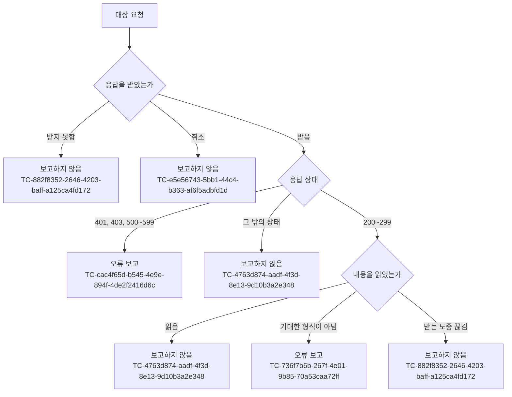

# 원격 응답 실패 보고 테스트 케이스

기준 스펙: [원격 응답 실패 보고 스펙](../spec/client/remote-response-failure-logging.md)

오류 보고 기록 수단이 오류 보고를 남기는 방식과 플랫폼 제약은 [앱 로깅 테스트 케이스](./app-logging.md)에서 다룬다. 생성 결과를 조각으로 받는 Gemini 요청에서 조각을 읽지 못한 경우는 [메모 Gemini 작성 도우미 테스트 케이스](./memo-gemini.md)에서 다룬다.

케이스의 Given에서 서버나 외부 서비스의 응답은 실제 네트워크 없이 제어한다.

## domain

### TC-cac4f65d-b545-4e9e-894f-4de2f2416d6c: 401, 403, 500번대 응답을 받으면 오류 보고가 한 번 남는다

- 근거: `domain > 보고하는 실패`
- Given: 오류 보고 기록 수단이 등록되어 있고, 대상 요청의 응답 상태가 테스트 데이터의 값이 되도록 제어되어 있다.
- When: 그 요청을 보낸다.
- Then: 오류 보고가 한 번 남는다.
- 테스트 데이터: `401`, `403`, `500`, `503`, `599`

### TC-4763d874-aadf-4f3d-8e13-9d10b3a2e348: 보고 기준에 맞지 않는 응답은 오류 보고를 남기지 않는다

- 근거: `domain > 보고하지 않는 경우`
- Given: 오류 보고 기록 수단이 등록되어 있고, 대상 요청의 응답이 테스트 데이터대로 제어되어 있다.
- When: 그 요청을 보낸다.
- Then: 오류 보고가 남지 않는다.
- 테스트 데이터:

| 응답 상태 | 응답 내용 |
| --- | --- |
| `200` | 기대한 형식 |
| `204` | 내용 없음 |
| `400` | 아무 내용 |
| `404` | 아무 내용 |
| `409` | 아무 내용 |
| `429` | 아무 내용 |
| `404` | 기대한 형식이 아닌 내용 |

### TC-736f7b6b-267f-4e01-9b85-70a53caa72ff: 성공 응답의 내용을 기대한 형식으로 읽지 못하면 오류 보고가 한 번 남는다

- 근거: `domain > 보고하는 실패`
- Given: 오류 보고 기록 수단이 등록되어 있고, 대상 요청이 성공 응답을 받으며 그 내용이 테스트 데이터대로 제어되어 있다.
- When: 그 요청의 응답 내용을 읽는다.
- Then: 요청은 내용을 읽지 못한 실패로 끝나고, 읽지 못한 이유를 담은 오류 보고가 한 번 남는다.
- 테스트 데이터:

| 응답 내용 |
| --- |
| 구조가 기대한 것과 다른 내용 |
| 기대하지 않은 종류의 내용 |

### TC-95e226d5-51c8-4e9f-aeec-5e83f3cfbf0f: 실패 응답의 내용을 읽지 못해도 응답 상태 기준의 보고 하나만 남는다

- 근거: `domain > 보고하지 않는 경우`
- Given: 오류 보고 기록 수단이 등록되어 있고, 대상 요청이 `500` 응답을 받으며 그 내용은 기대한 형식이 아니도록 제어되어 있다.
- When: 그 요청의 응답 내용을 읽는다.
- Then: 응답 상태 `500`을 담은 오류 보고가 한 번만 남는다.

### TC-882f8352-2646-4203-baff-a125ca4fd172: 응답을 받지 못하면 오류 보고를 남기지 않는다

- 근거: `domain > 보고하지 않는 경우`
- Given: 오류 보고 기록 수단이 등록되어 있고, 대상 요청이 테스트 데이터의 상황으로 끝나도록 제어되어 있다.
- When: 그 요청을 보낸다.
- Then: 요청은 실패로 끝나고 오류 보고는 남지 않는다.
- 테스트 데이터:

| 상황 |
| --- |
| 서버에 연결하지 못함 |
| 응답을 기다리다 시간이 초과됨 |
| 성공 응답의 내용을 받는 도중 연결이 끊김 |

### TC-e5e56743-5bb1-44c4-b363-af6f5adbfd1d: 요청이 취소되면 오류 보고를 남기지 않는다

- 근거: `domain > 보고하지 않는 경우`
- Given: 오류 보고 기록 수단이 등록되어 있고, 대상 요청의 응답이 오지 않고 대기하도록 제어되어 있다.
- When: 진행 중인 요청을 취소한다.
- Then: 오류 보고가 남지 않는다.

### TC-a03f08d5-1c4f-4bf2-bcf0-c166ec3f0baa: 앱 기능이 보내는 요청은 모두 대상이다

- 근거: `domain > 대상 요청`
- Given: 오류 보고 기록 수단이 등록되어 있고, 테스트 데이터의 요청이 `500` 응답을 받도록 제어되어 있다.
- When: 그 요청을 보낸다.
- Then: 오류 보고가 한 번 남는다.
- 테스트 데이터: Diary 서버 요청, Gemini 요청, Google 장소 검색 요청, 네이버 장소 검색 요청, 날씨 요청, 공휴일·음력 요청, 위치 추정 요청, YouTube 영상 정보 요청, 보관한 파일의 내용을 내려받는 요청

### TC-39709ef2-65e5-4345-92be-878e6c8f587c: 웹 링크의 페이지 정보를 가져오는 요청은 대상이 아니다

- 근거: `domain > 대상 요청`
- Given: 오류 보고 기록 수단이 등록되어 있고, 웹 링크의 페이지 정보를 가져오는 요청이 테스트 데이터의 응답 상태를 받도록 제어되어 있다.
- When: 그 요청을 보낸다.
- Then: 오류 보고가 남지 않는다.
- 테스트 데이터: `401`, `403`, `500`

### TC-c0ff44d9-68fa-447b-b287-af5279e0260b: iOS에서 파일을 올리는 요청은 대상이 아니다

- 근거: `domain > 대상 요청`
- Given: iOS에서 오류 보고 기록 수단이 등록되어 있고, 파일을 올리는 요청이 테스트 데이터의 응답 상태를 받는다.
- When: 파일을 올린다.
- Then: 오류 보고가 남지 않는다.
- 테스트 데이터: `401`, `403`, `500`
- 작성하지 않는 이유: iOS에서는 운영체제가 앱 대신 올리기를 이어서 진행하므로 앱이 응답을 직접 받지 않고, 그 응답을 제어하려면 iOS에서 실제로 올리기를 실행해야 한다. 현재 유닛 테스트 환경은 데스크톱 앱과 Android 호스트 환경에서만 실행하므로, iOS 실행 환경에서 올리기 요청의 응답을 제어할 수 있게 되면 자동화한다.

### TC-64c1ccc1-96ed-40db-a9d7-35e593b4e1fc: 이미지를 표시하기 위해 내려받는 요청은 대상이 아니다

- 근거: `domain > 대상 요청`
- Given: 오류 보고 기록 수단이 등록되어 있고, 표시할 이미지의 주소가 `500` 응답을 돌려준다.
- When: 화면이 그 이미지를 표시하려고 내려받는다.
- Then: 오류 보고가 남지 않는다.
- 작성하지 않는 이유: 이미지는 화면이 이미지를 그릴 때 플랫폼의 이미지 표시 수단이 직접 내려받으므로, 실제 화면 그리기 없이는 그 요청의 응답을 제어할 수 없다. 이미지 표시 수단의 요청 경로를 테스트에서 바꿔 끼울 수 있어야 자동화할 수 있다.

### TC-c8c0bb6b-0a6e-4e54-8c79-aaf8cd688a3f: 보고에는 요청 방식, 서버 이름, 주소 경로, 응답 상태가 담긴다

- 근거: `domain > 보고 내용`
- Given: 오류 보고 기록 수단이 등록되어 있고, 검색 조건이 붙은 주소로 내용을 담아 보내는 요청이 내용을 담은 `503` 응답을 받도록 제어되어 있다.
- When: 그 요청을 보낸다.
- Then: 남은 오류 보고에 요청 방식, 서버 이름, 주소 경로, 응답 상태 `503`이 담기고, 주소의 검색 조건, 요청에 담아 보낸 내용, 응답 내용은 어디에도 나타나지 않는다.

### TC-c0362129-f138-4b9e-b2a1-66c8da9ef22f: 파일 내용을 내려받는 요청의 보고에는 주소 경로 없이 서버 이름만 담긴다

- 근거: `domain > 보고 내용`
- Given: 오류 보고 기록 수단이 등록되어 있고, 보관한 파일의 내용을 내려받는 요청이 `403` 응답을 받도록 제어되어 있다.
- When: 그 요청을 보낸다.
- Then: 남은 오류 보고에 요청 방식, 서버 이름, 응답 상태 `403`이 담기고, 주소 경로와 검색 조건은 나타나지 않는다.

### TC-07746aa2-d200-46dd-8436-fb64ed1b3c18: 요청 방식, 서버 이름, 주소 경로가 같은 보고만 같은 오류로 묶인다

- 근거: `domain > 보고 묶음`
- Given: 오류 보고 기록 수단이 등록되어 있고, 두 요청이 테스트 데이터처럼 다르며 모두 보고 기준에 맞는 응답을 받도록 제어되어 있다.
- When: 두 요청을 차례로 보낸다.
- Then: 두 오류 보고가 테스트 데이터의 결과대로 같은 오류로 묶이거나 서로 다른 오류로 구분된다.
- 테스트 데이터:

| 두 요청의 차이 | 결과 |
| --- | --- |
| 응답 상태만 다름(`401`, `500`) | 같은 오류 |
| 주소의 검색 조건만 다름 | 같은 오류 |
| 성공 응답의 내용을 읽지 못한 것과 `500` 응답 | 같은 오류 |
| 요청 방식이 다름 | 다른 오류 |
| 서버 이름이 다름 | 다른 오류 |
| 주소 경로가 다름 | 다른 오류 |

### TC-11116101-46d7-47d6-af90-68fd1130b4f6: 보고를 남겨도 요청의 결과는 바뀌지 않는다

- 근거: `domain > 기능 결과와의 관계`
- Given: 오류 보고 기록 수단이 등록되어 있고, 대상 요청이 테스트 데이터의 응답을 받도록 제어되어 있다.
- When: 그 요청을 보낸다.
- Then: 요청을 보낸 쪽은 오류 보고 기록 수단이 등록되지 않았을 때와 같은 응답 상태와 같은 결과를 받는다.
- 테스트 데이터: `500` 응답을 받는 요청, 성공 응답의 내용을 읽지 못하는 요청

### TC-a750cb56-7ff8-46b9-9224-862a1d1a164c: 같은 요청을 다시 보내면 보고 기준에 맞는 응답마다 보고가 남는다

- 근거: `domain > 기능 결과와의 관계`
- Given: 오류 보고 기록 수단이 등록되어 있고, 대상 요청이 매번 `500` 응답을 받도록 제어되어 있다.
- When: 같은 요청을 두 번 보낸다.
- Then: 오류 보고가 두 번 남는다.

### TC-977627ab-1bec-4d4d-beaa-8315ef91156c: 오류 보고 대상인 기능이 요청의 실패로 함께 실패하면 두 보고가 모두 남는다

- 근거: `domain > 기능 결과와의 관계`
- Given: 오류 보고 기록 수단이 등록되어 있고, 오류 보고 대상인 기능이 보내는 대상 요청이 `500` 응답을 받도록 제어되어 있다.
- When: 그 기능을 실행한다.
- Then: 기능이 실패하고, 원격 응답 실패 보고와 기능 실패의 오류 보고가 각각 남는다.
- 작성하지 않는 이유: 요청에 붙는 보고 수단과 오류 보고 대상인 기능이 서로 다른 모듈에서 구성되어, 실제 요청 구성과 기능을 함께 연결해 응답만 제어하는 실행 환경이 현재 없다. 각 보고가 따로 남는 것은 [기능 실패 로깅 테스트 케이스](./usecase-failure-logging.md)와 이 문서의 위 케이스가 각각 확인한다. 앱의 요청 구성과 오류 보고 대상 기능을 함께 연결하고 응답을 제어할 수 있는 통합 테스트 환경이 갖춰지면 자동화한다.
