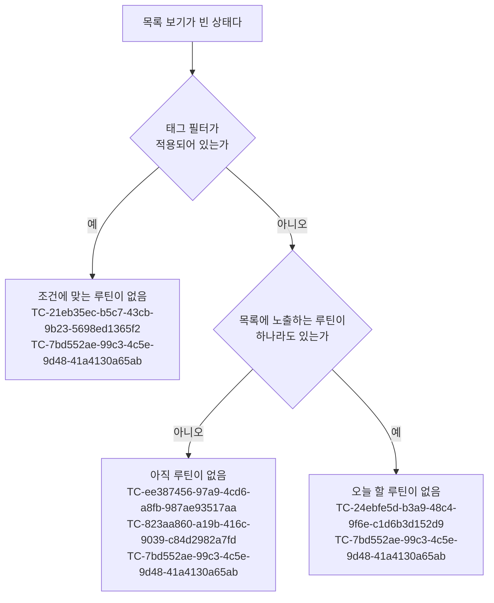

# RoutineHome 테스트 케이스

기준 스펙: [RoutineHome 화면 스펙](../spec/client/routine-home.md)

목록 보기의 목록 표시, 갱신과 조회, 추가·상세로 이동, 삭제와 실행 취소는 [항목 목록 화면 공통 스펙](../spec/client/entity-home.md)에, 달력 보기의 달 표시와 이동, 오늘 강조, 공휴일은 [CalendarHome 스펙](../spec/client/calendar-home.md)에, 달력에 표시할 루틴 기록의 기준은 [캘린더 루틴 기록 표시 스펙](../spec/client/calendar-routine.md)에, 태그 필터의 선택 방식과 판정은 [태그 필터 스펙](../spec/client/tag-filter.md)에, 필터를 열고 바꾼 결과와 선택 유지는 [목록 필터 반영 스펙](../spec/client/list-filter.md)에, 빈 상태는 [목록 빈 상태 스펙](../spec/client/list-empty-state.md)에, 자리 표시는 [페이지 조회 목록의 자리 표시 스펙](../spec/client/paged-list-placeholder.md)에, 새로고침은 [새로고침 스펙](../spec/client/sync-refresh.md)에, 추가 단축키는 [목록 추가 단축키 스펙](../spec/client/list-add-shortcut.md)에, 카드의 완료·삭제 상호작용과 안내는 [SwipeToFinishAndDelete 컴포넌트 스펙](../spec/client/swipe-to-finish-and-delete.md)에 위임된 규칙을 이 화면에 적용한 결과를 이 문서가 확인한다. 케이스의 `근거`는 위임한 RoutineHome 화면 스펙의 절을 가리키고, 공통 스펙의 절을 직접 가리킬 때만 그 문서를 링크한다.

시스템이 앱을 정리했다가 다시 만든 뒤 보던 목록 위치가 복원되는 결과와, 완료 안내나 삭제 안내가 보이는 동안 화면이 재생성되거나 앱이 백그라운드에 다녀오는 결과는 [MemoHome 테스트 케이스](./memo-home.md)가 대표로 확인한다. 이 화면에만 있는 기록 안내의 같은 경계는 이 문서가 확인한다. 카드 문구, 진행 상태와 합계의 계산 규칙은 [루틴 테스트 케이스](./routine.md)가, 캘린더 루틴 기록의 노출 기준과 정렬은 [캘린더 루틴 기록 표시 테스트 케이스](./calendar-routine.md)가, 공통 내비게이션에서 `루틴` 목적지로 이동하고 다시 선택하는 케이스는 [TopLevelNavigation 테스트 케이스](./top-level-navigation.md)가, 루틴 추가 화면의 입력 케이스는 [RoutineAdd 테스트 케이스](./routine-add.md)가, 상세에서 기록을 넣고 빼거나 루틴을 완료하고 다시 시작하는 케이스는 [RoutineDetail 테스트 케이스](./routine-detail.md)가, 완료된 루틴 목록의 내용과 행동은 [RoutineFinishedList 테스트 케이스](./routine-finished-list.md)가, 목록과 상세를 함께 사용하는 배치는 [Routine 목록·상세 배치 테스트 케이스](./routine-list-detail.md)가, 화면과 무관한 새로고침 공통 규칙은 [새로고침 테스트 케이스](./sync-refresh.md)가 확인한다.

카드 문구는 [루틴 앱 스펙](../spec/client/routine.md)의 `카드 문구`가 정한 한국어 문구를, 그 밖에 화면에 보이는 문구와 접근성 이름은 [RoutineHome 화면 디자인](../design/routine-home.md)이 정한 문구를 기대 결과로 쓴다. 특별히 밝히지 않으면 사용자 언어는 한국어이고, 2026년 7월은 1일이 수요일이며 달력은 6월 28일 일요일부터 8월 8일 토요일까지 여섯 주를 보여 준다. 2026년 7월 10일은 금요일, 11일은 토요일, 12일은 일요일, 13일은 월요일, 15일은 수요일이다.

특별히 밝히지 않으면 루틴은 주기가 `매일`이고 완료되지 않았으며, 보기 범위는 처음 상태인 `오늘 할 루틴`이고 선택한 태그가 없다. 보기 범위의 `오늘 할 루틴` 판정 규칙 자체는 [루틴 테스트 케이스](./routine.md)가 확인하고, 이 문서는 그 판정으로 목록을 좁힌 결과를 확인한다.

## feature

### TC-2d2e308a-e22c-4c4d-a9e3-77ccf9a7b55e: RoutineHome에 진입하면 목록 보기로 시작한다

- 근거: `feature > 진입`, `domain > 보기`
- Given: 현재 계정에 기록이 있는 루틴이 하나 있다.
- When: 사용자가 공통 내비게이션에서 `루틴` 목적지를 선택해 RoutineHome 화면에 진입한다.
- Then: 루틴 목록이 표시되고 달력은 표시되지 않는다.

### TC-62584258-fa41-4786-bd31-63fdb8274aff: 보기에 따라 화면에 두는 내용이 정해진다

- 근거: `feature > 화면 내용`, `domain > 보기`
- Given: 현재 계정에 루틴이 하나 있고 RoutineHome 화면이 테스트 데이터의 보기로 표시되어 있다.
- When: 사용자가 화면을 확인한다.
- Then: 보기 전환, 필터 열기와 루틴 추가는 두 보기 모두에 있고, 그 밖의 내용은 테스트 데이터와 같다.
- 테스트 데이터:

  | 보기 | 있는 것 | 없는 것 |
  | --- | --- | --- |
  | 목록 보기 | 루틴 목록, 완료된 루틴 확인 | 달력, 표시 중인 달 안내, 달 선택, 오늘이 속한 달로 이동 |
  | 달력 보기 | 달력, 표시 중인 달 안내, 달 선택, 오늘이 속한 달로 이동 | 루틴 목록, 완료된 루틴 확인 |

### TC-f31da5cf-f257-4492-a505-648d6782ddd8: 보기 전환을 실행하면 목록 보기와 달력 보기가 서로 바뀐다

- 근거: `feature > 보기 전환`, `domain > 보기`
- Given: RoutineHome 화면이 목록 보기로 표시되어 있다.
- When: 사용자가 보기 전환을 실행한 뒤 한 번 더 실행한다.
- Then: 처음 실행하면 루틴 목록 대신 달력이 표시되고, 다시 실행하면 달력 대신 루틴 목록이 표시된다. 두 보기가 동시에 표시되는 때는 없다.

### TC-f9000c81-6ac1-4558-add1-53bbfc9b46fd: 보기 전환은 목록의 내용, 필터 선택, 새로고침 진행과 무관하게 실행할 수 있다

- 근거: `feature > 보기 전환`
- Given: RoutineHome 화면이 목록 보기에서 테스트 데이터의 상태로 표시되어 있다.
- When: 사용자가 보기 전환을 실행한다.
- Then: 달력 보기로 바뀐다.
- 테스트 데이터:

  | 상태 |
  | --- |
  | 루틴이 표시되어 있음 |
  | 목록을 준비하는 중임 |
  | 빈 상태 안내가 표시되어 있음 |
  | 태그 필터를 적용해 둠 |
  | 새로고침이 진행 중임 |

### TC-e17b89a4-fb7e-47ef-9c84-149ceb9fa9ba: 달력 보기에서 목록 보기에 다녀와도 보던 달을 그대로 본다

- 근거: `feature > 보기 전환`, `domain > 보기의 유지`
- Given: 오늘이 2026-07-15이고, 사용자가 달력 보기에서 2026년 9월로 이동해 보고 있다.
- When: 사용자가 목록 보기로 바꿨다가 다시 달력 보기로 바꾼다.
- Then: 달력과 표시 중인 달 안내가 2026년 9월을 보여 준다.

### TC-2929c198-238d-48ae-b5ea-00368b8c2691: 계정에 저장된 루틴을 제목과 카드 문구로 표시한다

- 근거: `feature > 루틴 목록`, `domain > 오늘 기준`
- Given: 오늘이 2026-07-15 수요일이고, 현재 계정에 테스트 데이터의 루틴이 모두 진행 중인 상태로 있다.
- When: RoutineHome 화면이 목록 보기로 표시된다.
- Then: 루틴이 모두 목록에 나타나고, 각 카드에 제목과 테스트 데이터의 카드 문구가 함께 표시된다.
- 테스트 데이터:

  | 제목 | 주기 | 단위 | 목표량 | 삭제되지 않은 기록 | 카드 문구 |
  | --- | --- | --- | --- | --- | --- |
  | `물 마시기` | 매일 | ml | 2000 | 7월 15일 1000, 7월 15일 500, 7월 14일 2000 | `오늘 1500 / 2000ml`와 `75%` |
  | `운동` | 매주 | 회 | 3 | 7월 12일 1, 7월 14일 1, 7월 11일 1 | `이번 주 2 / 3회`와 `66%` |
  | `달리기` | 매월 | m | 없음 | 7월 1일 5000, 7월 10일 7000, 6월 30일 3000 | `이번 달 12000m` |
  | `독서` | 매일 | 회 | 없음 | 없음 | `오늘 0회` |

### TC-7b58f05e-7964-4d3f-86ce-9ce1f7555211: 루틴 카드에는 제목과 카드 문구, 빠른 기록 외의 내용을 표시하지 않는다

- 근거: `feature > 루틴 목록`
- Given: 현재 계정에 설명이 있고 한 번에 기록할 양이 250이며 태그 하나와 연결된 진행 중인 루틴이 있다.
- When: RoutineHome 화면이 목록 보기로 표시된다.
- Then: 그 카드에 보이는 글은 제목과 카드 문구뿐이며, 설명, 시작 날짜, 한 번에 기록할 양과 연결한 태그는 표시되지 않는다.

### TC-9383140e-a812-4260-96fd-b553d7b3bf60: 진행 중인 루틴의 카드에만 빠른 기록을 제공한다

- 근거: `feature > 루틴 목록`
- Given: 오늘이 2026-07-15이고, 현재 계정에 테스트 데이터의 루틴이 있으며 보기 범위가 `모든 루틴`이다.
- When: RoutineHome 화면이 목록 보기로 표시된다.
- Then: 각 카드가 테스트 데이터대로 빠른 기록을 제공하거나 제공하지 않는다.
- 테스트 데이터:

  | 시작 날짜 | 진행 상태 | 빠른 기록 |
  | --- | --- | --- |
  | 2026-07-01 | 진행 중 | 제공한다 |
  | 2026-07-15 | 진행 중 | 제공한다 |
  | 2026-07-16 | 시작 전 | 제공하지 않는다 |

### TC-2357de08-5442-4b44-8b3d-3cade4e361a2: 보기 범위가 `모든 루틴`이면 시작 전인 루틴도 목록에 카드 문구와 함께 남는다

- 근거: `feature > 루틴 목록`, `domain > 목록에 노출하는 루틴`
- Given: 오늘이 2026-07-15이고, 현재 계정에 시작 날짜가 2026-07-16이며 완료되지 않은 루틴이 있고, 보기 범위가 `모든 루틴`이다.
- When: RoutineHome 화면이 목록 보기로 표시된다.
- Then: 그 루틴이 목록에 나타나고, 카드에는 `시작 전`이 표시되며 합계와 달성률은 표시되지 않는다.

### TC-d243e034-7dbe-4b36-9f81-bfc258a14528: 완료된 루틴은 목록에 보이지 않는다

- 근거: `feature > 루틴 목록`
- Given: 오늘이 2026-07-15이고, 현재 계정에 완료되지 않은 진행 중인 루틴 `가`와 완료된 루틴 `나`가 있다.
- When: RoutineHome 화면이 목록 보기로 표시된다.
- Then: 목록에 `가`의 카드만 표시되고, `나`의 카드와 `완료` 문구는 표시되지 않는다.

### TC-bf4a3569-a8c2-4aeb-95d1-c2b958a9b7c4: 루틴을 추가하면 목록에 나타난다

- 근거: `feature > 루틴 목록`
- Given: RoutineHome 화면에 루틴 목록이 표시되어 있고 태그 필터를 적용하지 않았다.
- When: 현재 계정의 진행 중인 루틴이 새로 저장된다.
- Then: 별도 조작 없이 그 루틴이 목록 정렬에 맞는 자리에 카드 문구와 함께 나타난다.

### TC-917f0e47-5ab0-4af8-b720-1238223135e9: 목록의 루틴을 선택하면 그 루틴의 RoutineDetail 화면으로 이동한다

- 근거: `feature > 루틴 목록`
- Given: 목록과 상세를 함께 사용할 수 없는 환경에서 RoutineHome 목록에 루틴이 하나 이상 표시되어 있다.
- When: 사용자가 목록의 루틴 하나를 선택한다.
- Then: 선택한 그 루틴의 RoutineDetail 화면으로 이동하는 동작이 한 번 실행된다.

### TC-a8d83f9c-fb51-4ce1-8cfa-8e6448ca1961: 빠른 기록을 누르거나 길게 눌러도 상세로 이동하지 않는다

- 근거: `feature > 루틴 목록`
- Given: RoutineHome 목록에 진행 중인 루틴이 표시되어 있다.
- When: 사용자가 그 카드의 빠른 기록에 테스트 데이터의 조작을 한다.
- Then: RoutineDetail 화면으로 이동하는 동작이 실행되지 않는다.
- 테스트 데이터:

  | 조작 |
  | --- |
  | 누른다 |
  | 길게 누른다 |

### TC-e0b883bd-d3aa-453f-ba8f-f2524cc2f3d4: 아직 준비되지 않은 자리는 선택해도 이동하지 않는다

- 근거: `feature > 루틴 목록`
- Given: RoutineHome 목록에 아직 준비되지 않은 자리가 표시되어 있다.
- When: 사용자가 그 자리를 선택한다.
- Then: RoutineDetail 화면으로 이동하는 동작이 실행되지 않는다.

### TC-7256771b-8298-416e-a3a1-851c8dcdbaf2: 상세에서 루틴을 완료한 뒤 돌아오면 그 루틴이 목록에서 사라져 있다

- 근거: `feature > 루틴 목록`
- Given: 목록과 상세를 함께 사용할 수 없는 환경에서 RoutineHome 목록에 루틴 `가`와 `나`가 표시되어 있고, 사용자가 `나`를 선택해 RoutineDetail 화면에 들어와 있다.
- When: 사용자가 상세에서 `나`를 완료한 뒤 뒤로가기로 RoutineHome에 돌아온다.
- Then: 목록 보기에 `가`만 표시되고 `나`는 표시되지 않는다.

### TC-049a798b-fd5a-4713-bbe2-899bef51c34e: 처음 상태에서는 완료되지 않은 루틴 가운데 오늘 할 루틴만 목록에 보인다

- 근거: `feature > 루틴 목록`, `feature > 보기 범위`, `domain > 보기 범위 기준`
- Given: 오늘이 2026-07-15 수요일이고, 현재 계정에 테스트 데이터의 루틴이 있으며, 사용자는 보기 범위를 한 번도 바꾸지 않았다.
- When: RoutineHome 화면이 목록 보기로 표시된다.
- Then: 목록에 `가`, `나`, `라`, `마`만 이 순서로 표시되고 나머지 루틴은 표시되지 않는다.
- 테스트 데이터:

  | 제목 | 주기 | 시작 날짜 | 완료 여부 | 목록 | 비고 |
  | --- | --- | --- | --- | --- | --- |
  | `가` | `매일` | 2026-07-01 | 완료되지 않음 | 보인다 | |
  | `나` | `평일만` | 2026-07-01 | 완료되지 않음 | 보인다 | 수요일은 하는 요일 |
  | `다` | `주말만` | 2026-07-01 | 완료되지 않음 | 보이지 않는다 | 수요일은 하는 요일이 아님 |
  | `라` | `매주` | 2026-07-01 | 완료되지 않음 | 보인다 | |
  | `마` | `매월` | 2026-07-15 | 완료되지 않음 | 보인다 | 오늘 시작 |
  | `바` | `매일` | 2026-07-16 | 완료되지 않음 | 보이지 않는다 | 시작 전 |
  | `사` | `평일만` | 2026-07-16 | 완료되지 않음 | 보이지 않는다 | 하는 요일이지만 시작 전 |
  | `아` | `매일` | 2026-07-01 | 완료됨 | 보이지 않는다 | 완료된 루틴 |

### TC-a747891d-2da5-46e2-8422-93afd70d71b9: `평일만`과 `주말만` 루틴의 카드는 `매일` 루틴과 같은 문구와 빠른 기록을 보여 준다

- 근거: `feature > 루틴 목록`
- Given: 완료되지 않았고 시작 날짜가 2026-07-01인 루틴의 주기, 단위, 목표량과 기록이 테스트 데이터와 같고, 오늘이 테스트 데이터와 같다.
- When: RoutineHome 화면이 목록 보기로 표시된다.
- Then: 그 루틴의 카드에 테스트 데이터의 카드 문구와 빠른 기록이 표시된다.
- 테스트 데이터:

  | 주기 | 오늘 | 단위 | 목표량 | 삭제되지 않은 기록 | 카드 문구 |
  | --- | --- | --- | --- | --- | --- |
  | `평일만` | 2026-07-10(금) | 쪽 | 20 | 7월 10일 15 | `오늘 15 / 20쪽`과 `75%` |
  | `평일만` | 2026-07-13(월) | 쪽 | 20 | 7월 10일 20 | `오늘 0 / 20쪽`과 `0%` |
  | `주말만` | 2026-07-11(토) | 회 | 없음 | 7월 11일 1 | `오늘 1회` |
  | `주말만` | 2026-07-12(일) | 회 | 없음 | 7월 11일 1 | `오늘 0회` |

### TC-92d3f5ec-33b9-44b6-8e1b-9bbc36e9cd4a: 보기 범위가 `모든 루틴`이면 오늘의 요일이 하는 요일에 들지 않는 루틴도 같은 카드 문구와 빠른 기록으로 보인다

- 근거: `feature > 루틴 목록`, `domain > 보기 범위 기준`
- Given: 보기 범위가 `모든 루틴`이고, 완료되지 않았고 시작 날짜가 2026-07-01이며 단위 쪽, 목표량 20에 기록이 없는 루틴의 주기와 오늘이 테스트 데이터와 같다.
- When: RoutineHome 화면이 목록 보기로 표시된다.
- Then: 모든 행에서 그 루틴의 카드가 목록에 보이고, 카드 문구는 `오늘 0 / 20쪽`과 `0%`이며 빠른 기록이 제공된다. 하는 요일이 아님을 알리는 문구는 없다.
- 테스트 데이터:

  | 주기 | 오늘 | 비고 |
  | --- | --- | --- |
  | `평일만` | 2026-07-11(토) | 하는 요일이 아님 |
  | `평일만` | 2026-07-12(일) | 하는 요일이 아님 |
  | `주말만` | 2026-07-15(수) | 하는 요일이 아님 |
  | `평일만` | 2026-07-15(수) | 하는 요일 |

### TC-abf5e756-2eba-4d3c-91bb-bf5ff87dac3f: 오늘의 요일이 하는 요일에 들지 않는 날에도 빠른 기록으로 오늘의 기록을 넣는다

- 근거: `feature > 빠른 기록`, `feature > 양을 입력해 기록`, `feature > 루틴 목록`
- Given: 오늘이 2026-07-11 토요일이고 보기 범위가 `모든 루틴`이며, 주기 `평일만`, 단위 쪽, 목표량 20, 한 번에 기록할 양 5인 진행 중인 루틴 `독서`의 카드에 `오늘 0 / 20쪽`과 `0%`가 표시되어 있고 기록 저장이 성공하도록 설정되어 있다.
- When: 사용자가 테스트 데이터의 방법으로 기록을 넣는다.
- Then: 그 루틴에 날짜 2026-07-11, 테스트 데이터의 양인 기록 하나가 저장되고, 카드 문구가 테스트 데이터와 같이 바뀌며 그 카드는 목록에 그대로 남는다.
- 테스트 데이터:

  | 기록을 넣는 방법 | 기록의 양 | 카드 문구 |
  | --- | --- | --- |
  | 빠른 기록을 누른다 | 5 | `오늘 5 / 20쪽`과 `25%` |
  | 빠른 기록을 길게 눌러 연 양 입력 창에서 양을 `10`으로 고쳐 확인한다 | 10 | `오늘 10 / 20쪽`과 `50%` |

### TC-9b897c89-a9df-46f1-ac07-e2c8a54dc8b1: 단위가 비어 있는 루틴은 카드 문구와 기록 안내의 양을 숫자만으로 보여 준다

- 근거: `feature > 루틴 목록`, `feature > 빠른 기록`
- Given: 오늘이 2026-07-15이고, 단위가 비어 있고 한 번에 기록할 양이 1인 진행 중인 루틴 `운동`의 목표량과 오늘 기록의 합계가 테스트 데이터와 같으며 기록 저장이 성공하도록 설정되어 있다.
- When: RoutineHome 화면이 목록 보기로 표시된 뒤 사용자가 그 카드의 빠른 기록을 누른다.
- Then: 처음에는 테스트 데이터의 기록 전 카드 문구가 표시되고, 빠른 기록을 누르면 카드 문구가 기록 뒤 문구로 바뀌며 `운동 1 기록` 안내가 표시된다.
- 테스트 데이터:

  | 목표량 | 오늘 기록의 합계 | 기록 전 카드 문구 | 기록 뒤 카드 문구 |
  | --- | --- | --- | --- |
  | 3 | 2 | `오늘 2 / 3`과 `66%` | `오늘 3 / 3`과 `100%` |
  | 없음 | 0 | `오늘 0` | `오늘 1` |

### TC-240ed16d-72da-4867-b62a-6a28da5b6a08: 빠른 기록을 누르면 되묻지 않고 한 번에 기록할 양이 오늘 기록으로 저장되고 카드 문구가 바뀐다

- 근거: `feature > 빠른 기록`
- Given: 오늘이 2026-07-15이고, 주기 매일, 단위 ml, 목표량 2000, 한 번에 기록할 양 250인 진행 중인 루틴 `물 마시기`의 카드에 `오늘 1500 / 2000ml`와 `75%`가 표시되어 있으며 기록 저장이 성공하도록 설정되어 있다.
- When: 사용자가 그 카드의 빠른 기록을 누른다.
- Then: 확인을 되묻거나 양을 입력받지 않고 그 루틴에 날짜 2026-07-15, 양 250인 기록 하나가 저장되며, 카드 문구가 `오늘 1750 / 2000ml`와 `87%`로 바뀐다.

### TC-36ae0040-60aa-4f93-8865-58a3ac573834: 목표량이 없는 루틴은 빠른 기록으로 합계만 늘어난다

- 근거: `feature > 빠른 기록`
- Given: 주기 매일, 단위 회, 목표량 없음, 한 번에 기록할 양 1인 진행 중인 루틴의 카드에 `오늘 0회`가 표시되어 있다.
- When: 사용자가 그 카드의 빠른 기록을 누른다.
- Then: 카드 문구가 `오늘 1회`로 바뀌고 달성률은 표시되지 않는다.

### TC-f06587fb-6c22-4f41-ab61-22676e4b000f: 빠른 기록은 누를 때마다 기록 하나를 새로 넣는다

- 근거: `feature > 빠른 기록`
- Given: 한 번에 기록할 양이 250인 진행 중인 루틴의 카드에 `오늘 0 / 2000ml`와 `0%`가 표시되어 있다.
- When: 사용자가 빠른 기록을 누르고, 그 기록의 저장이 끝난 뒤 다시 누른다.
- Then: 그 루틴에 오늘 날짜, 양 250인 기록이 두 개 저장되고 카드 문구가 `오늘 500 / 2000ml`와 `25%`가 된다.

### TC-11267459-481b-4b8f-9bb6-465cb8505f96: 달성률이 100이어도 빠른 기록을 계속 넣을 수 있다

- 근거: `feature > 빠른 기록`
- Given: 한 번에 기록할 양이 250인 진행 중인 루틴의 카드에 `오늘 2000 / 2000ml`와 `100%`가 표시되어 있다.
- When: 사용자가 그 카드의 빠른 기록을 누른다.
- Then: 기록 하나가 저장되고 카드 문구가 `오늘 2250 / 2000ml`와 `100%`가 된다.

### TC-fcd6c0ac-4cf3-4a03-88e4-337830cb9f33: 기록을 넣으면 기록했음을 안내하고 실행 취소 동작을 제공한다

- 근거: `feature > 빠른 기록`, `feature > 기록 안내와 실행 취소`
- Given: RoutineHome 목록에 제목이 `물 마시기`, 단위가 `ml`, 한 번에 기록할 양이 250인 진행 중인 루틴이 표시되어 있고 기록 저장이 성공하도록 설정되어 있다.
- When: 사용자가 테스트 데이터의 방법으로 기록을 넣는다.
- Then: 테스트 데이터의 기록 안내와 실행 취소 동작이 표시된다.
- 테스트 데이터:

  | 기록을 넣는 방법 | 기록 안내 |
  | --- | --- |
  | 빠른 기록을 누른다 | `물 마시기 250ml 기록` |
  | 빠른 기록을 길게 눌러 연 양 입력 창에서 양을 `500`으로 고쳐 확인한다 | `물 마시기 500ml 기록` |

### TC-9f044e4d-efb7-48c6-9ca9-61c80f0eb561: 기록을 저장하지 못하면 카드 문구가 바뀌지 않고 안내도 보이지 않으며 다시 기록할 수 있다

- 근거: `feature > 빠른 기록`, `feature > 양을 입력해 기록`
- Given: 진행 중인 루틴의 카드에 `오늘 1500 / 2000ml`와 `75%`가 표시되어 있고, 기록 저장이 실패하도록 설정되어 있다.
- When: 사용자가 테스트 데이터의 방법으로 기록을 넣은 뒤, 기록 저장이 성공하도록 바뀐 상태에서 같은 카드의 빠른 기록을 누른다.
- Then: 처음에는 카드 문구가 `오늘 1500 / 2000ml`와 `75%` 그대로이고 기록 안내와 실패 안내가 모두 표시되지 않는다. 다시 누르면 기록이 저장되고 카드 문구가 늘어난 합계로 바뀐다.
- 테스트 데이터:

  | 기록을 넣는 방법 |
  | --- |
  | 빠른 기록을 누른다 |
  | 빠른 기록을 길게 눌러 연 양 입력 창에서 확인한다 |

### TC-6d65a330-d99a-4e14-9c7e-425b1009346b: 달력 보기에서는 빠른 기록을 제공하지 않는다

- 근거: `feature > 빠른 기록`, `domain > 보기`
- Given: 현재 계정에 오늘 기록이 있는 진행 중인 루틴이 있다.
- When: 사용자가 달력 보기에서 실행할 수 있는 동작을 확인한다.
- Then: 빠른 기록과 양 입력 창을 여는 동작이 제공되지 않는다.

### TC-e9e3597c-9be5-4e61-8f08-4191ddf71a88: 빠른 기록을 길게 누르면 한 번에 기록할 양이 입력된 양 입력 창이 열린다

- 근거: `feature > 양을 입력해 기록`
- Given: 한 번에 기록할 양이 250인 진행 중인 루틴의 카드에 `오늘 1500 / 2000ml`가 표시되어 있다.
- When: 사용자가 그 카드의 빠른 기록을 길게 누른다.
- Then: 양에 `250`이 입력된 양 입력 창이 열리고, 기록은 저장되지 않아 카드 문구는 그대로다.

### TC-aa3bbc4f-6635-4bd1-ab3f-e8243128a23c: 양 입력 창에서는 기록하는 날짜를 바꿀 수 없다

- 근거: `feature > 양을 입력해 기록`
- Given: 진행 중인 루틴의 양 입력 창이 열려 있다.
- When: 사용자가 창에서 실행할 수 있는 동작을 확인한다.
- Then: 양 입력, 확인과 취소만 제공되고 기록하는 날짜를 고르거나 바꾸는 동작은 제공되지 않는다.

### TC-7814a8ec-7408-4bf8-96d6-a52987e90c91: 양에는 반각 숫자만 일곱 자리까지 입력된다

- 근거: `feature > 양을 입력해 기록`, `domain > 양 입력 기준`
- Given: 양 입력 창의 양이 테스트 데이터의 입력 전 값이다.
- When: 사용자가 테스트 데이터의 문자를 입력하거나 붙여 넣는다.
- Then: 양이 테스트 데이터의 입력 뒤 값이 된다.
- 테스트 데이터:

  | 입력 전 값 | 입력 | 입력 뒤 값 |
  | --- | --- | --- |
  | `12` | `3`을 입력 | `123` |
  | `12` | `a`를 입력 | `12` |
  | `12` | `-`를 입력 | `12` |
  | `12` | `3a4`를 붙여 넣음 | `1234` |
  | 비어 있음 | `123456789`를 붙여 넣음 | `1234567` |
  | `1234567` | `8`을 입력 | `1234567` |

### TC-c11c5e88-d55a-44da-accb-27591ab6b00d: 양이 비어 있거나 0이면 확인할 수 없다

- 근거: `feature > 양을 입력해 기록`, `domain > 양 입력 기준`
- Given: 진행 중인 루틴의 양 입력 창이 열려 있다.
- When: 사용자가 양을 테스트 데이터의 값으로 바꾼다.
- Then: 확인을 테스트 데이터대로 실행할 수 있거나 없다. 실행할 수 없는 동안에는 확인을 시도해도 기록이 저장되지 않고 창이 열린 채로 남는다.
- 테스트 데이터:

  | 양 | 확인 |
  | --- | --- |
  | 비어 있음 | 실행할 수 없다 |
  | `0` | 실행할 수 없다 |
  | `000` | 실행할 수 없다 |
  | `1` | 실행할 수 있다 |
  | `9999999` | 실행할 수 있다 |

### TC-29093cde-144c-4980-9874-c74cbf93fbe8: 확인하면 창이 닫히고 입력한 양이 오늘 기록으로 저장된다

- 근거: `feature > 양을 입력해 기록`
- Given: 오늘이 2026-07-15이고, 한 번에 기록할 양이 250인 진행 중인 루틴의 카드에 `오늘 1500 / 2000ml`와 `75%`가 표시되어 있으며, 그 루틴의 양 입력 창이 열려 있다.
- When: 사용자가 양을 테스트 데이터의 값으로 바꾸고 확인한다.
- Then: 창이 닫히고 그 루틴에 날짜 2026-07-15, 테스트 데이터의 양인 기록 하나가 저장되며, 카드 문구가 테스트 데이터와 같이 바뀐다.
- 테스트 데이터:

  | 입력한 값 | 기록의 양 | 카드 문구 |
  | --- | --- | --- |
  | `300` | 300 | `오늘 1800 / 2000ml`와 `90%` |
  | `0500` | 500 | `오늘 2000 / 2000ml`와 `100%` |
  | `250`(바꾸지 않음) | 250 | `오늘 1750 / 2000ml`와 `87%` |

### TC-d07d0ba4-9783-4bdc-bbec-8e7fd0ff373e: 창을 닫으면 기록하지 않고 입력하던 양도 남지 않는다

- 근거: `feature > 양을 입력해 기록`
- Given: 한 번에 기록할 양이 250인 진행 중인 루틴의 양 입력 창에서 사용자가 양을 `900`으로 바꿨다.
- When: 사용자가 테스트 데이터의 방법으로 창을 닫은 뒤 같은 카드의 빠른 기록을 다시 길게 누른다.
- Then: 창을 닫아도 기록이 저장되지 않아 카드 문구가 그대로이고 기록 안내도 표시되지 않는다. 다시 연 창의 양은 `250`이다.
- 테스트 데이터:

  | 창을 닫는 방법 |
  | --- |
  | 취소한다 |
  | 창 밖으로 벗어난다 |

### TC-a272d13b-0f9e-4e91-86f4-4e5651a02201: 창에서 양을 바꿔 기록해도 한 번에 기록할 양은 바뀌지 않는다

- 근거: `feature > 양을 입력해 기록`, `domain > 빠른 기록의 내용`
- Given: 한 번에 기록할 양이 250인 진행 중인 루틴의 카드에 `오늘 0 / 2000ml`가 표시되어 있다.
- When: 사용자가 양 입력 창에서 `900`을 입력해 확인하고, 그 저장이 끝난 뒤 같은 카드의 빠른 기록을 누른다.
- Then: 빠른 기록으로 양 250인 기록이 저장되어 카드 문구가 `오늘 1150 / 2000ml`와 `57%`가 되고, 그 루틴의 한 번에 기록할 양은 250 그대로다.

### TC-0011e20c-a37d-44bf-8c8e-fdb644709145: 실행 취소를 선택하면 방금 넣은 기록이 빠져 카드 문구가 기록하기 전으로 돌아간다

- 근거: `feature > 기록 안내와 실행 취소`
- Given: `오늘 1500 / 2000ml`와 `75%`이던 카드에서 테스트 데이터의 방법으로 기록을 넣어 카드 문구가 바뀌고 기록 안내와 실행 취소 동작이 표시되어 있다.
- When: 사용자가 실행 취소를 선택한다.
- Then: 방금 넣은 기록 하나가 삭제 상태가 되고, 카드 문구가 `오늘 1500 / 2000ml`와 `75%`로 돌아간다.
- 테스트 데이터:

  | 기록을 넣은 방법 |
  | --- |
  | 빠른 기록 |
  | 양을 입력한 기록 |

### TC-6b1c3e04-03dc-45e3-9fba-826c942f3006: 실행 취소는 마지막으로 넣은 기록 하나만 되돌린다

- 근거: `feature > 기록 안내와 실행 취소`
- Given: 한 번에 기록할 양이 250인 루틴의 카드가 `오늘 0 / 2000ml`인 상태에서 사용자가 빠른 기록을 두 번 이어 넣어 `오늘 500 / 2000ml`가 되었고 기록 안내가 표시되어 있다.
- When: 사용자가 실행 취소를 선택한다.
- Then: 마지막에 넣은 기록만 삭제 상태가 되어 카드 문구가 `오늘 250 / 2000ml`가 되고, 앞서 넣은 기록은 남는다. 실행 취소 동작은 더 제공되지 않는다.

### TC-1a471c6c-66af-4298-aed4-7fd0c1bf89d0: 안내가 보이는 동안 다른 루틴에 기록을 넣으면 마지막 기록의 안내만 남는다

- 근거: `feature > 기록 안내와 실행 취소`
- Given: 루틴 A에 빠른 기록을 넣어 기록 안내가 표시되어 있다.
- When: 안내가 사라지기 전에 사용자가 루틴 B에 빠른 기록을 넣고, 이어서 실행 취소를 선택한다.
- Then: 기록 안내는 하나만 표시되고, 실행 취소는 루틴 B의 기록에만 적용되어 루틴 B의 카드 문구만 기록하기 전으로 돌아가며 루틴 A의 기록은 남는다.

### TC-3c4b593b-df0e-4d3c-996f-316ab550768c: 기록 안내와 삭제 안내가 이어지면 새 동작의 안내만 남는다

- 근거: `feature > 기록 안내와 실행 취소`, `feature > 안내와 실행 취소`
- Given: RoutineHome 목록에 진행 중인 루틴 A와 루틴 B가 표시되어 있다.
- When: 사용자가 테스트 데이터의 앞 동작을 실행하고, 그 안내가 사라지기 전에 뒤 동작을 실행한 다음 실행 취소를 선택한다.
- Then: 뒤 동작을 실행하면 앞 동작의 안내는 바로 사라지고 뒤 동작의 안내만 보이며, 실행 취소의 결과는 테스트 데이터와 같다.
- 테스트 데이터:

  | 앞 동작 | 뒤 동작 | 실행 취소의 결과 |
  | --- | --- | --- |
  | 루틴 A에 빠른 기록 | 루틴 B를 목록에서 삭제 | 루틴 B가 목록에 돌아오고 루틴 A의 기록은 남는다 |
  | 루틴 B를 목록에서 삭제 | 루틴 A에 빠른 기록 | 루틴 A의 기록이 빠지고 루틴 B는 삭제된 채로 남는다 |

### TC-f805951d-adfc-45d4-b7be-f38f1b1ba7b4: 기록 안내와 완료 안내가 이어지면 새 동작의 안내만 남는다

- 근거: `feature > 기록 안내와 실행 취소`, `feature > 안내와 실행 취소`
- Given: RoutineHome 목록에 진행 중인 루틴 A와 루틴 B가 표시되어 있다.
- When: 사용자가 테스트 데이터의 앞 동작을 실행하고, 그 안내가 사라지기 전에 뒤 동작을 실행한 다음 실행 취소를 선택한다.
- Then: 뒤 동작을 실행하면 앞 동작의 안내는 바로 사라지고 뒤 동작의 안내만 보이며, 실행 취소의 결과는 테스트 데이터와 같다.
- 테스트 데이터:

  | 앞 동작 | 뒤 동작 | 실행 취소의 결과 |
  | --- | --- | --- |
  | 루틴 A에 빠른 기록 | 루틴 B를 목록에서 완료 | 루틴 B가 완료되지 않은 상태로 목록에 돌아오고 루틴 A의 기록은 남는다 |
  | 루틴 B를 목록에서 완료 | 루틴 A에 빠른 기록 | 루틴 A의 기록이 빠지고 루틴 B는 완료된 채로 남는다 |

### TC-65be3fea-f2e8-4688-ba43-2630bd90d09b: 완료 안내와 삭제 안내가 이어지면 새 동작의 안내만 남는다

- 근거: `feature > 기록 안내와 실행 취소`, `feature > 안내와 실행 취소`
- Given: RoutineHome 목록에 루틴 A와 루틴 B가 표시되어 있다.
- When: 사용자가 테스트 데이터의 앞 동작을 실행하고, 그 안내가 사라지기 전에 뒤 동작을 실행한 다음 실행 취소를 선택한다.
- Then: 뒤 동작을 실행하면 앞 동작의 안내는 바로 사라지고 뒤 동작의 안내만 보이며, 실행 취소의 결과는 테스트 데이터와 같다.
- 테스트 데이터:

  | 앞 동작 | 뒤 동작 | 실행 취소의 결과 |
  | --- | --- | --- |
  | 루틴 A를 목록에서 완료 | 루틴 B를 목록에서 삭제 | 루틴 B가 목록에 돌아오고 루틴 A는 완료된 채로 남는다 |
  | 루틴 A를 목록에서 삭제 | 루틴 B를 목록에서 완료 | 루틴 B가 완료되지 않은 상태로 목록에 돌아오고 루틴 A는 삭제된 채로 남는다 |

### TC-e346190c-bc56-4531-8569-0dc7473f409c: 실행 취소를 선택하지 않으면 기록 안내가 잠시 뒤 사라지고 기록이 남는다

- 근거: `feature > 기록 안내와 실행 취소`
- Given: 빠른 기록을 넣어 기록 안내와 실행 취소 동작이 표시되어 있다.
- When: 사용자가 실행 취소를 선택하지 않고 안내가 저절로 사라질 때까지 기다린다.
- Then: 안내와 실행 취소 동작이 사라지고, 기록은 삭제되지 않은 채 남아 카드 문구가 늘어난 합계 그대로다.

### TC-5271eaca-f6fd-481e-8a1f-153eb67939f7: 안내가 보이는 동안 목록을 떠나거나 화면이 재생성되면 안내가 닫히고 이 화면에서 되돌릴 수 없다

- 근거: `feature > 기록 안내와 실행 취소`
- Given: RoutineHome 목록 보기에서 테스트 데이터의 안내와 실행 취소 동작이 표시되어 있다.
- When: 테스트 데이터의 일이 일어난 뒤 사용자가 목록 보기를 다시 본다.
- Then: 안내와 실행 취소 동작이 보이지 않고, 그 동작을 되돌리는 저장은 일어나지 않는다.
- 테스트 데이터:

  | 안내 | 일어난 일 |
  | --- | --- |
  | 기록 안내 | 루틴 상세로 이동했다가 돌아옴 |
  | 기록 안내 | 화면 회전처럼 시스템이 화면을 재생성함 |
  | 기록 안내 | 달력 보기로 바꿨다가 목록 보기로 돌아옴 |
  | 삭제 안내 | 달력 보기로 바꿨다가 목록 보기로 돌아옴 |

### TC-60d1124f-8d20-41bc-9120-69a57fe14e96: 완료 안내가 보이는 동안 목록을 떠나면 안내가 닫히고 이 화면에서 되돌릴 수 없다

- 근거: `feature > 기록 안내와 실행 취소`, `feature > 안내와 실행 취소`
- Given: RoutineHome 목록 보기에서 루틴을 완료해 완료 안내와 실행 취소 동작이 표시되어 있다.
- When: 테스트 데이터의 일이 일어난 뒤 사용자가 목록 보기를 다시 본다.
- Then: 안내와 실행 취소 동작이 보이지 않고, 완료를 되돌리는 저장은 일어나지 않으며 그 루틴은 목록에 나타나지 않는다.
- 테스트 데이터:

  | 일어난 일 |
  | --- |
  | 달력 보기로 바꿨다가 목록 보기로 돌아옴 |
  | 루틴 추가로 이동했다가 돌아옴 |
  | 완료된 루틴 확인으로 이동했다가 돌아옴 |

### TC-ca89891d-cfcf-4daa-a2b7-eb6ef0dc6491: 실행 취소를 선택하지 않으면 완료 안내가 잠시 뒤 사라지고 루틴은 완료된 채로 남는다

- 근거: `feature > 안내와 실행 취소`
- Given: RoutineHome 목록에서 루틴을 완료해 완료 안내와 실행 취소 동작이 표시되어 있다.
- When: 사용자가 실행 취소를 선택하지 않고 안내가 저절로 사라질 때까지 기다린다.
- Then: 안내와 실행 취소 동작이 사라지고, 완료를 되돌리는 요청은 일어나지 않으며 그 루틴은 목록에 나타나지 않는다.

### TC-7cdc34cd-2e37-4352-aeba-578d58bf3010: 기록 안내가 보이는 동안 앱이 백그라운드에 다녀와도 표시 시간이 남아 있으면 실행 취소할 수 있다

- 근거: `feature > 기록 안내와 실행 취소`
- Given: 빠른 기록을 넣어 기록 안내와 실행 취소 동작이 표시되어 있다.
- When: 안내가 표시되는 시간이 남아 있는 동안 앱이 백그라운드에 갔다가 같은 화면으로 돌아오고, 사용자가 실행 취소를 선택한다.
- Then: 돌아왔을 때 안내와 실행 취소 동작이 보이고, 실행 취소를 선택하면 그 기록이 삭제 상태가 되어 카드 문구가 기록하기 전으로 돌아간다.

### TC-f8b3d050-ec39-48e9-92ad-a5137d6db0b9: 실행 취소를 저장하지 못하면 기록이 그대로 남고 안내하지 않는다

- 근거: `feature > 기록 안내와 실행 취소`, `data > 빠른 기록의 저장`
- Given: 빠른 기록을 넣어 카드 문구가 `오늘 1750 / 2000ml`가 되었고 기록 안내가 표시되어 있으며, 실행 취소의 저장이 실패하도록 설정되어 있다.
- When: 사용자가 실행 취소를 선택한다.
- Then: 기록이 삭제되지 않은 채 남아 카드 문구가 `오늘 1750 / 2000ml` 그대로이고, 저장하지 못했다는 안내는 표시되지 않는다.

### TC-3606b4f1-86ce-42e1-9bb8-bdd048d00272: 달력 보기로 처음 바꾸면 오늘이 속한 달의 달력이 표시된다

- 근거: `feature > 달력 보기`
- Given: 오늘이 2026-07-15이고 RoutineHome 화면이 목록 보기로 표시되어 있다.
- When: 사용자가 달력 보기로 바꾼다.
- Then: 6월 28일부터 8월 8일까지 42개의 날짜가 순서대로 표시되고, 표시 중인 달 안내가 2026년 7월을 알린다.

### TC-a00e2e81-189e-4443-a564-51d1226aa3fd: 이전 달과 다음 달로 이동하면 달력과 표시 중인 달 안내가 바뀐다

- 근거: `feature > 달력 보기`
- Given: 달력 보기에 2026년 7월이 표시되어 있다.
- When: 사용자가 테스트 데이터의 방향으로 이동한다.
- Then: 달력과 표시 중인 달 안내가 테스트 데이터의 달로 바뀐다.
- 테스트 데이터:

  | 이동 | 표시되는 달 |
  | --- | --- |
  | 이전 달 | 2026년 6월 |
  | 다음 달 | 2026년 8월 |

### TC-5d80f18d-bcc7-43a8-963c-5b12fd736b38: 달 선택을 시작하면 표시 중인 달의 1일이 선택되어 있다

- 근거: `feature > 달력 보기`
- Given: 달력 보기에 2026년 7월이 표시되어 있다.
- When: 사용자가 달 선택을 시작한다.
- Then: 2026년 7월 1일이 선택된 상태로 달 선택이 열린다.

### TC-5a123a65-3ab1-4f89-99ef-331664866a51: 달 선택에서 날짜를 고르고 확인하면 그 달로 이동하고 취소하면 보던 달을 유지한다

- 근거: `feature > 달력 보기`
- Given: 달력 보기에 2026년 7월이 표시되어 있고 사용자가 달 선택에서 2026년 11월의 날짜를 골랐다.
- When: 사용자가 테스트 데이터의 동작을 실행한다.
- Then: 달 선택이 닫히고 달력과 표시 중인 달 안내가 테스트 데이터의 달을 보여 준다.
- 테스트 데이터:

  | 동작 | 표시되는 달 |
  | --- | --- |
  | 확인 | 2026년 11월 |
  | 취소 | 2026년 7월 |

### TC-99dfead1-4a27-48bb-9d4c-a74c2f078f1b: 오늘이 속한 달로 이동을 실행하면 오늘이 속한 달을 본다

- 근거: `feature > 달력 보기`
- Given: 오늘이 2026-07-15이고 달력 보기에 테스트 데이터의 달이 표시되어 있다.
- When: 사용자가 오늘이 속한 달로 이동을 실행한다.
- Then: 달력과 표시 중인 달 안내가 2026년 7월을 보여 준다.
- 테스트 데이터:

  | 보고 있던 달 |
  | --- |
  | 2026년 11월 |
  | 2026년 7월 |

### TC-0caf334b-08b8-4529-974e-4cf8943bc44f: 달력에서 오늘이 주요 날짜로 강조된다

- 근거: `feature > 달력 보기`, `domain > 오늘 기준`
- Given: 오늘이 2026-07-15이다.
- When: 사용자가 달력 보기에서 테스트 데이터의 달을 본다.
- Then: 주요 날짜로 강조되는 날짜가 테스트 데이터와 같다.
- 테스트 데이터:

  | 보는 달 | 강조되는 날짜 |
  | --- | --- |
  | 2026년 7월 | 7월 15일 하나 |
  | 2026년 9월 | 없음 |

### TC-e79569cd-abb5-4a3e-813c-7d1c0aa3de41: 달력에는 루틴 기록과 공휴일만 표시한다

- 근거: `feature > 달력 보기`
- Given: 현재 계정에 2026년 7월에 기간이 있는 메모, 기준일이 있는 디데이, 생일이 있는 연락처가 저장되어 있고 날씨가 준비되어 있으며, 7월 10일에 기록이 있는 루틴 `운동`과 7월 17일 공휴일 `제헌절`이 있다.
- When: 사용자가 달력 보기에서 2026년 7월을 본다.
- Then: 달력에는 `운동`의 루틴 기록과 `제헌절`만 표시되고, 메모 제목, 디데이, 생일과 날씨는 표시되지 않는다.

### TC-941ad955-4ce3-4467-95a1-711364585dff: 기록이 있는 날짜에 루틴의 제목과 그 날짜 합계의 양 문구가 표시된다

- 근거: `feature > 달력의 루틴 기록`
- Given: 현재 계정에 테스트 데이터의 루틴과 삭제되지 않은 기록이 있다.
- When: 사용자가 달력 보기에서 2026년 7월을 본다.
- Then: 테스트 데이터의 날짜마다 그 루틴의 아이템이 하나씩, 제목과 양 문구로 표시된다. 기록이 없는 날짜에는 그 루틴의 아이템이 없다.
- 테스트 데이터:

  | 제목 | 단위 | 기록 | 표시되는 아이템 |
  | --- | --- | --- | --- |
  | `물 마시기` | ml | 7월 10일 1000, 7월 10일 500 | 7월 10일에 `물 마시기`와 `1500ml` 하나 |
  | `운동` | 회 | 7월 10일 1, 7월 12일 1 | 7월 10일과 7월 12일에 각각 `운동`과 `1회` |
  | `달리기` | m | 7월 31일 5000 | 7월 31일에 `달리기`와 `5000m` 하나 |
  | `스트레칭` | 비어 있음 | 7월 15일 1 | 7월 15일에 `스트레칭`과 `1` 하나 |

### TC-9e6657c6-73af-4f3c-b2ce-a237714cf3fd: 진행 상태나 날짜 범위와 관계없이 기록은 그 날짜에 표시된다

- 근거: `feature > 달력의 루틴 기록`
- Given: 오늘이 2026-07-15이고, 현재 계정에 테스트 데이터의 루틴과 기록이 있다.
- When: 사용자가 달력 보기에서 2026년 7월을 본다.
- Then: 테스트 데이터의 기록이 모두 그 날짜에 표시된다.
- 테스트 데이터:

  | 루틴 | 기록의 날짜 |
  | --- | --- |
  | 시작 날짜가 2026-07-20인 시작 전 루틴 | 7월 22일 |
  | 기록을 넣은 뒤 시작 날짜를 2026-07-10으로 바꾼 진행 중인 루틴 | 7월 3일 |
  | 진행 중인 루틴 | 오늘보다 뒤인 7월 25일 |

### TC-84e33b0c-c3b3-43d7-ad10-583cdd282703: 완료된 루틴은 목록 보기에 보이지 않아도 그 기록은 달력 보기에 보인다

- 근거: `feature > 달력의 루틴 기록`
- Given: 현재 계정에 단위가 회이고 2026년 7월 10일에 양 1인 기록이 있는 완료된 루틴 `운동`이 있고, RoutineHome 화면이 목록 보기로 표시되어 `운동`의 카드가 보이지 않는다.
- When: 사용자가 달력 보기로 바꿔 2026년 7월을 본다.
- Then: 7월 10일에 `운동`과 `1회`가 표시된다.

### TC-2e137351-7d14-401d-87b3-aeaae08bb0f5: 표시할 기록이 준비되거나 바뀌면 조작 없이 달력에 반영된다

- 근거: `feature > 달력의 루틴 기록`, `domain > 목록 갱신`
- Given: 달력 보기에 2026년 7월이 표시되어 있고, 단위가 ml인 루틴 `물 마시기`의 7월 10일 기록 1000이 `1000ml`로 표시되어 있다.
- When: 테스트 데이터의 변경이 기기에 저장된다.
- Then: 사용자가 별도 조작을 하지 않아도 달력이 테스트 데이터의 기대 결과로 바뀐다.
- 테스트 데이터:

  | 저장 변경 | 기대 결과 |
  | --- | --- |
  | 7월 10일에 양 500인 기록이 추가됨 | 7월 10일의 아이템이 `1500ml`로 바뀜 |
  | 7월 12일에 양 250인 기록이 추가됨 | 7월 12일에 `물 마시기`와 `250ml`가 새로 나타남 |
  | 7월 10일의 기록이 삭제 상태가 됨 | 7월 10일의 아이템이 사라짐 |
  | 루틴의 제목이 `수분 보충`으로 수정됨 | 7월 10일의 아이템 제목이 `수분 보충`으로 바뀜 |
  | 루틴의 단위가 회로 수정됨 | 7월 10일의 아이템이 `1000회`로 바뀜 |
  | 루틴의 단위가 비워짐 | 7월 10일의 아이템이 `1000`으로 바뀜 |
  | 서버에서 내려받은 7월 20일 기록이 기기에 반영됨 | 7월 20일에 아이템이 나타남 |

### TC-33bb3eab-49e9-4407-94ef-de35b458b516: 다른 달로 이동하면 이동한 달의 기록을 표시한다

- 근거: `feature > 달력의 루틴 기록`, `domain > 달력에 표시하는 루틴 기록`
- Given: 루틴 `운동`에 2026년 7월 10일과 9월 10일의 기록이 있고, 달력 보기에 2026년 7월이 표시되어 있다.
- When: 사용자가 2026년 9월로 이동한다.
- Then: 9월 10일에 `운동`의 아이템이 표시되고 7월 10일의 아이템은 보이지 않는다.

### TC-0dc1de98-26a9-401d-b6e7-2336d684a226: 달력의 루틴 기록을 선택하면 그 루틴의 RoutineDetail 화면으로 이동한다

- 근거: `feature > 루틴 기록 선택`
- Given: 목록과 상세를 함께 사용할 수 없는 환경에서 달력 보기에 루틴 `운동`의 7월 10일과 7월 12일 아이템이 표시되어 있다.
- When: 사용자가 테스트 데이터의 아이템을 선택한다.
- Then: 어느 아이템을 선택해도 `운동`의 RoutineDetail 화면으로 이동하는 동작이 한 번 실행된다.
- 테스트 데이터:

  | 선택한 아이템 |
  | --- |
  | 7월 10일의 아이템 |
  | 7월 12일의 아이템 |

### TC-7d1c72c5-ae3e-4c67-8b72-b70fdd92826e: 완료된 루틴의 기록을 선택해도 그 루틴의 RoutineDetail 화면으로 이동한다

- 근거: `feature > 루틴 기록 선택`
- Given: 목록과 상세를 함께 사용할 수 없는 환경에서 달력 보기에 완료된 루틴 `운동`의 7월 10일 아이템이 표시되어 있다.
- When: 사용자가 그 아이템을 선택한다.
- Then: `운동`의 RoutineDetail 화면으로 이동하는 동작이 한 번 실행된다.

### TC-9b0ad3d8-df71-46d3-a7e2-463c92e0fca3: 달력에서 연 루틴 상세에서 돌아오면 달력 보기와 보던 달을 그대로 본다

- 근거: `feature > 루틴 기록 선택`, `domain > 보기의 유지`
- Given: 오늘이 2026-07-15이고, 사용자가 달력 보기에서 2026년 9월로 이동해 루틴 `운동`의 아이템을 선택해 RoutineDetail 화면에 들어와 있다.
- When: 사용자가 테스트 데이터의 방법으로 RoutineHome에 돌아온다.
- Then: 달력 보기가 표시되고 달력과 표시 중인 달 안내가 2026년 9월을 보여 주며, 달력의 기록은 테스트 데이터와 같다.
- 테스트 데이터:

  | 돌아오는 방법 | 달력의 기록 |
  | --- | --- |
  | 상세에서 뒤로가기 | `운동`의 아이템이 그대로 표시됨 |
  | 상세에서 제목을 `헬스`로 고쳐 반영한 뒤 뒤로가기 | 아이템의 제목이 `헬스`로 표시됨 |
  | 상세에서 그 날짜의 기록을 모두 뺀 뒤 뒤로가기 | 그 날짜의 아이템이 사라짐 |
  | 상세에서 그 루틴을 삭제 | `운동`의 아이템이 모두 사라짐 |

### TC-4e8b3034-f1d6-45ab-a64f-258e23e8c08e: 달력에서 연 루틴 상세에서 루틴을 완료하거나 다시 시작해도 그 루틴의 기록은 달력에 그대로 보인다

- 근거: `feature > 루틴 기록 선택`
- Given: 달력 보기에 2026년 7월이 표시되어 있고, 테스트 데이터의 루틴 `운동`의 7월 10일 아이템이 `1회`로 표시되어 있으며, 사용자가 그 아이템을 선택해 RoutineDetail 화면에 들어와 있다.
- When: 사용자가 상세에서 테스트 데이터의 동작을 실행한 뒤 뒤로가기로 RoutineHome에 돌아온다.
- Then: 달력 보기가 2026년 7월을 보여 주고, 7월 10일에 `운동`과 `1회`가 그대로 표시된다.
- 테스트 데이터:

  | 루틴 | 상세에서의 동작 |
  | --- | --- |
  | 완료되지 않은 루틴 | 완료 |
  | 완료된 루틴 | 다시 시작 |

### TC-69fff189-b21a-4fac-bf57-e42550960953: 루틴 기록을 길게 눌러도 아무 동작도 하지 않는다

- 근거: `feature > 루틴 기록 선택`
- Given: 달력 보기에 루틴 기록이 표시되어 있다.
- When: 사용자가 그 루틴 기록을 길게 누른다.
- Then: RoutineDetail 화면으로 이동하지 않고, 기록이 옮겨지거나 바뀌지 않으며 다른 화면이나 창도 열리지 않는다.

### TC-7765452e-7f65-48ef-9be6-e1a134da425a: 달력의 날짜나 주를 누르거나 길게 눌러도 아무 일도 일어나지 않는다

- 근거: `feature > 루틴 기록 선택`
- Given: 달력 보기에 2026년 7월이 표시되어 있다.
- When: 사용자가 테스트 데이터의 조작을 한다.
- Then: 다른 화면이 열리지 않고 날짜 기간이 선택되지 않으며, 달력은 2026년 7월을 그대로 보여 준다.
- 테스트 데이터:

  | 조작 |
  | --- |
  | 날짜를 누른다 |
  | 주를 누른다 |
  | 날짜를 길게 누른다 |
  | 날짜를 길게 누른 채 다른 날짜로 끈다 |

### TC-e027a476-9087-40e4-ba44-0671c2468720: 달력 보기에 공휴일 이름을 표시하고 공휴일 여부가 참인 날짜만 강조한다

- 근거: `feature > 달력의 공휴일`
- Given: 2026년 공휴일로 공휴일 여부가 참인 7월 17일 `제헌절`과 공휴일 여부가 거짓인 7월 20일 `초복`이 저장되어 있다.
- When: 사용자가 달력 보기에서 2026년 7월을 본다.
- Then: 달력에 `제헌절`과 `초복`이 모두 표시되고, 7월 17일은 공휴일로 강조되며 7월 20일은 강조되지 않는다.

### TC-e711a815-288c-4f22-9283-2418f2d46824: 공휴일이 준비되면 조작 없이 이름과 날짜 강조가 반영된다

- 근거: `feature > 달력의 공휴일`
- Given: 표시할 공휴일이 없는 상태로 달력 보기에 2026년 7월이 표시되어 있다.
- When: 공휴일 여부가 참인 2026년 7월 17일 `제헌절`이 준비된다.
- Then: 사용자가 별도 조작을 하지 않아도 달력에 `제헌절`이 표시되고 7월 17일이 공휴일로 강조된다.

### TC-5fe075ae-c61f-47db-a75d-c6709f5123f5: 공휴일 이름을 선택하면 그 이름으로 검색한 결과를 앱 밖의 브라우저로 연다

- 근거: `feature > 달력의 공휴일`, `domain > 달력의 공휴일 기준`
- Given: 달력 보기에 2026년 7월이 표시되어 있고 7월 17일에 `제헌절`이 표시되어 있다.
- When: 사용자가 `제헌절`을 선택한다.
- Then: `https://search.naver.com/search.naver?query=%EC%A0%9C%ED%97%8C%EC%A0%88`을 앱 밖의 브라우저로 여는 요청이 한 번 발생한다.

### TC-44cf2bcc-b5c7-47ea-9cd8-d74103335b86: 공휴일 이름을 선택해 브라우저에 다녀와도 달력 보기와 보던 달을 그대로 본다

- 근거: `feature > 달력의 공휴일`, `domain > 보기의 유지`
- Given: 오늘이 2026-07-15이고, 사용자가 달력 보기에서 2026년 10월로 이동해 10월 9일의 `한글날`을 보고 있다.
- When: 사용자가 `한글날`을 선택해 앱 밖의 브라우저로 나갔다가 앱으로 돌아온다.
- Then: 달력 보기가 표시되고 달력과 표시 중인 달 안내가 2026년 10월을 보여 주며 `한글날`이 계속 표시된다.

### TC-1a13e707-47be-4d45-8c5f-ead9273961cb: 공휴일 선택에서 브라우저를 열지 못하면 화면이 유지되고 검색 결과를 열지 못했다고 알린다

- 근거: `feature > 달력의 공휴일`
- Given: 열지 못한 것을 실행 환경이 알려 주는 환경에서 달력 보기에 2026년 7월의 `제헌절`이 표시되어 있고, 브라우저 열기가 실패하도록 정해져 있다.
- When: 사용자가 `제헌절`을 선택한다.
- Then: 달력 보기와 2026년 7월이 그대로 유지되고, `검색 결과를 열지 못했습니다.` 안내가 표시된다.

### TC-ee15484d-6677-4b8f-9366-5005f128ad47: 태그 필터를 열면 선택할 수 있는 태그와 선택 여부가 표시된다

- 근거: `feature > 태그 필터`
- Given: 선택할 수 있는 태그 중 하나는 RoutineHome 필터에 선택되어 있고 다른 하나는 선택되어 있지 않으며, RoutineHome 화면이 테스트 데이터의 보기로 표시되어 있다.
- When: 사용자가 필터를 연다.
- Then: 선택할 수 있는 태그 전체와 각 태그의 선택 여부가 표시된다.
- 테스트 데이터:

  | 보기 |
  | --- |
  | 목록 보기 |
  | 달력 보기 |

### TC-4820510e-4b81-4843-8a5c-5d16899442e3: 목록 보기에서 태그를 선택하면 그 태그와 연결된 루틴만 즉시 표시된다

- 근거: `feature > 태그 필터`
- Given: 선택한 태그가 없고, 태그 A에만 연결된 루틴과 태그 B에만 연결된 루틴이 목록에 표시되어 있다.
- When: 사용자가 필터에서 태그 A를 선택한다.
- Then: 별도 확정 없이 태그 A가 선택된 것으로 표시되고, 목록에는 태그 A와 연결된 루틴만 표시되며, 필터는 열린 채로 남는다.

### TC-b2819662-a1d0-425f-a8cb-bfa8e7fba927: 달력 보기에서 태그를 선택하면 보던 달을 둔 채 그 태그와 연결된 루틴의 기록만 표시된다

- 근거: `feature > 태그 필터`, `domain > 달력에 표시하는 루틴 기록`
- Given: 오늘이 2026-07-15이고, 선택한 태그가 없으며, 태그 A에만 연결된 루틴 X와 태그 B에만 연결된 루틴 Y가 각각 2026년 9월 3일과 9월 10일에 기록을 갖는다. 사용자가 달력 보기에서 2026년 9월을 보고 있다.
- When: 사용자가 필터에서 태그 A를 선택한다.
- Then: 달력은 2026년 9월을 그대로 보여 주고, 루틴 X의 9월 3일과 9월 10일 기록은 모두 표시되며 루틴 Y의 기록은 하나도 표시되지 않는다.

### TC-62e580b1-8520-4fb5-bf67-3498742ac101: 여러 태그를 선택하면 그중 하나 이상과 연결된 루틴을 표시한다

- 근거: `feature > 태그 필터`, `domain > 태그 필터 기준`
- Given: 태그 A가 선택되어 있고, 태그 A에만 연결된 루틴, 태그 B에만 연결된 루틴, 태그 A와 B 모두와 연결된 루틴, 어느 태그와도 연결되지 않은 루틴이 있다.
- When: 사용자가 필터에서 태그 B도 선택한다.
- Then: 태그 A 또는 B와 연결된 세 루틴이 표시되고 어느 태그와도 연결되지 않은 루틴은 표시되지 않는다.

### TC-f62e5739-96d3-4ba4-a49c-677d4be78f62: 마지막 태그의 선택을 해제하면 태그와 관계없이 루틴을 표시한다

- 근거: `feature > 태그 필터`
- Given: 태그 하나만 선택되어 그 태그와 연결된 루틴만 표시되어 있다.
- When: 사용자가 그 태그의 선택을 해제한다.
- Then: 태그의 선택 표시가 사라지고 태그와 관계없이 노출 기준과 보기 범위에 맞는 루틴이 모두 표시된다.

### TC-00f9ccc5-62c8-4f55-8a1f-5ea23dcd2137: 필터를 닫았다가 다시 열어도 선택을 표시한다

- 근거: `feature > 태그 필터`
- Given: RoutineHome 필터에서 두 태그를 선택했다.
- When: 사용자가 필터를 닫았다가 다시 연다.
- Then: 두 태그가 선택된 상태로 표시되고 목록은 닫기 전과 같은 범위로 좁혀져 있다.

### TC-20f11ddc-de59-47c7-b8ce-7b8c5bd7e4c5: 두 보기는 같은 필터 선택을 함께 쓴다

- 근거: `feature > 태그 필터`, `feature > 보기 전환`, `domain > 태그 필터 기준`
- Given: 선택한 태그가 없고, 태그 A와 연결된 루틴 X와 어느 태그와도 연결되지 않은 루틴 Y가 각각 오늘이 속한 달에 기록을 갖는다.
- When: 사용자가 테스트 데이터의 보기에서 필터를 열어 태그 A를 선택하고 필터를 닫은 뒤 다른 보기로 바꾼다.
- Then: 바꾼 보기에서 필터를 다시 고르지 않아도 필터 열기 동작이 필터가 적용되었음을 알리고, 목록 보기에는 루틴 X만, 달력 보기에는 루틴 X의 기록만 표시된다. 필터를 열면 태그 A가 선택되어 있다.
- 테스트 데이터:

  | 태그를 선택한 보기 | 바꾼 보기 |
  | --- | --- |
  | 목록 보기 | 달력 보기 |
  | 달력 보기 | 목록 보기 |

### TC-a60aafc3-af10-487a-8a50-21a7a7339617: 태그 필터에 이모지와 제목을 함께 표시한다

- 근거: `feature > 태그 필터`
- Given: 이모지가 저장된 태그와 이모지가 비어 있는 태그가 선택할 수 있는 태그로 있다.
- When: 사용자가 RoutineHome에서 필터를 연다.
- Then: 이모지가 있는 태그는 이모지, 제목 순서로 함께 표시되고 이모지가 비어 있는 태그는 앞선 공백 없이 제목만 표시된다.

### TC-c1bfcba4-e940-4456-80a1-34433eacf6b6: 필터를 열면 이동 없이 선택할 수 있는 태그 전체가 채워진다

- 근거: `feature > 태그 필터`
- Given: 현재 계정에 선택할 수 있는 태그가 한 번에 조회하는 범위보다 많이 저장되어 있다.
- When: 사용자가 RoutineHome에서 필터를 연다.
- Then: 사용자가 태그 영역을 이동하지 않아도 선택할 수 있는 태그 전체가 제목 오름차순으로 표시된다.

### TC-34ed066c-fe48-4e77-8971-b661ee740d0d: 선택 전체 해제를 실행하면 선택한 태그가 모두 해제된다

- 근거: `feature > 태그 필터`
- Given: 두 태그가 선택되어 그 태그들과 연결된 루틴만 표시되어 있다.
- When: 사용자가 필터에서 선택 전체 해제를 실행한다.
- Then: 확인을 되묻지 않고 두 태그 모두 선택되지 않은 것으로 표시되며, 노출 기준과 보기 범위에 맞는 루틴이 모두 표시되고 필터는 열린 채로 남는다.

### TC-352ec4e8-7287-4cc1-904a-107c56600ac8: 선택한 태그가 없으면 선택 전체 해제를 실행할 수 없다

- 근거: `feature > 태그 필터`
- Given: 선택할 수 있는 태그가 표시되어 있고 선택한 태그가 하나도 없다.
- When: 사용자가 필터에서 선택 전체 해제를 실행하려고 한다.
- Then: 선택 전체 해제가 실행되지 않고 목록에 표시된 루틴도 바뀌지 않는다.

### TC-57ca4493-f020-4301-9187-9b77d574c461: 태그 필터에 태그 추가 동작을 항상 제공한다

- 근거: `feature > 태그 필터`, `domain > 태그 필터 기준`
- Given: 태그 조회 상태가 테스트 데이터와 같다.
- When: 사용자가 RoutineHome에서 필터를 연다.
- Then: 필터에 태그 추가 동작이 표시되고 실행할 수 있다. 태그가 하나도 없어도 빈 상태 안내는 표시되지 않는다.
- 테스트 데이터:

  | 태그 조회 상태 |
  | --- |
  | 선택할 수 있는 태그가 있다 |
  | 선택할 수 있는 태그 없이 조회가 끝났다 |
  | 태그 조회가 진행 중이다 |
  | 태그 조회에 실패했다 |

### TC-43a00cd3-b527-412b-ad64-2f863fcd1e49: 태그 추가를 실행하면 필터가 닫히고 TagAdd 화면으로 이동한다

- 근거: `feature > 태그 필터`
- Given: RoutineHome 필터가 열려 있고 태그 하나가 선택되어 있다.
- When: 사용자가 필터의 태그 추가를 실행한다.
- Then: 필터가 닫히고 TagAdd 화면으로 이동하는 동작이 한 번 실행되며, 태그 필터 선택은 바뀌지 않는다.

### TC-3578dfe1-15bc-4b19-9d97-d0e03d284f4a: TagAdd 화면에서 태그를 추가하고 돌아와도 필터가 다시 열리지 않고 추가한 태그가 선택되지 않는다

- 근거: `feature > 태그 필터`
- Given: 사용자가 목록 보기에서 필터의 태그 추가로 TagAdd 화면으로 이동해 있다.
- When: 사용자가 TagAdd 화면에서 태그를 추가하고 RoutineHome으로 돌아온 뒤 필터를 연다.
- Then: 돌아왔을 때 필터는 열려 있지 않고, 필터를 열면 추가한 태그가 선택되지 않은 상태로 표시된다.

### TC-cb0ac90d-6220-4b92-8875-4b902016db1c: 태그를 조회하지 못하면 오류 안내 없이 태그 추가만 표시한다

- 근거: `feature > 태그 필터`, `data > 태그 필터 조회`
- Given: 태그 필터의 태그 조회가 실패하도록 제어되어 있다.
- When: 사용자가 RoutineHome에서 필터를 연다.
- Then: 태그 없이 태그 추가 동작만 표시되고 실행할 수 있으며, 오류 안내는 표시되지 않는다.

### TC-b83f232b-0a9a-4d7c-95f3-d7c7b82eb95e: 태그의 이모지, 제목이나 컬러가 바뀌면 필터에 반영하고 선택 여부를 유지한다

- 근거: `feature > 태그 필터`, [태그 필터 스펙의 선택할 수 있는 태그](../spec/client/tag-filter.md#선택할-수-있는-태그)
- Given: RoutineHome 필터가 열려 있고 선택한 태그 하나와 선택하지 않은 태그 하나가 표시되어 있다.
- When: 두 태그의 이모지, 제목과 컬러가 다른 곳에서 바뀌어 저장된다.
- Then: 필터를 다시 열지 않아도 두 태그가 바뀐 이모지와 제목으로 표시되고, 선택한 태그는 선택된 채로, 선택하지 않은 태그는 선택되지 않은 채로 남는다.

### TC-9b191b04-3c12-4e33-a7fd-0116065066dd: 필터를 연 채로 태그가 추가되면 필터에 바로 나타난다

- 근거: `feature > 태그 필터`, `data > 태그 필터 조회`
- Given: RoutineHome 필터가 열려 있고 선택할 수 있는 태그 하나가 표시되어 있다.
- When: 선택할 수 있는 태그가 새로 추가되어 저장된다.
- Then: 필터를 다시 열지 않아도 새 태그가 선택되지 않은 상태로 나타나고 기존 태그의 선택 여부는 바뀌지 않는다.

### TC-77c3b7f7-809e-4f01-a76a-7f35727644d4: 선택한 태그가 있을 때만 필터 열기 동작이 필터 적용 상태를 알린다

- 근거: `feature > 태그 필터`, [목록 필터 반영 스펙의 필터 적용 상태](../spec/client/list-filter.md#필터-적용-상태)
- Given: RoutineHome 필터 선택이 테스트 데이터와 같다.
- When: RoutineHome 화면이 목록 보기로 표시되고, 사용자가 달력 보기로 바꾼다.
- Then: 두 보기 모두에서 필터 열기 동작이 테스트 데이터의 적용 알림 여부대로 필터가 적용되어 있음을 알리거나 알리지 않는다.
- 테스트 데이터:

  | 필터 선택 | 적용 알림 |
  | --- | --- |
  | 선택한 태그가 없다 | 알리지 않는다 |
  | 태그를 하나 이상 선택했다 | 알린다 |
  | 선택한 태그가 모두 선택할 수 없게 되어 판정에서 무시되고 있다 | 알리지 않는다 |

### TC-63948bb2-bf13-450a-ba48-60863d40a2f7: 필터를 연 채 실행 경계를 지나도 필터는 열린 채로 남는다

- 근거: `feature > 태그 필터`, `domain > 화면 유지`, [목록 필터 반영 스펙의 필터 열림 유지](../spec/client/list-filter.md#필터-열림-유지)
- Given: 사용자가 RoutineHome에서 필터를 열어 태그 하나를 선택한 상태다.
- When: 테스트 데이터의 경계를 지난다.
- Then: 필터가 열린 채로 표시되고 고른 태그 선택이 그대로 보인다.
- 테스트 데이터:

  | 경계 |
  | --- |
  | 화면 회전처럼 시스템이 화면을 재생성한다 |
  | 앱이 종료되지 않은 채 백그라운드에 갔다가 돌아온다 |
  | 앱이 백그라운드에 있는 동안 시스템이 앱을 정리했다가 다시 만든다 |

### TC-17ceb6ac-a4b0-4e0f-b315-6ff45b4645c4: 필터를 연 채 앱을 다시 실행하면 필터는 닫힌 상태로 시작한다

- 근거: `feature > 태그 필터`, `domain > 화면 유지`, [목록 필터 반영 스펙의 필터 열림 유지](../spec/client/list-filter.md#필터-열림-유지)
- Given: 사용자가 RoutineHome에서 필터를 연 채 앱을 종료했다.
- When: 앱을 다시 실행해 RoutineHome 화면에 진입한다.
- Then: 필터는 닫혀 있다.

### TC-cb3bc7ed-8b27-48ae-8b61-72f0a3923dcd: 목록 보기에서 태그 필터 선택을 바꾸면 목록을 처음부터 다시 본다

- 근거: `feature > 태그 필터`
- Given: 한 화면에 다 들어가지 않을 만큼 루틴이 목록에 표시되어 있고, 사용자가 목록을 아래로 이동해 첫 루틴 카드가 보이지 않는 상태다.
- When: 사용자가 필터에서 테스트 데이터의 동작을 실행하고, 좁힌 결과가 목록에 놓인다.
- Then: 좁힌 결과의 첫 루틴 카드가 보이고, 사용자가 이동해 보고 있던 자리의 루틴 카드는 보이지 않는다.
- 테스트 데이터:

  | 동작 |
  | --- |
  | 선택되어 있지 않은 태그를 선택한다 |
  | 선택되어 있는 태그의 선택을 해제한다 |
  | 선택을 전체 해제한다 |

### TC-3361901a-d462-4bc3-80b2-ac9cd72098c1: 좁힌 결과가 놓이기 전에는 목록 위치를 유지한다

- 근거: `feature > 태그 필터`, [목록 필터 반영 스펙의 되돌리는 시점](../spec/client/list-filter.md#되돌리는-시점)
- Given: 사용자가 목록을 아래로 이동해 첫 루틴 카드가 보이지 않는 상태다.
- When: 사용자가 태그 필터 선택을 바꾸고, 좁힌 결과가 아직 목록에 놓이지 않았다.
- Then: 첫 루틴 카드는 여전히 보이지 않고 사용자가 보고 있던 자리가 그대로 유지된다.

### TC-1a9c1b54-0647-48d1-92b5-b86b387667e4: 필터를 바꾸지 않은 목록 갱신에서는 목록 위치를 유지한다

- 근거: `domain > 목록 갱신`, [목록 필터 반영 스펙의 되돌리지 않는 경우](../spec/client/list-filter.md#되돌리지-않는-경우)
- Given: 사용자가 목록을 아래로 이동해 첫 루틴 카드가 보이지 않는 상태다.
- When: 필터를 바꾸지 않은 채 테스트 데이터의 일로 목록이 갱신된다.
- Then: 첫 루틴 카드는 여전히 보이지 않고 사용자가 보고 있던 자리가 그대로 유지된다.
- 테스트 데이터:

  | 목록 갱신 |
  | --- |
  | 노출 대상 루틴이 추가됨 |
  | 보고 있던 자리 밖의 루틴이 삭제됨 |
  | 보고 있는 카드에서 빠른 기록을 넣음 |
  | 서버에서 내려받은 루틴과 루틴 기록이 기기에 반영됨 |

### TC-9cd1164d-7349-425c-bab0-83bf20d6195a: 저장된 필터를 처음 불러와 반영해도 목록 위치를 유지한다

- 근거: [목록 필터 반영 스펙의 되돌리지 않는 경우](../spec/client/list-filter.md#되돌리지-않는-경우)
- Given: 태그 하나가 선택된 필터가 저장되어 있고, 저장된 필터를 불러오기 전에 사용자가 목록을 아래로 이동해 첫 루틴 카드가 보이지 않는 상태다.
- When: 저장된 필터를 불러와 반영한 뒤, 필터를 바꾸지 않은 채 노출 대상 루틴이 추가되어 목록이 갱신된다.
- Then: 첫 루틴 카드는 여전히 보이지 않고 사용자가 보고 있던 자리가 그대로 유지된다.

### TC-f7966cbb-26e2-41e3-b445-8eff6c9a02b7: 태그 필터는 목록 순서를 바꾸지 않는다

- 근거: `feature > 태그 필터`, `domain > 목록 정렬`
- Given: 오늘이 2026-07-15이고, 보기 범위가 `모든 루틴`이며, 진행 중인 루틴 `가`, `나`, `다`와 시작 전인 루틴 `라`, `마` 중 `가`, `다`, `라`, `마`가 태그 A와 연결되어 있다.
- When: 사용자가 필터에서 태그 A를 선택한다.
- Then: 목록에 `가`, `다`, `라`, `마`가 이 순서로 표시된다.

### TC-2620cf49-f221-4418-a847-990202fe3899: 태그 필터는 공휴일 표시를 바꾸지 않는다

- 근거: `feature > 태그 필터`
- Given: 달력 보기에 2026년 7월이 표시되어 있고 7월 17일에 `제헌절`이 표시되어 강조되어 있으며, 어느 태그와도 연결되지 않은 루틴의 기록이 7월에 표시되어 있다.
- When: 사용자가 필터에서 태그 A를 선택한다.
- Then: 그 루틴의 기록은 사라지고, `제헌절`과 7월 17일의 강조는 그대로 표시된다.

### TC-e0a4632d-5772-4d2a-82d1-c555027f3aec: 필터 선택을 저장하지 못하면 바꾸기 전의 선택을 그대로 보여 준다

- 근거: `domain > 태그 필터 기준`, [목록 필터 반영 스펙의 필터 선택 저장](../spec/client/list-filter.md#필터-선택-저장)
- Given: RoutineHome 필터에 태그 A만 선택되어 있고, 필터 선택의 저장이 실패하도록 제어되어 있다.
- When: 사용자가 태그 B를 선택한다.
- Then: 필터에는 태그 A만 선택된 것으로 보이고 목록도 태그 A 기준으로 좁혀진 그대로이며, 실패 안내는 표시되지 않는다.

### TC-829e32df-b32a-4101-812c-58ee288ec037: 필터를 열면 태그 필터와 함께 보기 범위를 고를 수 있고 처음에는 `오늘 할 루틴`이 골라져 있다

- 근거: `feature > 보기 범위`
- Given: 현재 사용자 계정에서 보기 범위를 한 번도 바꾸지 않았고, RoutineHome 화면이 테스트 데이터의 보기로 표시되어 있다.
- When: 사용자가 필터를 연다.
- Then: 같은 필터 안에 태그 필터와 함께 보기 범위 `오늘 할 루틴`과 `모든 루틴`이 표시되고, `오늘 할 루틴` 하나만 골라져 있다.
- 테스트 데이터:

  | 보기 |
  | --- |
  | 목록 보기 |
  | 달력 보기 |

### TC-484e3e37-a791-40e0-a578-b47f5b5a4816: 보기 범위가 `오늘 할 루틴`이면 오늘의 요일에 따라 `평일만`과 `주말만` 루틴이 목록에 보이거나 보이지 않는다

- 근거: `feature > 보기 범위`, `domain > 보기 범위 기준`
- Given: 보기 범위가 `오늘 할 루틴`이고, 현재 계정에 완료되지 않았고 시작 날짜가 2026-07-01인 `평일만` 루틴 `독서`, `주말만` 루틴 `등산`, `매주` 루틴 `운동`, `매월` 루틴 `저축`이 있으며, 오늘이 테스트 데이터와 같다.
- When: RoutineHome 화면이 목록 보기로 표시된다.
- Then: 목록에 테스트 데이터의 루틴만 그 순서로 표시된다.
- 테스트 데이터:

  | 오늘 | 목록에 보이는 루틴 | 비고 |
  | --- | --- | --- |
  | 2026-07-10(금) | `독서`, `운동`, `저축` | `평일만`의 마지막 요일 |
  | 2026-07-11(토) | `등산`, `운동`, `저축` | 금요일 다음 날 |
  | 2026-07-12(일) | `등산`, `운동`, `저축` | `주말만`의 마지막 요일 |
  | 2026-07-13(월) | `독서`, `운동`, `저축` | 일요일 다음 날 |

### TC-bb93d3d7-ef7b-40bf-9571-c9dae3bc536e: 오늘이 공휴일이어도 요일로만 판정해 `평일만` 루틴을 보여 준다

- 근거: `feature > 보기 범위`, `domain > 보기 범위 기준`
- Given: 오늘이 공휴일 여부가 참인 `제헌절` 2026-07-17 금요일이고, 보기 범위가 `오늘 할 루틴`이며, 현재 계정에 완료되지 않았고 시작 날짜가 2026-07-01인 `평일만` 루틴 `독서`와 `주말만` 루틴 `등산`이 있다.
- When: RoutineHome 화면이 목록 보기로 표시된다.
- Then: 목록에 `독서`만 표시되고 `등산`은 표시되지 않는다.

### TC-07fef83b-4cac-4e3a-8c90-ed97fcd1cf84: 보기 범위를 `모든 루틴`으로 바꾸면 완료되지 않은 루틴이 모두 보이고 `오늘 할 루틴`으로 되돌리면 다시 좁혀진다

- 근거: `feature > 보기 범위`, `feature > 루틴 목록`
- Given: 오늘이 2026-07-15 수요일이고, 현재 계정에 진행 중인 `매일` 루틴 `가`, 진행 중인 `주말만` 루틴 `나`, 시작 날짜가 2026-07-16인 `매일` 루틴 `다`와 완료된 루틴 `라`가 있어 목록에 `가`만 표시되어 있다.
- When: 사용자가 필터에서 보기 범위를 `모든 루틴`으로 고르고, 이어서 다시 `오늘 할 루틴`으로 고른다.
- Then: `모든 루틴`을 고르면 별도 확정 없이 `모든 루틴` 하나만 골라진 것으로 표시되고, 목록에 `가`, `나`, `다`가 이 순서로 표시되며 `라`는 표시되지 않고, 필터는 열린 채로 남는다. 다시 `오늘 할 루틴`을 고르면 `오늘 할 루틴` 하나만 골라진 것으로 표시되고 목록에 `가`만 표시된다.

### TC-7611b734-5a81-486f-b5d5-b5c1e2004421: 목록 보기에서 보기 범위를 다른 값으로 바꾸면 목록을 처음부터 다시 본다

- 근거: `feature > 보기 범위`, [목록 필터 반영 스펙의 되돌리는 조건](../spec/client/list-filter.md#되돌리는-조건)
- Given: 한 화면에 다 들어가지 않을 만큼 루틴이 목록에 표시되어 있고, 사용자가 목록을 아래로 이동해 첫 루틴 카드가 보이지 않는 상태이며, 보기 범위가 테스트 데이터의 바꾸기 전 값이다.
- When: 사용자가 필터에서 보기 범위를 테스트 데이터의 바꾼 값으로 고르고, 바뀐 범위의 결과가 목록에 놓인다.
- Then: 바뀐 범위의 첫 루틴 카드가 보이고, 사용자가 이동해 보고 있던 자리의 루틴 카드는 보이지 않는다.
- 테스트 데이터:

  | 바꾸기 전 | 바꾼 값 |
  | --- | --- |
  | `오늘 할 루틴` | `모든 루틴` |
  | `모든 루틴` | `오늘 할 루틴` |

### TC-8389da95-7521-4222-9754-2e7007fb3d13: 보기 범위에서 이미 고른 값을 다시 골라도 목록과 보던 자리가 바뀌지 않는다

- 근거: `feature > 보기 범위`, [목록 필터 반영 스펙의 되돌리는 조건](../spec/client/list-filter.md#되돌리는-조건)
- Given: 사용자가 목록을 아래로 이동해 첫 루틴 카드가 보이지 않는 상태이고, 보기 범위가 테스트 데이터의 값이다.
- When: 사용자가 필터에서 지금 골라져 있는 그 값을 다시 고른다.
- Then: 골라진 값과 목록에 놓인 루틴이 그대로이고, 첫 루틴 카드는 여전히 보이지 않으며 사용자가 보고 있던 자리가 그대로 유지된다.
- 테스트 데이터:

  | 보기 범위 |
  | --- |
  | `오늘 할 루틴` |
  | `모든 루틴` |

### TC-0c810935-f3e9-406c-84c7-b3f039f54c93: 보기 범위는 달력 보기를 좁히지 않는다

- 근거: `feature > 보기 범위`, `domain > 달력에 표시하는 루틴 기록`, `domain > 보기`
- Given: 오늘이 2026-07-15 수요일이고, 현재 계정에 테스트 데이터의 루틴과 삭제되지 않은 기록이 있으며, 보기 범위가 `오늘 할 루틴`이다.
- When: 사용자가 달력 보기에서 2026년 7월을 보고, 이어서 필터에서 보기 범위를 `모든 루틴`으로 바꾼다.
- Then: 보기 범위가 `오늘 할 루틴`일 때도 `모든 루틴`으로 바꾼 뒤에도 테스트 데이터의 기록이 모두 그 날짜에 표시되고, 보기 범위를 바꿔도 달력은 2026년 7월을 그대로 보여 주며 표시된 기록이 달라지지 않는다.
- 테스트 데이터:

  | 루틴 | 기록의 날짜 | 비고 |
  | --- | --- | --- |
  | 시작 날짜가 2026-07-20인 시작 전 루틴 | 7월 22일 | 목록 보기의 `오늘 할 루틴`에는 보이지 않는 루틴 |
  | 진행 중인 `주말만` 루틴 | 7월 11일(토), 7월 14일(화) | 오늘이 하는 요일이 아닌 루틴, 하는 요일이 아닌 날짜의 기록 |
  | 진행 중인 `평일만` 루틴 | 7월 11일(토), 7월 15일(수) | 하는 요일이 아닌 날짜의 기록 |
  | 진행 중인 `매일` 루틴 | 7월 15일(수) | |

### TC-5d746b2b-5de4-4886-b84a-fcee31664391: 달력 보기에서 바꾼 보기 범위는 목록 보기로 바꿨을 때 적용되어 있고 보기를 바꿔도 그대로다

- 근거: `feature > 보기 범위`, `feature > 보기 전환`
- Given: 오늘이 2026-07-15 수요일이고, 현재 계정에 진행 중인 `매일` 루틴 `가`와 시작 날짜가 2026-07-16인 루틴 `나`가 있으며, 보기 범위가 `오늘 할 루틴`인 채 달력 보기가 표시되어 있다.
- When: 사용자가 달력 보기에서 필터를 열어 보기 범위를 `모든 루틴`으로 고르고 필터를 닫은 뒤 목록 보기로 바꾸고, 다시 달력 보기로 바꿨다가 목록 보기로 돌아온다.
- Then: 목록 보기로 바꾸면 필터를 다시 고르지 않아도 목록에 `가`, `나`가 표시되고, 필터를 열면 `모든 루틴`이 골라져 있다. 달력 보기에 다녀온 뒤에도 목록에 `가`, `나`가 표시된다.

### TC-2272cec0-2dd9-4487-91cc-6502d3ca705d: 보기 범위와 태그 필터를 함께 적용한다

- 근거: `feature > 보기 범위`, `domain > 태그 필터 기준`
- Given: 오늘이 2026-07-15 수요일이고, 현재 계정에 태그 A와 연결된 진행 중인 `매일` 루틴 `가`, 태그 A와 연결된 진행 중인 `주말만` 루틴 `나`, 태그 A와 연결되고 시작 날짜가 2026-07-16인 루틴 `다`, 어느 태그와도 연결되지 않은 진행 중인 `매일` 루틴 `라`가 있다.
- When: 사용자가 필터에서 보기 범위와 태그 선택을 테스트 데이터와 같이 맞춘다.
- Then: 목록에 테스트 데이터의 루틴만 그 순서로 표시되고, 어느 행에서도 필터의 태그 선택과 태그 추가 동작을 실행할 수 있다.
- 테스트 데이터:

  | 보기 범위 | 태그 선택 | 목록에 보이는 루틴 |
  | --- | --- | --- |
  | `오늘 할 루틴` | 없음 | `가`, `라` |
  | `오늘 할 루틴` | 태그 A | `가` |
  | `모든 루틴` | 없음 | `가`, `나`, `라`, `다` |
  | `모든 루틴` | 태그 A | `가`, `나`, `다` |

### TC-7d9ad72e-b2d5-4ab4-9a3f-3fc34c3b23cb: 보기 범위는 필터 적용 알림에 영향을 주지 않는다

- 근거: `feature > 보기 범위`, [목록 필터 반영 스펙의 필터 적용 상태](../spec/client/list-filter.md#필터-적용-상태)
- Given: RoutineHome의 보기 범위와 태그 선택이 테스트 데이터와 같다.
- When: RoutineHome 화면이 목록 보기로 표시되고, 사용자가 달력 보기로 바꾼다.
- Then: 두 보기 모두에서 필터 열기 동작이 테스트 데이터의 적용 알림 여부대로 필터가 적용되어 있음을 알리거나 알리지 않는다.
- 테스트 데이터:

  | 보기 범위 | 태그 선택 | 적용 알림 |
  | --- | --- | --- |
  | `오늘 할 루틴` | 선택한 태그가 없다 | 알리지 않는다 |
  | `모든 루틴` | 선택한 태그가 없다 | 알리지 않는다 |
  | `오늘 할 루틴` | 태그를 하나 선택했다 | 알린다 |
  | `모든 루틴` | 태그를 하나 선택했다 | 알린다 |

### TC-ee387456-97a9-4cd6-a8fb-987ae93517aa: 표시할 루틴이 없으면 빈 상태 안내를 표시한다

- 근거: `feature > 빈 상태`
- Given: 현재 계정에 노출 기준을 만족하는 루틴이 하나도 없고, 필터 선택이 테스트 데이터와 같으며, 목록 불러오기가 끝났다.
- When: RoutineHome 화면이 목록 보기로 표시된다.
- Then: 목록 자리에 `아직 루틴이 없습니다`와 새로 추가할 수 있음을 알리는 빈 상태 안내가 표시된다.
- 테스트 데이터:

  | 필터 선택 |
  | --- |
  | 선택한 태그가 없다 |
  | 선택한 태그가 모두 선택할 수 없게 되어 판정에서 무시되고 있다 |

### TC-823aa860-a19b-416c-9039-c84d2982a7fd: 완료된 루틴만 있으면 빈 상태 안내를 표시한다

- 근거: `feature > 빈 상태`, `domain > 목록에 노출하는 루틴`
- Given: 현재 계정에 완료된 루틴만 있고, 선택한 태그가 없으며, 목록 불러오기가 끝났다.
- When: RoutineHome 화면이 목록 보기로 표시된다.
- Then: 목록 자리에 `아직 루틴이 없습니다`와 새로 추가할 수 있음을 알리는 빈 상태 안내가 표시된다.

### TC-21eb35ec-b5c7-43cb-9b23-5698ed1365f2: 필터를 적용한 채로 표시할 루틴이 없으면 조건에 맞는 루틴이 없음을 알린다

- 근거: `feature > 빈 상태`
- Given: 현재 계정에 루틴이 있지만 선택한 태그와 연결된 루틴이 없고, 목록 불러오기가 끝났다.
- When: RoutineHome 화면이 목록 보기로 표시된다.
- Then: 목록 자리에 `조건에 맞는 루틴이 없습니다`와 필터를 바꾸면 다른 루틴을 볼 수 있음을 알리는 빈 상태 안내가 표시되고, `아직 루틴이 없습니다` 안내는 표시되지 않는다.

### TC-24ebfe5d-b3a9-48c4-9f6e-c1d6b3d152d9: 완료되지 않은 루틴은 있지만 오늘 할 루틴이 없으면 오늘 할 루틴이 없음을 알린다

- 근거: `feature > 빈 상태`, `domain > 빈 이유의 구분`
- Given: 오늘이 2026-07-15 수요일이고, 선택한 태그가 없으며 보기 범위가 `오늘 할 루틴`이고, 현재 계정의 루틴이 테스트 데이터와 같으며 목록 불러오기가 끝났다.
- When: RoutineHome 화면이 목록 보기로 표시된다.
- Then: 목록 자리에 `오늘 할 루틴이 없습니다`와 `필터에서 모든 루틴을 볼 수 있습니다`가 표시되고, `아직 루틴이 없습니다`와 `조건에 맞는 루틴이 없습니다` 안내는 표시되지 않는다.
- 테스트 데이터:

  | 현재 계정의 루틴 |
  | --- |
  | 시작 날짜가 2026-07-16인 완료되지 않은 루틴 하나뿐 |
  | 진행 중이고 완료되지 않은 `주말만` 루틴 하나뿐 |
  | 시작 전인 완료되지 않은 루틴 하나와 완료된 진행 중인 `매일` 루틴 하나 |

### TC-7ba08dd3-fee8-4da0-bdb5-511ea813b1e7: 오늘 할 루틴이 없는 빈 상태에서 `모든 루틴`으로 바꾸면 목록이 나타나고 되돌리면 다시 빈 상태가 된다

- 근거: `feature > 빈 상태`, `feature > 보기 범위`
- Given: 오늘이 2026-07-15 수요일이고, 선택한 태그가 없으며, 현재 계정에 시작 날짜가 2026-07-16인 완료되지 않은 루틴 `가` 하나만 있어 목록 자리에 `오늘 할 루틴이 없습니다`가 표시되어 있다.
- When: 사용자가 필터를 열어 보기 범위를 `모든 루틴`으로 고르고, 이어서 다시 `오늘 할 루틴`으로 고른다.
- Then: `모든 루틴`을 고르면 빈 상태 안내가 사라지고 `가`의 카드가 `시작 전`과 함께 표시된다. 다시 `오늘 할 루틴`을 고르면 `가`의 카드가 사라지고 `오늘 할 루틴이 없습니다`가 다시 표시된다.

### TC-5af87806-0c0c-4dd1-b948-0fd3eb19e8d3: 목록을 불러오는 동안에는 빈 상태 안내를 표시하지 않는다

- 근거: `feature > 빈 상태`
- Given: 루틴 목록 불러오기가 아직 끝나지 않아 표시된 루틴이 하나도 없다.
- When: RoutineHome 화면이 목록 보기로 표시된다.
- Then: 빈 상태 안내가 표시되지 않는다.

### TC-ff40f9dc-74c9-45e2-8314-922c9564d423: 표시할 루틴이 있으면 빈 상태 안내를 표시하지 않는다

- 근거: `feature > 빈 상태`
- Given: 현재 계정에 노출 기준과 태그 필터를 만족하는 루틴이 테스트 데이터의 진행 상태로 하나 있고, 보기 범위가 테스트 데이터와 같다.
- When: RoutineHome 화면이 목록 보기로 표시된다.
- Then: 그 루틴이 목록에 표시되고 빈 상태 안내는 표시되지 않는다.
- 테스트 데이터:

  | 진행 상태 | 보기 범위 |
  | --- | --- |
  | 진행 중 | `오늘 할 루틴` |
  | 진행 중 | `모든 루틴` |
  | 시작 전 | `모든 루틴` |

### TC-ae2fda6d-823e-44ac-85a9-5cfb4bf175f5: 빈 상태에서도 루틴 추가와 당겨서 새로고침을 실행할 수 있다

- 근거: `feature > 빈 상태`
- Given: RoutineHome 화면에 빈 상태 안내가 표시되어 있다.
- When: 사용자가 화면에서 실행할 수 있는 동작을 확인한다.
- Then: 루틴 추가 동작과 당겨서 새로고침 동작이 모두 제공된다.

### TC-18ff80b1-d6b4-469e-b9cb-eb5db3dffcfc: 빈 상태에서도 필터 열기와 보기 전환을 실행할 수 있다

- 근거: `feature > 빈 상태`, `feature > 태그 필터`
- Given: RoutineHome 목록 자리에 테스트 데이터의 빈 상태 안내가 표시되어 있다.
- When: 사용자가 필터를 열었다 닫은 뒤 보기 전환을 실행한다.
- Then: 필터가 열렸다가 닫히고, 보기 전환을 실행하면 달력 보기로 바뀐다.
- 테스트 데이터:

  | 빈 상태 안내 |
  | --- |
  | 아직 루틴이 없음 |
  | 오늘 할 루틴이 없음 |
  | 조건에 맞는 루틴이 없음 |

### TC-292acd00-bf41-4124-b178-a1860e3bb171: 새로고침이 진행되는 동안에도 빈 상태 안내를 유지한다

- 근거: `feature > 빈 상태`
- Given: RoutineHome 화면에 빈 상태 안내가 표시되어 있다.
- When: 새로고침이 진행 중임이 표시된다.
- Then: 빈 상태 안내가 그대로 표시된다.

### TC-bcc0a9ae-1a36-4bb7-b201-1188c40a114b: 마지막 루틴이 사라지면 빈 상태가 되고 실행 취소로 돌아오면 빈 상태가 사라진다

- 근거: `feature > 빈 상태`
- Given: RoutineHome 목록에 루틴이 하나만 표시되어 있고 삭제가 성공하도록 설정되어 있다.
- When: 사용자가 그 루틴을 목록에서 삭제한 뒤 실행 취소를 선택한다.
- Then: 삭제하면 목록 자리에 빈 상태 안내가 나타나고, 실행 취소하면 빈 상태 안내가 사라지며 그 루틴이 다시 표시된다.

### TC-791aa349-e7d4-4bdd-9866-a6c9726738ee: 마지막 루틴을 완료하면 빈 상태가 되고 실행 취소로 돌아오면 빈 상태가 사라진다

- 근거: `feature > 빈 상태`, `feature > 완료`
- Given: RoutineHome 목록에 루틴이 하나만 표시되어 있고 완료가 성공하도록 설정되어 있다.
- When: 사용자가 그 루틴을 목록에서 완료한 뒤 실행 취소를 선택한다.
- Then: 완료하면 목록 자리에 빈 상태 안내가 나타나고, 실행 취소하면 빈 상태 안내가 사라지며 그 루틴이 다시 표시된다.

### TC-2e9b4548-afee-4175-8ce8-99eefb1838e8: 달력 보기에는 빈 상태 안내가 없다

- 근거: `feature > 빈 상태`, `feature > 달력 보기`, `domain > 보기`
- Given: 현재 계정의 루틴과 기록이 테스트 데이터와 같고 조회가 끝났다.
- When: 사용자가 달력 보기에서 오늘이 속한 달을 본다.
- Then: 루틴 기록 없이 달력이 표시되고, 빈 상태 안내나 그 밖의 안내는 표시되지 않는다.
- 테스트 데이터:

  | 루틴과 기록 |
  | --- |
  | 루틴이 하나도 없다 |
  | 루틴은 있지만 기록이 하나도 없다 |
  | 기록이 있는 루틴이 있지만 선택한 태그와 연결된 루틴이 없다 |

### TC-0d8da035-0560-42a7-aeeb-0b800f21fc86: 화면을 당기면 계정 데이터의 서버 동기화가 요청된다

- 근거: `feature > 새로고침`
- Given: 인증된 사용자 계정이 확인된 상태로 RoutineHome 화면이 테스트 데이터의 상태로 표시되어 있고 진행 중인 동기화가 없다.
- When: 사용자가 화면을 아래로 당겨 새로고침을 요청한다.
- Then: 계정 데이터의 서버 동기화가 한 번 요청된다.
- 테스트 데이터:

  | 화면 상태 |
  | --- |
  | 목록 보기에 루틴이 표시되어 있음 |
  | 목록 보기에 태그 필터를 적용해 좁힌 루틴이 표시되어 있음 |
  | 달력 보기가 표시되어 있음 |

### TC-2b65aca6-9688-4d03-9528-12f85a50e2d9: 새로고침이 실행되는 동안 진행이 표시된다

- 근거: `feature > 새로고침`
- Given: RoutineHome 화면이 테스트 데이터의 보기로 표시되어 있고 진행 중인 동기화가 없다.
- When: 사용자가 당겨서 요청한 동기화가 실행되기 시작한 뒤 성공 또는 실패로 끝난다.
- Then: 실행되는 동안 진행 표시가 나타나고, 끝나면 사라진다.
- 테스트 데이터:

  | 보기 |
  | --- |
  | 목록 보기 |
  | 달력 보기 |

### TC-175699d1-4329-40f4-8317-e54965c7acf5: 루틴 추가를 선택하면 RoutineAdd로 이동한다

- 근거: `feature > 루틴 추가로 이동`
- Given: 목록과 상세를 함께 사용할 수 없는 환경에서 RoutineHome 화면이 테스트 데이터의 상태로 표시되어 있다.
- When: 사용자가 루틴 추가를 선택한다.
- Then: RoutineAdd 화면으로 한 번 이동한다.
- 테스트 데이터:

  | 화면 상태 |
  | --- |
  | 목록 보기에 루틴이 표시되어 있음 |
  | 목록 보기에 빈 상태 안내가 표시되어 있음 |
  | 태그 필터를 적용해 둠 |
  | 달력 보기가 표시되어 있음 |

### TC-a64037cb-fe32-47f2-937c-4dee6b34c0d8: 데스크톱 앱과 웹에서도 루틴 추가를 표시하고 선택하면 RoutineAdd 화면으로 이동한다

- 근거: `feature > 루틴 추가로 이동`
- Given: 테스트 데이터의 환경에서 RoutineHome 화면이 표시되어 있다.
- When: 사용자가 루틴 추가를 선택한다.
- Then: 루틴 추가가 표시되어 있고, RoutineAdd 화면으로 이동하는 동작이 한 번 실행된다.
- 테스트 데이터:

  | 환경 |
  | --- |
  | 데스크톱 앱 |
  | 웹 |

- 작성하지 않는 이유: 화면 표시와 선택은 데스크톱 앱과 웹의 화면 테스트로만 관찰할 수 있고, 현재 테스트 환경은 Android 화면 테스트만 실행한다. Android에서의 결과는 TC-175699d1-4329-40f4-8317-e54965c7acf5가 확인한다. 데스크톱 앱이나 웹에서 화면 테스트를 실행할 수 있는 환경이 제공되면 자동화한다.

### TC-48b15011-3834-4587-903a-6a7d361d0783: 추가 단축키를 사용하면 RoutineAdd로 이동한다

- 근거: `feature > 루틴 추가로 이동`
- Given: 물리 키보드를 사용할 수 있고 목록과 상세를 함께 사용할 수 없는 환경에서 RoutineHome 화면이 표시되어 있다.
- When: 사용자가 추가 단축키를 누른다.
- Then: RoutineAdd 화면으로 한 번 이동한다.

### TC-3f8ddfc4-ac23-49c7-bd80-9c7052ad0a1d: 추가한 루틴이 적용한 태그 필터에 맞지 않으면 목록에 나타나지 않는다

- 근거: `feature > 루틴 추가로 이동`
- Given: RoutineHome 필터에 태그 A가 선택되어 있다.
- When: 태그 A와 연결되지 않은 루틴이 새로 추가된다.
- Then: 그 루틴은 목록에 나타나지 않고, 필터의 태그 A 선택을 해제하면 나타난다.

### TC-d1a7a776-6f63-4832-8e3d-6e7cc0bf14f9: 보기 범위가 `오늘 할 루틴`이면 추가한 루틴이 오늘 할 루틴이 아닐 때 목록에 나타나지 않는다

- 근거: `feature > 루틴 추가로 이동`, `domain > 보기 범위 기준`
- Given: 오늘이 2026-07-15 수요일이고, 보기 범위가 `오늘 할 루틴`이며 선택한 태그가 없고, RoutineHome 목록에 진행 중인 루틴 하나가 표시되어 있다.
- When: 테스트 데이터의 루틴이 새로 추가되고, 이어서 사용자가 필터에서 보기 범위를 `모든 루틴`으로 바꾼다.
- Then: 추가한 직후에는 그 루틴이 목록에 나타나지 않고, `모든 루틴`으로 바꾸면 목록 정렬에 맞는 자리에 나타난다.
- 테스트 데이터:

  | 추가한 루틴 | 비고 |
  | --- | --- |
  | 주기 `매일`, 시작 날짜 2026-07-16 | 시작 날짜가 오늘보다 뒤 |
  | 주기 `주말만`, 시작 날짜 2026-07-15 | 오늘의 요일이 하는 요일이 아님 |
  | 주기 `평일만`, 시작 날짜 2026-07-20 | 하는 요일이지만 시작 날짜가 오늘보다 뒤 |

### TC-28fe97c1-6c3d-456e-ac1e-f9da6393b47c: 완료된 루틴 확인을 선택하면 RoutineFinishedList 화면으로 이동한다

- 근거: `feature > 완료된 루틴 확인`
- Given: RoutineHome 화면이 목록 보기로 표시되어 있다.
- When: 사용자가 완료된 루틴 확인을 선택한다.
- Then: RoutineFinishedList 화면으로 이동하는 동작이 한 번 실행된다.

### TC-9c992a40-79e0-4309-8bcd-521b46cfa07c: 완료된 루틴이 없어도, 목록이 비어 있어도, 태그 필터를 걸어도, 보기 범위가 무엇이어도 완료된 루틴 확인을 제공한다

- 근거: `feature > 완료된 루틴 확인`, `feature > 빈 상태`
- Given: RoutineHome 화면이 목록 보기에서 테스트 데이터의 상태로 표시되어 있다.
- When: 사용자가 완료된 루틴 확인을 선택한다.
- Then: 완료된 루틴 확인 동작이 제공되어 있고, RoutineFinishedList 화면으로 이동하는 동작이 한 번 실행된다.
- 테스트 데이터:

  | 상태 |
  | --- |
  | 현재 계정에 완료된 루틴이 하나도 없음 |
  | `아직 루틴이 없습니다` 빈 상태 안내가 표시되어 있음 |
  | 태그 필터를 적용해 좁힌 루틴이 표시되어 있음 |
  | 태그 필터를 적용해 `조건에 맞는 루틴이 없습니다` 빈 상태 안내가 표시되어 있음 |
  | 보기 범위가 `오늘 할 루틴`이고 `오늘 할 루틴이 없습니다` 빈 상태 안내가 표시되어 있음 |
  | 보기 범위를 `모든 루틴`으로 바꿔 둠 |

### TC-00a4ba83-2169-44a1-b395-0cb762ad9e4e: 완료된 루틴 확인에서 돌아오면 목록 보기와 필터 선택, 보던 목록 위치가 그대로다

- 근거: `feature > 완료된 루틴 확인`, `domain > 보기의 유지`, `domain > 화면 유지`
- Given: RoutineHome 필터에 태그 하나가 선택되어 있고, 한 화면에 다 들어가지 않는 수의 루틴이 목록 보기에 표시되어 있으며, 사용자가 목록을 내려 뒤쪽의 루틴을 보고 있다.
- When: 사용자가 완료된 루틴 확인을 선택해 RoutineFinishedList 화면으로 이동했다가 뒤로가기로 돌아온다.
- Then: 목록 보기가 표시되고, 필터 열기 동작이 필터가 적용되었음을 알리며, 떠나기 전에 보던 루틴이 같은 위치에 그대로 표시되고 목록의 맨 위로 돌아가지 않는다.

### TC-b7326827-053e-4ad2-a65f-187e91aae352: 달력 보기에서는 완료된 루틴 확인을 제공하지 않는다

- 근거: `feature > 완료된 루틴 확인`, `domain > 보기`
- Given: 현재 계정에 완료된 루틴이 있다.
- When: 사용자가 달력 보기에서 실행할 수 있는 동작을 확인한다.
- Then: 완료된 루틴 확인 동작이 제공되지 않는다.

### TC-08080f94-9198-4ced-a92b-e291989f0576: 루틴 카드를 완료 방향으로 밀면 완료되고 안내와 실행 취소가 표시된다

- 근거: `feature > 완료`, `feature > 안내와 실행 취소`
- Given: 오늘이 2026-07-15이고, 보기 범위가 `모든 루틴`인 RoutineHome 목록 보기에 테스트 데이터의 루틴이 표시되어 있으며 완료가 성공하도록 설정되어 있다.
- When: 사용자가 그 루틴 카드를 왼쪽에서 오른쪽으로 민다.
- Then: 확인을 되묻지 않고 그 루틴의 완료가 한 번 요청되며, 그 카드가 목록에서 사라지고 `루틴이 완료되었습니다.` 안내와 실행 취소 동작이 표시된다.
- 테스트 데이터:

  | 루틴 |
  | --- |
  | 진행 중인 루틴 |
  | 시작 전인 루틴 |

### TC-0669af90-226a-46ea-b894-f44015f39613: 아직 준비되지 않은 자리는 밀어도 완료되지 않는다

- 근거: `feature > 완료`
- Given: RoutineHome 목록에 아직 준비되지 않은 자리가 표시되어 있다.
- When: 사용자가 그 자리를 왼쪽에서 오른쪽으로 민다.
- Then: 완료가 요청되지 않는다.

### TC-1730d138-f1e8-4c16-a918-3d633792065e: 완료를 실행 취소하면 그 루틴이 목록 정렬에 맞는 자리에 완료하기 전의 카드 문구로 다시 나타난다

- 근거: `feature > 완료`
- Given: 진행 중인 루틴 `가`, `나`, `다`가 표시된 RoutineHome 목록에서 카드 문구가 `오늘 1500 / 2000ml`와 `75%`인 `나`를 완료해 안내와 실행 취소 동작이 표시되어 있다.
- When: 사용자가 실행 취소를 선택한다.
- Then: `나`를 완료되지 않은 상태로 되돌리는 요청이 한 번 일어나고, 목록에 `가`, `나`, `다` 순서로 다시 표시되며 `나`의 카드 문구는 `오늘 1500 / 2000ml`와 `75%`다.

### TC-543783a6-fd15-4c26-8217-4c3e95ef9027: 루틴을 완료해도 그 루틴의 기록은 달력에 그대로 보인다

- 근거: `feature > 완료`
- Given: 루틴 `운동`에 오늘이 속한 달의 기록이 두 날짜에 있고 완료와 실행 취소가 성공하도록 설정되어 있다.
- When: 사용자가 목록 보기에서 `운동`을 완료하고 테스트 데이터의 동작을 한 뒤 달력 보기로 바꾼다.
- Then: 달력에 `운동`의 기록이 두 날짜 모두 완료하기 전과 같은 양 문구로 표시된다.
- 테스트 데이터:

  | 완료 뒤의 동작 |
  | --- |
  | 실행 취소하지 않는다 |
  | 실행 취소를 선택한다 |

### TC-be59232a-b39c-44d3-8d35-29bf42965bf7: 완료를 저장하지 못하면 루틴이 목록에 남고 안내가 보이지 않으며 다시 완료할 수 있다

- 근거: `feature > 완료`
- Given: RoutineHome 목록에 루틴이 표시되어 있고, 루틴 완료의 저장이 실패하도록 설정되어 있다.
- When: 사용자가 목록에서 그 루틴을 완료한 뒤, 완료의 저장이 성공하도록 바뀐 상태에서 같은 카드에서 다시 완료한다.
- Then: 처음에는 완료 안내와 실행 취소 동작이 제공되지 않고 그 루틴이 목록에 남는다. 다시 완료하면 그 루틴이 목록에서 사라지고 완료 안내와 실행 취소 동작이 표시된다.

### TC-721521d1-4be6-4f41-ba70-c50ab99415f2: 달력 보기에서는 루틴을 완료하는 동작을 제공하지 않는다

- 근거: `feature > 완료`, `domain > 보기`
- Given: 달력 보기에 완료되지 않은 루틴의 기록이 표시되어 있다.
- When: 사용자가 그 루틴 기록을 왼쪽에서 오른쪽으로 민다.
- Then: 루틴의 완료가 요청되지 않고 완료 안내도 표시되지 않는다.

### TC-b2aa114d-4bae-48c8-96e0-c52dca307491: 루틴 카드를 삭제 방향으로 밀면 삭제되고 안내와 실행 취소가 표시된다

- 근거: `feature > 삭제`, `feature > 안내와 실행 취소`
- Given: RoutineHome 목록 보기에 루틴이 표시되어 있고 삭제가 성공하도록 설정되어 있다.
- When: 사용자가 그 루틴 카드를 오른쪽에서 왼쪽으로 민다.
- Then: 확인을 되묻지 않고 그 루틴의 삭제가 한 번 요청되며, 그 카드가 목록에서 사라지고 `루틴이 삭제되었습니다.` 안내와 실행 취소 동작이 표시된다.

### TC-802769f3-1dad-4fd2-bde5-7a246557d115: 아직 준비되지 않은 자리는 밀어도 삭제되지 않는다

- 근거: `feature > 삭제`
- Given: RoutineHome 목록에 아직 준비되지 않은 자리가 표시되어 있다.
- When: 사용자가 그 자리를 오른쪽에서 왼쪽으로 민다.
- Then: 삭제가 요청되지 않는다.

### TC-86e61dbb-b1cb-4bd0-b9af-03d709d0b17c: 삭제를 실행 취소하면 그 루틴이 목록 정렬에 맞는 자리에 삭제하기 전의 카드 문구로 다시 나타난다

- 근거: `feature > 삭제`
- Given: 진행 중인 루틴 `가`, `나`, `다`가 표시된 RoutineHome 목록에서 카드 문구가 `오늘 1500 / 2000ml`와 `75%`인 `나`를 삭제해 안내와 실행 취소 동작이 표시되어 있다.
- When: 사용자가 실행 취소를 선택한다.
- Then: `나`를 삭제되지 않은 상태로 되돌리는 요청이 한 번 일어나고, 목록에 `가`, `나`, `다` 순서로 다시 표시되며 `나`의 카드 문구는 `오늘 1500 / 2000ml`와 `75%`다.

### TC-e6cd90ec-c02d-40a6-b11e-13e858e2ecc9: 루틴을 삭제하면 그 루틴의 기록이 달력에서 사라지고 실행 취소하면 다시 나타난다

- 근거: `feature > 삭제`, `domain > 삭제와 실행 취소의 상태 전이`
- Given: 루틴 `운동`에 오늘이 속한 달의 기록이 두 날짜에 있고 삭제와 실행 취소가 성공하도록 설정되어 있다.
- When: 사용자가 목록 보기에서 `운동`을 삭제하고 테스트 데이터의 동작을 한 뒤 달력 보기로 바꾼다.
- Then: 달력의 `운동` 기록이 테스트 데이터와 같다.
- 테스트 데이터:

  | 삭제 뒤의 동작 | 달력의 `운동` 기록 |
  | --- | --- |
  | 실행 취소하지 않는다 | 두 날짜 모두 표시되지 않는다 |
  | 실행 취소를 선택한다 | 두 날짜 모두 삭제하기 전과 같은 양 문구로 표시된다 |

### TC-91f8781a-4df5-4e2b-925d-d8903fd3c68e: 달력 보기에서는 루틴을 삭제하는 동작을 제공하지 않는다

- 근거: `feature > 삭제`, `domain > 보기`
- Given: 달력 보기에 루틴 기록이 표시되어 있다.
- When: 사용자가 그 루틴 기록을 오른쪽에서 왼쪽으로 민다.
- Then: 루틴과 기록의 삭제가 요청되지 않고 삭제 안내도 표시되지 않는다.

### TC-7431fc32-44af-40eb-86b9-592e8dc4d72f: 안내가 보이는 동안 다른 루틴을 삭제하면 마지막 삭제의 안내만 남는다

- 근거: `feature > 안내와 실행 취소`
- Given: RoutineHome 목록에서 루틴 A를 삭제해 안내가 표시되어 있다.
- When: 안내가 사라지기 전에 루틴 B가 삭제되고, 이어서 사용자가 실행 취소를 선택한다.
- Then: 삭제 안내는 하나만 표시되고, 실행 취소는 루틴 B에만 적용되며 루틴 A는 되돌려지지 않는다.

### TC-00e20165-67a0-4248-9139-014e8422cc4c: 삭제가 저장되지 못하면 안내를 표시하지 않는다

- 근거: `feature > 안내와 실행 취소`
- Given: 루틴 삭제의 저장이 실패하도록 설정되어 있다.
- When: 사용자가 목록에서 루틴을 삭제한다.
- Then: 삭제 안내와 실행 취소 동작이 제공되지 않고 그 루틴은 목록에 남는다.

### TC-ef54e369-132e-40a9-8cf6-0a4150a55850: 실행 취소를 선택하지 않으면 삭제 안내가 잠시 뒤 사라지고 되돌릴 수 없다

- 근거: `feature > 안내와 실행 취소`
- Given: RoutineHome 목록에서 루틴을 삭제해 안내가 표시되어 있다.
- When: 사용자가 실행 취소를 선택하지 않고 안내가 저절로 사라질 때까지 기다린다.
- Then: 안내와 실행 취소 동작이 사라지고, 삭제를 되돌리는 요청은 일어나지 않는다.

### TC-6f62c520-9cc4-4033-8ce6-531f49a12030: 삭제 안내가 보이는 동안 화면을 떠나면 안내가 닫히고 되돌릴 수 없다

- 근거: `feature > 안내와 실행 취소`
- Given: RoutineHome 목록에서 루틴을 삭제해 안내와 실행 취소 동작이 표시되어 있다.
- When: 사용자가 루틴 추가로 이동했다가 RoutineHome으로 돌아온다.
- Then: 안내와 실행 취소 동작이 보이지 않고, 삭제를 되돌리는 요청은 일어나지 않는다.

### TC-81daa578-3961-422f-a5d2-5198be3c26e9: 목록과 상세를 함께 보는 동안 상세에 열린 루틴을 목록에서 삭제해도 상세 영역은 바뀌지 않는다

- 근거: `feature > 삭제`
- Given: 목록과 상세를 함께 보는 배치에서 목록의 루틴을 선택해 상세 영역에 그 루틴의 상세가 표시되어 있다.
- When: 사용자가 목록에서 그 루틴 카드를 밀어 삭제한다.
- Then: 상세 영역에는 그 루틴의 상세가 그대로 표시되고, 루틴 추가로 되돌아가거나 다른 화면으로 바뀌지 않는다.

### TC-c3ac5635-c24d-44ed-804c-a1c62dab49c7: 어느 보기에서든 뒤로가기를 실행하면 기본 목적지로 돌아간다

- 근거: `feature > 뒤로가기`
- Given: 사용자가 기본 목적지에서 `루틴` 목적지로 이동해 RoutineHome 화면이 테스트 데이터의 보기로 단독으로 표시되어 있다.
- When: 사용자가 뒤로가기를 실행한다.
- Then: 기본 목적지인 `캘린더`의 화면이 표시된다. 달력 보기에서 실행해도 목록 보기로 바뀌지 않는다.
- 테스트 데이터:

  | 보기 |
  | --- |
  | 목록 보기 |
  | 목록 보기에서 달력 보기로 바꾼 상태 |

## domain

### TC-79b8dc32-7477-42c7-821e-909e0a7f3204: 사용자의 조작 없이는 보기가 바뀌지 않는다

- 근거: `domain > 보기`
- Given: RoutineHome 화면이 테스트 데이터의 보기로 표시되어 있다.
- When: 사용자가 보기 전환을 실행하지 않은 채 테스트 데이터의 일이 일어난다.
- Then: 보기가 그대로다.
- 테스트 데이터:

  | 보기 | 일어난 일 |
  | --- | --- |
  | 달력 보기 | 마지막 루틴이 삭제되어 표시할 기록이 없어짐 |
  | 달력 보기 | 사용자가 태그 필터 선택을 바꿈 |
  | 달력 보기 | 새로고침이 시작되어 끝남 |
  | 달력 보기 | 로그아웃으로 현재 사용자 계정이 바뀜 |
  | 목록 보기 | 기록이 있는 루틴이 새로 저장됨 |

### TC-ea461024-62df-46c0-b869-43019c5218f8: RoutineHome을 보고 있는 동안에는 바꿔 둔 보기를 유지한다

- 근거: `domain > 보기의 유지`, `feature > 루틴 추가로 이동`
- Given: 오늘이 2026-07-15이고, 사용자가 달력 보기로 바꿔 2026년 9월로 이동해 보고 있다.
- When: 테스트 데이터의 경계를 지나 RoutineHome을 다시 본다.
- Then: 달력 보기가 표시되고 달력이 2026년 9월을 보여 준다.
- 테스트 데이터:

  | 경계 |
  | --- |
  | 화면 회전처럼 시스템이 화면을 재생성함 |
  | 앱이 백그라운드에 갔다가 같은 화면으로 돌아옴 |
  | 루틴 추가로 이동했다가 뒤로가기 |
  | 달력의 루틴 기록을 선택해 루틴 상세로 이동했다가 뒤로가기 |

### TC-0a157b74-f1da-47aa-a53d-c4008c0c6619: 다른 주요 목적지에 다녀오거나 앱을 다시 실행하면 목록 보기로 초기화한다

- 근거: `domain > 보기의 유지`, `domain > 달력의 달 이동과 유지`
- Given: 오늘이 2026-07-15이고, 사용자가 달력 보기로 바꿔 2026년 9월로 이동해 보고 있다.
- When: 테스트 데이터의 경로로 떠났다가 RoutineHome에 다시 진입하고, 이어서 달력 보기로 바꾼다.
- Then: 다시 진입하면 목록 보기가 표시되고, 달력 보기로 바꾸면 달력이 오늘이 속한 2026년 7월을 보여 준다.
- 테스트 데이터:

  | 떠났다 다시 진입하는 경로 |
  | --- |
  | 공통 내비게이션에서 다른 주요 목적지로 이동했다가 `루틴`을 다시 선택 |
  | 앱을 종료한 뒤 다시 실행해 `루틴` 목적지에 진입 |

### TC-af979bcf-a9cb-48b3-a4a5-00e43815a292: 달력 보기에 다녀오면 목록의 맨 위부터 보여 준다

- 근거: `domain > 보기의 유지`
- Given: 한 화면에 다 들어가지 않는 수의 루틴이 표시되어 있고, 사용자가 목록을 내려 첫 루틴 카드가 보이지 않는 상태다.
- When: 사용자가 달력 보기로 바꿨다가 다시 목록 보기로 바꾼다.
- Then: 목록의 첫 루틴 카드부터 표시된다.

### TC-ddf146fd-79f8-40e3-ae8e-70d353a32cbf: 보기 범위가 `모든 루틴`이면 현재 계정과 연결되고 완료되지 않았고 삭제되지 않은 루틴을 모두 노출한다

- 근거: `domain > 목록에 노출하는 루틴`, `domain > 보기 범위 기준`
- Given: 오늘이 2026-07-15 수요일이고, 보기 범위가 `모든 루틴`이며 선택한 태그가 없다. 현재 계정과 연결된 완료되지 않은 루틴 여러 개, 현재 계정과 연결되었지만 완료된 진행 중인 루틴과 완료된 시작 전인 루틴, 현재 계정과 연결되었지만 삭제된 루틴, 다른 계정과만 연결된 루틴이 저장되어 있다. 현재 계정의 완료되지 않은 루틴 가운데에는 시작 전인 루틴, 주기가 `주말만`이어서 오늘의 요일이 하는 요일에 들지 않는 루틴, 목표량이 없는 루틴, 목표를 채운 루틴, 기록이 하나도 없는 루틴이 있다.
- When: 루틴 목록을 조회한다.
- Then: 현재 계정과 연결되고 완료되지 않았고 삭제되지 않은 루틴만 모두 조회되며, 진행 상태, 오늘의 요일이 하는 요일에 드는지, 목표량, 달성률, 기록의 유무와 관계없이 빠지는 루틴이 없다. 완료된 루틴은 진행 상태와 관계없이 조회되지 않는다.

### TC-d37eb7e7-5a57-467f-97e5-16f02aed1518: 현재 계정을 확인할 수 없으면 노출하는 루틴이 없다

- 근거: `domain > 목록에 노출하는 루틴`
- Given: 현재 계정 조회가 실패하도록 설정되어 있다.
- When: 루틴 목록을 조회한다.
- Then: 노출하는 루틴이 없다.

### TC-be0a277f-164c-45df-b4b8-7d7ebec4217e: 빠른 기록과 그 실행 취소는 루틴이 목록에 놓이는지를 바꾸지 않고 오늘 목표를 채운 루틴도 목록에 남는다

- 근거: `domain > 보기 범위 기준`
- Given: 오늘이 2026-07-15이고 보기 범위가 `오늘 할 루틴`이며, 목표량 2000, 한 번에 기록할 양 250인 진행 중인 루틴의 카드에 `오늘 1750 / 2000ml`와 `87%`가 표시되어 있다.
- When: 사용자가 그 카드의 빠른 기록을 눌러 카드 문구가 `오늘 2000 / 2000ml`와 `100%`가 된 뒤, 실행 취소를 선택한다.
- Then: 목표를 채운 뒤에도, 실행 취소한 뒤에도 그 루틴의 카드는 목록에 그대로 남고 빠른 기록이 제공된다.

### TC-181573d3-b753-4a1f-b3d6-5e1962cf1c46: 보기 범위는 목록 순서를 바꾸지 않고 `오늘 할 루틴`에서는 제목 오름차순으로만 놓인다

- 근거: `domain > 목록 정렬`, `domain > 보기 범위 기준`
- Given: 오늘이 2026-07-11 토요일이고, 현재 계정에 테스트 데이터의 완료되지 않은 루틴이 있다.
- When: 보기 범위가 `오늘 할 루틴`일 때와 `모든 루틴`일 때 루틴 목록을 각각 조회한다.
- Then: `오늘 할 루틴`에서는 `가`, `다` 순서로, `모든 루틴`에서는 `가`, `나`, `다`, `라`, `마` 순서로 조회된다.
- 테스트 데이터:

  | 제목 | 주기 | 시작 날짜 | 진행 상태 | 오늘 할 루틴 |
  | --- | --- | --- | --- | --- |
  | `마` | `매일` | 2026-07-12 | 시작 전 | 아님 |
  | `다` | `매일` | 2026-07-01 | 진행 중 | 예 |
  | `나` | `평일만` | 2026-07-01 | 진행 중 | 아님 |
  | `라` | `주말만` | 2026-07-18 | 시작 전 | 아님 |
  | `가` | `주말만` | 2026-07-01 | 진행 중 | 예 |

### TC-ada941d6-d2f9-4eaa-b5a4-d313a4615474: 오늘을 다시 정하면 필터를 다시 고르지 않아도 그 오늘의 요일과 진행 상태로 목록에 놓이는 루틴이 바뀐다

- 근거: `domain > 보기 범위 기준`, `domain > 목록 갱신`, `domain > 오늘 기준`
- Given: 보기 범위가 `오늘 할 루틴`이고, 현재 계정에 완료되지 않은 `평일만` 루틴 `독서`(시작 날짜 2026-07-01), `주말만` 루틴 `등산`(시작 날짜 2026-07-01)과 `매일` 루틴 `요가`(시작 날짜 2026-07-11)가 있다. 오늘이 테스트 데이터의 처음 오늘일 때 RoutineHome 목록에 테스트 데이터의 처음 목록이 표시되어 있다.
- When: 앱이 백그라운드에 있는 사이 자정이 지나 기기의 날짜가 테스트 데이터의 돌아왔을 때 오늘이 되고, 사용자가 같은 화면으로 돌아온다.
- Then: 사용자가 필터를 다시 고르지 않아도 목록이 테스트 데이터의 돌아온 뒤 목록으로 바뀐다.
- 테스트 데이터:

  | 처음 오늘 | 처음 목록 | 돌아왔을 때 오늘 | 돌아온 뒤 목록 | 비고 |
  | --- | --- | --- | --- | --- |
  | 2026-07-10(금) | `독서` | 2026-07-11(토) | `등산`, `요가` | `평일만`은 사라지고 `주말만`과 오늘 시작하는 루틴이 나타남 |
  | 2026-07-12(일) | `등산`, `요가` | 2026-07-13(월) | `독서`, `요가` | `주말만`은 사라지고 `평일만`이 나타남 |

### TC-56b5d000-db96-4dd1-a053-d3c19305d889: 화면을 보는 동안 자정이 지나 요일이 바뀌어도 오늘을 다시 정하기 전에는 목록에 놓인 루틴이 바뀌지 않는다

- 근거: `domain > 보기 범위 기준`, `domain > 오늘 기준`
- Given: 보기 범위가 `오늘 할 루틴`이고, 오늘이 2026-07-10 금요일일 때 RoutineHome 목록에 진행 중인 `평일만` 루틴 `독서`가 표시되어 있으며, 현재 계정에 진행 중인 `주말만` 루틴 `등산`이 있다.
- When: 사용자가 화면을 벗어나지 않은 채 자정이 지나 기기의 날짜가 2026-07-11 토요일이 된다.
- Then: 목록에 `독서`가 그대로 표시되고 `등산`은 나타나지 않는다.

### TC-cc04f0c1-ae90-400a-8dee-87a4fc434d7f: 오늘을 다시 정해 목록에 놓인 루틴이 달라져도 보던 목록 위치를 유지한다

- 근거: `domain > 목록 갱신`, [목록 필터 반영 스펙의 되돌리지 않는 경우](../spec/client/list-filter.md#되돌리지-않는-경우)
- Given: 보기 범위가 `오늘 할 루틴`이고, 오늘이 2026-07-10 금요일일 때 한 화면에 다 들어가지 않는 수의 `매일` 루틴과 `평일만` 루틴이 목록에 표시되어 있으며, 사용자가 목록을 아래로 이동해 첫 루틴 카드가 보이지 않는 상태로 뒤쪽의 `매일` 루틴을 보고 있다.
- When: 앱이 백그라운드에 있는 사이 자정이 지나 기기의 날짜가 2026-07-11 토요일이 되고, 사용자가 같은 화면으로 돌아온다.
- Then: `평일만` 루틴은 목록에서 사라지지만 목록의 맨 위로 돌아가지 않고, 사용자가 보고 있던 `매일` 루틴이 그대로 보인다.

### TC-2d2a748a-d6d0-4eeb-bf4f-c58412b9395c: 완료나 삭제를 실행 취소해 되돌아온 루틴도 그 시점의 보기 범위 기준으로 목록에 놓이는지를 정한다

- 근거: `feature > 완료`, `feature > 삭제`, `domain > 보기 범위 기준`
- Given: 오늘이 2026-07-15 수요일이고 보기 범위가 `오늘 할 루틴`이며, 사용자가 목록에서 진행 중인 `매일` 루틴 `가`에 테스트 데이터의 동작을 실행해 안내와 실행 취소 동작이 표시되어 있다. 그 뒤 화면을 벗어나지 않은 채 다른 경로에서 `가`에 테스트 데이터의 변경이 기기에 저장되었다.
- When: 사용자가 실행 취소를 선택하고, 이어서 필터에서 보기 범위를 `모든 루틴`으로 바꾼다.
- Then: 실행 취소하면 `가`는 완료되지 않았고 삭제되지 않은 상태로 되돌려지지만 목록에는 나타나지 않고, `모든 루틴`으로 바꾸면 목록 정렬에 맞는 자리에 나타난다.
- 테스트 데이터:

  | 목록에서의 동작 | 다른 경로의 변경 |
  | --- | --- |
  | 완료 | 주기가 `주말만`으로 수정됨 |
  | 완료 | 시작 날짜가 2026-07-16으로 수정됨 |
  | 삭제 | 주기가 `주말만`으로 수정됨 |
  | 삭제 | 시작 날짜가 2026-07-16으로 수정됨 |

### TC-0bff665b-1451-463f-886f-9e8bd7d230ec: 보기 범위 선택은 사용자가 직접 바꿀 때만 바뀌고 앱을 다시 실행해도 이어진다

- 근거: `domain > 보기 범위 기준`, `domain > 화면 유지`, [목록 필터 반영 스펙의 필터 선택 유지](../spec/client/list-filter.md#필터-선택-유지)
- Given: 오늘이 2026-07-15이고, 현재 계정에 진행 중인 루틴 `가`와 시작 날짜가 2026-07-16인 루틴 `나`가 있으며, 사용자가 보기 범위를 `모든 루틴`으로 바꿔 목록에 `가`, `나`가 표시되어 있다.
- When: 테스트 데이터의 경계를 지나 RoutineHome 목록 보기를 다시 본다.
- Then: 필터를 열면 `모든 루틴`이 골라져 있고 목록에 `가`, `나`가 표시된다.
- 테스트 데이터:

  | 경계 |
  | --- |
  | 필터를 닫았다가 다시 연다 |
  | 화면 회전처럼 시스템이 화면을 재생성한다 |
  | 앱이 백그라운드에 갔다가 같은 화면으로 돌아온다 |
  | 루틴 상세로 이동했다가 뒤로가기 |
  | 공통 내비게이션에서 다른 주요 목적지로 이동했다가 `루틴`을 다시 선택 |
  | 앱을 종료한 뒤 다시 실행해 `루틴` 목적지에 진입 |

### TC-13d78fca-59cd-4698-96fc-b8c0ee88b159: 계정마다 서로 다른 보기 범위 선택을 유지한다

- 근거: `domain > 보기 범위 기준`, `data > 필터 선택 저장`
- Given: 첫 번째 계정의 RoutineHome 보기 범위에는 `모든 루틴`이, 두 번째 계정에는 `오늘 할 루틴`이 저장되어 있고, 세 번째 계정에는 저장된 선택이 없다.
- When: 현재 사용자 계정이 테스트 데이터와 같이 바뀐다.
- Then: 바뀐 계정의 보기 범위가 테스트 데이터의 기대 결과로 적용된다.
- 테스트 데이터:

  | 계정 변경 | 기대 결과 |
  | --- | --- |
  | 첫 번째에서 두 번째 계정으로 | `오늘 할 루틴` |
  | 두 번째에서 첫 번째 계정으로 | `모든 루틴` |
  | 첫 번째에서 세 번째 계정으로 | `오늘 할 루틴` |
  | 첫 번째에서 로그아웃 뒤 같은 첫 번째 계정으로 다시 로그인 | `모든 루틴` |

목록 보기가 빈 상태일 때 알리는 내용은 태그 필터의 적용 여부와 완료되지 않은 루틴이 있는지로 세 갈래로 갈린다. 다음 케이스가 갈래를 나누어 덮는다.

### TC-7bd552ae-99c3-4c5e-9d48-41a4130a65ab: 빈 상태에서 알리는 내용은 태그 필터의 적용 여부와 완료되지 않은 루틴이 있는지로 가른다

- 근거: `domain > 빈 이유의 구분`
- Given: 오늘이 2026-07-15 수요일이고, 태그 필터 선택, 보기 범위와 현재 계정의 루틴이 테스트 데이터와 같으며 목록 불러오기가 끝났다.
- When: RoutineHome 화면이 목록 보기로 표시된다.
- Then: 목록 자리에 테스트 데이터의 빈 상태 안내 하나만 표시된다.
- 테스트 데이터:

  | 태그 필터 선택 | 보기 범위 | 현재 계정의 루틴 | 빈 상태 안내 |
  | --- | --- | --- | --- |
  | 선택한 태그가 없다 | `오늘 할 루틴` | 없음 | `아직 루틴이 없습니다` |
  | 선택한 태그가 없다 | `모든 루틴` | 없음 | `아직 루틴이 없습니다` |
  | 선택한 태그가 없다 | `오늘 할 루틴` | 완료된 루틴과 삭제된 루틴뿐 | `아직 루틴이 없습니다` |
  | 선택한 태그가 없다 | `모든 루틴` | 완료된 루틴과 삭제된 루틴뿐 | `아직 루틴이 없습니다` |
  | 선택한 태그가 없다 | `오늘 할 루틴` | 완료되지 않은 시작 전 루틴 하나 | `오늘 할 루틴이 없습니다` |
  | 선택한 태그가 모두 선택할 수 없게 되어 판정에서 무시되고 있다 | `오늘 할 루틴` | 완료되지 않은 진행 중인 `주말만` 루틴 하나 | `오늘 할 루틴이 없습니다` |
  | 태그 A를 선택했다 | `오늘 할 루틴` | 태그 A와 연결되지 않은 진행 중인 루틴 하나 | `조건에 맞는 루틴이 없습니다` |
  | 태그 A를 선택했다 | `오늘 할 루틴` | 태그 A와 연결된 시작 전 루틴 하나 | `조건에 맞는 루틴이 없습니다` |
  | 태그 A를 선택했다 | `모든 루틴` | 태그 A와 연결되지 않은 진행 중인 루틴 하나 | `조건에 맞는 루틴이 없습니다` |
  | 태그 A를 선택했다 | `오늘 할 루틴` | 없음 | `조건에 맞는 루틴이 없습니다` |

### TC-15563460-fe46-4c90-912b-a04b3644dc2a: 달력이 보여 주는 여섯 주에 드는 날짜의 기록만 표시한다

- 근거: `domain > 달력에 표시하는 루틴 기록`
- Given: 루틴 `운동`에 테스트 데이터의 날짜마다 기록이 하나씩 있다.
- When: 사용자가 달력 보기에서 2026년 7월을 본다.
- Then: 각 날짜의 기록이 테스트 데이터대로 표시되거나 표시되지 않는다.
- 테스트 데이터:

  | 기록의 날짜 | 표시 |
  | --- | --- |
  | 2026-06-27 | 표시되지 않는다 |
  | 2026-06-28 | 이웃 달 날짜에 표시된다 |
  | 2026-07-01 | 표시된다 |
  | 2026-07-31 | 표시된다 |
  | 2026-08-08 | 이웃 달 날짜에 표시된다 |
  | 2026-08-09 | 표시되지 않는다 |

### TC-02241816-994f-49e6-8e18-693974dfb580: 삭제된 루틴의 기록과 삭제된 기록은 달력에 표시하지 않는다

- 근거: `domain > 달력에 표시하는 루틴 기록`, `domain > 삭제와 실행 취소의 상태 전이`
- Given: 삭제된 루틴 X에 7월 10일의 삭제되지 않은 기록이 있고, 삭제되지 않은 루틴 Y에 7월 10일의 삭제된 기록 하나와 7월 12일의 삭제되지 않은 기록 500, 삭제된 기록 300이 있으며, 루틴 Y의 단위는 ml다.
- When: 사용자가 달력 보기에서 2026년 7월을 본다.
- Then: 루틴 X의 아이템은 표시되지 않고, 루틴 Y는 7월 10일에는 아이템이 없으며 7월 12일에 `500ml`로 표시된다.

### TC-83014771-8024-42d5-bdd3-0313fa7c869a: 루틴의 완료 여부는 달력의 표시 대상을 가르지 않는다

- 근거: `domain > 달력에 표시하는 루틴 기록`
- Given: 현재 계정에 테스트 데이터의 루틴이 있고, 루틴마다 2026년 7월 10일의 삭제되지 않은 기록이 하나씩 있다.
- When: 사용자가 달력 보기에서 2026년 7월을 본다.
- Then: 7월 10일에 각 루틴의 기록이 테스트 데이터대로 표시되거나 표시되지 않는다.
- 테스트 데이터:

  | 루틴 | 표시 |
  | --- | --- |
  | 완료되지 않았고 삭제되지 않은 루틴 | 표시된다 |
  | 완료되었고 삭제되지 않은 루틴 | 표시된다 |
  | 완료되었고 삭제된 루틴 | 표시되지 않는다 |

### TC-d3133150-9803-45c5-a0a9-0885c9a0eb31: 달력의 태그 필터는 루틴 단위로 판정한다

- 근거: `domain > 달력에 표시하는 루틴 기록`
- Given: 필터에 태그 A가 선택되어 있고, 태그 A와 연결된 루틴 X와 연결되지 않은 루틴 Y가 각각 7월 10일과 7월 20일에 기록을 갖는다.
- When: 사용자가 달력 보기에서 2026년 7월을 본다.
- Then: 루틴 X의 두 날짜 기록이 모두 표시되고 루틴 Y의 기록은 하나도 표시되지 않는다.

### TC-d0483b27-35dc-49ae-a8e1-2fd510e42118: 루틴 기록을 조회하지 못하면 기록 없이 달력을 표시하고 알리지 않는다

- 근거: `domain > 루틴 기록 조회 실패`
- Given: 달력의 루틴 기록 조회가 실패하도록 설정되어 있고, 2026년 7월 17일 `제헌절`과 8월 15일 `광복절`이 저장되어 있다.
- When: 사용자가 달력 보기에서 2026년 7월을 본 뒤 다음 달로 이동한다.
- Then: 루틴 기록 없이 달력이 표시되고 오류 안내는 표시되지 않는다. 7월에는 `제헌절`이 표시되고, 다음 달로 이동하면 달력이 2026년 8월을 보여 주며 `광복절`이 표시된다.

### TC-b18b2091-6103-4ed5-930a-c428ef600a49: 같은 날짜의 루틴 기록과 공휴일 이름은 루틴 기록, 공휴일 이름 순으로 놓인다

- 근거: `domain > 같은 기간 아이템 순서`
- Given: 2026년 7월 17일 하루의 공휴일 `제헌절`이 있고, 루틴 `운동`에 7월 17일의 기록이 있다.
- When: 사용자가 달력 보기에서 2026년 7월을 본다.
- Then: 7월 17일이 속한 주에서 `운동`의 루틴 기록이 `제헌절`보다 위 줄에 놓인다.

### TC-f13a1c48-7e28-46e0-b777-644a88b56b35: 같은 날짜의 루틴 기록끼리는 제목 오름차순으로 놓인다

- 근거: `domain > 같은 기간 아이템 순서`
- Given: 루틴 `다`, `가`, `나`에 각각 2026년 7월 10일의 기록이 있다.
- When: 사용자가 달력 보기에서 2026년 7월을 본다.
- Then: 7월 10일에 루틴 기록이 위에서부터 `가`, `나`, `다` 순으로 놓인다.

### TC-e7e0d005-b730-4324-8b3d-dbea1efc6320: 태그 필터는 해제되지 않은 연결로만 판정한다

- 근거: `domain > 태그 필터 기준`
- Given: 태그 A가 필터에 선택되어 있고, 태그 A와 연결된 루틴 X와 태그 A와의 연결이 해제된 루틴 Y가 있으며 두 루틴 모두 오늘이 속한 달에 기록이 있다.
- When: 루틴 목록과 달력의 루틴 기록을 조회한다.
- Then: 목록에는 루틴 X만, 달력에는 루틴 X의 기록만 표시되고 루틴 Y와 그 기록은 표시되지 않는다.

### TC-677c3c59-a128-4993-8098-882ba48bc8ba: 태그와 태그의 연결을 따라 판정하지 않는다

- 근거: `domain > 태그 필터 기준`
- Given: 태그 A에서 태그 B로 향하는 연결이 있고, 루틴은 태그 B에만 연결되어 있으며 필터에는 태그 A만 선택되어 있다.
- When: 루틴 목록과 달력의 루틴 기록을 조회한다.
- Then: 그 루틴과 그 기록은 표시되지 않는다.

### TC-4f4abd15-fd12-455c-9ee8-ad0e114f2856: 선택한 태그와 연결되어 있어도 삭제된 루틴과 그 기록은 표시하지 않는다

- 근거: `domain > 태그 필터 기준`
- Given: 필터에 태그 A가 선택되어 있고, 태그 A와 연결된 루틴 중 하나가 삭제되어 있으며 그 루틴에 오늘이 속한 달의 기록이 있다.
- When: 루틴 목록과 달력의 루틴 기록을 조회한다.
- Then: 삭제된 루틴과 그 기록은 표시되지 않고 태그 A와 연결된 나머지 루틴과 그 기록만 표시된다.

### TC-3d982bf4-5c1d-4827-beb4-dde375714f0f: 선택한 태그와 연결된 완료된 루틴은 목록에 표시하지 않고 그 기록은 달력에 표시한다

- 근거: `domain > 태그 필터 기준`, `domain > 달력에 표시하는 루틴 기록`
- Given: 필터에 태그 A가 선택되어 있고, 태그 A와 연결된 완료된 루틴 X와 태그 A와 연결되지 않은 완료된 루틴 Y가 각각 오늘이 속한 달에 기록을 갖는다.
- When: 루틴 목록과 달력의 루틴 기록을 조회한다.
- Then: 목록에는 루틴 X와 루틴 Y가 모두 표시되지 않고, 달력에는 루틴 X의 기록만 표시된다.

### TC-65a5f4df-ef5f-483c-961b-a8fdbe5541fc: 선택할 수 있는 태그만 제목 오름차순으로 제공한다

- 근거: `domain > 태그 필터 기준`
- Given: 현재 계정과 연결된 미완료·미삭제 태그, 완료된 태그, 삭제된 태그와 다른 계정에만 연결된 태그가 있다.
- When: RoutineHome 태그 필터의 선택 대상을 확인한다.
- Then: 현재 계정의 미완료·미삭제 태그만 제목 오름차순으로 제공된다.

### TC-c899736a-783d-4e51-8a6e-62b9da997222: 선택한 태그를 선택할 수 없게 되면 그 선택을 무시한다

- 근거: `domain > 태그 필터 기준`
- Given: 필터에 선택된 유일한 태그 A가 있어 태그 A와 연결된 루틴만 표시되어 있다.
- When: 태그 A가 테스트 데이터의 이유로 선택할 수 없게 된다.
- Then: 태그 A는 필터의 선택 대상과 선택 표시에서 사라지고 노출 기준과 보기 범위에 맞는 루틴이 모두 표시된다.
- 테스트 데이터:

  | 선택할 수 없게 된 이유 |
  | --- |
  | 완료 |
  | 삭제 |
  | 현재 사용자 계정과의 연결 해제 |

### TC-2319742e-fb58-48af-9315-9f6cd0e11e2f: 태그가 다시 선택할 수 있게 되면 이전 선택을 다시 적용한다

- 근거: `domain > 태그 필터 기준`
- Given: 필터에 선택된 유일한 태그 A가 완료되어 선택이 무시되고 있다.
- When: 태그 A를 다시 시작한다.
- Then: 필터에 태그 A가 선택된 상태로 표시되고 목록에는 태그 A와 연결된 루틴만 다시 표시된다.

### TC-71ba9e96-d9ad-428e-8dc3-5c9f3c13411f: 무시되고 있는 선택만 남으면 선택 전체 해제를 실행할 수 없고 그 선택이 유지된다

- 근거: [태그 필터 스펙의 선택 전체 해제 기준](../spec/client/tag-filter.md#선택-전체-해제-기준)
- Given: RoutineHome 필터에 선택한 태그가 태그 A 하나뿐이고, 태그 A가 삭제되어 판정에서 무시되고 있다.
- When: 사용자가 필터에서 선택 전체 해제를 실행하려고 한 뒤, 다른 기기에서 받은 내용으로 태그 A의 삭제가 풀린다.
- Then: 선택 전체 해제는 실행되지 않고, 삭제가 풀린 뒤 태그 A가 다시 선택된 상태로 적용된다.

### TC-517f6bc4-dfa1-4d4b-bb5c-ff875cf0f8bb: RoutineHome의 필터 선택은 MemoHome, CalendarHome, DDayHome의 태그 필터 선택과 독립이다

- 근거: `domain > 태그 필터 기준`
- Given: 같은 계정에서 MemoHome 필터에는 태그 A가, CalendarHome 필터에는 태그 B가, DDayHome 필터에는 태그 C가 선택되어 있고 RoutineHome 필터에는 선택한 태그가 없다.
- When: 사용자가 RoutineHome에서 태그 D를 선택한다.
- Then: RoutineHome 필터에는 태그 D만 선택되어 있고, MemoHome 필터는 태그 A만, CalendarHome 필터는 태그 B만, DDayHome 필터는 태그 C만 선택된 그대로다.

### TC-925b05f1-650b-4a66-8cf6-d6d4dda30c20: 목록은 진행 중, 시작 전 순으로 놓고 같은 상태 안에서는 제목 오름차순으로 놓는다

- 근거: `domain > 목록 정렬`
- Given: 오늘이 2026-07-15 수요일이고, 보기 범위가 `모든 루틴`이며, 현재 계정에 테스트 데이터의 완료되지 않은 루틴이 있고 주기(`매일`, `평일만`, `주말만`, `매주`), 단위, 목표량과 기록의 합계가 서로 다르다.
- When: 루틴 목록을 조회한다.
- Then: 루틴이 `나`, `라`, `가`, `마` 순서로 조회된다.
- 테스트 데이터:

  | 제목 | 시작 날짜 | 진행 상태 |
  | --- | --- | --- |
  | `가` | 2026-07-16 | 시작 전 |
  | `나` | 2026-07-01 | 진행 중 |
  | `라` | 2026-07-15 | 진행 중 |
  | `마` | 2026-08-01 | 시작 전 |

### TC-1057a4b5-02cf-4544-b6cb-eff9f0375a24: 완료나 삭제를 실행 취소한 순서는 목록 순서에 영향을 주지 않는다

- 근거: `domain > 목록 정렬`
- Given: 오늘이 2026-07-15이고, 보기 범위가 `모든 루틴`인 RoutineHome 목록에 진행 중인 루틴 `가`, `나`와 시작 전인 루틴 `다`가 이 순서로 표시되어 있다.
- When: 사용자가 `나`를 완료했다가 실행 취소하고, 이어서 `가`를 삭제했다가 실행 취소한다.
- Then: 실행 취소할 때마다 목록이 `가`, `나`, `다` 순서로 표시되고, 마지막에 되돌린 루틴이 다른 자리로 옮겨지지 않는다.

### TC-115d314d-eb03-4b9a-85ed-643f736e6751: RoutineHome에 들어오거나 다른 화면이나 다른 앱에서 돌아오면 오늘을 다시 정한다

- 근거: `domain > 오늘 기준`, `domain > 목록 갱신`
- Given: 두 루틴 모두 주기 매일, 단위 회이고 목표량이 없으며 보기 범위가 `모든 루틴`이다. 오늘이 2026-07-15일 때 RoutineHome 목록에 시작 날짜가 2026-07-01이고 7월 15일에 양 1인 기록이 있는 루틴 `나`가 `오늘 1회`와 빠른 기록과 함께, 시작 날짜가 2026-07-16이고 기록이 없는 루틴 `가`가 `시작 전`과 함께 `나`, `가` 순서로 표시되어 있다.
- When: 사용자가 테스트 데이터의 경로로 RoutineHome을 벗어난 사이 자정이 지나 기기의 날짜가 2026-07-16이 되고, 사용자가 RoutineHome으로 돌아온다.
- Then: 목록이 `가`, `나` 순서가 되고, `가`의 카드에는 `오늘 0회`와 빠른 기록이, `나`의 카드에는 `오늘 0회`와 빠른 기록이 표시된다.
- 테스트 데이터:

  | 벗어난 경로 |
  | --- |
  | 루틴 상세로 이동했다가 뒤로가기 |
  | 루틴 추가로 이동했다가 뒤로가기 |
  | 필터의 태그 추가로 TagAdd 화면에 갔다가 돌아옴 |
  | 앱이 백그라운드에 갔다가 같은 화면으로 돌아옴 |
  | 다른 주요 목적지로 이동했다가 `루틴`을 다시 선택 |

### TC-21eae803-7dfa-42d6-adde-57de3d4294c7: 화면을 보는 동안 자정이 지나도 카드 문구와 목록 순서는 바뀌지 않는다

- 근거: `domain > 오늘 기준`
- Given: 두 루틴 모두 주기 매일, 단위 회이고 목표량이 없으며 보기 범위가 `모든 루틴`이다. 오늘이 2026-07-15일 때 RoutineHome 목록에 시작 날짜가 2026-07-01이고 7월 15일에 양 1인 기록이 있는 루틴 `나`가 `오늘 1회`와 빠른 기록과 함께, 시작 날짜가 2026-07-16인 루틴 `가`가 `시작 전`과 함께 `나`, `가` 순서로 표시되어 있다.
- When: 사용자가 화면을 벗어나지 않은 채 자정이 지나 기기의 날짜가 2026-07-16이 된다.
- Then: 목록 순서와 두 카드의 카드 문구, 빠른 기록의 제공 여부가 그대로다.

### TC-1bbf226d-16ea-44ee-923e-9112a9e8423d: 보기를 바꾸는 것으로는 오늘을 다시 정하지 않는다

- 근거: `domain > 오늘 기준`
- Given: 보기 범위가 `모든 루틴`이고, 오늘이 2026-07-15일 때 RoutineHome 목록에 시작 날짜가 2026-07-16인 루틴이 `시작 전`과 함께 표시되어 있다.
- When: 사용자가 화면을 벗어나지 않은 채 자정이 지나 기기의 날짜가 2026-07-16이 된 뒤, 달력 보기로 바꿨다가 다시 목록 보기로 바꾼다.
- Then: 달력 보기에서는 7월 15일이 주요 날짜로 강조되고 7월 16일은 강조되지 않으며, 목록 보기로 돌아오면 그 루틴의 카드 문구가 `시작 전` 그대로이고 빠른 기록은 제공되지 않는다.

### TC-e8d9b607-73fa-4e8d-8271-0224de6b1a02: 목록과 상세를 함께 쓰는 동안 상세 영역의 화면이 바뀌어도 오늘을 다시 정하지 않는다

- 근거: `domain > 오늘 기준`
- Given: 목록과 상세를 함께 쓰는 배치에서 보기 범위가 `모든 루틴`이고, 오늘이 2026-07-15일 때 시작 날짜가 2026-07-16인 루틴이 `시작 전`과 함께 목록에 표시되어 있으며, 상세 영역에는 루틴 추가가 놓여 있다.
- When: 자정이 지나 기기의 날짜가 2026-07-16이 된 뒤, 사용자가 목록에서 다른 루틴을 골라 상세 영역을 그 상세로 바꾸고 다시 뒤로가기로 루틴 추가로 돌아온다.
- Then: 목록의 그 루틴의 카드 문구는 `시작 전` 그대로다.

### TC-746d0a93-a6f3-43c7-b5f3-372fe38b0429: 다른 화면에서 돌아와 오늘을 다시 정하면 달력의 오늘 강조도 바뀐다

- 근거: `domain > 오늘 기준`
- Given: 오늘이 2026-07-15일 때 달력 보기에 2026년 7월이 표시되어 7월 15일이 주요 날짜로 강조되어 있다.
- When: 사용자가 루틴 추가로 이동한 사이 자정이 지나 기기의 날짜가 2026-07-16이 되고, 사용자가 RoutineHome으로 돌아온다.
- Then: 7월 16일이 주요 날짜로 강조되고 7월 15일은 강조되지 않는다.

### TC-b09db714-23b1-45da-b55f-3509cd40a276: 빠른 기록은 기록하는 시점에 저장된 한 번에 기록할 양으로 오늘 날짜의 기록을 만든다

- 근거: `domain > 빠른 기록의 내용`
- Given: 오늘이 2026-07-15일 때 RoutineHome 목록에 한 번에 기록할 양이 250인 진행 중인 루틴이 표시되어 있고, 그 뒤 화면을 벗어나지 않은 채 다른 경로에서 그 루틴의 한 번에 기록할 양이 300으로 수정되어 기기에 저장되었다.
- When: 사용자가 그 카드의 빠른 기록을 누른다.
- Then: 현재 사용자 계정의 그 루틴에 속하고 날짜가 2026-07-15, 양이 300이며 삭제되지 않은 상태인 기록 하나가 새로 만들어진다.

### TC-285be36d-12e3-4d28-a6a1-36666b8716bd: 화면을 보는 동안 자정이 지나도 빠른 기록의 날짜는 화면이 정해 둔 오늘이다

- 근거: `domain > 빠른 기록의 내용`, `domain > 오늘 기준`
- Given: 오늘이 2026-07-15일 때 RoutineHome 목록에 주기 매일, 한 번에 기록할 양 1인 진행 중인 루틴이 `오늘 0회`와 함께 표시되어 있고, 사용자가 화면을 벗어나지 않은 채 자정이 지나 기기의 날짜가 2026-07-16이 되었다.
- When: 사용자가 테스트 데이터의 방법으로 기록을 넣는다.
- Then: 날짜가 2026-07-15인 기록이 만들어지고 카드 문구가 `오늘 1회`가 된다.
- 테스트 데이터:

  | 기록을 넣는 방법 |
  | --- |
  | 빠른 기록을 누른다 |
  | 양 입력 창에서 `1`을 둔 채 확인한다 |

### TC-eef32c86-88c5-4e8d-a914-f853d3d832ed: 기록을 넣어도 루틴의 정보는 바뀌지 않는다

- 근거: `domain > 빠른 기록의 내용`
- Given: 진행 중인 루틴이 저장되어 있다.
- When: 사용자가 빠른 기록과 양을 입력한 기록을 하나씩 넣는다.
- Then: 그 루틴의 제목, 설명, 컬러, 시작 날짜, 주기, 단위, 목표량, 한 번에 기록할 양과 수정 시각이 기록을 넣기 전과 같다.

### TC-ea83a6c0-2edc-4171-8b04-a1d3846983b1: 확인하는 시점에 오늘 날짜의 기록을 넣을 수 없으면 창을 닫고 기록하지 않는다

- 근거: `domain > 빠른 기록의 내용`
- Given: 진행 중인 루틴의 양 입력 창이 열려 있다.
- When: 테스트 데이터의 변경이 기기에 저장된 뒤 사용자가 확인한다.
- Then: 창이 닫히고 기록이 만들어지지 않으며, 기록 안내와 실패 안내가 모두 표시되지 않는다.
- 테스트 데이터:

  | 창을 연 뒤의 변경 |
  | --- |
  | 그 루틴이 삭제됨 |
  | 그 루틴의 시작 날짜가 오늘보다 뒤로 수정됨 |

### TC-23b3f4f7-13eb-4898-a4af-b704e6d69481: 양 입력 창을 연 뒤 그 루틴이 완료되면 확인해도 창만 닫히고 기록하지 않는다

- 근거: `domain > 빠른 기록의 내용`
- Given: 진행 중인 루틴의 양 입력 창이 열려 있다.
- When: 다른 경로에서 그 루틴이 완료 상태로 기기에 저장된 뒤 사용자가 확인한다.
- Then: 창이 닫히고 기록이 만들어지지 않으며, 기록 안내와 실패 안내가 모두 표시되지 않는다.

### TC-2156c8fc-d92b-4722-9a33-ffd46f3520a0: 양 입력 창을 연 뒤 오늘의 요일이 하는 요일에 들지 않게 되어 목록에서 빠져도 그 루틴이 진행 중이면 확인했을 때 기록한다

- 근거: `domain > 빠른 기록의 내용`, `domain > 양 입력 창의 유지`
- Given: 보기 범위가 `오늘 할 루틴`이고, 오늘이 2026-07-10 금요일일 때 한 번에 기록할 양이 5이고 진행 중인 `평일만` 루틴 `독서`의 양 입력 창이 열려 있으며 기록 저장이 성공하도록 설정되어 있다.
- When: 앱이 백그라운드에 있는 사이 자정이 지나 기기의 날짜가 2026-07-11 토요일이 된 뒤 같은 화면으로 돌아오고, 사용자가 확인한다.
- Then: 돌아왔을 때 `독서`의 카드는 목록에서 사라져 있지만 창은 열린 채로 남아 있고, 확인하면 창이 닫히며 `독서`에 날짜 2026-07-11, 양 5인 기록 하나가 저장된다.

### TC-da48468e-ae2a-45bd-b406-de0dac89755d: 기록의 실행 취소는 기록을 지우지 않고 삭제 상태로만 바꾼다

- 근거: `domain > 기록 실행 취소의 상태 전이`
- Given: 사용자가 빠른 기록으로 날짜 2026-07-15, 양 250인 기록을 넣어 기록 안내가 표시되어 있다.
- When: 사용자가 실행 취소를 선택한다.
- Then: 그 기록은 기기에 남은 채 삭제 여부만 삭제 상태가 되고, 날짜 2026-07-15와 양 250, 속한 루틴의 정보는 바뀌지 않는다. 그 기록은 카드의 합계와 달력의 그 날짜 합계에서 빠진다.

### TC-8b41ff69-57ea-4181-88d1-370b18d77ab6: 실행 취소하는 시점에 루틴이 이미 삭제 상태여도 그 기록은 삭제 상태로 바뀐다

- 근거: `domain > 기록 실행 취소의 상태 전이`
- Given: 사용자가 빠른 기록으로 날짜 2026-07-15, 양 250인 기록을 넣어 기록 안내와 실행 취소 동작이 표시되어 있고, 그 뒤 화면을 벗어나지 않은 채 다른 경로에서 그 루틴이 삭제 상태로 기기에 저장되었다.
- When: 사용자가 실행 취소를 선택한다.
- Then: 그 기록의 삭제 여부가 삭제 상태로 바뀌고, 루틴은 삭제 상태 그대로다.

### TC-ebd9deee-73ac-4b54-9806-3bb3e9f9c38a: 실행 취소하는 시점에 루틴이 이미 완료되었어도 그 기록은 삭제 상태로 바뀐다

- 근거: `domain > 기록 실행 취소의 상태 전이`
- Given: 사용자가 빠른 기록으로 날짜 2026-07-15, 양 250인 기록을 넣어 기록 안내와 실행 취소 동작이 표시되어 있고, 그 뒤 화면을 벗어나지 않은 채 다른 경로에서 그 루틴이 완료 상태로 기기에 저장되었다.
- When: 사용자가 실행 취소를 선택한다.
- Then: 그 기록의 삭제 여부가 삭제 상태로 바뀌고, 루틴은 완료된 상태 그대로이며 삭제 여부도 바뀌지 않는다.

### TC-0b5314d0-e101-4994-8bd9-4fe65a4b495c: 실행 취소한 기록을 다시 되돌리는 동작은 제공하지 않는다

- 근거: `domain > 기록 실행 취소의 상태 전이`
- Given: 사용자가 빠른 기록을 넣은 뒤 실행 취소를 선택했다.
- When: 사용자가 RoutineHome에서 실행할 수 있는 동작을 확인한다.
- Then: 실행 취소한 기록을 되살리는 안내나 동작이 제공되지 않는다.

### TC-74ea6b30-22c7-46f6-bc81-0da504109eac: 한 루틴의 기록을 처리하는 동안 같은 루틴의 기록은 다시 처리하지 않는다

- 근거: `domain > 기록 요청 제한`
- Given: 한 번에 기록할 양이 250인 진행 중인 루틴의 카드가 `오늘 0 / 2000ml`이고, 기록 저장이 끝나지 않도록 제어되어 있다.
- When: 사용자가 그 카드의 빠른 기록을 누른 뒤 저장이 끝나기 전에 같은 카드의 빠른 기록을 다시 누르고, 그 뒤 저장이 끝난다.
- Then: 그 루틴에 양 250인 기록 하나만 저장되고 카드 문구가 `오늘 250 / 2000ml`가 된다.

### TC-c8845230-5dba-4f21-abbf-d5c10ab79573: 기록을 처리하는 동안에도 양 입력 창을 열 수 있고 확인하면 창이 닫히며 기록되지 않는다

- 근거: `domain > 기록 요청 제한`
- Given: 한 번에 기록할 양이 250인 진행 중인 루틴의 카드가 `오늘 0 / 2000ml`이고, 기록 저장이 끝나지 않도록 제어되어 있다.
- When: 사용자가 그 카드의 빠른 기록을 누른 뒤 저장이 끝나기 전에 같은 카드의 빠른 기록을 길게 누르고, 열린 양 입력 창에서 양을 `500`으로 고쳐 확인한다. 그 뒤 저장이 끝난다.
- Then: 길게 누르면 양 입력 창이 열리고, 확인하면 창이 닫히며 기록 안내와 실패 안내가 모두 표시되지 않는다. 저장이 끝나면 그 루틴에 양 250인 기록 하나만 저장되어 있고 카드 문구가 `오늘 250 / 2000ml`가 된다.

### TC-aab9e2bd-2fab-4a45-a960-624c1951c2ff: 처리가 끝나면 같은 루틴에 이어서 기록할 수 있고 서로 다른 루틴은 처리 중에도 기록할 수 있다

- 근거: `domain > 기록 요청 제한`
- Given: 진행 중인 루틴 A와 루틴 B가 목록에 표시되어 있고, 루틴 A의 기록 저장이 끝나지 않도록 제어되어 있다.
- When: 사용자가 루틴 A의 빠른 기록을 누르고, 그 저장이 끝나기 전에 루틴 B의 빠른 기록을 누른다. 루틴 A의 저장이 끝난 뒤 루틴 A의 빠른 기록을 다시 누른다.
- Then: 루틴 B의 기록은 루틴 A의 저장을 기다리지 않고 저장되고, 루틴 A에는 기록이 모두 두 개 저장된다.

### TC-5b2ecc6d-c194-4aef-875b-26c8dd7f69ee: 저장 상태가 바뀌면 노출 기준, 필터와 정렬 기준으로 목록과 카드 문구를 갱신한다

- 근거: `domain > 목록 갱신`, `feature > 새로고침`
- Given: 오늘이 2026-07-15 수요일이고 보기 범위가 `모든 루틴`인 루틴 목록이 조회되어 있으며, 주기 매일, 단위 ml, 목표량 2000인 진행 중인 루틴 `나`가 `오늘 1500 / 2000ml`와 `75%`로 표시되어 있다.
- When: 테스트 데이터의 변경이 저장된다.
- Then: 사용자가 별도 조작을 하지 않아도 목록이 테스트 데이터의 기대 결과로 갱신된다.
- 테스트 데이터:

  | 저장 변경 | 기대 결과 |
  | --- | --- |
  | 노출 기준을 만족하는 루틴 추가 | 목록 정렬에 맞는 자리에 나타남 |
  | 목록에 있는 루틴이 삭제 상태로 변경 | 목록에서 사라짐 |
  | 삭제 상태였던 루틴이 미삭제로 변경(실행 취소) | 목록 정렬에 맞는 자리에 다시 나타남 |
  | `나`의 제목이 `하`로 수정됨 | 바뀐 제목으로 진행 중인 루틴 가운데 제목 순서에 맞는 자리로 옮겨짐 |
  | `나`의 컬러가 수정됨 | 그 카드가 바뀐 컬러로 구분되고 자리는 그대로임 |
  | `나`의 목표량이 3000으로 수정됨 | 카드 문구가 `오늘 1500 / 3000ml`와 `50%`가 되고 자리는 그대로임 |
  | `나`의 목표량이 없어짐 | 카드 문구가 `오늘 1500ml`가 되고 자리는 그대로임 |
  | `나`의 단위가 회로 수정됨 | 카드 문구가 `오늘 1500 / 2000회`와 `75%`가 됨 |
  | `나`의 단위가 비워짐 | 카드 문구가 `오늘 1500 / 2000`과 `75%`가 됨 |
  | `나`의 주기가 매월로 수정됨 | 카드 문구가 `이번 달`로 시작하고 7월의 기록을 모두 더한 합계로 바뀜 |
  | `나`의 주기가 평일만으로 수정됨 | 카드 문구가 `오늘 1500 / 2000ml`와 `75%` 그대로이고 자리도 그대로임 |
  | `나`의 주기가 주말만으로 수정됨 | 카드 문구가 `오늘 1500 / 2000ml`와 `75%` 그대로이고 빠른 기록과 자리도 그대로임 |
  | `나`의 시작 날짜가 2026-07-16으로 수정됨 | 카드 문구가 `시작 전`이 되고 빠른 기록이 사라지며 시작 전 루틴의 자리로 옮겨짐 |
  | `나`의 설명이나 한 번에 기록할 양이 수정됨 | 카드 문구와 자리가 그대로임 |
  | 서버에서 내려받은 루틴이 기기에 반영됨 | 노출 기준과 정렬 기준에 따라 목록에 반영됨 |

### TC-af7fae20-4fed-4520-93e3-d692c7778272: 루틴의 완료 여부가 바뀌면 목록에서 사라지거나 목록 정렬에 맞는 자리에 나타난다

- 근거: `domain > 목록 갱신`
- Given: 오늘이 2026-07-15이고, RoutineHome 목록에 완료되지 않은 진행 중인 루틴 `가`, `나`, `다`가 이 순서로 표시되어 있으며, 현재 계정에 완료된 진행 중인 루틴 `라`가 있다.
- When: 테스트 데이터의 변경이 기기에 저장된다.
- Then: 사용자가 별도 조작을 하지 않아도 목록이 테스트 데이터의 기대 결과로 갱신된다.
- 테스트 데이터:

  | 저장 변경 | 기대 결과 |
  | --- | --- |
  | 상세 화면에서 `나`를 완료함 | `나`가 사라져 `가`, `다`가 표시됨 |
  | 검색 결과에서 `나`를 완료함 | `나`가 사라져 `가`, `다`가 표시됨 |
  | 서버에서 내려받은 `나`의 완료가 기기에 반영됨 | `나`가 사라져 `가`, `다`가 표시됨 |
  | 상세 화면에서 `라`를 다시 시작함 | `가`, `나`, `다`, `라` 순서로 표시됨 |
  | 완료된 루틴 목록에서 `라`를 다시 시작함 | `가`, `나`, `다`, `라` 순서로 표시됨 |
  | 검색 결과에서 `라`를 다시 시작함 | `가`, `나`, `다`, `라` 순서로 표시됨 |
  | 서버에서 내려받은 `라`의 다시 시작이 기기에 반영됨 | `가`, `나`, `다`, `라` 순서로 표시됨 |

### TC-0455ffe0-672a-44a8-9fc1-71ff198a876d: 시작 날짜나 주기가 바뀌어 보기 범위 기준에 맞지 않게 되거나 맞게 되면 다시 고르지 않아도 목록에서 사라지거나 나타난다

- 근거: `domain > 목록 갱신`, `feature > 루틴 목록`
- Given: 오늘이 2026-07-15 수요일이고 보기 범위가 `오늘 할 루틴`이며, RoutineHome 목록에 진행 중인 `매일` 루틴 `가`와 `나`가 이 순서로 표시되어 있고 `나`의 카드 문구는 `오늘 1500 / 2000ml`와 `75%`다. 현재 계정에는 시작 날짜가 2026-07-16인 `매일` 루틴 `다`와 진행 중인 `주말만` 루틴 `라`도 있지만 목록에 표시되지 않는다.
- When: 테스트 데이터의 변경이 기기에 저장된다.
- Then: 사용자가 필터를 다시 고르지 않아도 목록이 테스트 데이터의 기대 결과로 갱신된다.
- 테스트 데이터:

  | 저장 변경 | 기대 결과 |
  | --- | --- |
  | 상세 화면에서 `나`의 시작 날짜를 2026-07-16으로 수정함 | `나`가 사라져 `가`만 표시됨 |
  | 상세 화면에서 `나`의 주기를 `주말만`으로 수정함 | `나`가 사라져 `가`만 표시됨 |
  | 서버에서 내려받은 `나`의 주기 `주말만`이 기기에 반영됨 | `나`가 사라져 `가`만 표시됨 |
  | `나`의 주기가 `평일만`으로 수정됨 | `가`, `나`가 그대로 표시되고 `나`의 카드 문구도 그대로임 |
  | `다`의 시작 날짜가 2026-07-15로 수정됨 | `가`, `나`, `다` 순서로 표시됨 |
  | `라`의 주기가 `매일`로 수정됨 | `가`, `나`, `라` 순서로 표시됨 |
  | `라`의 주기가 `평일만`으로 수정됨 | `가`, `나`, `라` 순서로 표시됨 |

### TC-f3044014-279c-4acc-881a-4ce519c30e33: 다시 시작한 루틴은 보기 범위 기준에 맞을 때만 목록에 나타난다

- 근거: `domain > 목록 갱신`
- Given: 오늘이 2026-07-15 수요일이고, RoutineHome 목록에 진행 중인 `매일` 루틴 `가`가 표시되어 있으며, 현재 계정에 테스트 데이터의 완료된 루틴 `나`가 있고 보기 범위가 테스트 데이터와 같다.
- When: 완료된 루틴 목록에서 `나`를 다시 시작한 것이 기기에 저장된다.
- Then: 목록이 테스트 데이터의 기대 결과와 같다.
- 테스트 데이터:

  | 완료된 루틴 `나` | 보기 범위 | 기대 결과 |
  | --- | --- | --- |
  | 진행 중인 `주말만` 루틴 | `오늘 할 루틴` | `나`가 나타나지 않고 `가`만 표시됨 |
  | 시작 날짜가 2026-07-16인 `매일` 루틴 | `오늘 할 루틴` | `나`가 나타나지 않고 `가`만 표시됨 |
  | 진행 중인 `평일만` 루틴 | `오늘 할 루틴` | `가`, `나` 순서로 표시됨 |
  | 진행 중인 `주말만` 루틴 | `모든 루틴` | `가`, `나` 순서로 표시됨 |
  | 시작 날짜가 2026-07-16인 `매일` 루틴 | `모든 루틴` | `가`, `나` 순서로 표시됨 |

### TC-685d6a20-1a30-467f-bf3e-96382f57d24c: 루틴 기록이 추가되거나 삭제 상태가 바뀌면 카드 문구만 다시 정하고 순서는 그대로다

- 근거: `domain > 목록 갱신`, `feature > 루틴 목록`
- Given: 오늘이 2026-07-15이고, 진행 중인 루틴 `가`, `나`, `다`가 이 순서로 표시되어 있으며 `나`의 카드 문구가 `오늘 1500 / 2000ml`와 `75%`다.
- When: 테스트 데이터의 변경이 기기에 저장된다.
- Then: 사용자가 별도 조작을 하지 않아도 `나`의 카드 문구가 테스트 데이터와 같이 바뀌고, 목록은 `가`, `나`, `다` 순서 그대로다.
- 테스트 데이터:

  | 저장 변경 | `나`의 카드 문구 |
  | --- | --- |
  | 상세 화면에서 오늘 날짜에 양 500인 기록을 넣음 | `오늘 2000 / 2000ml`와 `100%` |
  | 상세 화면에서 오늘 날짜의 양 500인 기록을 뺌 | `오늘 1000 / 2000ml`와 `50%` |
  | 서버에서 내려받은 오늘 날짜의 양 250인 기록이 기기에 반영됨 | `오늘 1750 / 2000ml`와 `87%` |
  | 어제 날짜에 양 500인 기록이 추가됨 | `오늘 1500 / 2000ml`와 `75%` 그대로 |

### TC-3237c371-33cd-4e46-8960-62101549ac42: 필터를 적용한 동안 태그 연결이 바뀌면 다시 고르지 않아도 목록과 달력에서 사라지거나 나타난다

- 근거: `domain > 목록 갱신`
- Given: RoutineHome 필터에 태그 A가 선택되어 있고, 태그 A와 연결된 루틴 X와 연결되지 않은 루틴 Y가 각각 오늘이 속한 달에 기록을 가지며, RoutineHome 화면이 테스트 데이터의 보기로 표시되어 있다.
- When: 다른 경로에서 루틴 X와 태그 A의 연결이 해제되고, 루틴 Y와 태그 A가 연결된다.
- Then: 필터를 다시 고르지 않아도 테스트 데이터의 기대 결과가 된다.
- 테스트 데이터:

  | 보기 | 기대 결과 |
  | --- | --- |
  | 목록 보기 | 루틴 X는 목록에서 사라지고 루틴 Y가 목록 정렬에 맞는 자리에 나타남 |
  | 달력 보기 | 루틴 X의 기록은 달력에서 사라지고 루틴 Y의 기록이 나타남 |

### TC-1f95e299-8738-4411-a9c0-7efec0662367: 목록의 완료는 완료 여부를 완료로 바꾸고 수정 시각을 갱신하며 루틴의 정보와 기록, 태그 연결은 바꾸지 않는다

- 근거: `domain > 완료와 실행 취소의 상태 전이`
- Given: 현재 계정과 연결되고 태그 A와 연결된 완료되지 않은 루틴이 기록 두 개와 함께 저장되어 있고, 다른 계정과만 연결된 완료되지 않은 루틴도 저장되어 있으며, 현재 시각이 고정되어 있다.
- When: 목록에서 현재 계정의 그 루틴을 완료한다.
- Then: 현재 계정의 그 루틴만 완료 여부가 완료로, 수정 시각이 고정된 현재 시각으로 저장되고, 루틴은 기기에 남으며 제목, 설명, 컬러, 시작 날짜, 주기, 단위, 목표량과 한 번에 기록할 양은 바뀌지 않는다. 그 루틴의 기록 두 개는 삭제 상태로 바뀌지 않고 날짜와 양도 그대로이며, 태그 A와의 연결도 해제되지 않는다. 다른 계정과만 연결된 루틴은 바뀌지 않는다.

### TC-44da985b-f646-490d-8f22-a744f33a8690: 완료의 실행 취소는 완료 여부를 미완료로 되돌리고 수정 시각을 갱신하며 루틴의 정보와 기록, 태그 연결은 그대로다

- 근거: `domain > 완료와 실행 취소의 상태 전이`
- Given: 현재 계정과 연결되고 태그 A와 연결된 루틴을 목록에서 완료했고, 그 루틴에 삭제되지 않은 기록이 있으며 현재 시각이 고정되어 있다.
- When: 그 완료를 실행 취소한다.
- Then: 현재 계정의 그 루틴만 완료 여부가 미완료로, 수정 시각이 고정된 현재 시각으로 저장되고, 루틴의 정보와 기록, 태그 A와의 연결은 완료하기 전과 같다.

### TC-1336b40c-0a9f-43f3-be56-23a72bb05de3: 목록의 삭제는 삭제 여부를 삭제로 바꾸고 수정 시각을 갱신하며 루틴의 정보와 기록은 바꾸지 않는다

- 근거: `domain > 삭제와 실행 취소의 상태 전이`
- Given: 현재 계정과 연결된 루틴이 기록 두 개와 함께 저장되어 있고 현재 시각이 고정되어 있다.
- When: 목록에서 그 루틴을 삭제한다.
- Then: 현재 계정의 그 루틴만 삭제 여부가 삭제로, 수정 시각이 고정된 현재 시각으로 저장되고, 제목, 설명, 컬러, 시작 날짜, 주기, 단위, 목표량과 한 번에 기록할 양은 바뀌지 않는다. 그 루틴의 기록 두 개는 삭제 상태로 바뀌지 않고 날짜와 양도 그대로다.

### TC-5585c876-466c-4887-8d63-9c54b0c6a7d5: 실행 취소는 삭제 여부를 미삭제로 되돌리고 루틴의 정보와 기록은 그대로다

- 근거: `domain > 삭제와 실행 취소의 상태 전이`
- Given: 현재 계정과 연결된 루틴이 삭제되어 있고 그 루틴에 삭제되지 않은 기록이 있으며 현재 시각이 고정되어 있다.
- When: 그 삭제를 실행 취소한다.
- Then: 현재 계정의 그 루틴만 삭제 여부가 미삭제로, 수정 시각이 고정된 현재 시각으로 저장되고, 루틴의 정보와 기록은 삭제 전과 같다.

### TC-2c80b13e-8a77-4748-a317-77b7950255ff: 현재 계정을 확인할 수 없으면 실행 취소가 저장되지 않아 루틴이 삭제된 채 남는다

- 근거: `domain > 삭제와 실행 취소의 상태 전이`, `data > 삭제와 실행 취소의 저장`
- Given: 루틴을 삭제했고, 현재 계정을 확인할 수 없는 상태다.
- When: 사용자가 그 삭제를 실행 취소한다.
- Then: 루틴의 삭제 여부가 바뀌지 않아 삭제된 채로 남아 목록에 다시 나타나지 않고, 저장하지 못했다는 별도 안내도 표시되지 않는다.

### TC-39d24732-cb8a-494c-8393-5c433c2f44b6: 이동 범위를 벗어나는 달 이동 요청은 무시된다

- 근거: `domain > 달력의 달 이동과 유지`
- Given: 달력 보기가 이동 범위의 가장 이전 달인 1년 1월을 표시하고 있다.
- When: 사용자가 이전 달로 이동한다.
- Then: 달력과 표시 중인 달 안내는 1년 1월을 그대로 유지한다.

### TC-f3b4f76c-09b8-4eec-9e58-ed82aa4e701b: 다른 앱에 다녀오는 동안 시스템이 앱을 정리했다가 다시 만들어도 달력 보기와 보던 달을 그대로 본다

- 근거: `domain > 달력의 달 이동과 유지`, `domain > 보기의 유지`
- Given: 오늘이 2026-07-15이고, 사용자가 달력 보기에서 2026년 9월로 이동해 보고 있다.
- When: 앱이 백그라운드에 있는 동안 시스템이 앱을 정리했다가 다시 만든다.
- Then: 달력 보기가 표시되고 달력과 표시 중인 달 안내가 2026년 9월을 보여 준다.

### TC-e6767167-926c-48bd-adee-8c39f9d8e15b: 달 선택이 열린 채 실행 경계를 지나도 달 선택은 열린 채로 남고 달은 이동하지 않는다

- 근거: `domain > 달력의 달 이동과 유지`
- Given: 달력 보기에 2026년 7월이 표시되어 있고, 사용자가 달 선택을 열어 다른 달의 날짜를 고른 채 확인하지 않았다.
- When: 테스트 데이터의 경계를 지난다.
- Then: 달 선택이 열린 채로 표시되고, 달력과 표시 중인 달 안내는 2026년 7월 그대로다.
- 테스트 데이터:

  | 경계 |
  | --- |
  | 화면 회전처럼 시스템이 화면을 재생성한다 |
  | 다른 앱에 다녀온다 |
  | 다른 앱에 다녀오는 동안 시스템이 앱을 정리했다가 다시 만든다 |

### TC-8a984839-ffdf-4f18-874d-014359d49591: 달 선택이 열린 채 다른 주요 목적지에 다녀오거나 앱을 다시 실행하면 달 선택은 닫혀 있다

- 근거: `domain > 달력의 달 이동과 유지`
- Given: 사용자가 달력 보기에서 달 선택을 열어 둔 상태다.
- When: 테스트 데이터의 경로로 떠났다가 RoutineHome에 다시 진입하고, 이어서 달력 보기로 바꾼다.
- Then: 다시 진입하면 목록 보기가 표시되고 달 선택은 열려 있지 않으며, 달력 보기로 바꿔도 달 선택은 닫혀 있다.
- 테스트 데이터:

  | 떠났다 다시 진입하는 경로 |
  | --- |
  | 공통 내비게이션에서 다른 주요 목적지로 이동했다가 `루틴`을 다시 선택 |
  | 앱을 종료한 뒤 다시 실행해 `루틴` 목적지에 진입 |

### TC-6634424a-9197-4734-9b5e-20f24b07aa77: 숨김으로 고른 공휴일은 달력 보기에 표시하지 않는다

- 근거: `domain > 달력의 공휴일 기준`
- Given: 2026년 공휴일로 공휴일 여부가 참인 7월 17일 `제헌절`과 8월 15일 `광복절`이 저장되어 있고, 사용자가 공휴일 노출 설정에서 `제헌절`을 숨김으로 골라 두었다.
- When: 사용자가 달력 보기에서 2026년 7월과 8월을 차례로 본다.
- Then: `제헌절`은 표시되지 않고 7월 17일도 공휴일로 강조되지 않으며, `광복절`은 표시되고 8월 15일이 강조된다.

### TC-fa3734b4-69f4-47e4-bfac-6477570864c4: 달력 보기는 CalendarHome과 같은 공휴일 국가 설정을 쓴다

- 근거: `domain > 달력의 공휴일 기준`
- Given: 한국 공휴일 `제헌절`과 미국 공휴일 `Independence Day`가 2026년 7월에 저장되어 있고, 공휴일 국가 설정의 적용 국가가 테스트 데이터와 같다.
- When: 사용자가 달력 보기에서 2026년 7월을 본다.
- Then: 달력에 테스트 데이터의 공휴일이 표시된다.
- 테스트 데이터:

  | 적용 국가 | 표시되는 공휴일 |
  | --- | --- |
  | 한국 | `제헌절`만 |
  | 미국 | `Independence Day`만 |
  | 한국과 미국 | `제헌절`과 `Independence Day` 모두 |

### TC-d1fe881f-5cc1-4f0b-b7a1-7339ea88c2ce: 표시 대상 연도의 공휴일만 달력 보기에 표시한다

- 근거: `domain > 달력의 공휴일 기준`
- Given: 2025년, 2026년, 2027년에 각각 공휴일 여부가 참인 공휴일이 저장되어 있다.
- When: 사용자가 달력 보기에서 테스트 데이터의 달을 본다.
- Then: 표시할 공휴일에 표시 대상 연도의 공휴일만 포함되고 나머지 연도의 공휴일은 포함되지 않는다.
- 테스트 데이터:

  | 보는 달 | 표시 대상 연도 |
  | --- | --- |
  | 2026년 7월 | 2026 |
  | 2026년 1월 | 2025, 2026 |
  | 2026년 2월 | 2025, 2026 |
  | 2026년 11월 | 2026, 2027 |
  | 2026년 12월 | 2026, 2027 |

### TC-ff3219bf-a32c-40e7-8d8b-71ed3ddc16e0: 같은 연도의 공휴일 동기화가 진행 중이면 그 연도를 다시 요청하지 않는다

- 근거: `domain > 달력의 공휴일 기준`
- Given: 달력 보기에 2026년 7월이 표시되어 2026년 공휴일 동기화를 요청했고, 그 동기화가 아직 끝나지 않았다.
- When: 사용자가 2027년 1월로 이동한다.
- Then: 진행 중인 2026년 공휴일 동기화는 새로 요청하지 않고, 그 동기화가 끝나기를 기다리지 않고 2027년 공휴일 동기화를 요청한다.

### TC-8ee42f6c-a618-40e3-8a77-06268a932be2: 달력 보기는 음력 자료를 동기화하지 않는다

- 근거: `domain > 달력의 공휴일 기준`
- Given: 음력 생일이 저장된 연락처가 있고 RoutineHome 화면이 목록 보기로 표시되어 있다.
- When: 사용자가 달력 보기로 바꾸고 다음 달로 이동한 뒤 화면을 당겨 새로고침한다.
- Then: 음력 자료 동기화가 요청되지 않는다.

### TC-8d9cb061-9a76-4810-a880-98923e37b409: 양 입력 창이 열린 채 실행 경계를 지나도 창과 입력하던 양이 그대로 남는다

- 근거: `domain > 양 입력 창의 유지`
- Given: 한 번에 기록할 양이 250인 진행 중인 루틴의 양 입력 창에서 사용자가 양을 `900`으로 바꿨다.
- When: 테스트 데이터의 경계를 지난다.
- Then: 창이 열린 채로 표시되고 양은 `900`이며, 확인하면 양 900인 기록이 그 루틴에 저장된다.
- 테스트 데이터:

  | 경계 |
  | --- |
  | 화면 회전처럼 시스템이 화면을 재생성한다 |
  | 앱이 종료되지 않은 채 백그라운드에 갔다가 돌아온다 |
  | 앱이 백그라운드에 있는 동안 시스템이 앱을 정리했다가 다시 만든다 |

### TC-7b6971ee-9640-45c5-8c6a-6bf67c85ba73: 양 입력 창이 열린 채 앱을 다시 실행하거나 다른 주요 목적지에 다녀오면 창은 닫혀 있고 입력하던 양은 남지 않는다

- 근거: `domain > 양 입력 창의 유지`
- Given: 한 번에 기록할 양이 250인 진행 중인 루틴의 양 입력 창에서 사용자가 양을 `900`으로 바꿨다.
- When: 테스트 데이터의 경로로 떠났다가 RoutineHome에 다시 진입하고, 같은 카드의 빠른 기록을 길게 누른다.
- Then: 다시 진입하면 창은 닫혀 있고 기록은 저장되지 않았으며, 다시 연 창의 양은 `250`이다.
- 테스트 데이터:

  | 떠났다 다시 진입하는 경로 |
  | --- |
  | 앱을 종료한 뒤 다시 실행해 `루틴` 목적지에 진입 |
  | 공통 내비게이션에서 다른 주요 목적지로 이동했다가 `루틴`을 다시 선택 |

### TC-0e39318e-df0e-4550-8a30-905115f4b2dd: 창이 열려 있는 동안 오늘을 다시 정해도 창은 닫히지 않고 확인하면 그 시점의 오늘로 기록한다

- 근거: `domain > 양 입력 창의 유지`, `domain > 빠른 기록의 내용`
- Given: 오늘이 2026-07-15일 때 진행 중인 루틴의 양 입력 창이 열려 있다.
- When: 앱이 백그라운드에 있는 사이 자정이 지나 기기의 날짜가 2026-07-16이 된 뒤 같은 화면으로 돌아오고, 사용자가 확인한다.
- Then: 돌아왔을 때 창은 열린 채로 남아 있고, 확인하면 날짜가 2026-07-16인 기록이 저장된다.

### TC-bc90d6bc-3f87-4666-86da-8d9ef50a5935: 화면이 재생성되어도 보던 목록 위치와 필터 선택을 유지한다

- 근거: `domain > 화면 유지`
- Given: RoutineHome 필터에 태그 하나가 선택되어 있고, 한 화면에 다 들어가지 않는 수의 루틴이 표시되어 있으며, 사용자가 목록을 내려 뒤쪽의 루틴을 보고 있다.
- When: 화면 회전처럼 시스템이 화면을 재생성한다.
- Then: 필터 열기 동작이 필터가 적용되었음을 알리고, 재생성 전에 보던 루틴이 같은 위치에 그대로 표시되며 목록의 맨 위로 돌아가지 않는다.

### TC-4aaba15d-5d44-4ee6-9138-b78fb32cf1ea: 다른 화면이나 다른 앱에 다녀와도 보던 목록 위치를 유지한다

- 근거: `domain > 화면 유지`, `domain > 보기의 유지`
- Given: RoutineHome 목록 보기에서 사용자가 목록을 내려 뒤쪽의 루틴을 보고 있다.
- When: 테스트 데이터의 경로로 나갔다가 RoutineHome으로 돌아온다.
- Then: 목록 보기가 표시되고 나가기 전에 보던 루틴이 같은 위치에 그대로 표시되며, 목록의 맨 위로 돌아가지 않는다.
- 테스트 데이터:

  | 나갔다 돌아오는 경로 |
  | --- |
  | 루틴 추가로 이동한 뒤 뒤로가기 |
  | 루틴 상세로 이동한 뒤 뒤로가기 |
  | 앱이 백그라운드에 갔다가 같은 화면으로 돌아옴 |

### TC-ff209542-6500-409c-a923-13086046df13: 다른 주요 목적지에 다녀오거나 앱을 다시 실행하면 목록의 맨 위부터 보여 주고 필터 선택은 유지한다

- 근거: `domain > 화면 유지`
- Given: RoutineHome 필터에 태그 하나가 선택되어 있고, 사용자가 목록을 내려 뒤쪽의 루틴을 보고 있다.
- When: 테스트 데이터의 경로로 떠났다가 RoutineHome에 다시 진입한다.
- Then: 필터에 같은 태그가 선택되어 목록이 그 태그로 좁혀져 있고, 목록의 맨 위 루틴부터 표시된다.
- 테스트 데이터:

  | 떠났다 다시 진입하는 경로 |
  | --- |
  | 공통 내비게이션에서 다른 주요 목적지로 이동했다가 `루틴`을 다시 선택 |
  | 앱을 종료한 뒤 다시 실행해 `루틴` 목적지에 진입 |

## data

### TC-851c367c-ac29-47f2-ba80-30a3faae119d: 기록을 넣으면 같은 날짜의 기록과 합치지 않고 새 기록으로 기기에 즉시 저장한다

- 근거: `data > 빠른 기록의 저장`
- Given: 오늘이 2026-07-15이고, 현재 사용자 계정의 진행 중인 루틴에 날짜 2026-07-15, 양 250인 기록이 하나 저장되어 있으며 그 루틴의 한 번에 기록할 양이 250이다.
- When: 사용자가 그 루틴의 빠른 기록을 누른다.
- Then: 기기에는 그 루틴에 속한 날짜 2026-07-15, 양 250인 기록이 두 개 있고, 먼저 있던 기록의 양과 수정 시각은 바뀌지 않는다.

### TC-d513ab4c-84b3-4ea4-8309-6d39e08fc80e: 기록과 그 실행 취소를 기기에 저장하면 업로드 대기로 기록되고 동기화가 시작된다

- 근거: `data > 빠른 기록의 저장`
- Given: 로그인한 사용자 계정의 진행 중인 루틴이 저장되어 있고 기기 저장이 성공하며 현재 시각이 고정되어 있다.
- When: 테스트 데이터의 동작을 실행한다.
- Then: 테스트 데이터의 내용이 기기에 저장되고, 그 기록이 계정의 업로드 대기 상태로 기록되며 백그라운드 동기화가 한 번 요청된다.
- 테스트 데이터:

  | 동작 | 기기에 저장되는 내용 |
  | --- | --- |
  | 빠른 기록 | 새 루틴 기록 하나 |
  | 양을 입력한 기록 | 새 루틴 기록 하나 |
  | 기록의 실행 취소 | 그 기록의 삭제 여부(삭제)와 수정 시각(고정된 현재 시각). 기록 자체는 기기에서 지워지지 않는다 |

### TC-b2068d06-812b-4553-a5c3-a6cb17f5b483: 로그인하지 않은 상태에서 넣거나 되돌린 기록은 기기에만 저장된다

- 근거: `data > 빠른 기록의 저장`
- Given: 로그인하지 않아 게스트 상태의 계정이 확인되고, 그 계정의 진행 중인 루틴이 있다.
- When: 테스트 데이터의 동작을 저장한다.
- Then: 게스트 계정 기준으로 기기에 저장되고 서버 동기화는 요청되지 않는다.
- 테스트 데이터:

  | 동작 |
  | --- |
  | 빠른 기록 |
  | 기록의 실행 취소 |

### TC-2b60a7e5-af87-4138-8500-bd361b035fa8: 현재 계정을 확인할 수 없으면 기록이 생기지 않는다

- 근거: `data > 빠른 기록의 저장`
- Given: RoutineHome 목록에 진행 중인 루틴이 표시된 뒤 현재 계정을 확인할 수 없는 상태가 되었다.
- When: 사용자가 그 카드의 빠른 기록을 누른다.
- Then: 기기에 새 기록이 저장되지 않고 카드 문구가 바뀌지 않으며, 기록 안내와 실패 안내가 모두 표시되지 않는다.

### TC-6d3fa494-c938-45d6-9274-1bd2f4ec22d5: 완료와 실행 취소를 기기에 저장하면 업로드 대기로 기록되고 동기화가 시작된다

- 근거: `data > 완료와 실행 취소의 저장`
- Given: 로그인한 사용자 계정과 연결된 루틴이 저장되어 있고 기기 저장이 성공한다.
- When: 목록에서 테스트 데이터의 동작을 실행한다.
- Then: 그 루틴의 완료 여부와 수정 시각이 기기에 저장되고, 그 루틴이 계정의 업로드 대기 상태로 기록되며 백그라운드 동기화가 한 번 요청된다. 루틴 자체는 기기에서 지워지지 않는다.
- 테스트 데이터:

  | 동작 |
  | --- |
  | 완료 |
  | 완료의 실행 취소 |

### TC-ce155f26-bce6-46d6-8019-89cca1f171e2: 완료하고 실행 취소해도 루틴의 기록과 태그 연결은 그대로 남는다

- 근거: `feature > 완료`, `data > 완료와 실행 취소의 저장`
- Given: RoutineHome 목록에 태그 A와 연결되고 기록 두 개를 가진 루틴이 표시되어 있다.
- When: 사용자가 그 루틴을 완료한 뒤 실행 취소한다.
- Then: 완료한 동안과 실행 취소한 뒤 모두 그 루틴의 기록 두 개가 삭제되지 않은 채, 태그 A와의 연결이 해제되지 않은 채 기기에 남는다. 실행 취소한 뒤 필터에서 태그 A를 선택하면 그 루틴이 표시된다.

### TC-671812a3-cadc-4364-a28a-ee5458ab2643: 완료의 실행 취소를 저장하지 못하면 루틴이 완료된 채로 남고 안내하지 않는다

- 근거: `data > 완료와 실행 취소의 저장`
- Given: RoutineHome 목록에서 루틴을 완료해 완료 안내와 실행 취소 동작이 표시되어 있고, 실행 취소의 저장이 실패하도록 설정되어 있다.
- When: 사용자가 실행 취소를 선택한다.
- Then: 루틴의 완료 여부가 바뀌지 않아 완료된 채로 남아 목록에 다시 나타나지 않고, 저장하지 못했다는 안내는 표시되지 않는다.

### TC-091631e1-6514-4f40-b33a-87d5eeb743a4: 삭제와 실행 취소를 기기에 저장하면 업로드 대기로 기록되고 동기화가 시작된다

- 근거: `data > 삭제와 실행 취소의 저장`
- Given: 로그인한 사용자 계정과 연결된 루틴이 저장되어 있고 기기 저장이 성공한다.
- When: 테스트 데이터의 동작을 실행한다.
- Then: 그 루틴의 삭제 여부와 수정 시각이 기기에 저장되고, 그 루틴이 계정의 업로드 대기 상태로 기록되며 백그라운드 동기화가 한 번 요청된다. 루틴 자체와 계정 연결은 기기에서 지워지지 않는다.
- 테스트 데이터:

  | 동작 |
  | --- |
  | 삭제 |
  | 실행 취소 |

### TC-5d2c34e1-fd3e-4b4e-9075-0357e5ceee91: 로그인하지 않은 상태의 삭제와 실행 취소는 기기에만 저장된다

- 근거: `data > 삭제와 실행 취소의 저장`
- Given: 로그인하지 않아 게스트 상태의 계정이 확인된다.
- When: 테스트 데이터의 동작을 저장한다.
- Then: 게스트 계정 기준으로 기기에 저장되고 서버 동기화는 요청되지 않는다.
- 테스트 데이터:

  | 동작 |
  | --- |
  | 삭제 |
  | 실행 취소 |

### TC-b4940246-2db0-4693-8a2e-47f12aee0ad5: 삭제하고 실행 취소해도 루틴의 기록과 태그 연결은 그대로 남는다

- 근거: `feature > 삭제`, `data > 삭제와 실행 취소의 저장`
- Given: RoutineHome 목록에 태그 A와 연결되고 기록 두 개를 가진 루틴이 표시되어 있다.
- When: 사용자가 그 루틴을 삭제한 뒤 실행 취소한다.
- Then: 삭제한 동안과 실행 취소한 뒤 모두 그 루틴의 기록 두 개가 삭제되지 않은 채, 태그 A와의 연결이 해제되지 않은 채 기기에 남는다. 실행 취소한 뒤 필터에서 태그 A를 선택하면 그 루틴이 표시된다.

### TC-180d8c6d-c98a-4e86-8fec-4523943fb45b: 현재 계정 기준으로 기기에 저장된 루틴을 나누어 불러온다

- 근거: `data > 목록 조회`
- Given: 현재 계정과 연결된 루틴이 한 페이지보다 많이 저장되어 있다.
- When: 루틴 목록을 조회한다.
- Then: 노출 기준, 보기 범위 기준, 태그 필터와 정렬 순서를 만족하는 루틴이 페이지 단위로 조회되고, 사용자가 목록을 계속 확인하면 다음 페이지가 이어서 조회된다.

### TC-2d115de0-7a00-44de-85a0-f8fe82507656: 태그 필터를 바꾸면 바뀐 기준으로 다시 조회한다

- 근거: `data > 목록 조회`
- Given: 태그 A가 선택된 기준으로 루틴 목록이 조회되어 있다.
- When: 사용자가 필터에서 태그 B를 더 선택한다.
- Then: 태그 A 또는 B와 연결된 루틴을 목록 정렬에 따라 다시 조회한 결과가 목록에 놓인다.

### TC-02029f5d-0bca-4746-92aa-8fb254bf6768: 목록을 조회하지 못하면 빈 상태로 표시한다

- 근거: `data > 목록 조회`
- Given: 루틴 목록 조회가 실패하도록 설정되어 있다.
- When: RoutineHome 화면이 목록 보기로 표시된다.
- Then: 목록에 루틴이 하나도 표시되지 않고 빈 상태 안내가 표시되며 오류 안내는 표시되지 않는다.

### TC-68d686f2-29c1-4d2d-aefe-55fd3e84df8f: 저장된 루틴이 바뀌어 완료되지 않은 루틴의 유무가 달라지면 빈 상태에서 알리는 내용도 함께 바뀐다

- 근거: `data > 목록 조회`, `domain > 빈 이유의 구분`
- Given: 오늘이 2026-07-15 수요일이고, 선택한 태그가 없으며 보기 범위가 `오늘 할 루틴`이고, RoutineHome 목록 보기에 테스트 데이터의 처음 빈 상태 안내가 표시되어 있다.
- When: 테스트 데이터의 변경이 기기에 저장된다.
- Then: 사용자가 별도 조작을 하지 않아도 빈 상태 안내가 테스트 데이터의 기대 결과로 바뀐다.
- 테스트 데이터:

  | 처음 빈 상태 안내 | 저장 변경 | 기대 결과 |
  | --- | --- | --- |
  | `아직 루틴이 없습니다` | 시작 날짜가 2026-07-16인 루틴이 추가됨 | `오늘 할 루틴이 없습니다` |
  | `아직 루틴이 없습니다` | 서버에서 내려받은 진행 중인 `주말만` 루틴이 기기에 반영됨 | `오늘 할 루틴이 없습니다` |
  | 시작 전인 루틴 하나만 있어 `오늘 할 루틴이 없습니다` | 상세 화면에서 그 루틴을 삭제함 | `아직 루틴이 없습니다` |
  | 시작 전인 루틴 하나만 있어 `오늘 할 루틴이 없습니다` | 상세 화면에서 그 루틴을 완료함 | `아직 루틴이 없습니다` |

### TC-48b863d4-42c4-40e5-9b06-d1241d6f47f6: RoutineHome 진입과 보기 전환, 달 이동만으로는 서버 조회를 일으키지 않는다

- 근거: `data > 목록 조회`, `data > 표시 중인 달의 루틴 기록 조회`
- Given: 진행 중인 동기화가 없다.
- When: 사용자가 RoutineHome 화면에 진입해 달력 보기로 바꾸고 다음 달로 이동하며, 새로고침을 요청하지 않는다.
- Then: 계정 데이터의 서버 동기화가 요청되지 않는다.

### TC-7cdd0d5f-43ef-4791-8afc-6c09ecda6e34: 달력 보기가 표시되면 두 달 전 1일부터 두 달 후 마지막 날까지의 루틴 기록을 조회한다

- 근거: `data > 표시 중인 달의 루틴 기록 조회`, `domain > 루틴 기록 조회 기간`
- Given: 오늘이 2026-07-15이고 RoutineHome 화면이 목록 보기로 표시되어 있다.
- When: 사용자가 달력 보기로 바꾼다.
- Then: 2026-05-01부터 2026-09-30까지의 루틴 기록을 기기에서 조회한다.

### TC-be5be321-fffd-42b4-9da5-ab07615d259b: 표시 중인 달이 바뀌거나 화면에 복귀하면 그 시점의 달을 기준으로 루틴 기록을 다시 조회한다

- 근거: `domain > 루틴 기록 조회 기간`
- Given: 달력 보기에 2026년 7월이 표시되어 있다.
- When: 사용자가 2026년 8월로 이동한 뒤 테스트 데이터의 일이 일어난다.
- Then: 8월로 이동하면 2026-06-01부터 2026-10-31까지의 루틴 기록을 조회하고, 테스트 데이터의 일 뒤에도 같은 기간으로 조회한다.
- 테스트 데이터:

  | 이동 뒤에 일어난 일 |
  | --- |
  | 일어난 일 없음 |
  | 화면 회전처럼 시스템이 화면을 재생성함 |
  | 루틴 추가로 이동했다가 돌아옴 |

### TC-31835a2a-74c5-4312-9179-40db74187d4f: 현재 사용자 계정이 바뀌면 바뀐 계정을 기준으로 달력의 루틴 기록을 다시 조회한다

- 근거: `data > 표시 중인 달의 루틴 기록 조회`
- Given: 첫 번째 계정의 루틴 X와 두 번째 계정의 루틴 Y가 각각 2026년 7월에 기록을 갖고, 첫 번째 계정으로 달력 보기에 루틴 X의 기록이 표시되어 있다.
- When: 현재 사용자 계정이 두 번째 계정으로 바뀐다.
- Then: 달력에 루틴 Y의 기록이 표시되고 루틴 X의 기록은 표시되지 않는다.

### TC-3f5d4d91-4ba0-4b35-9151-e1acbb05c55c: 달력 보기가 표시되면 표시 중인 달의 공휴일을 동기화한다

- 근거: `data > 표시 중인 달의 공휴일 동기화`
- Given: RoutineHome 화면이 목록 보기로 표시되어 있고 달력 보기에서 볼 달이 테스트 데이터와 같다.
- When: 사용자가 달력 보기로 바꾼다.
- Then: 테스트 데이터의 연도마다 공휴일 동기화를 요청한다.
- 테스트 데이터:

  | 표시되는 달 | 동기화를 요청하는 연도 |
  | --- | --- |
  | 2026년 7월 | 2026 |
  | 2026년 1월 | 2025, 2026 |
  | 2026년 2월 | 2025, 2026 |
  | 2026년 11월 | 2026, 2027 |
  | 2026년 12월 | 2026, 2027 |

### TC-badc63d3-8d62-4623-b3d2-6ae72d3c1398: 표시 중인 달이 바뀌면 이동한 달의 연도 공휴일을 동기화한다

- 근거: `data > 표시 중인 달의 공휴일 동기화`
- Given: 달력 보기에 2026년 12월이 표시되어 있고 해당 월에 필요한 공휴일 동기화가 끝났다.
- When: 사용자가 다음 달인 2027년 1월로 이동한다.
- Then: 2027년 1월에 필요한 2026년과 2027년 공휴일 동기화를 새로 요청한다.

### TC-f49668d9-0cda-41eb-bd93-92322a3dc8fd: 목록 보기에 있는 동안에는 공휴일을 동기화하지 않는다

- 근거: `data > 표시 중인 달의 공휴일 동기화`
- Given: 진행 중인 동기화가 없다.
- When: 사용자가 RoutineHome 화면에 진입해 목록 보기를 둔 채 화면을 당겨 새로고침한다.
- Then: 진입할 때도 새로고침할 때도 공휴일 동기화가 요청되지 않는다.

### TC-384da1ca-f392-41ea-832b-60e069109671: 달력 보기에서 당겨 새로고침하면 표시 중인 달의 공휴일도 다시 동기화한다

- 근거: `feature > 새로고침`, `data > 표시 중인 달의 공휴일 동기화`
- Given: 달력 보기에 2026년 7월이 표시되어 화면 표시로 요청한 공휴일 동기화가 끝났다.
- When: 사용자가 화면을 당겨 새로고침한다.
- Then: 계정 데이터의 서버 동기화와 함께 2026년 공휴일 동기화를 다시 요청한다.

### TC-93383832-1ad1-4393-b75c-991946abc665: 달력 보기를 둔 채 다른 화면에서 돌아오면 공휴일을 다시 동기화하고 다른 앱에 다녀오는 것만으로는 동기화하지 않는다

- 근거: `data > 표시 중인 달의 공휴일 동기화`
- Given: 사용자가 달력 보기에서 2026년 12월에서 2027년 1월로 이동해 보고 있고 공휴일 동기화 요청이 끝났다.
- When: 사용자가 테스트 데이터의 방법으로 RoutineHome을 벗어났다가 돌아온다.
- Then: 공휴일 동기화 요청이 테스트 데이터와 같다.
- 테스트 데이터:

  | 벗어나는 방법 | 공휴일 동기화 요청 |
  | --- | --- |
  | 루틴 추가로 이동했다가 뒤로가기 | 2027년 1월을 기준으로 다시 요청한다 |
  | 달력의 루틴 기록을 선택해 루틴 상세로 이동했다가 뒤로가기 | 2027년 1월을 기준으로 다시 요청한다 |
  | 다른 앱으로 이동했다가 앱으로 돌아옴 | 다시 요청하지 않는다 |

### TC-90d5f4db-fa74-483b-9b4b-988d84dc6669: 공휴일 동기화가 실패해도 알리지 않고 다른 대상 연도의 동기화와 달력 표시를 계속한다

- 근거: `data > 표시 중인 달의 공휴일 동기화`
- Given: 2026년 공휴일 동기화가 실패하도록 정해져 있고, 루틴 `운동`에 2026년 12월 10일의 기록이 있다.
- When: 사용자가 달력 보기에서 2026년 12월을 본다.
- Then: 2026년 동기화 실패 뒤에도 2027년 공휴일 동기화를 요청하고, 실패 안내 없이 달력에 `운동`의 기록이 표시된다.

### TC-ed96a045-837e-4f19-9c3a-95312032f3c6: 표시 대상 연도에 저장된 공휴일을 달력 보기에 표시하고 바뀌면 조작 없이 반영한다

- 근거: `data > 표시 중인 달의 공휴일 조회`
- Given: 2026년 공휴일로 7월 17일 `제헌절`이 저장되어 있고 달력 보기에 2026년 7월이 표시되어 `제헌절`이 보인다.
- When: 동기화 결과로 2026년에 저장된 공휴일이 7월 20일 `임시공휴일` 하나로 교체된다.
- Then: 사용자가 별도 조작을 하지 않아도 `제헌절`이 사라지고 `임시공휴일`이 표시된다.

### TC-83a0068c-783e-4745-bf07-e2136d93ef45: 대상 연도에 공휴일이 없거나 조회에 실패하면 공휴일 없이 달력을 표시한다

- 근거: `data > 표시 중인 달의 공휴일 조회`
- Given: 2026년 공휴일 조회 결과가 테스트 데이터와 같고, 루틴 `운동`에 2026년 7월 10일의 기록이 있다.
- When: 사용자가 달력 보기에서 2026년 7월을 본다.
- Then: 공휴일 없이 달력이 표시되고 `운동`의 기록은 표시되며, 사용자에게 별도 안내가 표시되지 않는다.
- 테스트 데이터:

  | 2026년 공휴일 조회 결과 |
  | --- |
  | 저장된 공휴일 없음 |
  | 조회 실패 |

### TC-b44f19f0-b15a-4e76-8115-63ae5013a07f: 필터 선택을 현재 사용자 계정에 즉시 저장하고 두 보기가 하나의 선택을 쓴다

- 근거: `data > 필터 선택 저장`
- Given: 현재 사용자 계정의 RoutineHome 필터에 선택되지 않은 태그가 있고 RoutineHome 화면이 테스트 데이터의 보기로 표시되어 있다.
- When: 사용자가 그 태그를 선택한다.
- Then: 그 태그가 현재 사용자 계정의 RoutineHome 필터 선택 하나로 기기에 저장되고, 보기마다 따로 저장되는 선택은 없다.
- 테스트 데이터:

  | 보기 |
  | --- |
  | 목록 보기 |
  | 달력 보기 |

### TC-e472bb1e-c379-44d9-83ad-27799ade41e6: 계정마다 서로 다른 필터 선택을 유지한다

- 근거: `domain > 태그 필터 기준`, `data > 필터 선택 저장`
- Given: 첫 번째 계정과 두 번째 계정의 RoutineHome 필터에 서로 다른 태그 선택이 저장되어 있고, 세 번째 계정에는 저장된 선택이 없다.
- When: 현재 사용자 계정이 테스트 데이터와 같이 바뀐다.
- Then: 바뀐 계정의 필터 선택이 테스트 데이터의 기대 결과로 적용된다.
- 테스트 데이터:

  | 계정 변경 | 기대 결과 |
  | --- | --- |
  | 첫 번째에서 두 번째 계정으로 | 두 번째 계정의 선택만 적용됨 |
  | 첫 번째에서 세 번째 계정으로 | 선택한 태그가 없음 |
  | 두 번째에서 로그아웃 뒤 같은 두 번째 계정으로 다시 로그인 | 두 번째 계정의 선택이 다시 적용됨 |

### TC-6a5ce6d3-563e-4a8f-a08a-ae52ebc26078: 필터 선택을 서버 동기화 대상으로 보내지 않는다

- 근거: [목록 필터 반영 스펙의 필터 선택 저장](../spec/client/list-filter.md#필터-선택-저장)
- Given: 로그인한 사용자 계정의 RoutineHome 화면이 표시되어 있다.
- When: 사용자가 필터에서 태그를 선택하거나 선택을 해제한다.
- Then: 선택은 기기에 저장되고 필터 선택을 서버에 반영하는 요청은 발생하지 않는다.

### TC-1e0ead9c-3a07-4d75-aeea-e9f1e17b33fa: 선택 전체 해제는 무시되고 있던 선택까지 지운다

- 근거: `data > 필터 선택 저장`
- Given: RoutineHome 필터에 태그 A와 태그 B가 선택되어 있고, 태그 B는 삭제되어 필터에 표시되지 않는다.
- When: 사용자가 필터에서 선택 전체 해제를 실행한 뒤, 다른 기기에서 받은 내용으로 태그 B의 삭제가 풀린다.
- Then: 두 태그 모두 선택되지 않은 것으로 표시되고 노출 기준과 보기 범위에 맞는 루틴이 모두 표시된다.

### TC-bf5875b4-c174-403e-82ed-7a1dcdc04dd6: 선택 전체 해제는 다른 계정과 다른 화면의 태그 필터 선택을 지우지 않는다

- 근거: `data > 필터 선택 저장`
- Given: 현재 계정의 RoutineHome 필터, 같은 계정의 MemoHome 필터와 CalendarHome 필터와 DDayHome 필터, 다른 계정의 RoutineHome 필터에 같은 태그가 각각 선택되어 있다.
- When: 사용자가 현재 계정의 RoutineHome 필터에서 선택 전체 해제를 실행한다.
- Then: 현재 계정의 RoutineHome 필터 선택만 지워지고, 같은 계정의 MemoHome 필터와 CalendarHome 필터와 DDayHome 필터, 다른 계정의 RoutineHome 필터에는 그 태그가 선택된 채로 남는다.

### TC-8b42734d-c494-4ae6-8a02-37c771734b62: 강제 전체 재동기화를 하면 그 계정의 RoutineHome 필터 선택이 처음 상태로 돌아간다

- 근거: [목록 필터 반영 스펙의 필터 선택 초기화](../spec/client/list-filter.md#필터-선택-초기화)
- Given: 현재 계정의 RoutineHome 필터에 태그가 선택되어 있다.
- When: 그 계정의 강제 전체 재동기화가 실행된다.
- Then: 그 계정의 RoutineHome 필터에 선택한 태그가 없다.

### TC-80220c94-0abb-4324-ba26-4297993a422d: 보기 범위 선택을 현재 사용자 계정에 즉시 저장하고 서버에는 보내지 않는다

- 근거: `data > 필터 선택 저장`
- Given: 로그인한 사용자 계정의 RoutineHome 보기 범위가 `오늘 할 루틴`이고 RoutineHome 화면이 테스트 데이터의 보기로 표시되어 있다.
- When: 사용자가 필터에서 보기 범위를 `모든 루틴`으로 고른다.
- Then: `모든 루틴`이 현재 사용자 계정의 RoutineHome 보기 범위 선택 하나로 기기에 저장되고, 보기마다 따로 저장되는 선택은 없으며, 보기 범위 선택을 서버에 반영하는 요청은 발생하지 않는다.
- 테스트 데이터:

  | 보기 |
  | --- |
  | 목록 보기 |
  | 달력 보기 |

### TC-d86bcda0-2d05-4e0b-b4d8-57ad3926daa0: 태그 필터의 선택 전체 해제는 보기 범위 선택을 바꾸지 않는다

- 근거: `data > 필터 선택 저장`
- Given: RoutineHome 필터에 태그 A가 선택되어 있고 보기 범위가 테스트 데이터의 값이다.
- When: 사용자가 필터에서 선택 전체 해제를 실행한다.
- Then: 태그 A의 선택은 해제되고 보기 범위는 테스트 데이터의 값 그대로 골라져 있다.
- 테스트 데이터:

  | 보기 범위 |
  | --- |
  | `모든 루틴` |
  | `오늘 할 루틴` |

### TC-ab4d2410-0156-42b1-b2f5-e77016b9d15e: 보기 범위 선택을 저장하지 못하면 바꾸기 전의 선택을 그대로 보여 준다

- 근거: `data > 필터 선택 저장`, [목록 필터 반영 스펙의 필터 선택 저장](../spec/client/list-filter.md#필터-선택-저장)
- Given: 오늘이 2026-07-15이고, 현재 계정에 진행 중인 루틴 `가`와 시작 날짜가 2026-07-16인 루틴 `나`가 있으며, 보기 범위가 `오늘 할 루틴`이어서 목록에 `가`만 표시되어 있고, 필터 선택의 저장이 실패하도록 제어되어 있다.
- When: 사용자가 필터에서 보기 범위를 `모든 루틴`으로 고른다.
- Then: 필터에는 `오늘 할 루틴`이 골라진 것으로 보이고 목록에도 `가`만 표시된 그대로이며, 실패 안내는 표시되지 않는다.

### TC-2298fe03-2886-410b-95bb-6ce7241ef79b: 강제 전체 재동기화를 하면 그 계정의 보기 범위 선택이 `오늘 할 루틴`으로 돌아간다

- 근거: [목록 필터 반영 스펙의 필터 선택 초기화](../spec/client/list-filter.md#필터-선택-초기화)
- Given: 현재 계정의 RoutineHome 보기 범위가 `모든 루틴`으로 저장되어 있다.
- When: 그 계정의 강제 전체 재동기화가 실행된다.
- Then: 그 계정의 RoutineHome 보기 범위는 `오늘 할 루틴`이다.
