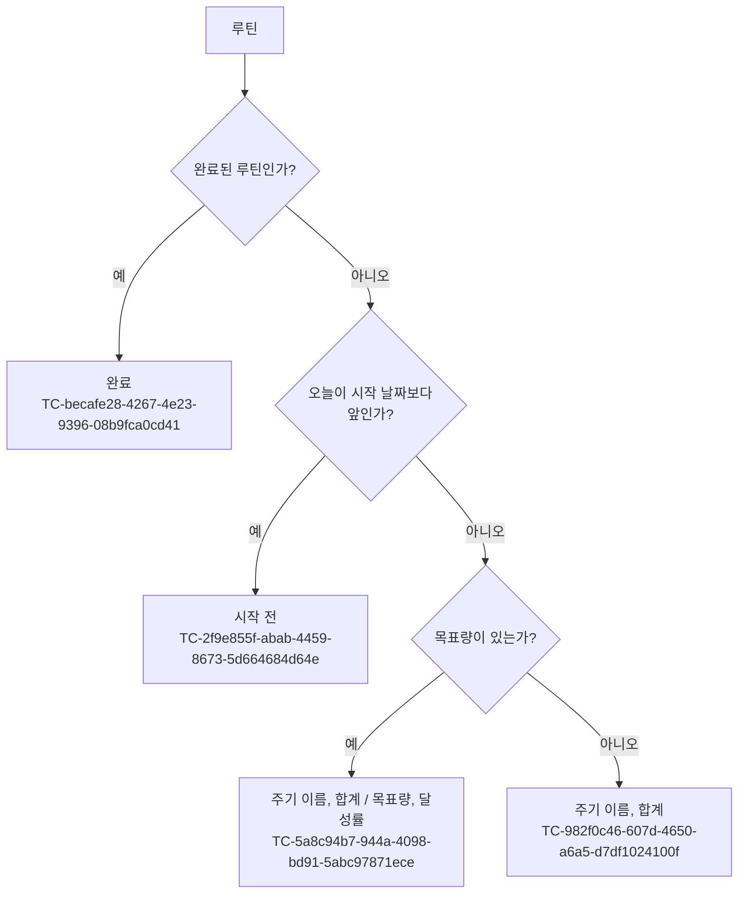
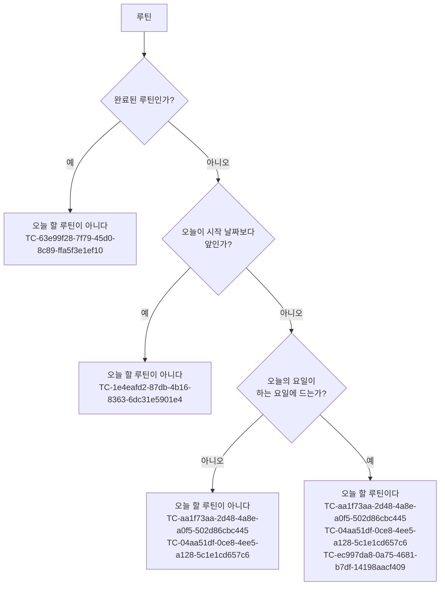

# 루틴 테스트 케이스

기준 스펙: [루틴 앱 스펙](../spec/client/routine.md), [루틴 스펙](../spec/common/routine.md)

이 문서에서 `domain > 루틴 기록의 정보`, `domain > 완료 여부`, `domain > 날짜`, `domain > 주기`, `domain > 단위`, `domain > 유효 범위`, `domain > 기본값` 절은 [루틴 스펙](../spec/common/routine.md)이 소유하고, 나머지 케이스의 절은 [루틴 앱 스펙](../spec/client/routine.md)이 소유한다.

카드 문구와 양의 문구의 기대 결과는 루틴 앱 스펙이 정한 형식으로 쓴다. 계산 결과를 화면에 보여 주는 결과와 오늘을 다시 정하는 시점, 오늘 할 루틴으로 목록을 좁히는 결과는 [RoutineHome 테스트 케이스](./routine-home.md)가, 날짜별 합계를 캘린더에 놓는 결과는 [캘린더 루틴 기록 표시 테스트 케이스](./calendar-routine.md)가 확인한다. 상세 화면에서 고치고 아직 반영하지 않은 날짜를 기록할 수 있는 날짜의 판정에 쓰지 않는 것과 사용자가 루틴을 완료하고 다시 시작하는 조작, 완료된 루틴의 정보를 고치는 것은 [RoutineDetail 테스트 케이스](./routine-detail.md)가, 완료 여부에 따른 목록의 노출과 빠른 기록의 제공 여부는 각 화면의 테스트 케이스가 확인한다.

`domain > 유효 범위`의 케이스는 값이 루틴이나 루틴 기록의 정보로 성립하는지만 확인한다. 앱의 입력이 이 범위를 벗어난 값을 만들지 않는 것은 [RoutineAdd 테스트 케이스](./routine-add.md)와 [RoutineDetail 테스트 케이스](./routine-detail.md)가, 서버가 동기화 요청에서 값을 확인하는 것은 [데이터 동기화 테스트 케이스](./data-sync.md)가 확인한다.

따로 적지 않으면 루틴의 시작 날짜는 2026-01-01이고 목표량은 없으며 완료되지 않은 상태이고, 기록은 삭제되지 않은 상태다. 케이스에 적은 요일은 그 날짜의 실제 요일이다. 2026-11-13은 금요일, 2026-11-14는 토요일, 2026-11-15는 일요일, 2026-11-16은 월요일이다.

## domain

### TC-a624a684-0e13-4102-995b-7318bfa2cf95: 오늘과 시작 날짜로 진행 상태를 정한다

- 근거: `domain > 진행 상태`
- Given: 루틴의 시작 날짜가 2026-11-10이고 오늘이 테스트 데이터와 같다.
- When: 진행 상태를 정한다.
- Then: 진행 상태가 테스트 데이터의 기대 결과와 같다.
- 테스트 데이터:

  | 오늘 | 진행 상태 | 비고 |
  | --- | --- | --- |
  | 2026-11-09 | 시작 전 | 시작 날짜 하루 전 |
  | 2026-11-10 | 진행 중 | 시작 날짜와 같음 |
  | 2026-11-11 | 진행 중 | 시작 날짜 하루 뒤 |
  | 2099-12-31 | 진행 중 | 시작 날짜 뒤로는 끝나지 않음 |

### TC-f623479e-76d0-4e37-b5d2-f683348a86a1: 기록의 유무와 목표를 채웠는지는 진행 상태에 영향을 주지 않는다

- 근거: `domain > 진행 상태`
- Given: 루틴의 시작 날짜가 2026-11-10, 주기가 `매월`, 단위가 `회`, 목표량이 3이고, 기록과 오늘이 테스트 데이터와 같다.
- When: 진행 상태를 정한다.
- Then: 진행 상태가 테스트 데이터의 기대 결과와 같다.
- 테스트 데이터:

  | 오늘 | 기록 | 진행 상태 |
  | --- | --- | --- |
  | 2026-11-13 | 없음 | 진행 중 |
  | 2026-11-13 | 2026-11-12에 양 3(목표를 채움) | 진행 중 |
  | 2026-11-09 | 없음 | 시작 전 |
  | 2026-11-09 | 2026-11-12에 양 3(목표를 채움) | 시작 전 |

### TC-afa98e83-e823-4df3-8263-f7012e5a5568: `매일` 루틴의 이번 주기는 오늘 하루이고 주기 이름은 `오늘`이다

- 근거: `domain > 이번 주기`
- Given: 루틴의 주기가 `매일`이고 오늘이 2026-11-13이다.
- When: 이번 주기와 주기 이름을 정한다.
- Then: 이번 주기는 2026-11-13 하루이고 주기 이름은 `오늘`이다.

### TC-731d6bde-1311-45ee-80b1-7605c8a6708f: `평일만`과 `주말만` 루틴의 이번 주기는 하는 요일이 아닌 날에도 오늘 하루이고 주기 이름은 `오늘`이다

- 근거: `domain > 이번 주기`, `domain > 주기`
- Given: 루틴의 주기와 오늘이 테스트 데이터와 같다.
- When: 이번 주기와 주기 이름을 정한다.
- Then: 이번 주기가 테스트 데이터의 기대 결과와 같고 주기 이름은 언제나 `오늘`이다.
- 테스트 데이터:

  | 주기 | 오늘 | 이번 주기 | 비고 |
  | --- | --- | --- | --- |
  | `평일만` | 2026-11-13(금) | 2026-11-13 하루 | 하는 요일 |
  | `평일만` | 2026-11-14(토) | 2026-11-14 하루 | 하는 요일이 아님. 가장 가까운 하는 요일로 옮기지 않음 |
  | `평일만` | 2026-11-15(일) | 2026-11-15 하루 | 하는 요일이 아님 |
  | `주말만` | 2026-11-14(토) | 2026-11-14 하루 | 하는 요일 |
  | `주말만` | 2026-11-13(금) | 2026-11-13 하루 | 하는 요일이 아님 |
  | `주말만` | 2026-11-16(월) | 2026-11-16 하루 | 하는 요일이 아님 |

### TC-31e9ea3d-a0b6-46da-b4f9-b8d5401e116e: `매주` 루틴의 이번 주기는 오늘이 속한 주의 일요일부터 토요일까지이고 주기 이름은 `이번 주`다

- 근거: `domain > 이번 주기`, `domain > 주기`
- Given: 루틴의 주기가 `매주`이고 오늘이 테스트 데이터와 같다.
- When: 이번 주기와 주기 이름을 정한다.
- Then: 이번 주기가 테스트 데이터의 기대 결과와 같고 주기 이름은 언제나 `이번 주`다.
- 테스트 데이터:

  | 오늘 | 이번 주기 | 비고 |
  | --- | --- | --- |
  | 2026-11-08(일) | 2026-11-08부터 2026-11-14까지 | 주의 첫날 |
  | 2026-11-11(수) | 2026-11-08부터 2026-11-14까지 | |
  | 2026-11-14(토) | 2026-11-08부터 2026-11-14까지 | 주의 마지막 날 |
  | 2026-11-15(일) | 2026-11-15부터 2026-11-21까지 | 다음 주의 첫날 |
  | 2026-12-01(화) | 2026-11-29부터 2026-12-05까지 | 달이 바뀌는 주 |
  | 2027-01-01(금) | 2026-12-27부터 2027-01-02까지 | 해가 바뀌는 주 |

### TC-423bd999-9c1a-4660-b88d-e7bf1a7ceb07: `매월` 루틴의 이번 주기는 오늘이 속한 달의 1일부터 마지막 날까지이고 주기 이름은 `이번 달`이다

- 근거: `domain > 이번 주기`, `domain > 주기`
- Given: 루틴의 주기가 `매월`이고 오늘이 테스트 데이터와 같다.
- When: 이번 주기와 주기 이름을 정한다.
- Then: 이번 주기가 테스트 데이터의 기대 결과와 같고 주기 이름은 언제나 `이번 달`이다.
- 테스트 데이터:

  | 오늘 | 이번 주기 | 비고 |
  | --- | --- | --- |
  | 2026-11-01 | 2026-11-01부터 2026-11-30까지 | 달의 첫날, 30일인 달 |
  | 2026-11-30 | 2026-11-01부터 2026-11-30까지 | 달의 마지막 날 |
  | 2026-12-31 | 2026-12-01부터 2026-12-31까지 | 31일인 달, 해의 마지막 날 |
  | 2026-02-28 | 2026-02-01부터 2026-02-28까지 | 평년 2월 |
  | 2028-02-01 | 2028-02-01부터 2028-02-29까지 | 윤년 2월 |
  | 2028-02-29 | 2028-02-01부터 2028-02-29까지 | 윤년 2월의 마지막 날 |
  | 2028-03-01 | 2028-03-01부터 2028-03-31까지 | 윤년 2월 다음 날 |

### TC-38129340-a109-4d36-8eee-da47c51dd29a: 이번 주기는 루틴의 시작 날짜로 좁히지 않는다

- 근거: `domain > 이번 주기`, `domain > 주기`
- Given: 루틴의 주기, 시작 날짜와 오늘이 테스트 데이터와 같다.
- When: 이번 주기를 정한다.
- Then: 이번 주기가 테스트 데이터의 기대 결과와 같다.
- 테스트 데이터:

  | 주기 | 시작 날짜 | 오늘 | 이번 주기 |
  | --- | --- | --- | --- |
  | `매주` | 2026-11-11(수) | 2026-11-11 | 2026-11-08부터 2026-11-14까지 |
  | `매월` | 2026-11-10 | 2026-11-13 | 2026-11-01부터 2026-11-30까지 |

### TC-818e0b02-00ec-4b07-bb49-4ef5dea27df5: `매일` 루틴의 주기의 합계는 오늘 날짜의 기록만 더한다

- 근거: `domain > 주기의 합계`
- Given: 주기가 `매일`인 루틴에 2026-11-12에 양 100, 2026-11-13에 양 200, 2026-11-13에 양 300, 2026-11-14에 양 400인 기록이 있고 오늘이 2026-11-13이다.
- When: 주기의 합계를 정한다.
- Then: 주기의 합계는 500이다.

### TC-48bc7ccc-4625-45cc-ba03-629f39e3380d: `평일만`과 `주말만` 루틴의 주기의 합계는 하는 요일이 아닌 날에도 오늘 날짜의 기록만 더한다

- 근거: `domain > 주기의 합계`
- Given: 루틴의 주기가 테스트 데이터와 같고, 그 루틴에 2026-11-13(금)에 양 100, 2026-11-14(토)에 양 200, 2026-11-14(토)에 양 300, 2026-11-15(일)에 양 400인 기록이 있으며, 오늘이 테스트 데이터와 같다.
- When: 주기의 합계를 정한다.
- Then: 주기의 합계가 테스트 데이터의 기대 결과와 같다.
- 테스트 데이터:

  | 주기 | 오늘 | 주기의 합계 | 비고 |
  | --- | --- | --- | --- |
  | `평일만` | 2026-11-13(금) | 100 | 하는 요일 |
  | `평일만` | 2026-11-14(토) | 500 | 하는 요일이 아닌 오늘의 기록도 넣음 |
  | `주말만` | 2026-11-14(토) | 500 | 하는 요일 |
  | `주말만` | 2026-11-13(금) | 100 | 하는 요일이 아닌 오늘의 기록도 넣음 |
  | `주말만` | 2026-11-16(월) | 0 | 앞선 토요일과 일요일의 기록은 넣지 않음 |

### TC-1f0d3b55-f104-4839-98ff-1994e4618260: `매주` 루틴의 주기의 합계는 그 주의 일요일부터 토요일까지의 기록만 더한다

- 근거: `domain > 주기의 합계`, `domain > 이번 주기`
- Given: 주기가 `매주`인 루틴에 테스트 데이터의 기록이 있고 오늘이 테스트 데이터와 같다.
- When: 주기의 합계를 정한다.
- Then: 주기의 합계가 테스트 데이터의 기대 결과와 같다.
- 테스트 데이터:

  | 오늘 | 기록(날짜에 양) | 주기의 합계 | 비고 |
  | --- | --- | --- | --- |
  | 2026-11-11(수) | 2026-11-07(토)에 1, 2026-11-08(일)에 2, 2026-11-11(수)에 4, 2026-11-14(토)에 8, 2026-11-15(일)에 16 | 14 | 앞 주의 토요일과 다음 주의 일요일은 넣지 않음 |
  | 2026-12-01(화) | 2026-11-28(토)에 1, 2026-11-29(일)에 2, 2026-12-05(토)에 4, 2026-12-06(일)에 8 | 6 | 달이 바뀌는 주 |
  | 2027-01-01(금) | 2026-12-26(토)에 1, 2026-12-27(일)에 2, 2027-01-02(토)에 4, 2027-01-03(일)에 8 | 6 | 해가 바뀌는 주 |

### TC-be2e35ed-95fd-4386-8e61-2f1fc3d22e93: `매월` 루틴의 주기의 합계는 그 달의 1일부터 마지막 날까지의 기록만 더한다

- 근거: `domain > 주기의 합계`, `domain > 이번 주기`
- Given: 주기가 `매월`인 루틴에 테스트 데이터의 기록이 있고 오늘이 테스트 데이터와 같다.
- When: 주기의 합계를 정한다.
- Then: 주기의 합계가 테스트 데이터의 기대 결과와 같다.
- 테스트 데이터:

  | 오늘 | 기록(날짜에 양) | 주기의 합계 | 비고 |
  | --- | --- | --- | --- |
  | 2026-11-13 | 2026-10-31에 1, 2026-11-01에 2, 2026-11-30에 4, 2026-12-01에 8 | 6 | 30일인 달 |
  | 2026-12-13 | 2026-11-30에 1, 2026-12-01에 2, 2026-12-31에 4, 2027-01-01에 8 | 6 | 31일인 달, 해의 마지막 달 |
  | 2026-02-10 | 2026-01-31에 1, 2026-02-01에 2, 2026-02-28에 4, 2026-03-01에 8 | 6 | 평년 2월 |
  | 2028-02-10 | 2028-01-31에 1, 2028-02-01에 2, 2028-02-29에 4, 2028-03-01에 8 | 6 | 윤년 2월 |

### TC-7eeaa013-ba3c-4f85-b79c-6a36758b467a: 이번 주기에 드는 기록이 없으면 주기의 합계는 0이다

- 근거: `domain > 주기의 합계`
- Given: 주기가 `매일`인 루틴의 기록이 테스트 데이터와 같고 오늘이 2026-11-13이다.
- When: 주기의 합계를 정한다.
- Then: 주기의 합계는 0이다.
- 테스트 데이터:

  | 기록 |
  | --- |
  | 없음 |
  | 2026-11-12에 양 100 하나뿐 |

### TC-083ffdf1-88c3-45bd-ab8a-4b1585d5bf5d: 삭제된 기록은 주기의 합계에 넣지 않는다

- 근거: `domain > 주기의 합계`
- Given: 주기가 `매일`인 루틴의 2026-11-13 기록이 테스트 데이터와 같고 오늘이 2026-11-13이다.
- When: 주기의 합계를 정한다.
- Then: 주기의 합계가 테스트 데이터의 기대 결과와 같다.
- 테스트 데이터:

  | 2026-11-13의 기록 | 주기의 합계 |
  | --- | --- |
  | 양 200(삭제되지 않음), 양 300(삭제됨) | 200 |
  | 양 200(삭제됨), 양 300(삭제됨) | 0 |

### TC-7cd036cd-c8f3-4b37-85cb-1c37daec9b5f: 다른 루틴에 속한 기록은 주기의 합계에 넣지 않는다

- 근거: `domain > 주기의 합계`
- Given: 주기가 `매일`인 루틴 A와 루틴 B가 있고, 2026-11-13에 루틴 A의 기록 양 200과 루틴 B의 기록 양 300이 있으며 오늘이 2026-11-13이다.
- When: 두 루틴의 주기의 합계를 각각 정한다.
- Then: 루틴 A의 주기의 합계는 200이고 루틴 B의 주기의 합계는 300이다.

### TC-bcc1378c-3640-4c18-9175-55b704bb6a9a: 오늘보다 뒤의 기록도 이번 주기에 들면 주기의 합계에 넣는다

- 근거: `domain > 주기의 합계`
- Given: 루틴의 주기와 기록이 테스트 데이터와 같고 오늘이 2026-11-11이다.
- When: 주기의 합계를 정한다.
- Then: 주기의 합계가 테스트 데이터의 기대 결과와 같다.
- 테스트 데이터:

  | 주기 | 기록(날짜에 양) | 주기의 합계 |
  | --- | --- | --- |
  | `매주` | 2026-11-10에 2, 2026-11-13에 3 | 5 |
  | `매월` | 2026-11-10에 2, 2026-11-30에 3 | 5 |
  | `매일` | 2026-11-11에 2, 2026-11-12에 3 | 2 |

### TC-7fbc5f29-45aa-47a3-ad23-43ceeb94f8c4: 시작 날짜보다 앞에 놓인 기록도 이번 주기에 들면 주기의 합계에 넣는다

- 근거: `domain > 주기의 합계`
- Given: 루틴의 주기, 시작 날짜와 기록이 테스트 데이터와 같고, 시작 날짜보다 앞에 놓인 기록은 루틴의 시작 날짜를 바꾸기 전에 넣은 것이며, 오늘이 2026-11-12다.
- When: 주기의 합계를 정한다.
- Then: 주기의 합계가 테스트 데이터의 기대 결과와 같다.
- 테스트 데이터:

  | 주기 | 시작 날짜 | 기록(날짜에 양) | 주기의 합계 |
  | --- | --- | --- | --- |
  | `매주` | 2026-11-11 | 2026-11-09에 2(시작 날짜보다 앞), 2026-11-11에 3 | 5 |
  | `매월` | 2026-11-10 | 2026-11-05에 2(시작 날짜보다 앞), 2026-11-12에 3 | 5 |

### TC-8ef53f11-7827-4300-b067-7e68f631b156: 달성률은 주기의 합계를 목표량으로 나눈 백분율의 소수점 아래를 버리고 100을 넘지 않는다

- 근거: `domain > 달성률`
- Given: 진행 중인 루틴의 목표량과 주기의 합계가 테스트 데이터와 같다.
- When: 달성률을 정한다.
- Then: 달성률이 테스트 데이터의 기대 결과와 같다.
- 테스트 데이터:

  | 목표량 | 주기의 합계 | 달성률 | 비고 |
  | --- | --- | --- | --- |
  | 2000 | 0 | 0 | 기록 없음 |
  | 2000 | 1500 | 75 | |
  | 2000 | 1999 | 99 | 99.95를 올리지 않고 버림 |
  | 2000 | 2000 | 100 | 합계가 목표량과 같음 |
  | 2000 | 2500 | 100 | 100에서 멈춤 |
  | 3 | 1 | 33 | |
  | 3 | 2 | 66 | 66.66…을 올리지 않고 버림 |
  | 3 | 3 | 100 | |
  | 1 | 1 | 100 | 목표량의 가장 작은 값 |
  | 9999999 | 1 | 0 | 목표량의 가장 큰 값 |
  | 9999999 | 9999998 | 99 | 목표량에 1 모자람 |

### TC-21d3bedb-3a13-4eef-9240-fcbebb2c3a75: 목표량이 없는 루틴은 달성률을 갖지 않는다

- 근거: `domain > 달성률`
- Given: 진행 중이고 목표량이 없는 루틴의 주기의 합계가 테스트 데이터와 같다.
- When: 달성률을 정한다.
- Then: 달성률이 없다.
- 테스트 데이터:

  | 주기의 합계 |
  | --- |
  | 0 |
  | 1500 |

### TC-4210b8a5-ba71-4a36-b7dc-672982539931: 달성률이 100이어도 기록을 넣을 수 있고 합계는 계속 늘어난다

- 근거: `domain > 달성률`
- Given: 주기가 `매일`, 단위가 `회`, 목표량이 3인 진행 중 루틴에 오늘 날짜의 기록이 양 3으로 있어 달성률이 100이다.
- When: 오늘 날짜로 양 1의 기록을 넣는다.
- Then: 기록이 넣어지고 주기의 합계는 4, 달성률은 100이다.

### TC-8568139b-d0aa-4158-aa86-a0b144f787b2: 양은 숫자 바로 뒤에 단위를 붙여 쓰고 자릿수를 나누는 기호와 단위 변환을 쓰지 않는다

- 근거: `domain > 양의 문구`, `domain > 단위`
- Given: 양과 단위가 테스트 데이터와 같다.
- When: 양의 문구를 정한다.
- Then: 양의 문구가 테스트 데이터의 기대 결과와 같다.
- 테스트 데이터:

  | 양 | 단위 | 양의 문구 | 비고 |
  | --- | --- | --- | --- |
  | 3 | `회` | `3회` | |
  | 1 | `회` | `1회` | |
  | 0 | `회` | `0회` | 기록이 없는 합계 |
  | 1500 | `ml` | `1500ml` | L로 바꿔 읽지 않음 |
  | 1000 | `ml` | `1000ml` | L로 바꿔 읽지 않음 |
  | 5000 | `m` | `5000m` | km로 바꿔 읽지 않음 |
  | 20 | `쪽` | `20쪽` | |
  | 1500 | `ML` | `1500ML` | 대소문자를 적은 그대로 붙임 |
  | 30 | `분 걷기` | `30분 걷기` | 글자 사이의 공백도 그대로 붙임 |
  | 9999999 | `ml` | `9999999ml` | 자릿수를 나누는 기호 없음 |
  | 19999998 | `회` | `19999998회` | 양이 9999999인 기록 둘의 합계 |

### TC-e38d198b-7085-4c49-97bd-389f79e9e502: 단위가 비어 있으면 양의 문구는 숫자만 쓴다

- 근거: `domain > 양의 문구`
- Given: 단위가 비어 있고 양이 테스트 데이터와 같다.
- When: 양의 문구를 정한다.
- Then: 양의 문구가 테스트 데이터의 기대 결과와 같고 숫자 뒤에 아무 글자도 붙지 않는다.
- 테스트 데이터:

  | 양 | 양의 문구 |
  | --- | --- |
  | 0 | `0` |
  | 3 | `3` |
  | 1500 | `1500` |
  | 9999999 | `9999999` |

### TC-2063445d-1360-40ee-9cea-019fa22beb43: 단위는 언어 환경과 관계없이 사용자가 적은 글자 그대로 붙인다

- 근거: `domain > 양의 문구`, `domain > 단위`
- Given: 양이 3이고 단위가 테스트 데이터와 같으며, 사용자 언어 환경이 테스트 데이터와 같다.
- When: 양의 문구를 정한다.
- Then: 양의 문구가 테스트 데이터의 기대 결과와 같다.
- 테스트 데이터:

  | 언어 환경 | 단위 | 양의 문구 |
  | --- | --- | --- |
  | 한국어 | `회` | `3회` |
  | 영어 | `회` | `3회` |
  | 일본어 | `회` | `3회` |
  | 한국어 | `times` | `3times` |
  | 영어 | 비어 있음 | `3` |

### TC-535c4071-5f2e-4ef7-ad46-72191b97513d: 루틴의 단위가 바뀌면 이미 쌓인 기록의 양도 바뀐 단위로 읽는다

- 근거: `domain > 루틴 기록의 정보`, `domain > 단위`
- Given: 주기가 `매일`, 단위가 `ml`이고 목표량이 없는 진행 중 루틴에 오늘 2026-11-13 날짜의 기록이 양 1500으로 있다.
- When: 루틴의 단위를 테스트 데이터의 값으로 바꾼 뒤 카드 문구와 2026-11-13의 날짜별 합계 문구를 정한다.
- Then: 기록의 양은 1500 그대로이고 두 문구가 테스트 데이터의 기대 결과와 같다.
- 테스트 데이터:

  | 바꾼 단위 | 카드 문구 | 날짜별 합계 문구 |
  | --- | --- | --- |
  | `회` | `오늘 1500회` | `1500회` |
  | `m` | `오늘 1500m` | `1500m` |
  | `L` | `오늘 1500L` | `1500L` |
  | 비어 있음 | `오늘 1500` | `1500` |

카드 문구는 완료 여부, 진행 상태와 목표량에 따라 네 갈래로 갈린다. 다음 네 케이스가 갈래를 하나씩 덮는다.

### TC-5a8c94b7-944a-4098-bd91-5abc97871ece: 완료되지 않았고 진행 중이며 목표량이 있는 루틴의 카드 문구는 주기 이름, 합계와 목표량의 양 문구, 달성률이다

- 근거: `domain > 카드 문구`
- Given: 완료되지 않았고 진행 중인 루틴의 주기, 단위, 목표량과 주기의 합계가 테스트 데이터와 같다.
- When: 카드 문구를 정한다.
- Then: 카드 문구가 테스트 데이터의 두 문구와 같다.
- 테스트 데이터:

  | 주기 | 단위 | 목표량 | 주기의 합계 | 카드 문구 | 달성률 문구 |
  | --- | --- | --- | --- | --- | --- |
  | `매일` | `ml` | 2000 | 1500 | `오늘 1500 / 2000ml` | `75%` |
  | `매주` | `회` | 3 | 2 | `이번 주 2 / 3회` | `66%` |
  | `매월` | `m` | 20000 | 12000 | `이번 달 12000 / 20000m` | `60%` |
  | `매일` | `ml` | 2000 | 0 | `오늘 0 / 2000ml` | `0%` |
  | `매일` | `ml` | 2000 | 2500 | `오늘 2500 / 2000ml` | `100%` |

### TC-982f0c46-607d-4650-a6a5-d7df1024100f: 완료되지 않았고 진행 중이며 목표량이 없는 루틴의 카드 문구는 주기 이름과 합계의 양 문구다

- 근거: `domain > 카드 문구`
- Given: 완료되지 않았고 진행 중이며 목표량이 없는 루틴의 주기, 단위와 주기의 합계가 테스트 데이터와 같다.
- When: 카드 문구를 정한다.
- Then: 카드 문구가 테스트 데이터의 기대 결과와 같고 달성률은 쓰지 않는다.
- 테스트 데이터:

  | 주기 | 단위 | 주기의 합계 | 카드 문구 |
  | --- | --- | --- | --- |
  | `매월` | `m` | 12000 | `이번 달 12000m` |
  | `매일` | `회` | 0 | `오늘 0회` |
  | `매주` | `ml` | 1500 | `이번 주 1500ml` |

### TC-a66b7b0c-556c-4a6c-b3e9-5d8bc6440c41: `평일만`과 `주말만` 루틴의 카드 문구는 하는 요일이 아닌 날에도 `매일` 루틴과 같다

- 근거: `domain > 카드 문구`
- Given: 완료되지 않았고 진행 중이며 단위가 `ml`인 루틴의 주기, 목표량과 오늘이 테스트 데이터와 같고, 오늘 날짜의 기록이 양 1500으로 있다.
- When: 카드 문구를 정한다.
- Then: 카드 문구가 테스트 데이터의 기대 결과와 같고, 하는 요일이 아님을 알리는 문구는 없다.
- 테스트 데이터:

  | 주기 | 오늘 | 목표량 | 카드 문구 | 달성률 문구 | 비고 |
  | --- | --- | --- | --- | --- | --- |
  | `평일만` | 2026-11-13(금) | 2000 | `오늘 1500 / 2000ml` | `75%` | 하는 요일 |
  | `평일만` | 2026-11-14(토) | 2000 | `오늘 1500 / 2000ml` | `75%` | 하는 요일이 아님 |
  | `주말만` | 2026-11-14(토) | 2000 | `오늘 1500 / 2000ml` | `75%` | 하는 요일 |
  | `주말만` | 2026-11-13(금) | 2000 | `오늘 1500 / 2000ml` | `75%` | 하는 요일이 아님 |
  | `평일만` | 2026-11-15(일) | 없음 | `오늘 1500ml` | 없음 | 하는 요일이 아님 |
  | `주말만` | 2026-11-16(월) | 없음 | `오늘 1500ml` | 없음 | 하는 요일이 아님 |

### TC-f49840de-0419-45c4-961d-ad96c83997fc: 단위가 비어 있는 루틴의 카드 문구는 합계와 목표량을 숫자만으로 쓴다

- 근거: `domain > 카드 문구`, `domain > 양의 문구`
- Given: 완료되지 않았고 진행 중이며 단위가 비어 있는 루틴의 주기, 목표량과 주기의 합계가 테스트 데이터와 같다.
- When: 카드 문구를 정한다.
- Then: 카드 문구가 테스트 데이터의 기대 결과와 같다.
- 테스트 데이터:

  | 주기 | 목표량 | 주기의 합계 | 카드 문구 | 달성률 문구 |
  | --- | --- | --- | --- | --- |
  | `매일` | 3 | 2 | `오늘 2 / 3` | `66%` |
  | `매주` | 3 | 0 | `이번 주 0 / 3` | `0%` |
  | `매일` | 없음 | 0 | `오늘 0` | 없음 |
  | `매월` | 없음 | 12 | `이번 달 12` | 없음 |

### TC-2f9e855f-abab-4459-8673-5d664684d64e: 완료되지 않았고 시작 전인 루틴의 카드 문구는 목표량과 기록과 관계없이 `시작 전`이다

- 근거: `domain > 카드 문구`
- Given: 주기가 `매월`, 단위가 `ml`, 시작 날짜가 2026-11-20이고 완료되지 않은 루틴의 목표량과 기록이 테스트 데이터와 같고 오늘이 2026-11-13이다.
- When: 카드 문구를 정한다.
- Then: 모든 행의 카드 문구가 `시작 전`이고 합계와 달성률은 쓰지 않는다.
- 테스트 데이터:

  | 목표량 | 기록 |
  | --- | --- |
  | 없음 | 없음 |
  | 2000 | 없음 |
  | 2000 | 2026-11-20에 양 500 |
  | 없음 | 2026-11-20에 양 500 |

### TC-becafe28-4267-4e23-9396-08b9fca0cd41: 완료된 루틴의 카드 문구는 진행 상태, 목표량과 기록과 관계없이 `완료`다

- 근거: `domain > 카드 문구`
- Given: 주기가 `매월`, 단위가 `ml`이고 완료된 루틴의 시작 날짜, 목표량과 기록이 테스트 데이터와 같고 오늘이 2026-11-13이다.
- When: 카드 문구를 정한다.
- Then: 모든 행의 카드 문구가 `완료`이고 합계와 달성률은 쓰지 않는다.
- 테스트 데이터:

  | 시작 날짜 | 진행 상태 | 목표량 | 기록 |
  | --- | --- | --- | --- |
  | 2026-11-01 | 진행 중 | 없음 | 없음 |
  | 2026-11-01 | 진행 중 | 2000 | 2026-11-05에 양 1500 |
  | 2026-11-01 | 진행 중 | 2000 | 2026-11-05에 양 2000(목표를 채움) |
  | 2026-11-01 | 진행 중 | 없음 | 2026-11-05에 양 2000 |
  | 2026-11-20 | 시작 전 | 없음 | 없음 |
  | 2026-11-20 | 시작 전 | 2000 | 2026-11-20에 양 500 |

### TC-2652e6ab-e46c-4e3b-ab40-6b320278a02c: 루틴을 완료하면 카드 문구가 `완료`가 되고 다시 시작하면 완료하기 전의 문구로 돌아간다

- 근거: `domain > 카드 문구`, `domain > 완료 여부와 진행 상태`
- Given: 완료되지 않은 루틴의 시작 날짜, 주기, 단위, 목표량과 기록이 테스트 데이터와 같아 카드 문구가 테스트 데이터의 완료 전 문구이고, 오늘이 2026-11-13이다.
- When: 그 루틴을 완료한 뒤 카드 문구를 정하고, 이어서 다시 시작한 뒤 카드 문구를 정한다.
- Then: 완료한 뒤의 카드 문구는 `완료`이고, 다시 시작한 뒤의 카드 문구는 테스트 데이터의 완료 전 문구와 같다.
- 테스트 데이터:

  | 시작 날짜 | 주기 | 단위 | 목표량 | 기록 | 완료 전 문구 |
  | --- | --- | --- | --- | --- | --- |
  | 2026-11-01 | `매일` | `ml` | 2000 | 2026-11-13에 양 1500 | `오늘 1500 / 2000ml`와 `75%` |
  | 2026-11-01 | `매월` | `m` | 없음 | 2026-11-05에 양 12000 | `이번 달 12000m` |
  | 2026-11-20 | `매일` | `회` | 없음 | 없음 | `시작 전` |

### TC-c785ccdf-600f-47ec-b068-48e1be546774: 날짜별 합계는 같은 날짜의 기록을 모두 더한 값이고 기록이 없는 날짜에는 없다

- 근거: `domain > 날짜별 합계`
- Given: 단위가 `ml`인 루틴에 2026-11-10에 양 500, 2026-11-10에 양 300, 2026-11-10에 양 200, 2026-11-12에 양 250인 기록이 있다.
- When: 2026-11-10부터 2026-11-12까지의 날짜별 합계를 정한다.
- Then: 2026-11-10의 날짜별 합계는 1000이고 문구는 `1000ml`, 2026-11-12의 날짜별 합계는 250이고 문구는 `250ml`이며, 2026-11-11에는 날짜별 합계가 없다.

### TC-1564f0b4-ee10-404a-9a99-53e65e0fae30: 삭제된 기록은 날짜별 합계에 넣지 않고 남은 기록이 없는 날짜에는 날짜별 합계가 없다

- 근거: `domain > 날짜별 합계`
- Given: 단위가 `ml`인 루틴의 2026-11-10 기록이 테스트 데이터와 같다.
- When: 2026-11-10의 날짜별 합계를 정한다.
- Then: 날짜별 합계가 테스트 데이터의 기대 결과와 같다.
- 테스트 데이터:

  | 2026-11-10의 기록 | 날짜별 합계 |
  | --- | --- |
  | 양 500(삭제되지 않음), 양 300(삭제됨) | 500, 문구 `500ml` |
  | 양 500(삭제됨), 양 300(삭제됨) | 없음 |

### TC-881762ca-cfe6-4dfd-92a9-7c057495c087: 날짜별 합계는 주기, 목표량, 진행 상태와 오늘의 영향을 받지 않는다

- 근거: `domain > 날짜별 합계`
- Given: 단위가 `회`이고 시작 날짜가 2026-11-01인 루틴에 2026-11-10에 양 2, 2026-11-10에 양 3인 기록이 있고, 주기, 목표량과 오늘이 테스트 데이터와 같다.
- When: 2026-11-10의 날짜별 합계를 정한다.
- Then: 모든 행의 날짜별 합계가 5이고 문구는 `5회`다.
- 테스트 데이터:

  | 주기 | 목표량 | 오늘 | 진행 상태 |
  | --- | --- | --- | --- |
  | `매일` | 없음 | 2026-11-10 | 진행 중 |
  | `매주` | 3 | 2026-11-13 | 진행 중 |
  | `매월` | 100 | 2027-06-30 | 진행 중 |
  | `매일` | 3 | 2026-10-31 | 시작 전 |

### TC-fefd184e-3269-4751-a0c3-801dac995ee1: 하는 요일에 들지 않는 날짜의 기록도 그 날짜의 날짜별 합계가 된다

- 근거: `domain > 날짜별 합계`
- Given: 단위가 `회`이고 주기가 테스트 데이터와 같은 루틴에 테스트 데이터의 날짜로 양 2와 양 3인 기록이 있다.
- When: 그 날짜의 날짜별 합계를 정한다.
- Then: 모든 행의 날짜별 합계가 5이고 문구는 `5회`다.
- 테스트 데이터:

  | 주기 | 기록의 날짜 |
  | --- | --- |
  | `평일만` | 2026-11-14(토) |
  | `평일만` | 2026-11-15(일) |
  | `주말만` | 2026-11-13(금) |
  | `주말만` | 2026-11-16(월) |

### TC-11b44b3b-5add-4404-a4c6-ce258d78e169: 한 루틴의 같은 날짜 기록은 하나로 합쳐 두지 않고 각각 남는다

- 근거: `domain > 루틴 기록의 정보`, `domain > 날짜별 합계`
- Given: 시작 날짜가 2026-11-01인 루틴에 기록이 없고 오늘이 2026-11-13이다.
- When: 2026-11-13 날짜로 양 200의 기록을 두 번 넣은 뒤 그중 하나를 삭제한다.
- Then: 두 번 넣은 뒤에는 2026-11-13에 양 200인 기록 두 개가 각각 있고 날짜별 합계는 400이며, 하나를 삭제한 뒤에는 나머지 기록 하나가 그대로 남아 날짜별 합계는 200이다.

### TC-c158cc96-e709-482b-afb6-a0a08e36efb6: 기록은 시작 날짜와 같거나 그 뒤인 날짜에만 넣을 수 있고 오늘보다 뒤에도 넣을 수 있다

- 근거: `domain > 기록할 수 있는 날짜`
- Given: 기기에 저장된 루틴의 시작 날짜가 2026-11-10이고 오늘이 2026-11-13이다.
- When: 테스트 데이터의 날짜에 기록을 넣을 수 있는지 판정한다.
- Then: 판정이 테스트 데이터의 기대 결과와 같다.
- 테스트 데이터:

  | 기록의 날짜 | 넣을 수 있음 | 비고 |
  | --- | --- | --- |
  | 2026-11-09 | 아님 | 시작 날짜 하루 전 |
  | 2026-11-10 | 예 | 시작 날짜와 같음 |
  | 2026-11-12 | 예 | 오늘보다 앞 |
  | 2026-11-13 | 예 | 오늘 |
  | 2026-11-18 | 예 | 오늘보다 뒤 |
  | 2099-12-31 | 예 | 뒤로는 끝이 없음 |

### TC-a1d370fb-a8c0-4aa6-b5dc-848d1d827ac4: 오늘 날짜의 기록은 진행 중인 루틴에만 넣을 수 있다

- 근거: `domain > 기록할 수 있는 날짜`, `domain > 진행 상태`
- Given: 기기에 저장된 루틴의 시작 날짜가 테스트 데이터와 같고 오늘이 2026-11-13이다.
- When: 오늘 날짜에 기록을 넣을 수 있는지 판정한다.
- Then: 판정이 테스트 데이터의 기대 결과와 같다.
- 테스트 데이터:

  | 시작 날짜 | 진행 상태 | 넣을 수 있음 |
  | --- | --- | --- |
  | 2026-11-10 | 진행 중 | 예 |
  | 2026-11-13 | 진행 중 | 예 |
  | 2026-11-14 | 시작 전 | 아님 |

### TC-984607d8-7cef-4134-8ede-37d0a7fee226: 시작 전인 루틴에도 시작 날짜와 같거나 그 뒤인 날짜에는 기록을 넣을 수 있다

- 근거: `domain > 기록할 수 있는 날짜`
- Given: 기기에 저장된 루틴의 시작 날짜가 2026-11-20이어서 시작 전이고 오늘이 2026-11-13이다.
- When: 테스트 데이터의 날짜에 기록을 넣을 수 있는지 판정한다.
- Then: 판정이 테스트 데이터의 기대 결과와 같다.
- 테스트 데이터:

  | 기록의 날짜 | 넣을 수 있음 |
  | --- | --- |
  | 2026-11-19 | 아님 |
  | 2026-11-20 | 예 |
  | 2026-11-25 | 예 |

### TC-3c883f41-9bbb-4b3e-b611-d4b439ba1ca4: 완료 여부는 기록할 수 있는 날짜를 바꾸지 않는다

- 근거: `domain > 기록할 수 있는 날짜`
- Given: 기기에 저장된 루틴의 시작 날짜가 테스트 데이터와 같고 오늘이 2026-11-13이다.
- When: 그 루틴이 완료되지 않았을 때와 완료되었을 때 각각 테스트 데이터의 날짜에 기록을 넣을 수 있는지 판정한다.
- Then: 완료되지 않았을 때와 완료되었을 때의 판정이 모두 테스트 데이터의 기대 결과와 같다.
- 테스트 데이터:

  | 시작 날짜 | 진행 상태 | 기록의 날짜 | 넣을 수 있음 | 비고 |
  | --- | --- | --- | --- | --- |
  | 2026-11-10 | 진행 중 | 2026-11-09 | 아님 | 시작 날짜 하루 전 |
  | 2026-11-10 | 진행 중 | 2026-11-10 | 예 | 시작 날짜와 같음 |
  | 2026-11-10 | 진행 중 | 2026-11-13 | 예 | 오늘 |
  | 2026-11-10 | 진행 중 | 2026-11-18 | 예 | 오늘보다 뒤 |
  | 2026-11-20 | 시작 전 | 2026-11-13 | 아님 | 시작 전인 루틴의 오늘 |
  | 2026-11-20 | 시작 전 | 2026-11-20 | 예 | 시작 날짜와 같음 |

### TC-3ba53fe9-94b9-495b-895b-c7ae224eec65: 루틴의 시작 날짜를 뒤로 옮겨 시작 날짜보다 앞에 놓인 기록도 지워지지 않고 합계에 그대로 쓰인다

- 근거: `domain > 기록할 수 있는 날짜`, `domain > 유효 범위`
- Given: 주기가 `매월`이고 시작 날짜가 2026-11-01인 루틴에 2026-11-05에 양 300인 기록이 있고 오늘이 2026-11-13이다.
- When: 루틴의 시작 날짜를 2026-11-10으로 바꿔 저장한다.
- Then: 2026-11-05의 기록이 그대로 남아 주기의 합계는 300, 2026-11-05의 날짜별 합계는 300이고, 2026-11-05 날짜에는 새 기록을 넣을 수 없다.

### TC-d501bfcb-b65e-4fc3-8460-1611469c275b: 주기와 하는 요일은 기록할 수 있는 날짜를 바꾸지 않는다

- 근거: `domain > 기록할 수 있는 날짜`
- Given: 기기에 저장된 루틴의 시작 날짜가 2026-11-10이고 주기가 테스트 데이터와 같으며 오늘이 테스트 데이터와 같다.
- When: 테스트 데이터의 날짜에 기록을 넣을 수 있는지 판정한다.
- Then: 판정이 테스트 데이터의 기대 결과와 같다.
- 테스트 데이터:

  | 주기 | 오늘 | 기록의 날짜 | 넣을 수 있음 | 비고 |
  | --- | --- | --- | --- | --- |
  | `평일만` | 2026-11-13(금) | 2026-11-14(토) | 예 | 하는 요일이 아닌 날짜 |
  | `평일만` | 2026-11-13(금) | 2026-11-15(일) | 예 | 하는 요일이 아닌 날짜 |
  | `평일만` | 2026-11-14(토) | 2026-11-14(토) | 예 | 하는 요일이 아닌 오늘 |
  | `주말만` | 2026-11-14(토) | 2026-11-13(금) | 예 | 하는 요일이 아닌 날짜 |
  | `주말만` | 2026-11-16(월) | 2026-11-16(월) | 예 | 하는 요일이 아닌 오늘 |
  | `평일만` | 2026-11-13(금) | 2026-11-09(월) | 아님 | 하는 요일이지만 시작 날짜보다 앞 |
  | `주말만` | 2026-11-14(토) | 2026-11-08(일) | 아님 | 하는 요일이지만 시작 날짜보다 앞 |

오늘 할 루틴은 완료 여부, 진행 상태와 오늘의 요일로 갈린다. 다음 케이스가 갈래를 나누어 덮는다.

### TC-63e99f28-7f79-45d0-8c89-ffa5f3e1ef10: 완료된 루틴은 오늘의 요일이 하는 요일에 들어도 오늘 할 루틴이 아니다

- 근거: `domain > 오늘 할 루틴`, `domain > 완료 여부와 진행 상태`
- Given: 시작 날짜가 2026-11-01이고 완료된 루틴의 주기가 테스트 데이터와 같으며 오늘이 테스트 데이터와 같다.
- When: 그 루틴이 오늘 할 루틴인지 판정한다.
- Then: 모든 행에서 오늘 할 루틴이 아니다.
- 테스트 데이터:

  | 주기 | 오늘 |
  | --- | --- |
  | `매일` | 2026-11-13(금) |
  | `평일만` | 2026-11-13(금) |
  | `주말만` | 2026-11-14(토) |
  | `매주` | 2026-11-13(금) |
  | `매월` | 2026-11-13(금) |

### TC-1e4eafd2-87db-4b16-8363-6dc31e5901e4: 시작 전인 루틴은 오늘 할 루틴이 아니고 시작 날짜부터 오늘 할 루틴이 된다

- 근거: `domain > 오늘 할 루틴`, `domain > 진행 상태`
- Given: 완료되지 않았고 주기가 `매일`인 루틴의 시작 날짜가 2026-11-13이고 오늘이 테스트 데이터와 같다.
- When: 그 루틴이 오늘 할 루틴인지 판정한다.
- Then: 판정이 테스트 데이터의 기대 결과와 같다.
- 테스트 데이터:

  | 오늘 | 진행 상태 | 오늘 할 루틴 | 비고 |
  | --- | --- | --- | --- |
  | 2026-11-12(목) | 시작 전 | 아님 | 시작 날짜 하루 전 |
  | 2026-11-13(금) | 진행 중 | 예 | 시작 날짜와 같음 |
  | 2026-11-14(토) | 진행 중 | 예 | 시작 날짜 하루 뒤 |

### TC-aa1f73aa-2d48-4a8e-a0f5-502d86cbc445: `평일만` 루틴은 오늘이 월요일부터 금요일 사이일 때만 오늘 할 루틴이다

- 근거: `domain > 오늘 할 루틴`, `domain > 주기`
- Given: 완료되지 않았고 시작 날짜가 2026-11-01이며 주기가 `평일만`인 루틴이 있고 오늘이 테스트 데이터와 같다.
- When: 그 루틴이 오늘 할 루틴인지 판정한다.
- Then: 판정이 테스트 데이터의 기대 결과와 같다.
- 테스트 데이터:

  | 오늘 | 오늘 할 루틴 | 비고 |
  | --- | --- | --- |
  | 2026-11-09(월) | 예 | 하는 요일의 첫날 |
  | 2026-11-10(화) | 예 | |
  | 2026-11-11(수) | 예 | |
  | 2026-11-12(목) | 예 | |
  | 2026-11-13(금) | 예 | 하는 요일의 마지막 날 |
  | 2026-11-14(토) | 아님 | 금요일 다음 날 |
  | 2026-11-15(일) | 아님 | |
  | 2026-11-16(월) | 예 | 일요일 다음 날 |

### TC-04aa51df-0ce8-4ee5-a128-5c1e1cd657c6: `주말만` 루틴은 오늘이 토요일이나 일요일일 때만 오늘 할 루틴이다

- 근거: `domain > 오늘 할 루틴`, `domain > 주기`
- Given: 완료되지 않았고 시작 날짜가 2026-11-01이며 주기가 `주말만`인 루틴이 있고 오늘이 테스트 데이터와 같다.
- When: 그 루틴이 오늘 할 루틴인지 판정한다.
- Then: 판정이 테스트 데이터의 기대 결과와 같다.
- 테스트 데이터:

  | 오늘 | 오늘 할 루틴 | 비고 |
  | --- | --- | --- |
  | 2026-11-13(금) | 아님 | 토요일 하루 전 |
  | 2026-11-14(토) | 예 | |
  | 2026-11-15(일) | 예 | |
  | 2026-11-16(월) | 아님 | 일요일 다음 날 |
  | 2026-11-11(수) | 아님 | |

### TC-ec997da8-0a75-4681-b7df-14198aacf409: `매일`, `매주`, `매월` 루틴은 완료되지 않았고 진행 중이면 어느 요일에나 오늘 할 루틴이다

- 근거: `domain > 오늘 할 루틴`, `domain > 주기`
- Given: 완료되지 않았고 시작 날짜가 2026-11-01인 루틴의 주기가 `매일`, `매주`, `매월` 가운데 하나이고 오늘이 테스트 데이터와 같다.
- When: `매일`, `매주`, `매월` 루틴이 각각 오늘 할 루틴인지 판정한다.
- Then: 모든 주기와 모든 행에서 오늘 할 루틴이다.
- 테스트 데이터:

  | 오늘 |
  | --- |
  | 2026-11-08(일) |
  | 2026-11-09(월) |
  | 2026-11-10(화) |
  | 2026-11-11(수) |
  | 2026-11-12(목) |
  | 2026-11-13(금) |
  | 2026-11-14(토) |

### TC-78d686ee-08a5-4885-9e15-967d2128d2f6: 오늘 할 루틴은 날짜의 요일로만 정하고 오늘이 공휴일인지는 보지 않는다

- 근거: `domain > 오늘 할 루틴`, `domain > 주기`
- Given: 완료되지 않았고 시작 날짜가 2026-11-01인 루틴의 주기가 테스트 데이터와 같고, 오늘이 공휴일인 2026-12-25(금)이다.
- When: 그 루틴이 오늘 할 루틴인지 판정한다.
- Then: 판정이 테스트 데이터의 기대 결과와 같다.
- 테스트 데이터:

  | 주기 | 오늘 할 루틴 | 비고 |
  | --- | --- | --- |
  | `평일만` | 예 | 월요일부터 금요일 사이의 공휴일도 하는 요일 |
  | `주말만` | 아님 | 공휴일이어도 금요일은 하는 요일이 아님 |
  | `매일` | 예 | |

### TC-f62a1e31-cafd-459b-b99f-9bbd380f2a0a: 기록이 있는지, 목표량이 있는지와 목표를 채웠는지는 오늘 할 루틴의 판정에 쓰지 않는다

- 근거: `domain > 오늘 할 루틴`
- Given: 완료되지 않았고 시작 날짜가 2026-11-01이며 주기가 테스트 데이터와 같은 루틴의 목표량과 오늘 날짜의 기록이 테스트 데이터와 같고, 오늘이 테스트 데이터와 같다.
- When: 그 루틴이 오늘 할 루틴인지 판정한다.
- Then: 판정이 테스트 데이터의 기대 결과와 같다.
- 테스트 데이터:

  | 주기 | 오늘 | 목표량 | 오늘 날짜의 기록 | 오늘 할 루틴 | 비고 |
  | --- | --- | --- | --- | --- | --- |
  | `매일` | 2026-11-13(금) | 없음 | 없음 | 예 | |
  | `매일` | 2026-11-13(금) | 3 | 양 3 | 예 | 오늘 목표를 다 채움 |
  | `평일만` | 2026-11-13(금) | 3 | 양 5 | 예 | 목표를 넘김 |
  | `평일만` | 2026-11-14(토) | 3 | 없음 | 아님 | 목표를 채우지 않았어도 하는 요일이 아님 |
  | `주말만` | 2026-11-13(금) | 없음 | 양 1 | 아님 | 오늘 기록이 있어도 하는 요일이 아님 |

### TC-97058f6c-8269-4b74-9e28-27cb5dfb0943: 목록은 진행 중, 시작 전 순이고 같은 진행 상태 안에서는 제목 오름차순이다

- 근거: `domain > 목록 순서`
- Given: 오늘이 2026-11-13이고 테스트 데이터의 루틴이 있다.
- When: 루틴 목록의 순서를 정한다.
- Then: 루틴이 `다`, `라`, `나`, `마` 순서로 놓인다.
- 테스트 데이터:

  | 제목 | 시작 날짜 | 진행 상태 |
  | --- | --- | --- |
  | `나` | 2026-11-20 | 시작 전 |
  | `다` | 2026-11-01 | 진행 중 |
  | `라` | 2026-11-13 | 진행 중 |
  | `마` | 2026-11-14 | 시작 전 |

### TC-3473ecbe-d720-47c8-a2f1-58f331bdd777: 합계, 달성률, 주기와 단위는 목록 순서에 영향을 주지 않는다

- 근거: `domain > 목록 순서`
- Given: 오늘이 2026-11-13이고 모두 진행 중인 테스트 데이터의 루틴이 있다.
- When: 루틴 목록의 순서를 정한다.
- Then: 루틴이 `가`, `나`, `다` 순서로 놓인다.
- 테스트 데이터:

  | 제목 | 주기 | 단위 | 목표량 | 주기의 합계 | 달성률 |
  | --- | --- | --- | --- | --- | --- |
  | `다` | `매주` | `ml` | 없음 | 9000 | 없음 |
  | `가` | `매월` | `m` | 20000 | 0 | 0 |
  | `나` | `매일` | `회` | 3 | 3 | 100 |

### TC-2d6a3601-5088-49c1-812f-be69a860e37d: 오늘의 요일이 하는 요일에 드는지는 목록 순서에 영향을 주지 않는다

- 근거: `domain > 목록 순서`, `domain > 오늘 할 루틴`
- Given: 오늘이 2026-11-14(토)이고 테스트 데이터의 루틴이 있다.
- When: 루틴 목록의 순서를 정한다.
- Then: 루틴이 `가`, `나`, `다`, `라` 순서로 놓인다.
- 테스트 데이터:

  | 제목 | 주기 | 시작 날짜 | 진행 상태 | 오늘이 하는 요일인지 |
  | --- | --- | --- | --- | --- |
  | `다` | `주말만` | 2026-11-01 | 진행 중 | 예 |
  | `가` | `평일만` | 2026-11-01 | 진행 중 | 아님 |
  | `라` | `주말만` | 2026-11-20 | 시작 전 | 예 |
  | `나` | `매일` | 2026-11-01 | 진행 중 | 예 |

### TC-55d85e67-90bc-486e-90b8-8059a0c17ee1: 오늘이 바뀌어 진행 상태가 달라진 루틴은 바뀐 상태의 자리로 옮겨진다

- 근거: `domain > 목록 순서`, `domain > 진행 상태`
- Given: 시작 날짜가 2026-11-14인 `가`, 시작 날짜가 2026-11-01인 `나`, 시작 날짜가 2026-11-20인 `다`가 있고, 오늘 2026-11-13을 기준으로 목록 순서가 `나`, `가`, `다`로 정해져 있다.
- When: 오늘을 2026-11-14로 바꿔 목록 순서를 다시 정한다.
- Then: `가`가 진행 중이 되어 루틴이 `가`, `나`, `다` 순서로 놓인다.

### TC-4df6ec01-4cb7-4c97-a909-eaf94a996459: 완료 여부와 완료한 시점은 목록 순서에 영향을 주지 않는다

- 근거: `domain > 목록 순서`
- Given: 오늘이 2026-11-13이고 테스트 데이터의 루틴이 있으며, 완료된 루틴은 `마`, `나`, `다` 순서로 완료했다.
- When: 테스트 데이터의 루틴 전체를 함께 보여 주는 목록과 완료된 루틴만 모은 목록의 순서를 각각 정한다.
- Then: 함께 보여 주는 목록은 `가`, `나`, `다`, `라`, `마` 순서로, 완료된 루틴만 모은 목록은 `나`, `다`, `마` 순서로 놓인다.
- 테스트 데이터:

  | 제목 | 시작 날짜 | 진행 상태 | 완료 여부 |
  | --- | --- | --- | --- |
  | `가` | 2026-11-01 | 진행 중 | 완료되지 않음 |
  | `나` | 2026-11-01 | 진행 중 | 완료됨 |
  | `다` | 2026-11-20 | 시작 전 | 완료됨 |
  | `라` | 2026-11-20 | 시작 전 | 완료되지 않음 |
  | `마` | 2026-11-20 | 시작 전 | 완료됨 |

### TC-9850658b-1865-4a9c-8067-10b6675fced0: 시작 날짜와 기록의 날짜는 기기의 시간대와 관계없이 같은 연·월·일이다

- 근거: `domain > 날짜`
- Given: 시작 날짜가 2026-03-01인 루틴과 그 루틴에 속한 날짜가 2026-03-01인 기록이 기기에 저장되어 있다.
- When: 기기의 시간대를 테스트 데이터의 시간대로 바꾸고 그 루틴과 기록을 조회한다.
- Then: 모든 시간대에서 시작 날짜는 2026-03-01, 기록의 날짜는 2026-03-01로 조회된다.
- 테스트 데이터:

  | 기기 시간대 |
  | --- |
  | 협정 세계시보다 14시간 빠름 |
  | 협정 세계시 |
  | 협정 세계시보다 12시간 느림 |

### TC-6f442d59-63b6-4f58-b781-7060329ecdce: 주기는 정해진 다섯 값으로 기록하고 주고받는다

- 근거: `domain > 주기`
- Given: 루틴의 주기가 테스트 데이터와 같다.
- When: 주기를 주고받는 값으로 바꾸고, 그 값을 다시 주기로 읽는다.
- Then: 주고받는 값이 테스트 데이터와 글자의 대소문자와 순서까지 같고, 다시 읽은 주기는 처음의 주기와 같다.
- 테스트 데이터:

  | 주기 | 주고받는 값 |
  | --- | --- |
  | `매일` | `FREQ=DAILY` |
  | `평일만` | `FREQ=DAILY;BYDAY=MO,TU,WE,TH,FR` |
  | `주말만` | `FREQ=DAILY;BYDAY=SA,SU` |
  | `매주` | `FREQ=WEEKLY;WKST=SU` |
  | `매월` | `FREQ=MONTHLY` |

### TC-b0f6d809-7328-44d8-8bf4-1d62c8eb366c: 정해진 다섯 값이 아닌 반복 규칙은 루틴의 주기로 다루지 않는다

- 근거: `domain > 주기`, `domain > 유효 범위`
- Given: 주고받는 값이 테스트 데이터와 같다.
- When: 그 값을 루틴의 주기로 읽는다.
- Then: 어느 값도 루틴의 주기로 읽히지 않는다.
- 테스트 데이터:

  | 주고받는 값 | 비고 |
  | --- | --- |
  | `freq=daily` | 대소문자가 다름 |
  | `Freq=Monthly` | 대소문자가 다름 |
  | `WKST=SU;FREQ=WEEKLY` | 순서가 다름 |
  | `FREQ=WEEKLY` | 주의 첫 요일이 빠짐 |
  | `FREQ=WEEKLY;WKST=MO` | 주의 첫 요일이 다름 |
  | `FREQ=WEEKLY;INTERVAL=2;WKST=SU` | 격주 |
  | `FREQ=WEEKLY;WKST=SU;BYDAY=MO,WE` | 표에 없는 요일 지정 |
  | `FREQ=DAILY;BYDAY=MO,WE,FR` | 표에 없는 요일 지정 |
  | `FREQ=DAILY;BYDAY=MO,TU,WE,TH,FR,SA` | 표에 없는 요일 지정 |
  | `FREQ=DAILY;BYDAY=SU,SA` | 요일의 순서가 다름 |
  | `FREQ=DAILY;BYDAY=FR,TH,WE,TU,MO` | 요일의 순서가 다름 |
  | `BYDAY=SA,SU;FREQ=DAILY` | 순서가 다름 |
  | `FREQ=DAILY;BYDAY=sa,su` | 대소문자가 다름 |
  | `FREQ=DAILY;BYDAY=MO, TU, WE, TH, FR` | 공백이 섞임 |
  | `FREQ=WEEKLY;WKST=SU;BYDAY=SA,SU` | 표에 없는 조합 |
  | `FREQ=DAILY;INTERVAL=2` | 이틀마다 |
  | `FREQ=YEARLY` | 표에 없는 단위 기간 |
  | 빈 값 | |

### TC-e2271ac7-d2fb-49ad-929e-91ab22b83107: 유효 범위를 모두 만족하는 루틴만 성립한다

- 근거: `domain > 유효 범위`
- Given: 시작 날짜가 2026-11-10, 주기 `매일`, 단위 `회`, 목표량 없음, 한 번에 기록할 양 1인 루틴에서 테스트 데이터의 값 하나만 바꿨다.
- When: 그 값들이 루틴으로 성립하는지 판정한다.
- Then: 판정이 테스트 데이터의 기대 결과와 같다.
- 테스트 데이터:

  | 바꾼 값 | 성립 | 비고 |
  | --- | --- | --- |
  | 바꾸지 않음 | 예 | |
  | 주기 `평일만` | 예 | |
  | 주기 `주말만` | 예 | |
  | 주기 `매주` | 예 | |
  | 주기 `매월` | 예 | |
  | 단위 `ml` | 예 | |
  | 단위 `L` | 예 | 미리 정해 둔 단위의 종류가 없음 |
  | 단위 `ML` | 예 | 대소문자를 가리지 않음 |
  | 단위 `분 걷기` | 예 | 글자 사이의 공백 |
  | 단위 비어 있음 | 예 | 0자 |
  | 단위 `가` | 예 | 1자 |
  | 단위 `kilometers` | 예 | 10자 |
  | 단위 `가나다라마바사아자차` | 예 | 한글 10자 |
  | 단위 `kilometerss` | 아님 | 11자 |
  | 단위 `가나다라마바사아자차카` | 아님 | 한글 11자 |
  | 단위 ` ml` | 아님 | 앞에 공백 |
  | 단위 `ml ` | 아님 | 뒤에 공백 |
  | 단위 공백 한 글자 | 아님 | 공백뿐인 글자 |
  | 단위 `밀리`와 `리터` 사이에 줄바꿈 | 아님 | 줄바꿈 |
  | 목표량 0 | 아님 | |
  | 목표량 1 | 예 | 가장 작은 값 |
  | 목표량 9999999 | 예 | 가장 큰 값 |
  | 목표량 10000000 | 아님 | |
  | 한 번에 기록할 양 0 | 아님 | |
  | 한 번에 기록할 양 9999999 | 예 | 가장 큰 값 |
  | 한 번에 기록할 양 10000000 | 아님 | |

### TC-8f20a50e-651a-42a3-9276-61ff22c596a3: 루틴 기록은 양이 1 이상 9,999,999 이하일 때만 성립하고 날짜가 루틴의 시작 날짜와 같거나 그 뒤인지는 묻지 않는다

- 근거: `domain > 유효 범위`
- Given: 시작 날짜가 2026-11-10인 루틴에 속한 기록의 날짜와 양이 테스트 데이터와 같다.
- When: 그 값들이 루틴 기록으로 성립하는지 판정한다.
- Then: 판정이 테스트 데이터의 기대 결과와 같다.
- 테스트 데이터:

  | 날짜 | 양 | 성립 | 비고 |
  | --- | --- | --- | --- |
  | 2026-11-13 | 0 | 아님 | |
  | 2026-11-13 | 1 | 예 | 가장 작은 값 |
  | 2026-11-13 | 9999999 | 예 | 가장 큰 값 |
  | 2026-11-13 | 10000000 | 아님 | |
  | 2026-11-09 | 1 | 예 | 시작 날짜보다 앞 |

### TC-aee23c66-2db7-41d8-9fec-cb549d0296ca: 새 루틴의 기본값은 `매일`, 빈 단위, 한 번에 기록할 양 1, 목표량 없음이다

- 근거: `domain > 기본값`
- Given: 새로 만드는 루틴의 주기, 단위, 한 번에 기록할 양과 목표량을 따로 정하지 않았다.
- When: 새 루틴의 정보를 확인한다.
- Then: 주기는 `매일`, 단위는 비어 있고, 한 번에 기록할 양은 1이며, 목표량은 없다.

### TC-43eabd90-fd95-4044-b9a6-bcc229ee7ae9: 새 루틴은 완료되지 않은 상태로 만들어진다

- 근거: `domain > 완료 여부`, `domain > 기본값`
- Given: 새 루틴을 만든다.
- When: 새 루틴의 완료 여부를 확인한다.
- Then: 새 루틴은 완료되지 않은 상태다.

### TC-4c8d139c-50a3-4d73-834f-2f6af23f7ffb: 완료와 다시 시작은 완료 여부를 바꾸고 루틴의 수정 시각을 그 시점으로 갱신한다

- 근거: `domain > 완료 여부`
- Given: 수정 시각이 시각 A인 완료되지 않은 루틴이 저장되어 있다.
- When: 시각 A보다 뒤인 시각 B에 그 루틴을 완료하고, 시각 B보다 뒤인 시각 C에 다시 시작한다.
- Then: 완료한 뒤에는 루틴이 완료된 상태이고 수정 시각이 시각 B이며, 다시 시작한 뒤에는 완료되지 않은 상태이고 수정 시각이 시각 C다.

### TC-d8b54831-56d1-44ff-8a5e-24ae97c4b065: 완료 여부는 날짜가 지나거나 기록을 넣고 빼거나 목표량을 채워도 저절로 바뀌지 않는다

- 근거: `domain > 완료 여부`
- Given: 주기가 `매일`, 단위가 `회`, 목표량이 3, 시작 날짜가 2026-11-10인 루틴이 테스트 데이터의 완료 여부로 저장되어 있고 오늘이 2026-11-13이다.
- When: 테스트 데이터의 일이 일어난 뒤 그 루틴의 완료 여부를 확인한다.
- Then: 모든 행에서 완료 여부가 처음과 같다.
- 테스트 데이터:

  | 처음 완료 여부 | 일어난 일 |
  | --- | --- |
  | 완료되지 않음 | 오늘이 2027-11-13으로 바뀜 |
  | 완료되지 않음 | 2026-11-13에 양 1인 기록을 넣음 |
  | 완료되지 않음 | 2026-11-13에 양 3인 기록을 넣어 달성률이 100이 됨 |
  | 완료되지 않음 | 넣어 둔 기록을 뺌 |
  | 완료됨 | 오늘이 2027-11-13으로 바뀜 |
  | 완료됨 | 2026-11-13에 양 1인 기록을 넣음 |
  | 완료됨 | 넣어 둔 기록을 모두 빼 합계가 0이 됨 |

### TC-eaa7d7f7-8938-4679-986e-be6ce7fc7535: 완료와 다시 시작은 루틴의 다른 정보와 루틴 기록을 바꾸지 않는다

- 근거: `domain > 완료 여부`
- Given: 제목, 설명, 컬러, 시작 날짜, 주기, 단위, 목표량과 한 번에 기록할 양이 정해진 완료되지 않은 루틴과 그 루틴에 속하고 날짜와 양이 정해진 기록 여러 개가 저장되어 있다.
- When: 그 루틴을 완료한 뒤 다시 시작한다.
- Then: 완료한 뒤와 다시 시작한 뒤 모두 루틴의 제목, 설명, 컬러, 시작 날짜, 주기, 단위, 목표량과 한 번에 기록할 양, 그리고 기록의 수와 각 기록의 날짜·양·삭제 여부가 완료하기 전과 같다.

### TC-be2d88be-ae77-4c97-a3d7-83e01a7ce559: 완료된 루틴도 시작 전이거나 진행 중이고 완료와 다시 시작은 진행 상태를 바꾸지 않는다

- 근거: `domain > 완료 여부와 진행 상태`
- Given: 완료되지 않은 루틴의 시작 날짜가 테스트 데이터와 같고 오늘이 2026-11-13이다.
- When: 그 루틴을 완료한 뒤 진행 상태를 정하고, 이어서 다시 시작한 뒤 진행 상태를 정한다.
- Then: 완료하기 전, 완료한 뒤와 다시 시작한 뒤의 진행 상태가 모두 테스트 데이터의 기대 결과와 같다.
- 테스트 데이터:

  | 시작 날짜 | 진행 상태 |
  | --- | --- |
  | 2026-11-10 | 진행 중 |
  | 2026-11-13 | 진행 중 |
  | 2026-11-14 | 시작 전 |

### TC-ec2c4ee3-a73a-4e56-abd1-7ff0ec880d17: 완료 여부는 이번 주기, 주기의 합계, 달성률과 날짜별 합계에 영향을 주지 않는다

- 근거: `domain > 완료 여부와 진행 상태`, `domain > 날짜별 합계`
- Given: 시작 날짜가 2026-11-01, 주기가 `매주`, 단위가 `회`, 목표량이 3인 루틴에 2026-11-07(토)에 양 1, 2026-11-10(화)에 양 1, 2026-11-10(화)에 양 1인 기록이 있고 오늘이 2026-11-11(수)다.
- When: 그 루틴이 완료되지 않았을 때와 완료되었을 때 각각 이번 주기, 주기의 합계, 달성률과 2026-11-10의 날짜별 합계를 정한다.
- Then: 두 경우 모두 이번 주기는 2026-11-08부터 2026-11-14까지, 주기의 합계는 2, 달성률은 66이고, 2026-11-10의 날짜별 합계는 2, 문구는 `2회`다.
