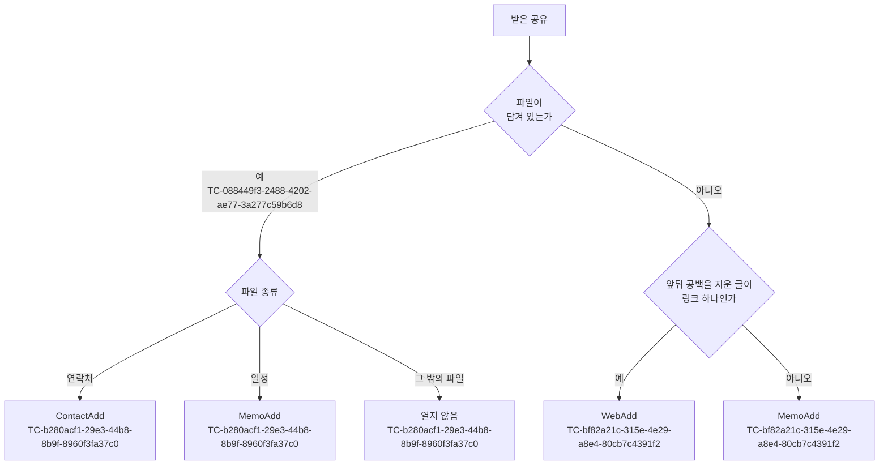

# 공유로 항목 추가 테스트 케이스

기준 스펙: [공유로 항목 추가 스펙](../spec/client/share-add.md)

공유 내용은 앱이 운영체제에서 받은 글, 공유 제목과 파일 종류·내용으로 주어진다. 열린 공유 Add 화면의 입력, 추가 실행과 추가 성공 뒤의 결과는 각 화면의 테스트 케이스가 다룬다.

## feature

### TC-e03f84ae-cbc3-48b0-8640-084afb8f87dc: 앱을 새로 시작하면 그 종류의 목록 화면 위에 공유 Add 화면을 연다

- 근거: `feature > 화면이 열리는 자리`
- Given: 앱이 실행 중이 아니다.
- When: 사용자가 테스트 데이터의 공유로 Diary를 고른다.
- Then: 앱이 시작되어 테스트 데이터의 여는 화면이 단독으로 보이고, 그 화면에서 뒤로 가면 테스트 데이터의 아래 화면이 보인다.
- 테스트 데이터:

| 공유 | 여는 화면 | 아래 화면 |
| --- | --- | --- |
| 글 `https://example.com` | WebAdd | WebHome |
| 글 `내일 10시 회의` | MemoAdd | MemoHome 목록 |
| 연락처 파일 | ContactAdd | ContactHome |
| 일정 파일 | MemoAdd | MemoHome 목록 |

### TC-51d6d123-653c-4b8f-aaf1-4da07dd196fb: 보던 화면이 남아 있으면 그 위에 공유 Add 화면을 연다

- 근거: `feature > 화면이 열리는 자리`
- Given: 앱이 보던 화면이 남아 있다.
- When: 사용자가 글 `https://example.com`을 공유해 Diary를 고른다.
- Then: 보던 화면 위에 WebAdd 화면이 단독으로 열리고, WebAdd에서 뒤로 가면 공유하기 전에 보던 화면이 그대로 보인다.
- 테스트 데이터:

| 보던 화면 |
| --- |
| CalendarHome |
| 목록과 상세를 함께 표시한 WebHome |
| 다른 경로로 연 WebAdd |

### TC-0751d47a-5e7c-41fb-8532-14f9dfd6fc32: 작성 중인 추가 화면 위에 새 추가 화면을 연다

- 근거: `feature > 화면이 열리는 자리`
- Given: MemoHome에서 연 MemoAdd 화면이 보이고 있다.
- When: 사용자가 글 `장보기`를 공유해 Diary를 고른다.
- Then: 이전 MemoAdd 화면은 닫히지 않고, 그 위에 제목 `장보기`가 채워진 MemoAdd 화면이 단독으로 열린다.

### TC-109de59a-cff3-4aec-b77f-55259ac459b1: 작성 중인 추가 화면 위에 열어도 작성 중이던 내용이 남는다

- 근거: `feature > 화면이 열리는 자리`
- Given: MemoHome에서 연 MemoAdd 화면에 제목 `작성 중`이 입력되어 있다.
- When: 사용자가 글 `장보기`를 공유해 Diary를 고른 뒤, 열린 MemoAdd에서 뒤로 간다.
- Then: 제목 `작성 중`이 입력된 이전 MemoAdd 화면이 보인다.
- 작성하지 않는 이유: 이전 화면의 입력이 남는지는 앱의 화면 백스택이 아래 화면의 상태를 보관하는지로 정해지며, 공유 주소를 받는 앱 전체 화면 구성을 통과해야 판정할 수 있다. 앱의 화면 구성 전체를 띄우고 공유 주소를 넣을 수 있는 화면 테스트 환경이 갖춰지면 자동화할 수 있다. 공유 Add 화면이 이전 화면을 닫지 않고 그 위에 열리는 것은 TC-0751d47a-5e7c-41fb-8532-14f9dfd6fc32가 확인한다.

### TC-713137bd-b0dc-4b28-ac7f-6fbbe6fae8d4: 공유만으로는 항목이 추가되지 않는다

- 근거: `feature > 공유 Add 화면 열기`
- Given: 앱이 실행 중이 아니고, 저장된 웹 항목이 없다.
- When: 사용자가 글 `https://example.com`을 공유해 Diary를 고른다.
- Then: URL이 채워진 WebAdd 화면이 보이고, 사용자가 추가를 실행하기 전까지 저장된 웹 항목은 없다.

### TC-a57a9406-dd47-4acc-b710-929daf33dba8: 앱을 다시 시작하면 공유 Add 화면을 다시 열지 않는다

- 근거: `feature > 작성 상태 유지`
- Given: 공유로 연 WebAdd 화면이 보이고 있다.
- When: 사용자가 앱을 종료한 뒤 앱을 다시 연다.
- Then: WebAdd 화면이 다시 열리지 않는다.
- 작성하지 않는 이유: 앱 종료와 재실행은 실제 운영체제의 앱 수명 주기를 통과해야 판정할 수 있다. 앱 시작 경로에 공유 내용이 있는지만 입력으로 받아 첫 화면을 정하는 경계가 테스트에서 제어할 수 있게 갖춰지면 자동화할 수 있다.

### TC-210f208c-1111-46f1-93a8-5a9359c6bcc4: 받는 공유에서만 공유 대상에 Diary가 나타난다

- 근거: `feature > 공유 대상`, `domain > 받는 공유`
- Given: 다른 앱에서 테스트 데이터의 공유를 시작한다.
- When: 운영체제가 공유 대상 목록을 보여 준다.
- Then: 테스트 데이터의 결과대로 Diary가 나타나거나 나타나지 않는다.
- 테스트 데이터:

| 공유 | 결과 |
| --- | --- |
| 글 하나 | 나타남 |
| 연락처 파일 하나 | 나타남 |
| 일정 파일 하나 | 나타남 |
| 이미지 하나 | 나타나지 않음 |
| PDF 파일 하나 | 나타나지 않음 |
| 이미지 두 장 | 나타나지 않음 |

- 작성하지 않는 이유: 공유 대상 목록은 운영체제가 앱의 선언을 읽어 그리므로 실제 운영체제 없이 판정할 수 없다. 기기에서 공유 시트를 직접 열어 확인한다.

### TC-35503cc0-cee4-4d75-93f7-e0cf87208690: iOS에서 Diary 앱을 열지 못하면 공유 시트에 안내한다

- 근거: `feature > 공유 Add 화면 열기`
- Given: iOS 공유 시트에서 Diary 앱을 열 수 없다.
- When: 사용자가 글을 공유해 Diary를 고른다.
- Then: 공유 시트에 Diary를 열지 못했다는 안내가 보이고, 사용자가 확인하면 공유 시트가 닫히며 공유 내용은 남지 않는다.
- 작성하지 않는 이유: 앱을 여는 데 실패하는 조건은 실제 iOS 공유 시트와 운영체제의 앱 열기 결과로만 만들 수 있다. 공유 시트에서 앱을 여는 경계를 제어된 실패로 바꿀 수 있는 테스트 환경이 갖춰지면 자동화할 수 있다.

## domain

### TC-bf82a21c-315e-4e29-a8e4-80cb7c4391f2: 글이 링크 하나로만 이루어졌을 때만 WebAdd를 연다

- 근거: `domain > 공유 내용과 여는 화면`
- Given: 파일 없이 테스트 데이터의 글이 공유된다.
- When: 여는 화면을 정한다.
- Then: 테스트 데이터의 여는 화면이 정해진다.
- 테스트 데이터:

| 글 | 여는 화면 |
| --- | --- |
| `https://example.com` | WebAdd |
| `http://example.com/a?b=1` | WebAdd |
| 앞뒤에 공백과 줄바꿈이 있는 `  https://example.com\n` | WebAdd |
| `HTTPS://EXAMPLE.COM` | WebAdd |
| `https://www.youtube.com/watch?v=abc` | WebAdd |
| `https://naver.me/xyz` | WebAdd |
| `https://a.com https://b.com` | MemoAdd |
| `기사 제목\nhttps://a.com` | MemoAdd |
| `ftp://example.com` | MemoAdd |
| `example.com` | MemoAdd |
| `내일 10시 회의` | MemoAdd |

### TC-b280acf1-29e3-44b8-8b9f-8960f3fa37c0: 파일은 종류에 따라 여는 화면을 정한다

- 근거: `domain > 공유 내용과 여는 화면`
- Given: 테스트 데이터의 파일이 공유된다.
- When: 여는 화면을 정한다.
- Then: 테스트 데이터의 여는 화면이 정해진다.
- 테스트 데이터:

| 파일 | 여는 화면 |
| --- | --- |
| 연락처 파일 | ContactAdd |
| 일정 파일 | MemoAdd |
| PDF 파일 | 열지 않음 |
| 이미지 | 열지 않음 |

### TC-088449f3-2488-4202-ae77-3a277c59b6d8: 파일과 글이 함께 오면 파일을 기준으로 정한다

- 근거: `domain > 받는 공유`
- Given: 연락처 파일과 글 `https://example.com`이 함께 공유된다.
- When: 여는 화면을 정한다.
- Then: ContactAdd가 정해지고, 글은 어느 입력에도 채워지지 않는다.

### TC-ec691cea-8626-42fe-b650-bff377ae5cea: 받지 않는 파일은 글이 함께 와도 받지 않는다

- 근거: `domain > 받는 공유`
- Given: 테스트 데이터의 파일과 글 `https://example.com`이 함께 공유된다.
- When: 받은 공유를 판단한다.
- Then: 어떤 추가 화면도 열지 않고 안내 없이 끝난다.
- 테스트 데이터:

| 파일 |
| --- |
| PDF 파일 |
| 이미지 |
| 글 파일 |

### TC-d0eb4e3b-73f9-47ad-976d-9c33ac0b12b1: 내용이 비었거나 읽을 수 없는 공유는 받지 않는다

- 근거: `domain > 받는 공유`, `feature > 공유 Add 화면 열기`
- Given: 테스트 데이터의 공유가 온다.
- When: 공유를 받을지 정한다.
- Then: 공유 Add 화면을 열지 않고 아무 안내 없이 끝난다.
- 테스트 데이터:

| 공유 |
| --- |
| 비어 있는 글 |
| 내용이 비어 있는 연락처 파일 |
| 내용을 읽을 수 없는 일정 파일 |

### TC-c0589900-2307-4f7d-bf06-7a5646ca17dc: Android에서 크기 한도를 넘는 공유는 너무 길다고 알린다

- 근거: `domain > 받는 공유`, `feature > 공유 Add 화면 열기`
- Given: Android에서 테스트 데이터의 공유를 받는다.
- When: 받은 공유를 판단한다.
- Then: 테스트 데이터의 결과가 나온다.
- 테스트 데이터:

| 공유 | 결과 |
| --- | --- |
| 글과 공유 제목을 합쳐 UTF-8로 64KiB인 글 | 공유 Add 화면을 연다 |
| 글과 공유 제목을 합쳐 UTF-8로 64KiB를 1바이트 넘는 글 | 열지 않고 공유한 내용이 너무 길다고 알린다 |
| 64KiB를 넘는 연락처 파일 | 열지 않고 공유한 내용이 너무 길다고 알린다 |

### TC-d5922752-2b00-4dd7-831c-0326e92737d4: 공유 제목은 앞뒤 공백을 지워 쓰고 비어 있으면 없는 것으로 본다

- 근거: `domain > 공유 제목`, `domain > WebAdd 채우기`
- Given: 글 `https://example.com`과 테스트 데이터의 공유 제목이 공유된다.
- When: WebAdd에 채울 값을 정한다.
- Then: 제목에 테스트 데이터의 값이 채워진다.
- 테스트 데이터:

| 공유 제목 | 채우는 제목 |
| --- | --- |
| `예시 페이지` | `예시 페이지` |
| `  예시 페이지  ` | `예시 페이지` |
| 공백만 `   ` | 비어 있음 |
| 공유 제목 없음 | 비어 있음 |

### TC-2cf68c16-0bc4-4734-8ba2-f30a08dc8e22: WebAdd에는 앞뒤 공백을 지운 링크를 URL로 채운다

- 근거: `domain > WebAdd 채우기`
- Given: 공유 제목 없이 글 `  https://example.com  `이 공유된다.
- When: WebAdd에 채울 값을 정한다.
- Then: URL은 `https://example.com`이고, 제목과 설명은 비어 있으며 요청 헤더는 하나도 없다.

### TC-5ed13d91-b8ae-43c6-b683-403f2c62d50d: 공유 제목이 있으면 메모 제목에 쓰고 글 전체를 설명에 채운다

- 근거: `domain > 글로 MemoAdd 채우기`
- Given: 공유 제목 `장보기 목록`과 글 `우유\n계란`이 공유된다.
- When: MemoAdd에 채울 값을 정한다.
- Then: 제목은 `장보기 목록`, 설명은 `우유\n계란`이고 기간은 선택되지 않았다.

### TC-4b01d038-ecbe-4f09-a15e-ba4deb570e54: 공유 제목이 없으면 첫 줄을 메모 제목, 나머지를 설명에 채운다

- 근거: `domain > 글로 MemoAdd 채우기`
- Given: 공유 제목 없이 테스트 데이터의 글이 공유된다.
- When: MemoAdd에 채울 값을 정한다.
- Then: 테스트 데이터의 제목과 설명이 채워지고 기간은 선택되지 않았다.
- 테스트 데이터:

| 글 | 제목 | 설명 |
| --- | --- | --- |
| `내일 10시 회의` | `내일 10시 회의` | 비어 있음 |
| `장보기\n우유\n계란` | `장보기` | `우유\n계란` |
| `\n\n  장보기  \n우유\n` | `장보기` | `우유` |

### TC-11cb6554-1a1d-49c7-9ce1-9525a42269f6: 일정의 제목, 설명과 장소를 메모에 채운다

- 근거: `domain > 일정으로 MemoAdd 채우기`
- Given: 테스트 데이터의 제목·설명·장소를 가진 일정 하나가 담긴 일정 파일이 공유된다.
- When: MemoAdd에 채울 값을 정한다.
- Then: 테스트 데이터의 제목과 설명이 채워진다.
- 테스트 데이터:

| 일정 제목 | 일정 설명 | 장소 | 메모 제목 | 메모 설명 |
| --- | --- | --- | --- | --- |
| `회의` | `안건 정리` | `본사 3층` | `회의` | `안건 정리\n장소: 본사 3층` |
| `회의` | 없음 | `본사 3층` | `회의` | `장소: 본사 3층` |
| `회의` | `안건 정리` | 없음 | `회의` | `안건 정리` |
| `회의\, 주간` | `첫 줄\n둘째 줄` | 없음 | `회의, 주간` | `첫 줄`, `둘째 줄` 두 줄 |

### TC-330a0380-5176-4e68-a6c5-b1893fbd896f: 일정 안에 담긴 알림의 제목과 설명은 메모에 채우지 않는다

- 근거: `domain > 일정으로 MemoAdd 채우기`
- Given: 제목이 `회의`이고 설명이 없는 일정 하나가 담긴 일정 파일이 공유된다. 그 일정 안에는 제목 `알림 제목`과 설명 `Reminder`를 가진 알림이 일정의 제목보다 앞에 담겨 있다.
- When: MemoAdd에 채울 값을 정한다.
- Then: 제목은 `회의`이고 설명은 비어 있다.

### TC-13ccb301-53c3-4073-ba2e-618b24fc1b3b: quoted-printable로 적힌 값은 풀어서 채운다

- 근거: `domain > quoted-printable로 적힌 값`
- Given: 테스트 데이터의 줄을 가진 연락처 파일 또는 일정 파일이 공유된다. `⏎`는 줄바꿈을 뜻한다.
- When: 공유 Add 화면에 채울 값을 정한다.
- Then: 테스트 데이터의 값이 채워진다.
- 테스트 데이터:

| 파일 | 파일에 적힌 줄 | 채우는 값 |
| --- | --- | --- |
| 연락처 | `FN;CHARSET=UTF-8;ENCODING=QUOTED-PRINTABLE:=ED=99=8D=EA=B8=B8=EB=8F=99` | 이름 `홍길동` |
| 연락처 | `FN` 없이 `N;CHARSET=UTF-8;ENCODING=QUOTED-PRINTABLE:=ED=99=8D;=EA=B8=B8=EB=8F=99;;;` | 이름 `홍 길동` |
| 연락처 | `FN;QUOTED-PRINTABLE:=ED=99=8D=⏎=EA=B8=B8=EB=8F=99` | 이름 `홍길동` |
| 연락처 | `FN:=ED=99=8D` (매개변수 없음) | 이름 `=ED=99=8D` |
| 일정 | `SUMMARY;ENCODING=QUOTED-PRINTABLE:=ED=9A=8C=EC=9D=98` | 제목 `회의` |

### TC-e6632fe9-6aa4-407e-9407-017d47ba4e4c: 일정의 시작과 종료로 메모 기간을 채운다

- 근거: `domain > 일정으로 MemoAdd 채우기`
- Given: 기기의 현재 시간대가 서울(UTC+9)이고, 테스트 데이터의 시작과 종료를 가진 일정 파일이 공유된다.
- When: MemoAdd에 채울 값을 정한다.
- Then: 테스트 데이터의 기간이 채워진다.
- 테스트 데이터:

| 일정의 시작 | 일정의 종료 | 채우는 기간 |
| --- | --- | --- |
| 날짜만 2026-11-20 | 날짜만 2026-11-22 | 종일 2026-11-20 ~ 2026-11-21 |
| 날짜만 2026-11-20 | 없음 | 종일 2026-11-20 ~ 2026-11-20 |
| UTC 2026-11-20 01:00 | UTC 2026-11-20 02:30 | 2026-11-20 10:00 ~ 2026-11-20 11:30 |
| 뉴욕 시간대 2026-11-20 09:00 | 뉴욕 시간대 2026-11-20 10:00 | 2026-11-20 23:00 ~ 2026-11-21 00:00 |
| 시간대 없음 2026-11-20 09:00 | 시간대 없음 2026-11-20 10:00 | 2026-11-20 09:00 ~ 2026-11-20 10:00 |
| 시간대 없음 2026-11-20 09:00 | 없음 | 2026-11-20 09:00 ~ 2026-11-20 09:00 |
| 시간대 없음 2026-11-20 09:00 | 시간대 없음 2026-11-20 08:00 | 2026-11-20 09:00 ~ 2026-11-20 09:00 |
| 알 수 없는 시간대 `Korea Standard Time` 2026-11-20 09:00 | 알 수 없는 시간대 `Korea Standard Time` 2026-11-20 10:00 | 2026-11-20 09:00 ~ 2026-11-20 10:00 |
| 없음 | 시간대 없음 2026-11-20 10:00 | 선택되지 않음 |

### TC-26a020ce-ec0f-45d3-88fc-84d13218c1a9: 일정이 여러 개면 첫 일정만 쓴다

- 근거: `domain > 일정으로 MemoAdd 채우기`
- Given: 제목이 `첫째`, `둘째`인 일정 두 개가 이 순서로 담긴 일정 파일이 공유된다.
- When: MemoAdd에 채울 값을 정한다.
- Then: 제목은 `첫째`이고 기간과 설명도 첫째 일정의 값으로 채워진다.

### TC-d75bdb3a-1dad-4570-80aa-122cfbb25cbf: 연락처의 이름과 전화번호를 채운다

- 근거: `domain > 연락처로 ContactAdd 채우기`
- Given: 테스트 데이터의 연락처 하나가 담긴 연락처 파일이 공유된다.
- When: ContactAdd에 채울 값을 정한다.
- Then: 테스트 데이터의 이름과 전화번호가 채워진다.
- 테스트 데이터:

| 연락처 | 이름 | 전화번호 |
| --- | --- | --- |
| `FN:김철수`, `TEL:010-1111-2222`, `TEL:02-333-4444` | `김철수` | `010-1111-2222`, `02-333-4444` 이 순서 |
| `FN` 없이 `N:김;철수;;;` | `김 철수` | 없음 |
| 이름 없이 `TEL;TYPE=CELL:010-1111-2222` | 비어 있음 | `010-1111-2222` |
| `FN:김철수`, `TEL:   `, `TEL:010-1111-2222` | `김철수` | `010-1111-2222` |

### TC-58c71280-9037-4354-bbed-15a04e14fdd9: 연도가 있는 생일은 양력 생일로 채운다

- 근거: `domain > 연락처로 ContactAdd 채우기`
- Given: `FN:김철수`와 `BDAY:1990-03-15`를 가진 연락처 파일이 공유된다.
- When: ContactAdd에 채울 값을 정한다.
- Then: 생일은 양력 1990년 3월 15일, 태어난 연도는 1990이고, 설명에 생일 줄이 없다.

### TC-e06a0262-07b4-4eae-b84e-595e758ab29b: ContactAdd에 입력이 없는 값은 정해진 순서로 설명에 채운다

- 근거: `domain > 연락처로 ContactAdd 채우기`
- Given: 다음 값을 가진 연락처 파일이 공유된다: `FN:김철수`, `NOTE:대학 동기`, `EMAIL:a@b.com`, `EMAIL:c@d.com`, `ORG:다이어리;개발팀`, `ADR:;;강남대로 1;서울;;;`, `URL:https://a.com`, `BDAY:--0315`.
- When: ContactAdd에 채울 값을 정한다.
- Then: 생일은 고르지 않은 상태이고, 설명은 `대학 동기`, `이메일: a@b.com`, `이메일: c@d.com`, `회사: 다이어리`, `주소: 강남대로 1 서울`, `웹사이트: https://a.com`, `생일: 3월 15일`을 이 순서로 한 줄씩 담는다. 키, 신발 사이즈, 고향과 알게 된 경로는 비어 있다.

### TC-914870fd-646b-4b3f-ac49-46ba563655e8: 날짜로 읽을 수 없는 생일은 적힌 값을 설명에 채운다

- 근거: `domain > 연락처로 ContactAdd 채우기`
- Given: `FN:김철수`, `EMAIL:a@b.com`, `BDAY:생일모름`을 가진 연락처 파일이 공유된다.
- When: ContactAdd에 채울 값을 정한다.
- Then: 생일은 고르지 않은 상태이고, 설명은 `이메일: a@b.com`, `생일: 생일모름`을 이 순서로 담는다.

### TC-004e53eb-2489-41ac-a8e0-0becf153a031: 연락처가 여러 개면 첫 연락처만 쓴다

- 근거: `domain > 연락처로 ContactAdd 채우기`
- Given: `FN:첫째`, `FN:둘째` 연락처가 이 순서로 담긴 연락처 파일이 공유된다.
- When: ContactAdd에 채울 값을 정한다.
- Then: 이름은 `첫째`이고 전화번호와 설명도 첫 연락처의 값으로 채워진다.

### TC-f49a958d-1e39-4a0c-afba-4bb224e063da: 공유 Add 화면은 연결 선택 없이 시작한다

- 근거: `domain > 공통 시작 상태`
- Given: 앱에 완료되지 않은 태그, 웹 항목, 연락처와 장소가 저장되어 있다.
- When: 사용자가 테스트 데이터의 공유로 공유 Add 화면을 연다.
- Then: 고른 태그가 없고, MemoAdd는 대표 태그와 웹·연락처·장소 선택도 없는 상태다.
- 테스트 데이터:

| 공유 | 여는 화면 |
| --- | --- |
| 글 `https://example.com` | WebAdd |
| 글 `장보기` | MemoAdd |
| 연락처 파일 | ContactAdd |
